# Account

Everything a person goes through to belong to the community and to keep what is theirs: arriving with a new device, installing the community certificate, creating an account by the community's rule, receiving the passphrase, signing in on another device, recovering access through trusted people, the account itself with its devices and preferences, the personal vault, and leaving.

The passphrase is the key to what is personal. It is made on the device, written on paper by the person, and never leaves the device: the machines receive only a proof that the person knows it, and keep what is personal sealed, without being able to open it. Creating an account waits for the machines that decide names; signing in with the passphrase never waits.

**Built** today: the welcome page and the certificate pages, and an account created with a name only, which stays signed in on that browser. There is no passphrase yet, so an account cannot be opened on a second device and nothing personal is protected. Everything else in this document is **proposed**. See [the core](../design/core.md#accounts-and-sessions).

## Welcome

`http://<address>/`, the only page served without a secure connection. The QR code on the community's poster opens it.

| Light | Dark |
| --- | --- |
| 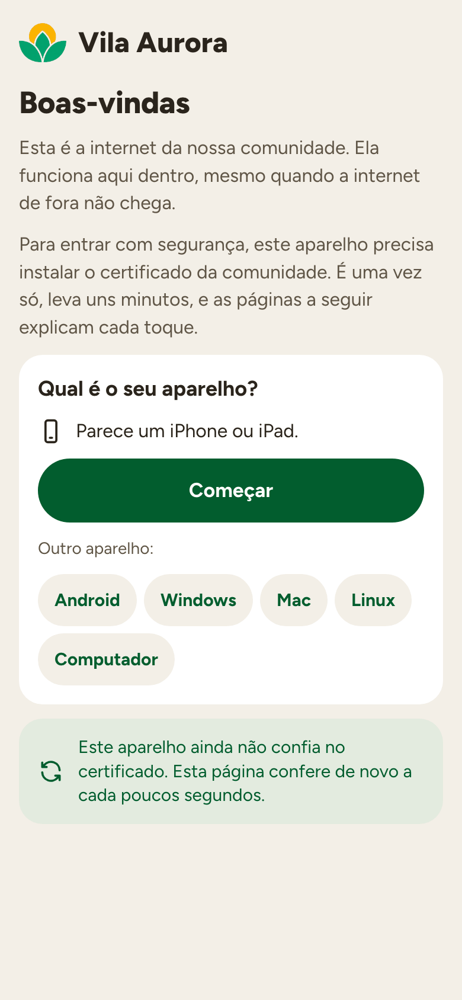 | 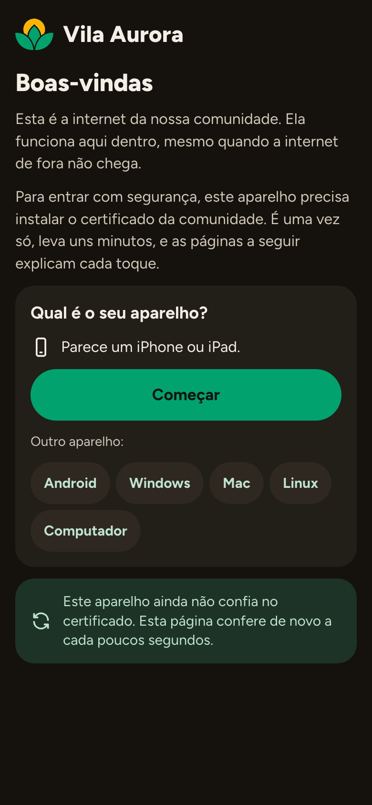 |

**What the person sees:** the community's mark and name. The title "Boas-vindas". Two paragraphs: "Esta é a internet da nossa comunidade. Ela funciona aqui dentro, mesmo quando a internet de fora não chega." and why the certificate comes first, "Para entrar com segurança, este aparelho precisa instalar o certificado da comunidade. É uma vez só, leva uns minutos, e as páginas a seguir explicam cada toque." A card, "Qual é o seu aparelho?", with what the page recognised, such as "Parece um iPhone ou iPad.", the button "Começar", and the other kinds of device, such as Android, Windows, Mac, Linux and Computador. The drawing leaves out the one recognised; the page built today lists all six. Under it, the state of trust: "Este aparelho ainda não confia no certificado. Esta página confere de novo a cada poucos segundos."

**What they can do:** start the steps for the device the page recognised, or choose another kind of device. Once the device trusts the certificate, enter the community.

**States:**

| State | What the person reads |
| --- | --- |
| A device the page does not recognise | "Não reconhecemos este aparelho. Escolha abaixo." |
| A Mac, which may be an iPad asking for the desktop pages | "Parece um Mac. Se for um iPad, escolha iPhone ou iPad abaixo." |
| The device already trusts the certificate | "Este aparelho já confia no certificado." and the button "Entrar na comunidade" becomes the main one |

**Built**, with these texts, in [`screens/welcome`](../../screens/welcome). The page guesses the device from what the browser says about itself, and every few seconds loads a tiny picture from the secure site: the moment it loads, the device trusts the certificate. **Proposed**: the look drawn here.

**Who may:** anyone on the community's network, before having an account. The page shows nothing of any resident.

**Journal:** writes nothing and reads nothing of the journal. Plain HTTP serves only the welcome pages and the certificate, and no resident data ever passes through it.

**Many machines:** never waits. Every machine serves the same page with the same community certificate, which a machine receives when it joins, so the poster is the same for all. **Built**: see [how the machines live together](../design/machines.md#joining).

## The certificate on an iPhone

`http://<address>/certificate/iphone`

| Light | Dark |
| --- | --- |
| 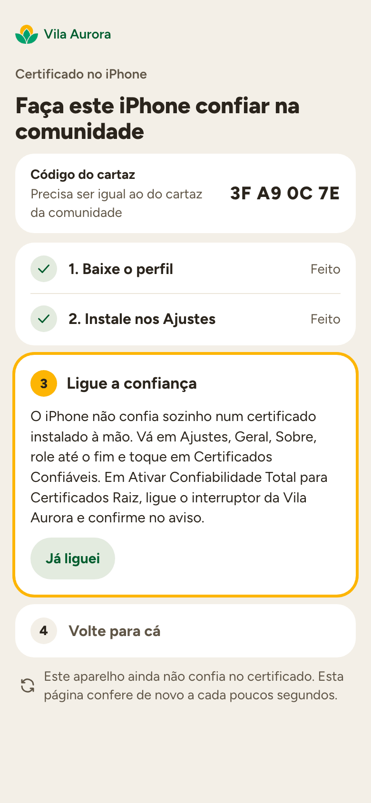 | 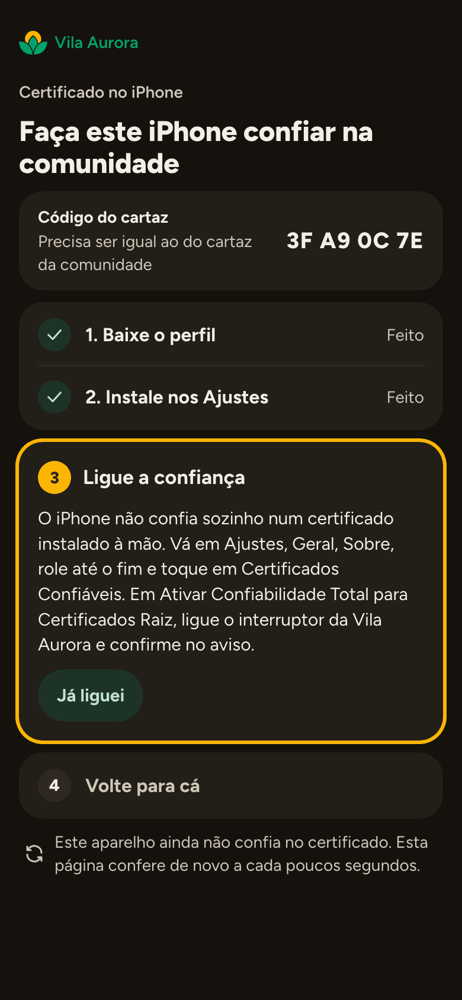 |

**What the person sees:** "Certificado no iPhone" and the title "Faça este iPhone confiar na comunidade". The code to compare with the poster: the first characters of the certificate's fingerprint, in pairs, such as "3F A9 0C 7E". Then one card per step, with the names the iPhone itself shows in Portuguese:

1. "Baixe o perfil", with the button "Baixar o certificado".
2. "Instale nos Ajustes", with "Já instalei".
3. "Ligue a confiança": in Ajustes, Geral, Sobre, Certificados Confiáveis, turn on the community, with "Já liguei".
4. "Volte para cá": the page notices by itself when the iPhone trusts the certificate.

The drawing shows a person back from the Settings app: steps 1 and 2 done and folded, step 3 marked with a ring of sun, step 4 waiting.

**What they can do:** compare the code, download the profile, mark each step done, switch to the page of another device. When the iPhone trusts the certificate, enter the community.

**States:**

| State | What the person reads |
| --- | --- |
| Opened in a browser other than Safari | "Abra esta página no Safari", because only Safari hands the profile to the Settings app, and the address to type in Safari |
| The profile was not installed within 8 minutes | "O iPhone apaga o perfil se ele não for instalado em 8 minutos. Se isso acontecer, é só baixar de novo." |
| The last step is done and trust has not arrived | "O iPhone ainda não confia. O passo que mais costuma faltar é o 3, ligar a confiança em Certificados Confiáveis." |
| The iPhone trusts the certificate | "Este aparelho já confia no certificado." and "Entrar na comunidade" |

**Built**, with these steps and texts, including the step remembered when the person comes back from the Settings app. An iPhone installed the certificate through these steps on 2026-11-09; see [the core](../design/core.md#what-the-first-proof-showed). **Proposed**: the look drawn here, with the steps done folded.

**Who may:** anyone on the community's network.

**Journal:** writes nothing. It reads the community certificate, to show its fingerprint and to hand the profile.

**Many machines:** never waits, as for the welcome page.

## The certificate on Android

`http://<address>/certificate/android`

| Light | Dark |
| --- | --- |
| 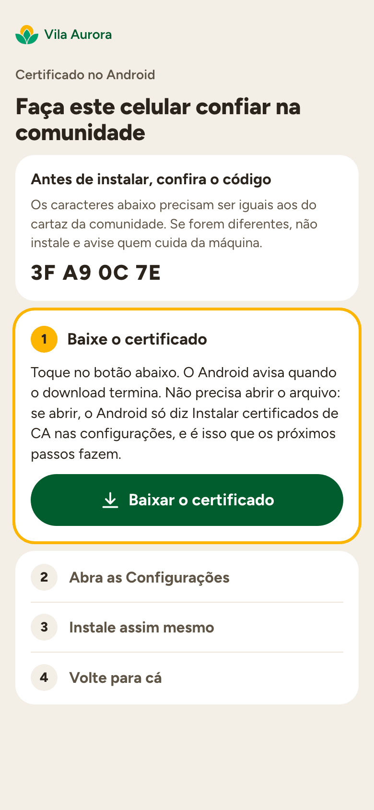 | 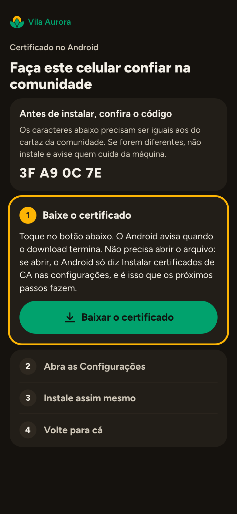 |

**What the person sees:** "Certificado no Android" and the title "Faça este celular confiar na comunidade". The card to compare the code, with what to do if it differs: "Se forem diferentes, não instale e avise quem cuida da máquina." Then the steps, the current one open and the others folded: "Baixe o certificado", with the button "Baixar o certificado"; "Abra as Configurações"; "Instale assim mesmo"; "Volte para cá".

**What they can do:** compare the code, download the certificate, follow the steps, mark each one done, switch to another device's page.

**States:**

| State | What the person reads |
| --- | --- |
| Android warns "Seus dados não serão particulares" | Step 3 explains it before it shows: the warning was written for certificates that cover every site, and this one covers only the community's name and the local network |
| After installing, Android keeps a warning about a certificate authority installed by an unknown party | "É este certificado. O aviso é normal e continua enquanto ele estiver instalado." |
| The last step is done and trust has not arrived | "O celular ainda não confia. Confira se o certificado da comunidade aparece em Configurações, Criptografia e credenciais, Credenciais confiáveis, na aba Usuário." |

**Built**, with these texts. **To prove**: the texts use the menu names of Android's own translation and have not been checked on a device. The pages for Windows, Mac, Linux and an unrecognised computer are built the same way and are not drawn here.

**Who may**, **journal** and **many machines**: as for the iPhone.

## Create an account

`/sign-up` on the secure site. The first of three steps.

| Light | Dark |
| --- | --- |
| 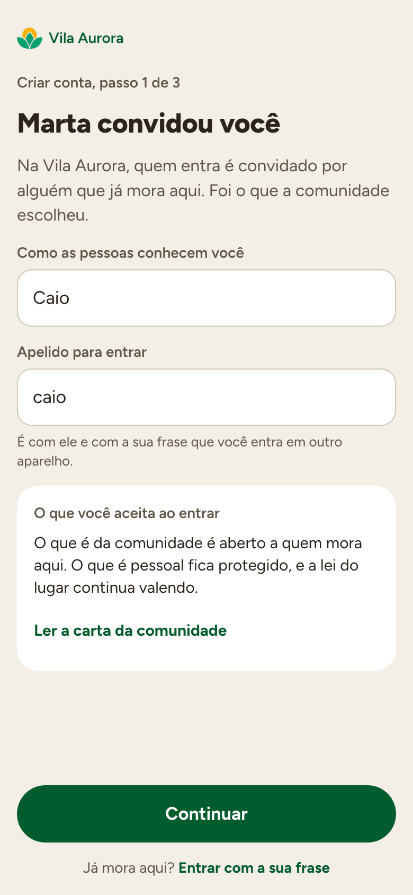 | 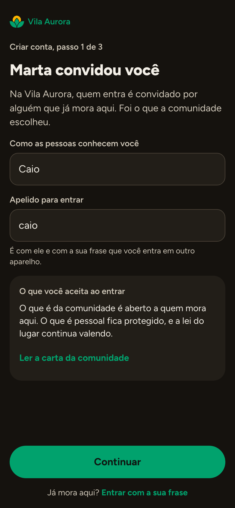 |

The screen follows the community's rule for coming in, chosen in the charter: open to anyone on the network, by invitation of a resident, or by approval. The drawing is the invitation.

**What the person sees:** "Criar conta, passo 1 de 3". The title says who invited them, "Marta convidou você", and the line under it the rule: "Na Vila Aurora, quem entra é convidado por alguém que já mora aqui. Foi o que a comunidade escolheu." Two fields: "Como as pessoas conhecem você", the name everyone sees, and "Apelido para entrar", with "É com ele e com a sua frase que você entra em outro aparelho." A card, "O que você aceita ao entrar", with one sentence about what is common and what is personal, and the link "Ler a carta da comunidade". The button "Continuar", and at the bottom "Já mora aqui? Entrar com a sua frase".

**What they can do:** write the name and the nickname, read the charter, continue to [the passphrase](#your-passphrase), or go to [signing in](#sign-in-on-another-device).

**States:**

| State | What the person reads |
| --- | --- |
| Open rule | The title "Criar conta" and "Escolha o nome pelo qual as pessoas da comunidade conhecem você." |
| Approval rule | The line says that whoever comes in is approved by the people who look after the community. After the third step, [waiting for approval](#waiting-for-approval) |
| The invitation no longer holds | "Este convite não vale mais. Peça outro a quem convidou você." |
| No name | "Escreva um nome para continuar." **Built** |
| A name too long | "O nome pode ter até 40 letras." **Built** |
| Characters that cannot be used | "O nome tem letras que não podem ser usadas. Use letras, números e sinais comuns, com os acentos escritos direto." **Built** |
| The name is taken | "Já existe alguém com esse nome. Escolha outro." **Built** |
| The nickname is taken | "Esse apelido já é de outra pessoa. Escolha outro." |
| The machines that decide names cannot be reached | [Not now](#not-now), after the third step |
| The system only reads | "O sistema está em somente leitura e não aceita nada novo agora. Avise quem cuida da máquina." **Built** |

The first step checks the name and the nickname against what the machine knows, so a taken one shows at once. The account itself is only created at the end of the third step, when the machines that decide names give the final word.

**Built** today, at `/sign-up`: one field, the name, and the button "Entrar na comunidade". The account and its first device are one entry of the journal, and the browser stays signed in for a year, with a cookie that scripts cannot read. A refused name comes back with the text kept, except a name that is not valid, which comes back empty. The same name differing only in case or spaces is the same name. See [the core](../design/core.md#accounts-and-sessions). **Proposed**: the rule of the charter, the nickname, the three steps and the charter card.

**Who may:** anyone who has installed the certificate, within the community's rule. A child does not create an account here: the guardian does, as in [children](#children).

**Journal:** at the end of the third step, one entry creates the account and its first device. **Built** with the name, and with a random mark the account keeps when it was asked for on a machine that does not count. **Proposed**, added to it: the nickname, the salt of the passphrase, a digest of the proof derived from the passphrase, the person's public keys and their sealed vault. With an invitation, the same entry spends the invitation. With approval, the request is an entry of its own, and the account comes from the administrator's approval. It reads the accounts index, to check the name and the nickname, and the charter, for the rule.

**Many machines:** a new account is counted, because names are unique, and waits for the machines that decide it. **Built**: it waits for the machine that counts, machine 0; when the answer was lost on the way, the machine that asked looks for the account by its random mark before saying not now. **Proposed**: it waits for every listed machine to see the others. See [many machines](../design/many-machines.md#essential-and-not-essential).

## Waiting for approval

`/sign-up`, after the third step, when the community's rule is approval.

| Light | Dark |
| --- | --- |
| 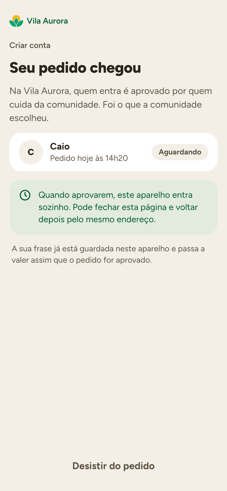 | 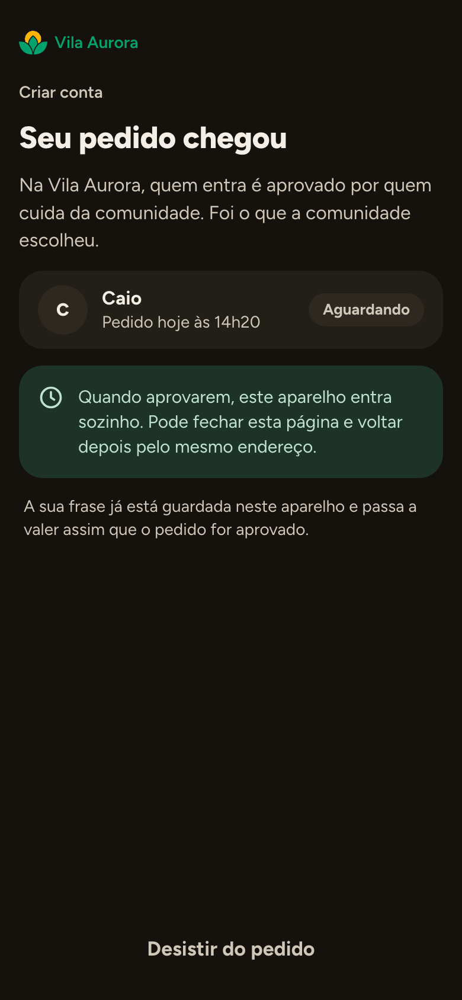 |

**What the person sees:** "Criar conta" and the title "Seu pedido chegou". The rule, "Na Vila Aurora, quem entra é aprovado por quem cuida da comunidade. Foi o que a comunidade escolheu." A row with their name, when the request was made and the mark "Aguardando". A soft card: "Quando aprovarem, este aparelho entra sozinho. Pode fechar esta página e voltar depois pelo mesmo endereço." Under it, "A sua frase já está guardada neste aparelho e passa a valer assim que o pedido for aprovado." At the bottom, "Desistir do pedido".

**What they can do:** wait, close the page and come back, or give up the request.

**States:**

| State | What the person reads |
| --- | --- |
| Approved | The device enters by itself and opens the portal |
| Refused | "O seu pedido não foi aprovado. Se quiser, fale com alguém que mora aqui." |
| Given up | The request is gone, and the screen returns to the first step |

**Proposed**, all of it. An administrator approves from the list of residents, in [administration](admin.md).

**Who may:** whoever made the request, on the device that made it.

**Journal:** the request was written at the end of the third step; giving up writes an entry that closes it. The approval and the refusal are written by the administrator. It reads the state of the request.

**Many machines:** the request is a fact the person states and never waits: any machine writes it. The approval creates the account, which is counted, and waits for the machines that decide names; if it cannot happen yet, the administrator reads the Not now notice: "Agora não dá para aprovar o pedido. Isso depende da ligação com toda a comunidade, e uma parte dela está sem ligação agora. Tente de novo daqui a pouco."

## Not now

`/sign-up`, at the end of the third step, when the machines that decide names cannot be reached.

| Light | Dark |
| --- | --- |
| 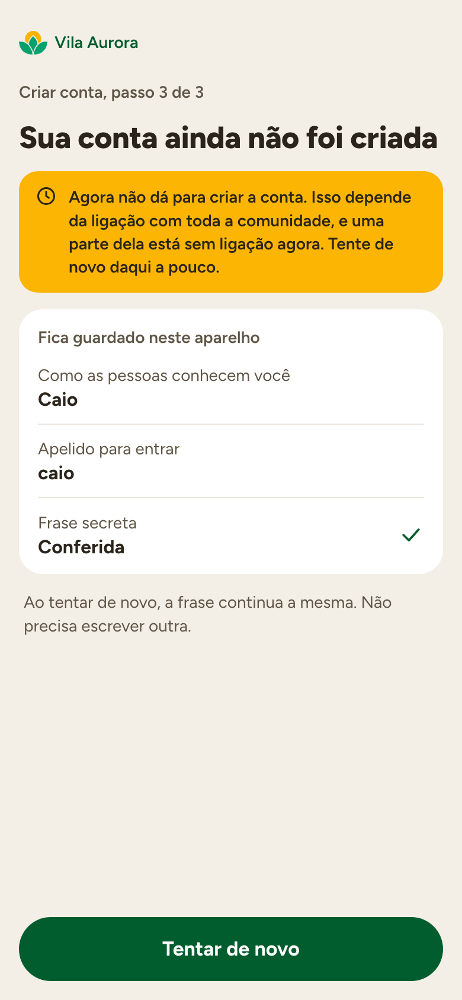 | 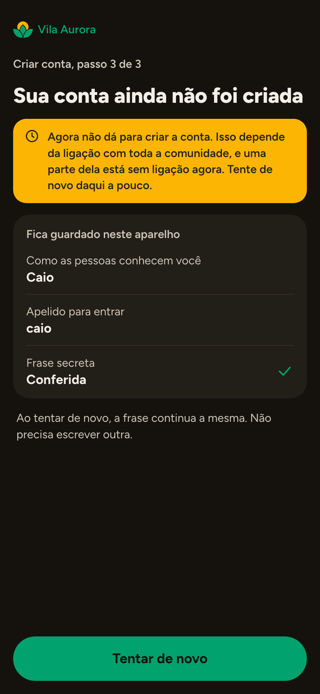 |

**What the person sees:** "Criar conta, passo 3 de 3" and the title "Sua conta ainda não foi criada". The Not now notice, in the sun color with dark text: "Agora não dá para criar a conta. Isso depende da ligação com toda a comunidade, e uma parte dela está sem ligação agora. Tente de novo daqui a pouco." A list of what stays on the device: the name, the nickname, and the passphrase, marked "Conferida". "Ao tentar de novo, a frase continua a mesma. Não precisa escrever outra." The button "Tentar de novo".

**What they can do:** try again, now or later. Nothing they filled in is lost, and the words on their paper stay the right ones.

**Built**: the sentence of the notice, shown on the sign up today with the name kept. **Proposed**: this screen, and keeping the passphrase and the keys on the device until the account exists.

**Who may:** whoever is creating the account.

**Journal:** writes nothing; nothing sits in a hidden queue.

**Many machines:** this screen is what waiting looks like. It never mentions a machine.

## Your passphrase

`/passphrase`, the second of three steps. The same screens follow a recovery, to make a new passphrase.

| Light | Dark |
| --- | --- |
| 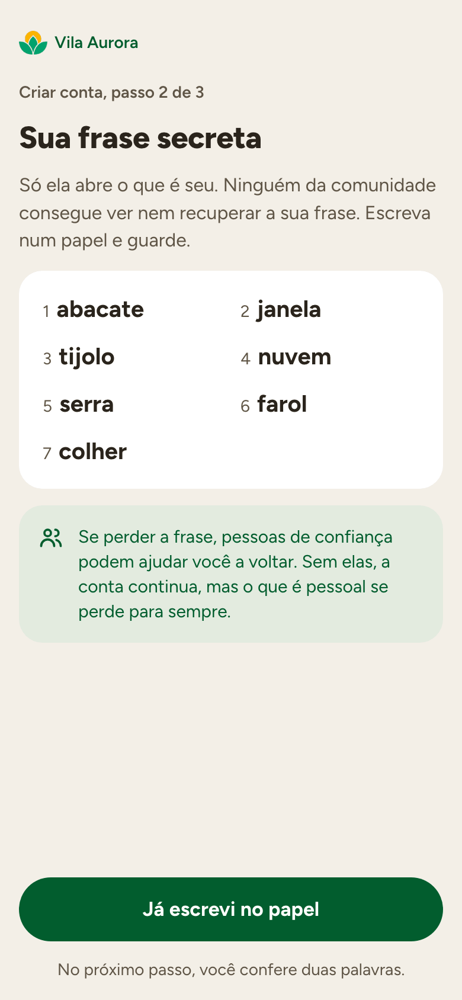 | 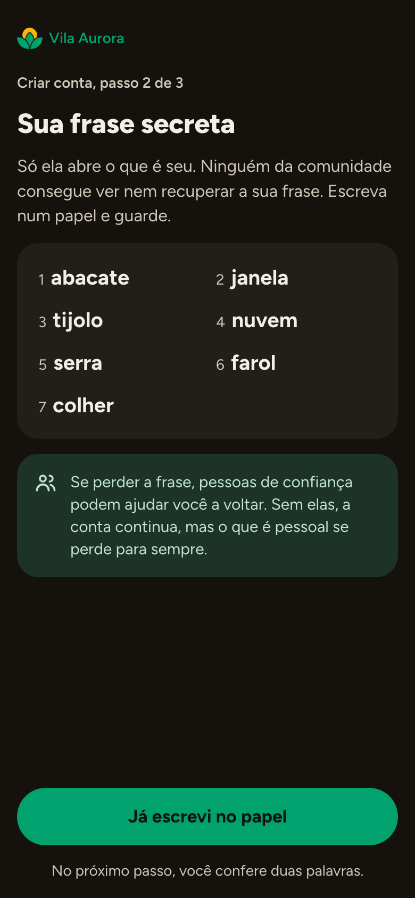 |

**What the person sees:** "Criar conta, passo 2 de 3" and the title "Sua frase secreta". "Só ela abre o que é seu. Ninguém da comunidade consegue ver nem recuperar a sua frase. Escreva num papel e guarde." The seven words, numbered, in two columns. A soft card: "Se perder a frase, pessoas de confiança podem ajudar você a voltar. Sem elas, a conta continua, mas o que é pessoal se perde para sempre." The button "Já escrevi no papel" and "No próximo passo, você confere duas palavras."

**What they can do:** write the words on paper and go on to check two of them.

**How it works, proposed:** the browser draws seven words from the Portuguese list of 2,048 words used for such phrases, which gives 77 bits: a stolen file cannot be opened by trying. From the words, the browser derives, with a slow function made against guessing, a key it never keeps; from that key come the proof of sign in, of which the machines keep only a digest, and the key that seals the vault. Before deriving, the browser writes the words in lowercase and removes extra spaces, so the way they are typed does not matter.

**Who may:** whoever is creating an account or recovering one. A child has no passphrase: see [children](#children).

**Journal:** writes nothing by itself. What derives from the words goes into the entry that creates the account, at the end of the third step.

**Many machines:** never waits. It all happens on the device.

## Checking two words

`/passphrase`, the third of three steps.

| Light | Dark |
| --- | --- |
| 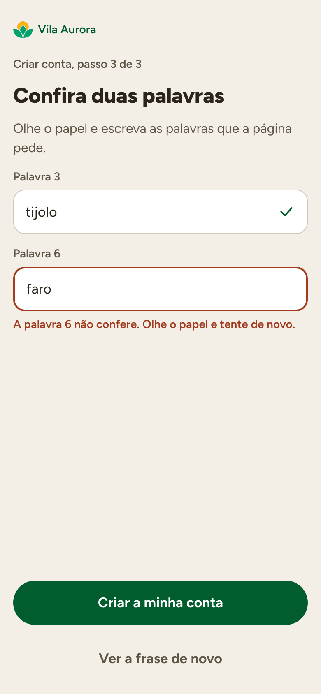 | 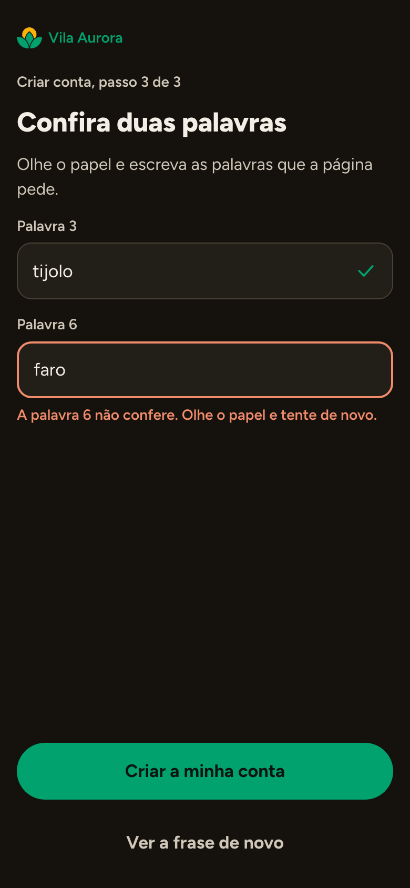 |

**What the person sees:** "Criar conta, passo 3 de 3" and the title "Confira duas palavras". "Olhe o papel e escreva as palavras que a página pede." Two fields, each named by the position of the word, such as "Palavra 3" and "Palavra 6". A word that matches gets a check. The button "Criar a minha conta", or "Enviar o pedido" when the rule is approval, and "Ver a frase de novo".

**What they can do:** write the two words, go back to see the phrase, and create the account.

**States:**

| State | What the person reads |
| --- | --- |
| A word does not match | "A palavra 6 não confere. Olhe o papel e tente de novo.", under the field, with the field marked |
| The account is created | The offer to choose [trusted people](#trusted-people), with "Deixar para depois", then the portal |
| The machines that decide names cannot be reached | [Not now](#not-now) |

**Proposed**, all of it.

**Who may**, **journal** and **many machines**: as for [creating an account](#create-an-account); the button of this step is the one that creates it.

## Sign in on another device

`/sign-in`

| Light | Dark |
| --- | --- |
| 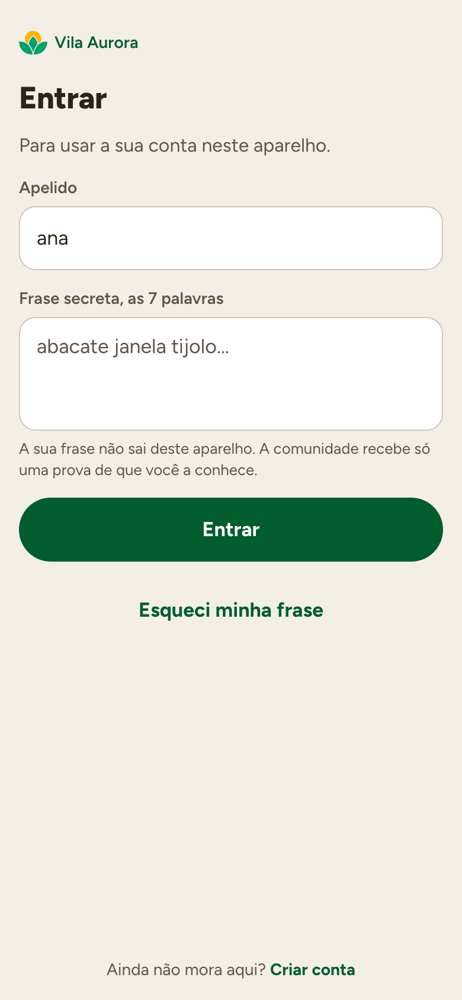 | 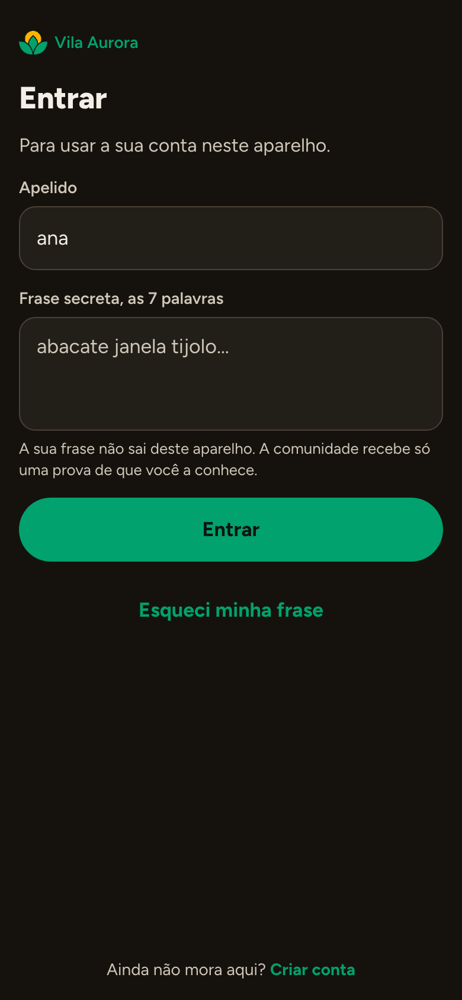 |

A person who already has an account opens the community on a new phone, a borrowed computer, or a phone whose browser lost its data. The device goes through the welcome page and the certificate first, like any new device.

**What the person sees:** the community's mark and name, the title "Entrar" and "Para usar a sua conta neste aparelho." Two fields: "Apelido" and "Frase secreta, as 7 palavras". Under them, "A sua frase não sai deste aparelho. A comunidade recebe só uma prova de que você a conhece." The button "Entrar", the link "Esqueci minha frase", and at the bottom "Ainda não mora aqui? Criar conta".

**What they can do:** sign in, go to [recover access](#recover-access), or go to [create an account](#create-an-account).

**States:**

The passphrase does not match:

| Light | Dark |
| --- | --- |
| 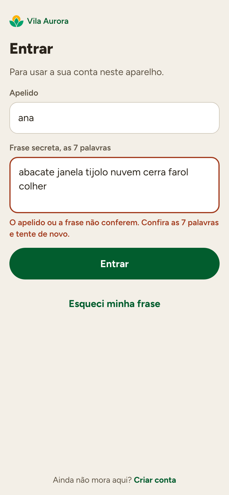 | 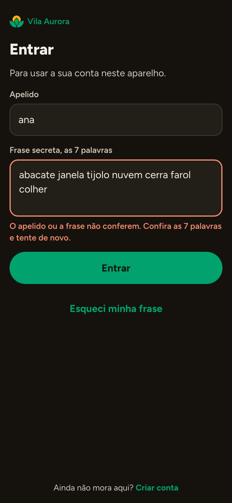 |

"O apelido ou a frase não conferem. Confira as 7 palavras e tente de novo." The words stay in the field, so a word typed wrong can be fixed. The screen never says whether the nickname exists: for a nickname that does not exist, the machine answers with a made up salt that is always the same for that nickname, and the answer looks like a wrong passphrase.

Too many tries:

| Light | Dark |
| --- | --- |
| 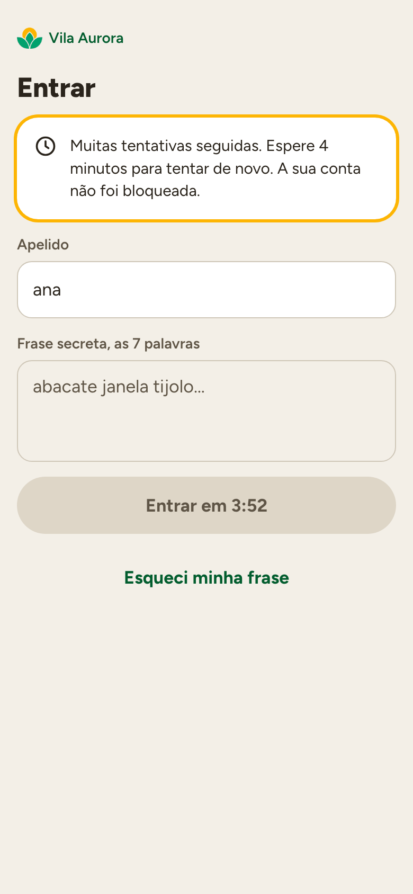 | 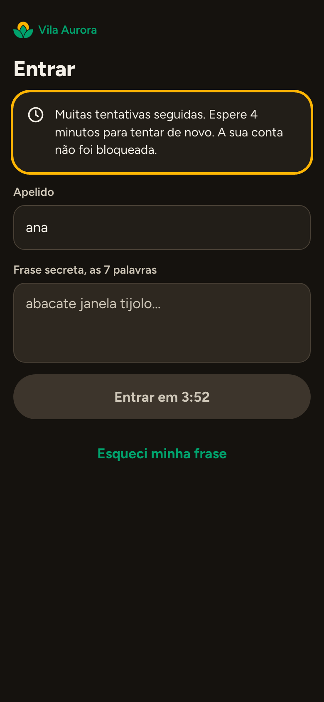 |

"Muitas tentativas seguidas. Espere 4 minutos para tentar de novo. A sua conta não foi bloqueada." The button counts down, "Entrar em 3:52", and "Esqueci minha frase" stays open. The wait grows with each round of wrong tries, for that account and for that device, and the account is never locked.

| Other state | What the person reads |
| --- | --- |
| No link with the community | The notice "Sem ligação com a comunidade." and the button waits until a machine answers |
| The device was revoked by its owner | The sign in again, with nothing kept from before |

**Proposed**, all of it. Today an account cannot be opened on a second device.

**Who may:** every role that has a passphrase: resident, moderator, administrator. A child signs in on the same screen with the password the guardian made.

**Journal:** reads the account's salt and checks the proof against the digest the account keeps. A proof that matches writes a new device for the account, the kind of entry the journal already knows, and hands back the sealed vault, which only the browser opens. Wrong tries write nothing in the journal.

**Many machines:** never waits. Signing in with the passphrase is in the list of what is essential, which the maintainer accepted on 2026-11-13: any machine checks the proof alone and writes the new device in its own journal. Each machine counts the tries it receives, so the wait never depends on another machine.

## Recover access

`/recover`, from "Esqueci minha frase".

| Light | Dark |
| --- | --- |
| 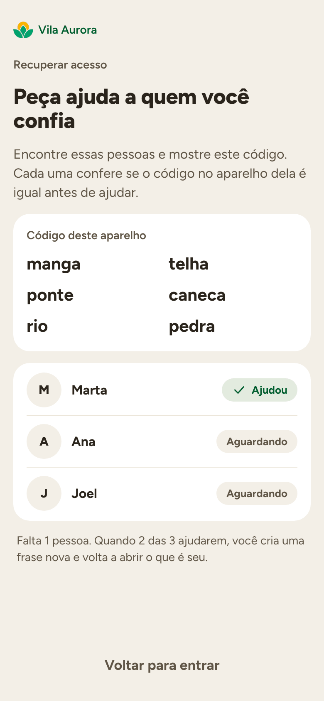 | 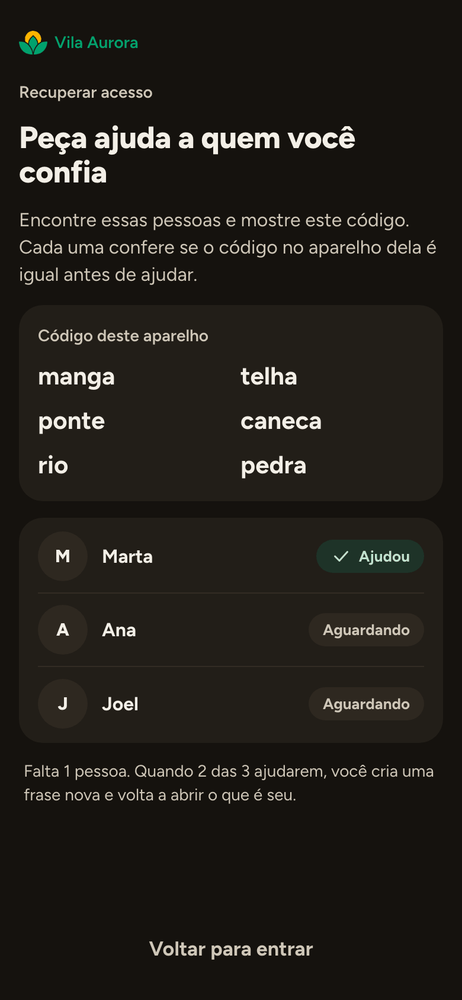 |

**What the person sees**, after typing their nickname: "Recuperar acesso" and the title "Peça ajuda a quem você confia". "Encontre essas pessoas e mostre este código. Cada uma confere se o código no aparelho dela é igual antes de ajudar." The code of this device, six words. The trusted people, each with a mark: "Ajudou" or "Aguardando". How many are still needed: "Falta 1 pessoa. Quando 2 das 3 ajudarem, você cria uma frase nova e volta a abrir o que é seu." At the bottom, "Voltar para entrar".

**What they can do:** find their trusted people and show them the code; wait; go back to signing in. When enough have helped, make [a new passphrase](#your-passphrase).

**States:**

| State | What the person reads |
| --- | --- |
| The nickname has no trusted people | "Esta conta não escolheu pessoas de confiança. Você pode entrar de novo pela regra da comunidade, mas o que era pessoal não volta." |
| Enough people helped | "Pronto. Agora crie uma frase nova.", then the passphrase screens |
| Someone answered that the words were not the same | The mark "Não conferiu" beside that person, and the request goes on with the others |

**How it works, proposed:** the new device makes a temporary key and shows six words calculated from it. The trusted person's browser calculates the same words from the key it receives, so a machine cannot invent a request: if the words differ, the person does not help. Each trusted person holds a part of a recovery key, sealed for them; helping opens their part and seals it again for the temporary key. With enough parts, the device rebuilds the recovery key, opens a second copy of the vault, and makes a new passphrase. At least two people are needed, and no one alone can open anything.

**Who may:** anyone who chose trusted people. A child does not recover this way; the guardian makes a new password.

**Journal:** writes the request with the temporary key, each helper's part sealed again, and at the end the new salt, the new digest of the proof and the new sealed vault. The old sealed vault goes to the night's erasure. Reads the account's trusted people and the parts sent back.

**Many machines:** the request and each help never wait: any machine writes them, and they meet as the journals meet. Whether the change of passphrase at the end waits for the listed machines is not decided.

## Helping someone come back

`/profile/trusted/help`, on the device of a trusted person.

| Light | Dark |
| --- | --- |
| 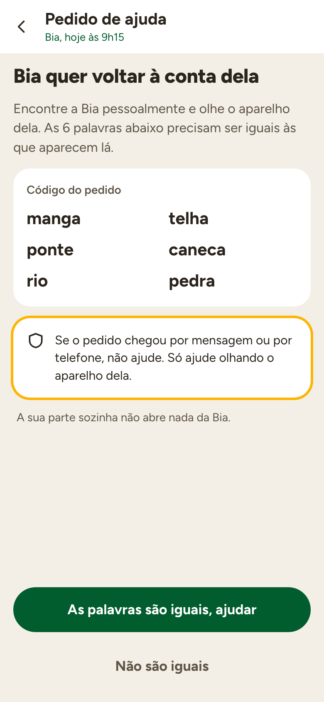 | 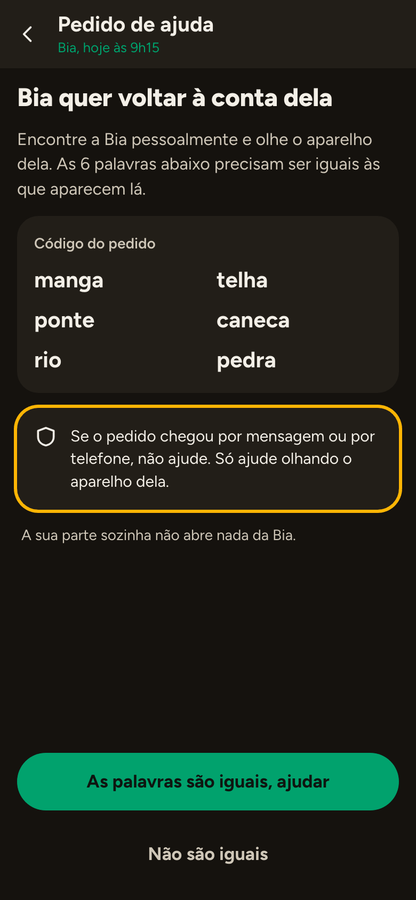 |

**What the person sees:** "Pedido de ajuda", who asked and when. The title "Bia quer voltar à conta dela" and "Encontre a Bia pessoalmente e olhe o aparelho dela. As 6 palavras abaixo precisam ser iguais às que aparecem lá." The six words of the request. A card ringed in sun: "Se o pedido chegou por mensagem ou por telefone, não ajude. Só ajude olhando o aparelho dela." Then "A sua parte sozinha não abre nada da Bia.", the button "As palavras são iguais, ajudar" and "Não são iguais".

**What they can do:** compare the words on the other person's device, help, or answer that they are not the same.

**States:**

| State | What the person reads |
| --- | --- |
| Helped | "Você ajudou a Bia. Ela vê isso no aparelho dela." |
| Answered that the words differ | "Você não ajudou. Se foi engano, peça à Bia para começar de novo." |
| The vault of the helper is locked | The passphrase first, as in [the vault](#the-vault), because the part is sealed for the helper |

**Proposed**, all of it. The request reaches the trusted person as a sun dot on their initial in the portal and as a card at the top of [trusted people](#trusted-people).

**Who may:** only the people the account chose, each for their own part.

**Journal:** writes the helper's part, sealed again for the temporary key of the request, or the answer that the words differ. Reads the request.

**Many machines:** never waits.

## Your account

`/profile`, from the initial at the top of the portal. **Proposed**: this is where the account, the vault, the devices and the trusted people are reached, in one place, outside the four apps.

| Light | Dark |
| --- | --- |
| 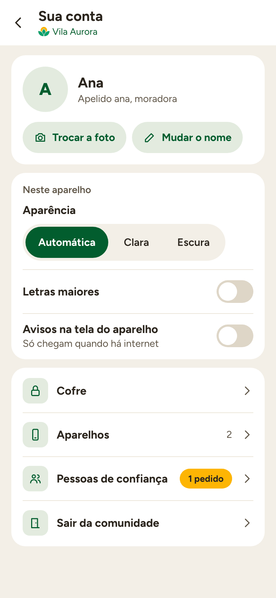 | 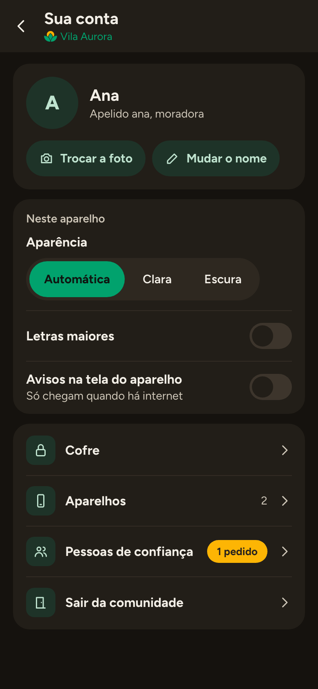 |

**What the person sees:** the inner header "Sua conta", with the community under it and the way back to the portal. A card with the photo or the initial, the name, the nickname and the role, such as "Apelido ana, moradora", and the buttons "Trocar a foto" and "Mudar o nome". Then "Neste aparelho": "Aparência", with "Automática", "Clara" and "Escura"; "Letras maiores"; "Avisos na tela do aparelho", "Só chegam quando há internet". Then a list: "Cofre"; "Aparelhos", with how many; "Pessoas de confiança", with "1 pedido" in sun when someone asked for help; "Sair da comunidade".

**What they can do:**

- Change the photo or the name.
- Choose how this device draws Earthler: following the device, always light, or always dark; and larger letters.
- Turn on notices on the device's screen, which only arrive when there is a way to the internet.
- Open the vault, the devices, the trusted people, or leave the community.

**States:**

| State | What the person reads |
| --- | --- |
| The name is taken | "Já existe alguém com esse nome. Escolha outro." |
| The machines that decide names cannot be reached | "Agora não dá para mudar o nome. Isso depende da ligação com toda a comunidade, e uma parte dela está sem ligação agora. Tente de novo daqui a pouco." |
| No link with the community | The preferences of the device still change. A new photo goes out when the link returns. A new name gets the Not now sentence above |

**Proposed**, all of it.

**Who may:** every role, for their own account. For a child, see [children](#children).

**Journal:** a new name or a new photo is an entry; the photo travels with it. The preferences of the device stay on the device and write nothing. Reads the accounts index for the name, the nickname, the photo and the role.

**Many machines:** the name is unique, so changing it is counted and waits for the machines that decide names. The photo never waits. The preferences never touch a machine.

## Devices

`/profile/devices`

| Light | Dark |
| --- | --- |
| 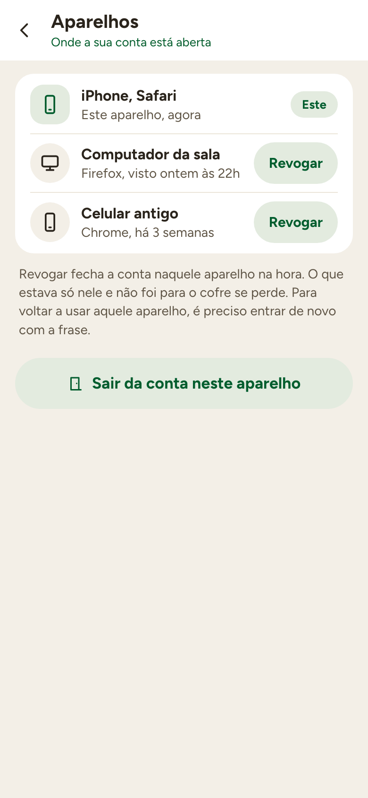 | 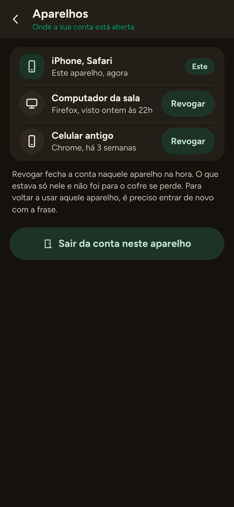 |

**What the person sees:** "Aparelhos" and "Onde a sua conta está aberta". One row per device: what it is and its browser, such as "iPhone, Safari" or "Computador da sala", when it was last seen, and "Este" on the device in hand. Every other device has "Revogar". Under the list: "Revogar fecha a conta naquele aparelho na hora. O que estava só nele e não foi para o cofre se perde. Para voltar a usar aquele aparelho, é preciso entrar de novo com a frase." At the bottom, "Sair da conta neste aparelho".

**What they can do:** revoke a device, after a question that says which one: "Revogar o Computador da sala? A conta fecha nele agora." They can sign out of the device in hand.

**States:**

| State | What the person reads |
| --- | --- |
| Only this device | The list with one row, and no "Revogar" |
| Signing out of this device with the vault open | "Ao sair, o cofre tranca e as chaves somem deste aparelho. Para voltar, entre com a sua frase." |

**Proposed**, all of it. The name of each device comes from what its browser says, and a device the person signed in on through a new browser counts as a new device.

**Who may:** every role, for their own devices.

**Journal:** revoking a device, or signing out, is an entry. The session cookie carries the number of the device and a counter, and the machines refuse a cookie whose device was revoked or whose counter is old, so revoking closes every session of that device at once. **Built**: the cookie with the device, the counter and the signature, and no table of sessions. Reads the devices of the account.

**Many machines:** never waits. A revocation is written on any machine. During a split, a revoked device may still be served on the other side until the entry reaches it.

**To prove:** on the iPhone, Safari copies the session cookie to each icon added to the Home Screen, so Safari and the icons count as one device, and signing out in one ends the session in all.

## Trusted people

`/profile/trusted`, and once after creating the account, with "Deixar para depois".

| Light | Dark |
| --- | --- |
| 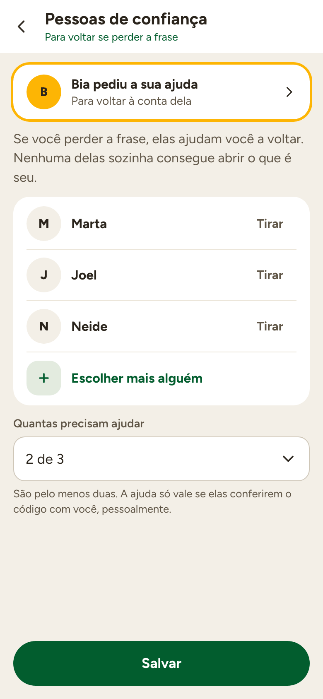 | 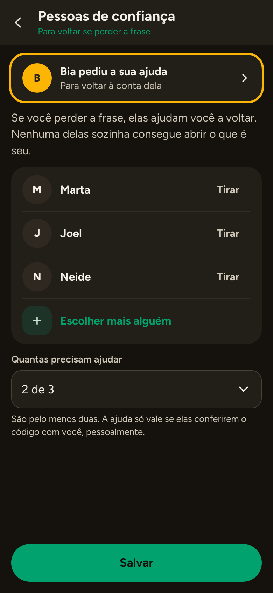 |

**What the person sees:** "Pessoas de confiança" and "Para voltar se perder a frase". When someone asked for this person's help, a card ringed in sun at the top: "Bia pediu a sua ajuda", "Para voltar à conta dela", which opens [helping someone come back](#helping-someone-come-back). Then "Se você perder a frase, elas ajudam você a voltar. Nenhuma delas sozinha consegue abrir o que é seu." The chosen people, each with "Tirar", and "Escolher mais alguém". "Quantas precisam ajudar", such as "2 de 3", with "São pelo menos duas. A ajuda só vale se elas conferirem o código com você, pessoalmente." The button "Salvar".

**What they can do:** choose people from the residents, remove one, choose how many must help, save.

**States:**

| State | What the person reads |
| --- | --- |
| Nobody chosen yet | "Você ainda não escolheu ninguém. Sem pessoas de confiança, quem perde a frase perde o que é pessoal." |
| Only one chosen | "Escolha pelo menos duas pessoas." and "Salvar" waits |
| The vault is locked | The passphrase first, because the parts are made from what the vault keeps |

**Proposed**, all of it.

**Who may:** resident, moderator and administrator. A child has no trusted people. A trusted person has to be a resident with a passphrase.

**Journal:** saving writes the parts of a new recovery key, each sealed for one chosen person, and how many must help; the parts of before stop counting. Reads the residents, to choose.

**Many machines:** never waits.

## The vault

`/vault`, from "Cofre" in the account.

Locked:

| Light | Dark |
| --- | --- |
| 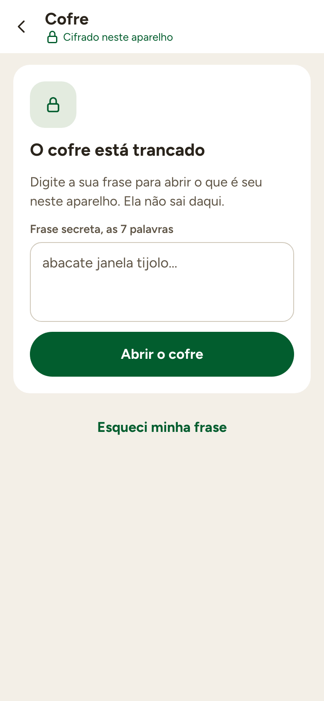 | 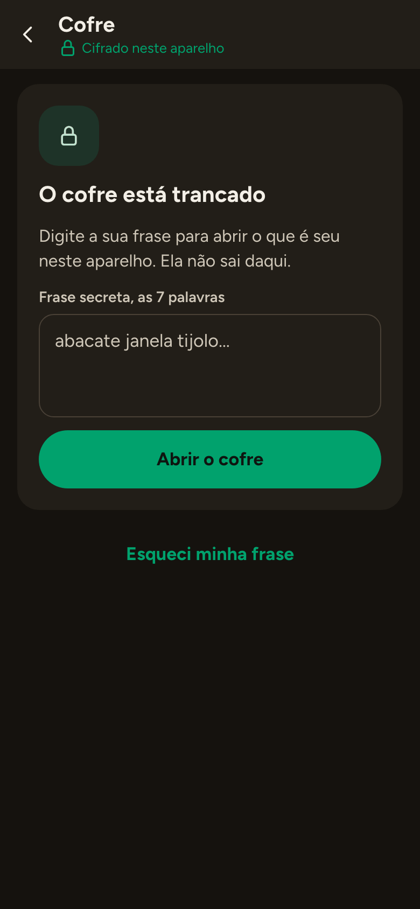 |

Open:

| Light | Dark |
| --- | --- |
| 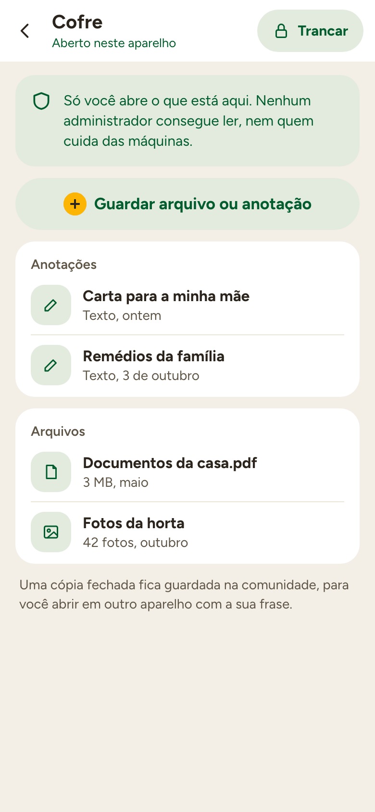 | 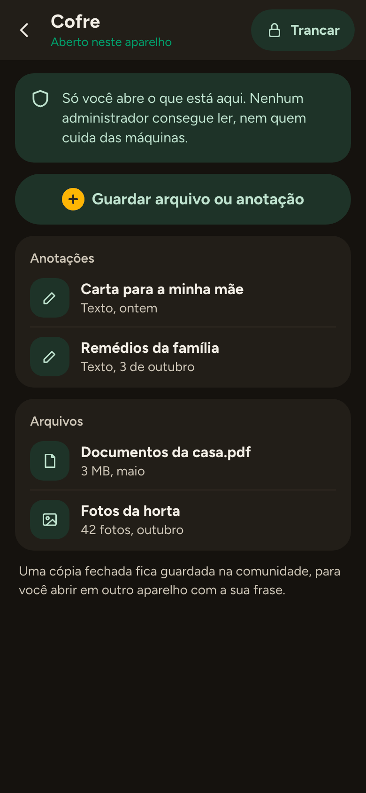 |

**What the person sees, locked:** "Cofre" and "Cifrado neste aparelho". A card with a lock: "O cofre está trancado", "Digite a sua frase para abrir o que é seu neste aparelho. Ela não sai daqui.", the field "Frase secreta, as 7 palavras" and the button "Abrir o cofre". Under it, "Esqueci minha frase".

**What the person sees, open:** "Cofre" and "Aberto neste aparelho", with the button "Trancar". A soft card: "Só você abre o que está aqui. Nenhum administrador consegue ler, nem quem cuida das máquinas." The button "Guardar arquivo ou anotação". The notes, then the files, each with what it is and when. At the bottom, "Uma cópia fechada fica guardada na comunidade, para você abrir em outro aparelho com a sua frase."

**What they can do:** open the vault with the passphrase; read a note or a file; keep a new one; lock the vault, which erases the open keys from the device.

**States:**

| State | What the person reads |
| --- | --- |
| Wrong passphrase | "A frase não confere. Confira as 7 palavras e tente de novo." |
| Empty | "Nada guardado ainda. O que você guardar aqui só você abre." |
| No link with the community | Everything already on the device opens; what is kept goes out when the link returns, with "Ainda não enviada" |

**How it works, proposed:** after the passphrase, the browser keeps the open keys in the storage of that address, encrypted with a key the browser cannot export. "Trancar" erases both. What is personal lives first on the device, encrypted, and every machine keeps the same sealed package, which none can open: the maintainer decided on 2026-11-13 that the machines keep it, so whoever loses a phone signs in on another device and finds what is theirs.

**On the iPhone:** each icon on the Home Screen has storage of its own, separate from Safari's, which a real iPhone showed on 2026-11-15. The vault opens where the portal opens, in the browser. Talk asks for the passphrase once inside its own icon, as the maintainer decided on 2026-11-15, because personal conversations live there; see [Talk](talk.md). Safari can erase a site's storage after seven days without use; whether an icon escapes that is **to prove**, and the sealed package on the machines is what makes it safe either way.

**Who may:** resident, moderator and administrator, each only their own vault. No administrator screen shows anyone's vault.

**Journal:** keeping or removing something writes the new sealed package. **Not decided:** whether the package travels in the journal or beside it. Reads the sealed package when the device does not have it.

**Many machines:** never waits. Opening and locking happen on the device, and reading works with every machine off.

## Leave the community

`/profile/leave`

| Light | Dark |
| --- | --- |
| 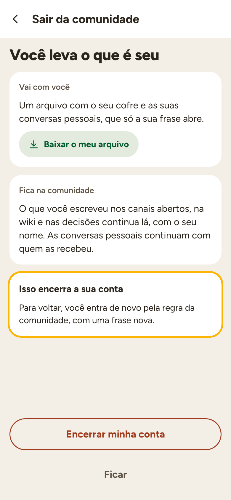 | 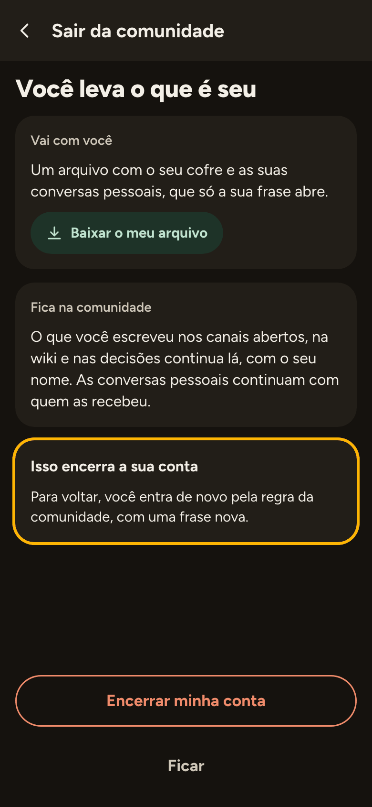 |

**What the person sees:** "Sair da comunidade" and the title "Você leva o que é seu". A card "Vai com você": "Um arquivo com o seu cofre e as suas conversas pessoais, que só a sua frase abre.", with "Baixar o meu arquivo". A card "Fica na comunidade": "O que você escreveu nos canais abertos, na wiki e nas decisões continua lá, com o seu nome. As conversas pessoais continuam com quem as recebeu." A card ringed in sun: "Isso encerra a sua conta", "Para voltar, você entra de novo pela regra da comunidade, com uma frase nova." The button "Encerrar minha conta", drawn with the border of what cannot be undone, and "Ficar".

**What they can do:** download the file of what is personal, end the account after a question, or stay. Before leaving, a person can still delete their own messages, as they can at any time.

**States:**

| State | What the person reads |
| --- | --- |
| Preparing the file | "Preparando o seu arquivo." with its progress |
| The question before ending | "Encerrar a conta de Ana? Isso não se desfaz." with "Encerrar" and "Voltar" |
| The last administrator | "A comunidade precisa de pelo menos um administrador. Antes de sair, dê esse papel a outra pessoa." |
| Ended | "Sua conta foi encerrada." and the page to create an account, on this device, with nothing kept |

**Proposed**, all of it. The rule that the last administrator stays is **built** for changes of role.

**Who may:** resident, moderator and administrator. A child does not leave alone: the guardian closes the account.

**Journal:** ending writes an entry that closes the account and every one of its devices. The sealed package and the parts of the recovery key go to the night's erasure. What the person wrote in the open stays, as the card says. Reads the sealed package, to make the file.

**Many machines:** ending the account never waits, and the name stays taken. The file is made on the device, from what it holds and the sealed package.

## Children

A child's account is made by the guardian, on the guardian's screen in [administration](admin.md), with a nickname and a simple password, because the child's layer uses no personal encryption. The password goes through the same derivation in the browser, and the machines keep only a digest. The child signs in on [the same screen](#sign-in-on-another-device) as everyone. A child has no vault, no trusted people, and no personal encrypted conversations: the child talks with the adults the guardian authorises, in protected conversations the guardian can read. The child's searches and questions never enter any list. **Proposed**, following the design of 2026-11-08; guardians are not built.

## Flows

### The way in

The way in is the same on every device: the poster, the community certificate, the account and the passphrase, then the icon.

1. The person joins the community's Wi-Fi and reads the QR code on the poster. If the phone warns that the network has no internet, they keep the connection.
2. [Welcome](#welcome) recognises the device and leads to its certificate page.
3. They compare the code with the poster, install the certificate following [the steps](#the-certificate-on-an-iphone), and the page notices the trust by itself.
4. "Entrar na comunidade" opens the secure site, which leads to [creating an account](#create-an-account) by the community's rule.
5. They receive [the passphrase](#your-passphrase), write it on paper and [check two words](#checking-two-words).
6. The account is created, or [waits for approval](#waiting-for-approval), or says [not now](#not-now).
7. They choose [trusted people](#trusted-people) or leave it for later.
8. The [portal](portal.md) opens, and from it they put the apps they want on the phone.

**Built**: steps 2 and 3; step 1 without the poster and its QR code, which do not exist yet; and step 4 with an account made with a name only, open to anyone, because the community's rule is not built. **Proposed**: the rest.

### On the iPhone, the icons

On a real iPhone, on 2026-11-15, the sign in went with every icon added to the Home Screen: Safari copied the session cookie to each icon when it was added. The rest of the storage did not: each icon started with storage of its own. So whoever signs in on the portal and then adds an icon arrives signed in, and Talk asks for the passphrase once, inside its icon, to open the personal conversations. Learn and Decide keep nothing personal and ask for nothing. **To prove**: the same with the community certificate and the real cookie, and an icon left unopened for more than seven days. See [apps on one address](../design/apps.md#what-a-real-iphone-showed).

### Signing in on another device

The new device installs the certificate, signs in with the nickname and the passphrase on any machine, receives the sealed vault and opens it in the browser. Nothing waits. Lost the phone instead of the passphrase: the person signs in on another device and [revokes](#devices) the lost one.

### Recovering access

The person lost the passphrase. On a new device, they ask for help with their nickname, meet their trusted people, each compares the six words and helps; with enough help, the device makes a new passphrase and opens what is theirs.

## Who may do what

| Action | Resident | Child | Moderator | Administrator | Guardian |
| --- | --- | --- | --- | --- | --- |
| Install the certificate | Yes | Yes | Yes | Yes | Yes |
| Create an account, by the community's rule | Yes | No, the guardian makes it | Yes | Yes | Makes the child's account |
| Approve a new resident | No | No | No | Yes | No |
| Sign in on another device | Yes, with the passphrase | Yes, with the password | Yes | Yes | Yes |
| Choose trusted people and help someone recover | Yes | No | Yes | Yes | Yes |
| Change their own name and photo | Yes | Not decided | Yes | Yes | Yes |
| Revoke their own devices | Yes | Not decided | Yes | Yes | Yes |
| Open a vault | Only their own | No vault | Only their own | Only their own | Only their own |
| Leave the community | Yes | No, the guardian closes it | Yes | Yes, unless the last administrator | Yes |

## Not decided

- Whether the nickname to sign in is a field of its own, as drawn after the design of 2026-11-08, or the unique name of today serves both; and, with a nickname, whether the name people see stays unique.
- Where a resident makes an invitation, and how long and how many times an invitation holds.
- Whether a refused request carries a reason.
- Whether the change of passphrase at the end of a recovery waits for the listed machines.
- Whether the name of someone who left can be taken again.
- How the file taken when leaving is opened outside Earthler.
- Whether the sealed package of the vault travels in the journal or beside it.
- How the sign in screen names the password of a child, and whether a child changes their own name, photo and devices or the guardian does.
