# Administration

Administration is where the people with powers look after the community: an administrator approves who comes in, gives roles, keeps the machines and the copies, and answers what the caretaker finds; a moderator removes what should not be in the open; a guardian looks after a child's account. Every resident can read what those people did, in the log. None of it is one of the four apps. It is reached from the portal, only by whoever may use it, and it never shows anything personal: no conversation between people, no closed group, no vault.

These screens are the only place where machines have names. A resident never sees a machine; an administrator sees the community's machines in plain words, which ones it waits for and which ones come and go, without ports, numbers or addresses.

The marks are the ones of [the product](README.md): **Built**, **Proposed**, **To prove** and **Not decided**. The people and numbers on the screens are examples, in a community called Vila Aurora: Ana and Joel are administrators, Bia is a moderator, Marta is the guardian of a child, Dani, and Neide and Rita are residents. The machines are called Escola, Galpão and Casa da Neide.

Event types in `code` that the code already has are **Built**. Every other event name below is a working name in the form the [glossary](../glossary.md) asks for, a noun and a verb in the past; the name is chosen when the code is written.

## What is built today

- **Built:** the list of residents at `/admin/residents`, where an administrator gives a role. The first account of a community is its administrator, the last administrator cannot step down, a role given to someone who already has it writes nothing, and a child cannot be made by hand. Roles are followed from the journal, and a change of role counts only if the one who made it was an administrator at that moment. See [the core](../design/core.md#roles-and-permissions).
- **Built:** a change of role is counted. On a machine other than the machine that counts, machine 0 today, the screen sends it there, and when that machine cannot be reached the screen says, after waiting about ten seconds for the change to arrive, "Agora não dá para trocar o papel. Isso depende da ligação com toda a comunidade, e uma parte dela está sem ligação agora. Tente de novo daqui a pouco." See [how the machines live together](../design/machines.md#what-is-counted).
- **Built:** a moderator or an administrator removes what someone else wrote in an open channel, at the message itself, with a reason of up to 200 letters.
- **Built:** the log at `/log`, open to every resident, child included, with the latest hundred acts: who gave which role to whom, and whose message was removed and why.
- **Built, on the command line only:** inviting a machine with `-invite` and joining with `-join`, with a code and the fingerprint of the community root; copies with `-copy` and `-copies`, the restore test with `-check`, the copy key with `-print-copy-key`; a [second machine](../design/replica.md) paired and unpaired by commands.

Everything else on this page is **Proposed**, and drawn here so it can be built.

## The screens

| Screen | Path | Who | Mark |
| --- | --- | --- | --- |
| [Overview](#overview) | `/admin` | Administrator | Proposed |
| [Residents](#residents) | `/admin/residents` | Administrator | Built in part |
| [A resident's role](#a-residents-role) | A sheet over `/admin/residents` | Administrator | Built in part |
| [Moderation](#moderation) | `/moderation` | Moderator, administrator | Proposed; removal built |
| [Charter](#charter) | `/admin/charter` | Administrator | Proposed |
| [Log](#log) | `/log` | Every resident | Built in part |
| [Guardian](#guardian) | `/guardian` | The guardian | Proposed |
| [Collection](#collection) | `/admin/collection` | Administrator | Proposed |
| [Machines](#machines) | `/admin/machines` | Administrator | Proposed |
| [Invite a machine](#invite-a-machine) | A sheet over `/admin/machines` | Administrator | Proposed; built on the command line |
| [Take a machine off](#take-a-machine-off) | A sheet over `/admin/machines/<name>` | Administrator | Proposed |
| [Caretaker](#caretaker) | `/caretaker` | Whoever the charter names to approve | Proposed |
| [A change on the machine](#a-change-on-the-machine) | `/caretaker/change/<number>` | Whoever the charter names to approve | Proposed |
| [Copies](#copies) | `/caretaker/copies` | Administrator | Proposed; copies built |
| [Test a copy](#test-a-copy) | A sheet over `/caretaker/copies` | Administrator | Proposed; the test built |
| [Doors to the internet](#doors-to-the-internet) | `/caretaker/doors` | Administrator | Proposed |
| [Connected AIs](#connected-ais) | `/caretaker/ais` | Administrator | Proposed |
| [Connect an AI](#connect-an-ai) | `/caretaker/ais/new` | Administrator | Proposed |

The paths come from the architecture, in the English of the code. `/admin/machines` is new: the architecture says the machines belong to the administrator's screens and does not give them a path. The log is at `/log`, where it is built, and not under `/admin`, because it is everyone's.

The portal shows the way in to whoever has a role that may use one of these screens, and to nobody else: administration to an administrator, moderation to a moderator and an administrator, the guardian's screen to a guardian, and the log to everyone. **Proposed.** Where that way in sits on the portal belongs to [the portal](portal.md).

The overview uses the community's header, the mark and the name that lead to the portal, as a page of no app does. Every other screen uses the inner header, with a way back to the overview, or to the portal for the log, moderation and the guardian's screen.

## Overview

`/admin`. **Proposed.**

| Light | Dark |
| --- | --- |
| 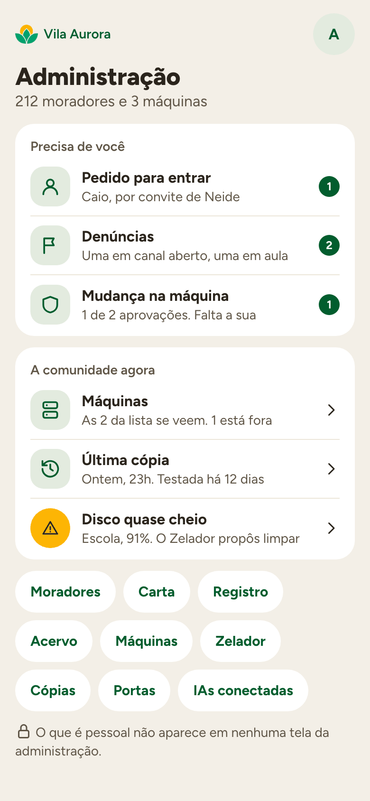 | 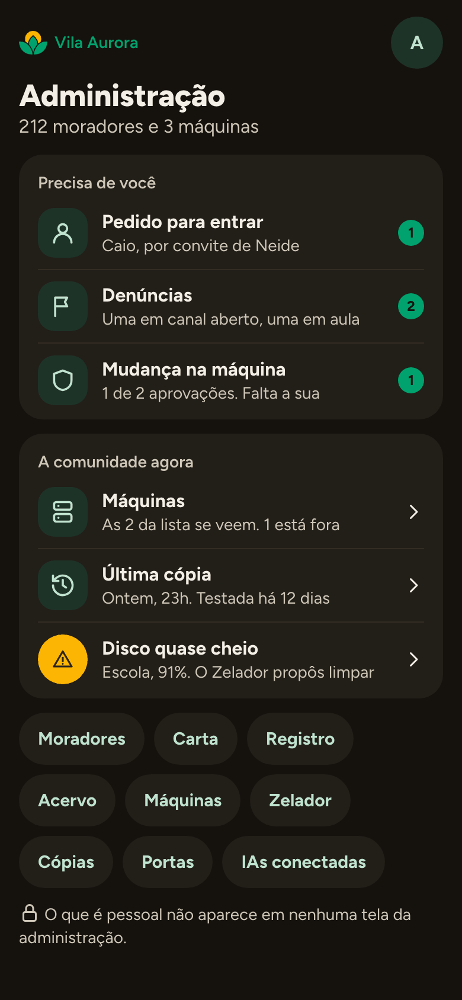 |

**What the person sees.** The community's header with the mark, the name and the person's own initial. The title "Administração" and a line with the number of residents and of machines. A card "Precisa de você" with what waits for this person: requests to join, flags, a change on the machine that still needs their approval, each with a count. A card "A comunidade agora" with the state at a glance: the machines, the last copy and the problems the caretaker found, a problem drawn with the sun and a sentence that says what it is. Under them, one pill for each part of administration, and a closing line: "O que é pessoal não aparece em nenhuma tela da administração."

**What they can do.** Open what waits for them, open the state of the machines, of the copies or of a problem, or go to any part of administration through the pills.

**States.**

- Nothing waits: the first card says "Nada precisa de você agora."
- A listed machine is away: the machines row says which one and since when, such as "Galpão está fora desde domingo. Contas novas e papéis esperam por ela."
- A copy is late, older than seven days: the copies row is drawn with the sun and says "A última cópia tem 9 dias."
- A machine's clock is far from the others: the machines row says "O relógio do Galpão está errado."
- No link with the community: the notice "Sem ligação com a comunidade." at the top, and nothing on the page can be done until the link returns.

**Who may.** Administrators. A moderator goes to moderation, and a guardian to the guardian's screen, without passing here.

**Journal.** Writes nothing. Reads the residents and their state, the flags, the changes waiting for approval, the machines, the copies and what the caretaker's probes found.

**Many machines.** Never waits. It reads the indexes of whichever machine serves the page, which hold the journals of every machine. What a machine that is away wrote while it was away appears when it returns.

## Residents

`/admin/residents`. **Built** for the list and the change of role; **Proposed** for approval, guardianship, reset, the search and the filters.

| Light | Dark |
| --- | --- |
| 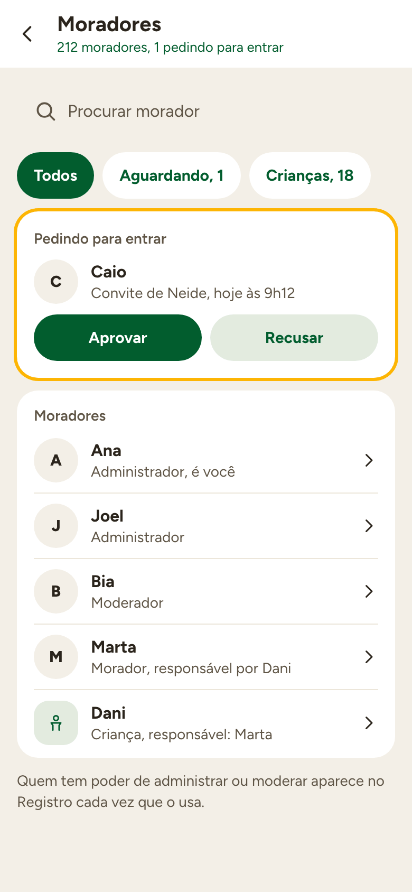 | 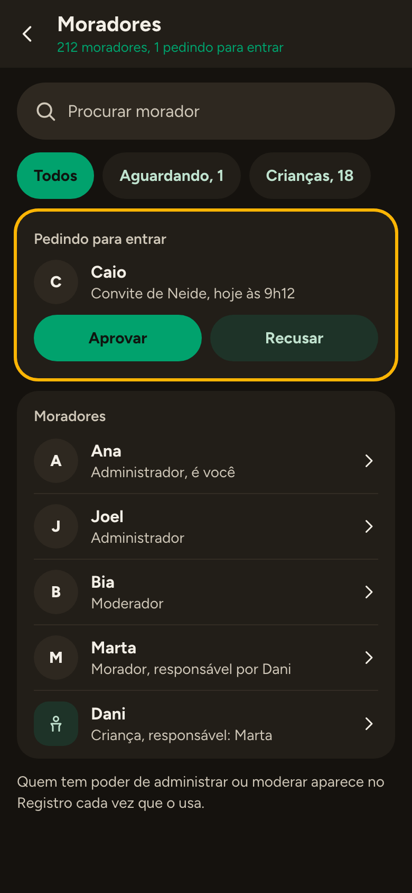 |

**What the person sees.** The inner header "Moradores", with the number of residents and of requests. A search field, "Procurar morador". Three filters: everyone, those waiting, and children. When someone asks to join, a card with the sun's ring, "Pedindo para entrar", with the person's name, who invited them and when, and the buttons "Aprovar" and "Recusar". Then the list of residents, each with their role and, for a child, the guardian; the person's own row says "é você". A line at the end: "Quem tem poder de administrar ou moderar aparece no Registro cada vez que o usa."

**What they can do.** Approve or refuse a request to join; open a resident to change their role or reset their account (see [a resident's role](#a-residents-role)); open a child to see who their guardian is.

**States.**

- No request: the card is not there.
- The person is not an administrator: "Seu papel não permite isso." **Built.**
- Approving cannot be done now, if approval is counted: "Agora não dá para aprovar a entrada. Isso depende da ligação com toda a comunidade, e uma parte dela está sem ligação agora. Tente de novo daqui a pouco." Whether approval is counted is **Not decided**.
- The system is read-only after a disk error: "O sistema está em somente leitura e não aceita nada novo agora. Avise quem cuida da máquina." **Built.**

**Who may.** Administrators. **Built** in the permission table as seeing the residents and changing roles.

**Journal.** Writes `role.changed` (**Built**), and `account.approved`, `account.refused` and `account.reset` (working names). Reads the accounts, their roles, their guardians and the charter's rule of entry.

**Many machines.** The list never waits. A change of role is counted and waits for the machine that counts, machine 0 today (**Built**), and for every listed machine once the list exists (**Proposed**).

Requests to join appear when the charter's rule of entry asks for approval; whether a person who comes with an invitation also waits for an administrator is **Not decided**. The drawn card shows an invitation, as the architecture's drawing did.

A child is never made from this screen. The guardian creates the child's account on the guardian's screen, and the child's row here only shows who the guardian is. **Built:** the role of child cannot be given by hand.

## A resident's role

A sheet over `/admin/residents`. **Built** for the change of role and its errors; **Proposed** for the sheet, the reset and the shape of the choice.

| Light | Dark |
| --- | --- |
| 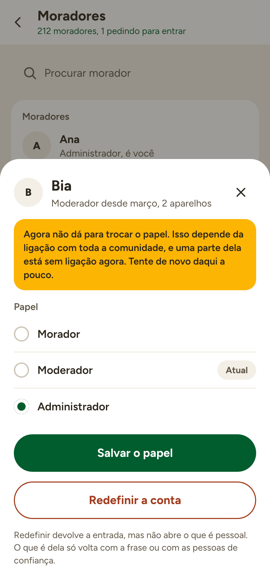 | 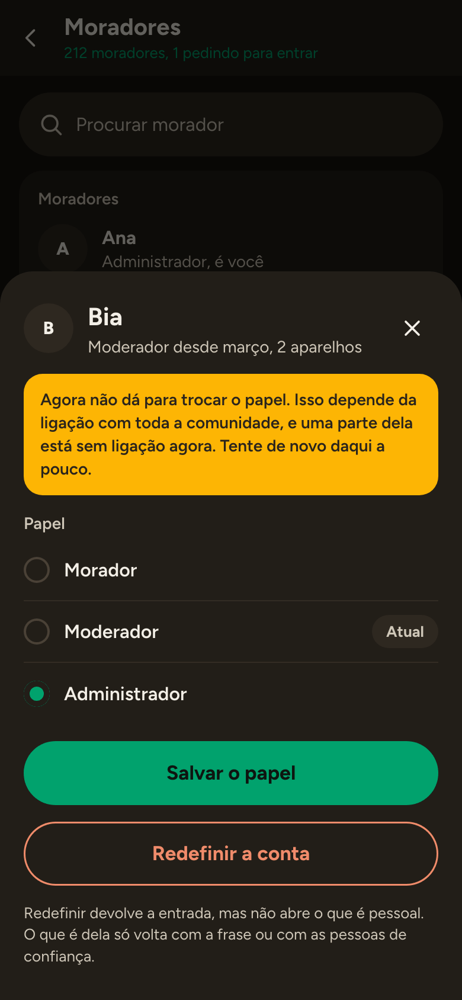 |

**What the person sees.** A sheet with the resident's name, their role, since when, and how many devices they use. The three roles that can be given by hand, "Morador", "Moderador" and "Administrador", with the current one marked "Atual". The button "Salvar o papel". Under it, "Redefinir a conta", drawn as a button that cannot be undone, and the line "Redefinir devolve a entrada, mas não abre o que é pessoal. O que é dela só volta com a frase ou com as pessoas de confiança." The picture shows the sheet when the change cannot be done now.

**What they can do.** Choose another role and save it; reset the account of someone who lost both the passphrase and the trusted contacts.

**States.**

- Not now, when the machine that counts cannot be reached: the notice "Agora não dá para trocar o papel. Isso depende da ligação com toda a comunidade, e uma parte dela está sem ligação agora. Tente de novo daqui a pouco." in the sun color, at the top of the sheet. **Built**, as a page, after about ten seconds; today the choice goes back to the current role. Saying it at once, and keeping the choice as the person left it, are **Proposed**.
- The last administrator: "A comunidade precisa de pelo menos um administrador." **Built.**
- A role that cannot be given here, such as child: "Esse papel não pode ser dado aqui." **Built.**
- The same role again: nothing is written, and the sheet closes. **Built.**
- Reset asks first, on a second step: "Redefinir a conta de Bia. Ela volta a entrar com uma frase nova, e o que era pessoal dela se perde." with "Redefinir" and "Cancelar". **Proposed.**

**Who may.** Administrators. **Built.**

**Journal.** Writes `role.changed` (**Built**) and `account.reset` (working name). Reads the role and the devices of the account.

**Many machines.** A change of role is counted and waits, as above. Whether a reset is counted is **Not decided**.

Roles are written with the names the code has, "Morador", "Moderador", "Administrador" and "Criança". Whether they are shown in the grammatical gender of the person, such as "Moderadora", is **Not decided**. The curator, a role the architecture defines, is not built and not drawn.

## Moderation

`/moderation`. **Proposed** for the screen and for flags; **Built** for the removal with a reason, which today happens at the message itself.

| Light | Dark |
| --- | --- |
| 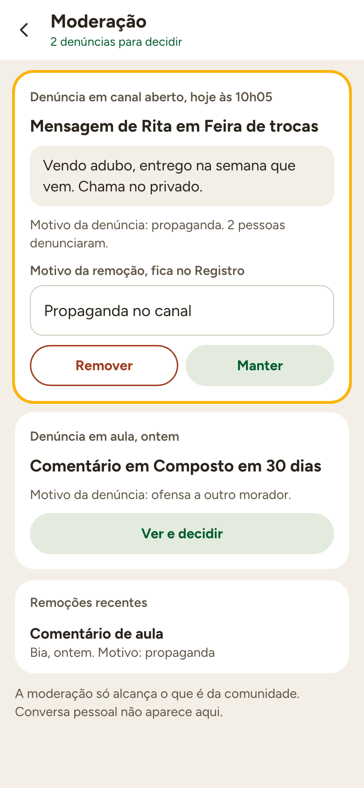 | 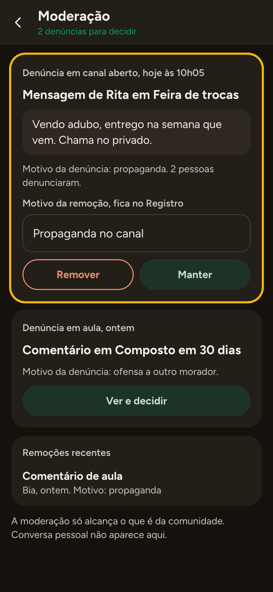 |

**What the person sees.** The inner header "Moderação" with how many flags wait. Each flag is a card: where and when it was flagged, whose content it is and where it is, the content itself, the reason residents gave and how many flagged it. The open flag has the field "Motivo da remoção, fica no Registro" and the buttons "Remover", drawn as a button that cannot be undone, and "Manter". A closed flag shows "Ver e decidir". Under the flags, the recent removals, with who removed, when and why. A line at the end: "A moderação só alcança o que é da comunidade. Conversa pessoal não aparece aqui."

**What they can do.** Read the flagged content, remove it with a reason, or keep it. Keeping closes the flag without touching the content.

**States.**

- No flag: "Nenhuma denúncia para decidir."
- Removing without a reason, or with more than 200 letters: "Para remover a mensagem de outra pessoa, escreva o motivo, em até 200 letras. Ele fica no Registro." **Built.**
- Removing asks first: "Remover a mensagem de Rita. Isso não se desfaz, e o motivo fica no Registro." with "Remover" and "Cancelar". **Proposed.**
- The content was already removed by someone else: the card says "Já removida por Bia, há 2 minutos." and closes.
- No link with the community: the notice "Sem ligação com a comunidade." and the buttons wait; nothing is removed from the device alone.

**Who may.** Moderators and administrators. **Built** in the permission table as removing content. The charter says who the moderators are.

**Journal.** Writes `message.deleted` with the reason (**Built**), and `flag.created` and `flag.resolved` (working names). Reads the flags and the flagged content. A removal takes the text out of the indexes at once, and the night's erasure takes it out of the journal, on every machine. **Built.**

**Many machines.** Never waits. Flagging and removal by a moderator are essential, as the maintainer accepted on 2026-11-13: any machine takes them alone. If two moderators remove the same message on two machines during a split, the earlier removal stays. **Built** for deletions.

Whether the moderator sees who flagged is **Not decided**; the drawing shows only how many.

## Charter

`/admin/charter`. **Proposed.**

| Light | Dark |
| --- | --- |
| 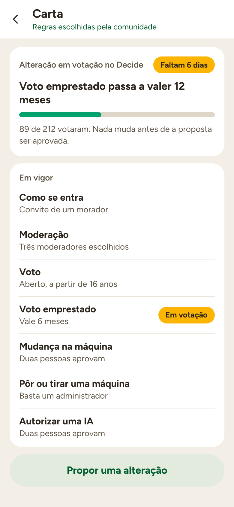 | 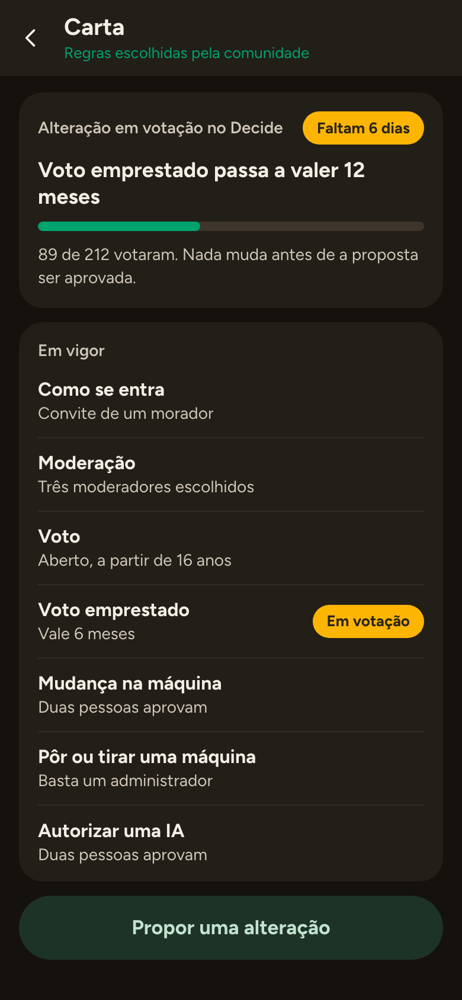 |

**What the person sees.** The inner header "Carta" and the line "Regras escolhidas pela comunidade". When a change is being voted, a card on top, "Alteração em votação no Decide", with the change, the days left in the sun color, a bar of how many voted and the sentence "Nada muda antes de a proposta ser aprovada." Then the rules in force, each with its value; a rule under vote carries the mark "Em votação". At the end, "Propor uma alteração".

**What they can do.** Read the rules; open the vote in Decide; propose a change, which opens a new proposal in [Decide](decide.md) with the rule and the new value already filled in.

**States.**

- No change under vote: the card is not there.
- The person may not propose under the charter: the button is not offered, and Decide says why.
- A change approved and waiting for the count: the card says "Aprovada. A regra muda quando a contagem sair." with the notice of what waits.

**Who may.** Administrators open this page. Who proposes a change is the charter's own rule, "Quem propõe", applied in Decide. Whether every resident reads the charter, and whether here or in Decide, is **Not decided**.

**Journal.** Writes `rule.changed` (working name) when the result of the vote is counted, never from this page by hand. Reads the rules in force and the open proposals that change a rule.

**Many machines.** Reading never waits. Changing the charter is counted and waits for the listed machines, as the maintainer accepted on 2026-11-13: the vote stays open, and closing and counting it waits.

The rules of the charter are chosen in the setup, one at a time, and the system suggests a value for each: how one joins, identity, moderation, who sends a general alert, the age to vote, who proposes, open or secret vote, quorum and majority, how long a lent vote lasts, who approves a change on the machine, who adds or removes a machine, who approves the Mentor's drafts, the quota of lessons, who authorizes an AI, graduated sanctions and conflicts. Three values come from the maintainer's decisions: the open vote, no cloud by default, and one administrator enough to add or remove a machine. The other suggested values are proposals. See [setup](setup.md).

## Log

`/log`. **Built** for the screen, its sentences and the latest hundred acts; **Proposed** for the filters, the acts beyond roles and removals, and the look.

| Light | Dark |
| --- | --- |
| 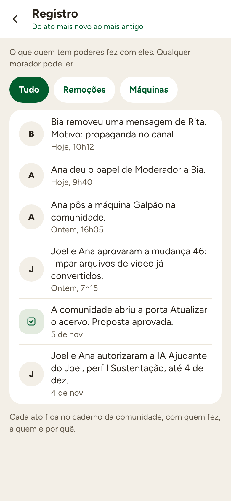 | 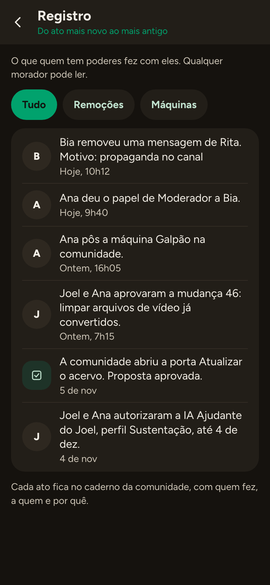 |

**What the person sees.** The inner header "Registro" and the line "O que quem tem poderes fez com eles. Qualquer morador pode ler." Filters: everything, removals, machines. Then each act, the newest first, as one sentence with who did it, to whom and why, and when. A line at the end: "Cada ato fica no caderno da comunidade, com quem fez, a quem e por quê."

The sentences are the ones the code writes: "Ana deu o papel de Moderador a Bia." and "Bia removeu uma mensagem de Rita. Motivo: propaganda no canal". **Built.** The other acts follow the same shape: a machine added or taken off with its reason, a change on the machine approved, a door opened by the community, an AI authorized or revoked, a resident approved or an account reset. **Proposed.**

**What they can do.** Read, and filter by kind of act.

**States.**

- Nothing yet: "Ninguém usou os poderes de administrar ou moderar ainda." **Built.**
- No link with the community: the notice "Sem ligação com a comunidade."

**Who may.** Every resident, child included. **Built.** The log is open to everyone on purpose: a power that is used is a power that is seen.

**Journal.** Writes nothing. Reads the index of acts, which shows only a change of role that took effect, so a forged entry never appears. **Built.**

**Many machines.** Never waits. An act written on a machine that was away appears when it returns, in its place by time. **Built.**

Whether an administrator's access to a child's protected conversation appears here, or only on the guardian's screen, is **Not decided**.

## Guardian

`/guardian`. **Proposed.** Nothing of guardians and children is built.

| Light | Dark |
| --- | --- |
| 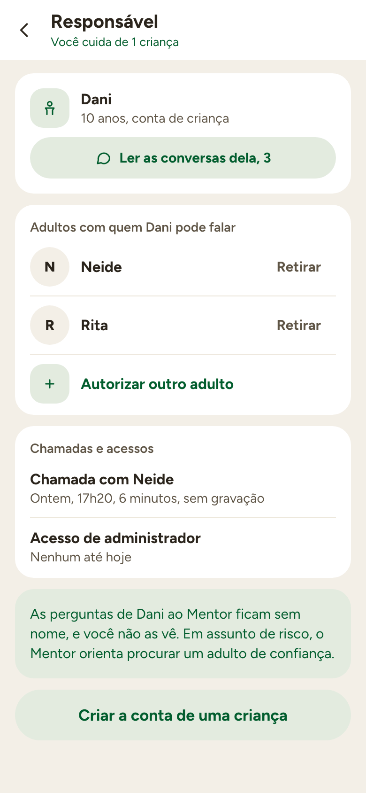 | 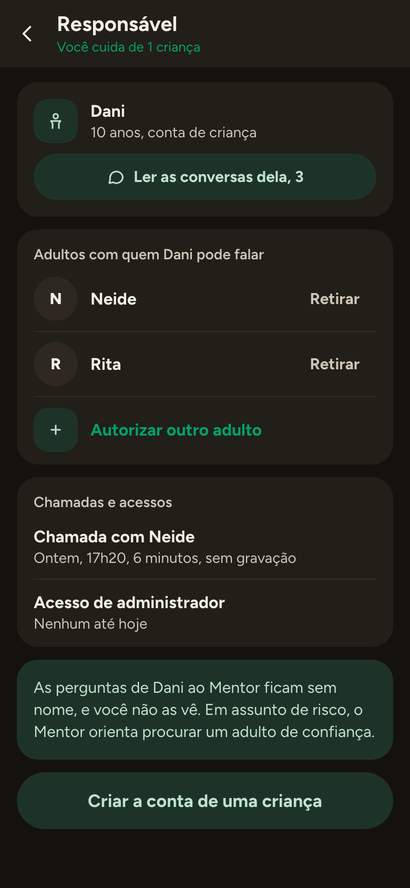 |

**What the person sees.** The inner header "Responsável" and how many children the person looks after. For each child, a card with the name, the age and "conta de criança", and the button "Ler as conversas dela" with how many protected conversations she has. The adults the child may talk to, each with "Retirar", and "Autorizar outro adulto". "Chamadas e acessos": each call the child made, with whom, when, how long, and that it was not recorded, and each access of an administrator to the child's conversations, or "Nenhum até hoje". A quiet panel: "As perguntas de Dani ao Mentor ficam sem nome, e você não as vê. Em assunto de risco, o Mentor orienta procurar um adulto de confiança." At the end, "Criar a conta de uma criança".

**What they can do.** Read the child's protected conversations; authorize an adult or take the authorization away; see the calls and the accesses; create a child's account, with a simple password, because this layer does not use personal encryption.

**States.**

- No child yet: only "Criar a conta de uma criança", with one line on what a child's account can do.
- An administrator opened a protected conversation: the access appears at the top, drawn with the sun: "Ana abriu a conversa de Dani com Neide, hoje às 10h, e escreveu o motivo: pedido da família."
- Taking an authorization away asks first: "Dani deixa de falar com Rita. As conversas que já existem continuam aqui para você ler."

**Who may.** The guardian of each child, for that child only. A child talks only with adults the guardian authorized, reads only the open channels the guardian allows, and does not write in them.

**Journal.** Writes the child's account, the guardianship, each authorization of an adult and its removal, and the protected conversation, with working names such as `guardianship.set`. Before an administrator opens a protected conversation, the system writes the access, and only then opens it. Reads the protected conversations, the calls and the accesses.

**Many machines.** The child's conversation never waits: it is a message. Creating the child's account waits, as every new account does, because names are unique. Whether authorizing an adult waits is **Not decided**.

A protected conversation has no edit, delete or forward, so the guardian keeps reading everything. Whoever controls the machine could read it without leaving a record, and that stays a risk. Whether an administrator's screen may open a child's protected conversation is **Not decided**: the architecture allows it when necessary, with a record the guardian sees, while the [principles](principles.md) say only the guardian sees it.

## Collection

`/admin/collection`. **Proposed.**

| Light | Dark |
| --- | --- |
| 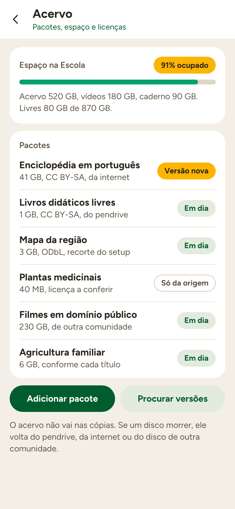 |  |

**What the person sees.** The inner header "Acervo" with "Pacotes, espaço e licenças". A card with the space on one machine's data disk: the share used, in the sun color when it is high, a bar, and what takes the space. Then each package with its size, its license and where it came from, and its state: "Em dia", "Versão nova", or "Só da origem" for one that cannot be passed on. The buttons "Adicionar pacote" and "Procurar versões", and a line: "O acervo não vai nas cópias. Se um disco morrer, ele volta do pendrive, da internet ou do disco de outra comunidade."

**What they can do.** Add a package from a pen drive, from the internet or from another community's disk; update one that has a new version; remove one; look for new versions.

**States.**

- No door to update the collection: "Procurar versões" says "A porta Atualizar o acervo está fechada. Só a comunidade abre." and leads to the doors.
- A package whose license is not checked: "Licença a conferir. Este pacote não pode ser repassado a outra comunidade."
- Not enough space: "Não cabe na Escola. Faltam 12 GB." with what could be removed.
- Removing asks first, with the size it frees and that it can come back from a pen drive or the internet.
- Downloading: the package shows how much has arrived, and the rest of the screen goes on.

**Who may.** Administrators.

**Journal.** Writes `pack.installed` and `pack.removed` (working names). Reads the signed catalog, each package's manifest, with its license and whether it may be passed on, and the space of each machine's disk.

**Many machines.** The collection is heavy, so it lives on the machines with disk for it, and a package that only one machine carries is missing while that machine is away. Which machine carries each package, and whether the administrator chooses it, is **Not decided**; the drawing shows the space of one machine.

## Machines

`/admin/machines`. **Proposed.** What is underneath is **Built**: a machine joins with a code and the fingerprint, becomes an image, and follows the others' journals. The list of machines, the clock warning and this screen are not built.

| Light | Dark |
| --- | --- |
| 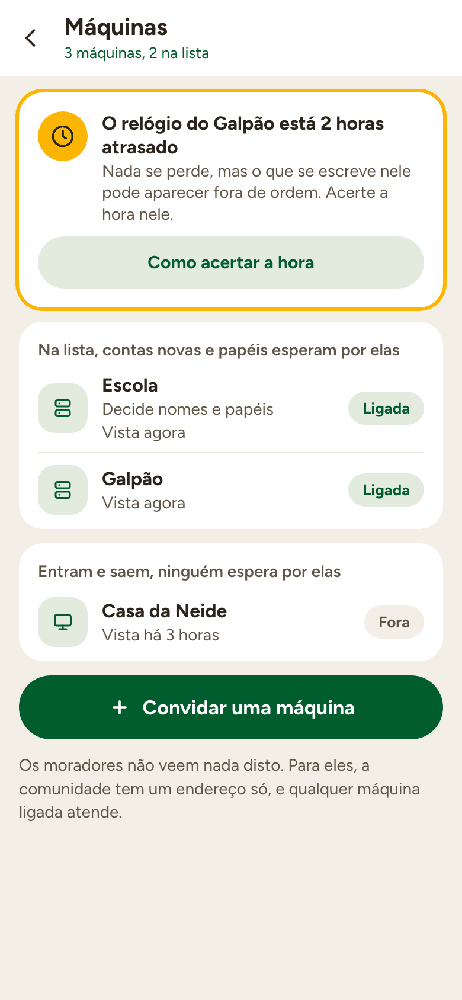 | 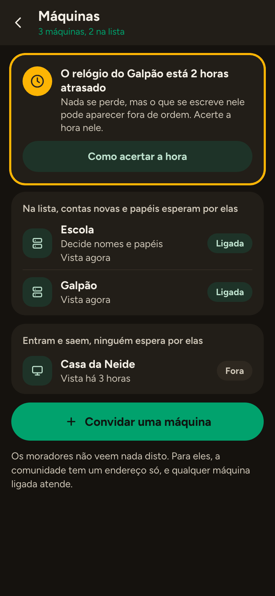 |

**What the person sees.** The inner header "Máquinas" with how many there are and how many are listed. When a clock is wrong, a card with the sun's ring: "O relógio do Galpão está 2 horas atrasado", what it means, "Nada se perde, mas o que se escreve nele pode aparecer fora de ordem. Acerte a hora nele.", and "Como acertar a hora". Then the listed machines, "Na lista, contas novas e papéis esperam por elas", and the machines that come and go, "Entram e saem, ninguém espera por elas". Each machine has its name, when it was last seen, and a word, "Ligada" or "Fora"; the machine that decides names and roles says so. The button "Convidar uma máquina", and a line: "Os moradores não veem nada disto. Para eles, a comunidade tem um endereço só, e qualquer máquina ligada atende."

**What they can do.** Open a machine to see what waits for it and to take it off the community; invite a new machine; follow the steps to set a clock.

**States.**

- One machine only: the screen shows it and says "Uma máquina só. Convide outra para a comunidade seguir quando esta desligar."
- A listed machine away: its row says "Fora desde domingo", and its page lists what waits for it, such as "2 contas novas e 1 troca de papel".
- A machine with another version of the screens: "Versão diferente. Recebe o que a comunidade escreve, mas não atende moradores até ser atualizada."
- The clock warning, when two machines meet and their clocks differ by much. **Proposed.** How much is too much is **Not decided**.

**Who may.** Administrators. One administrator is enough to add or remove a machine, as the maintainer decided on 2026-11-13; the charter can ask for more.

**Journal.** Writes `machine.added` (**Built**, today written by the machine that counts with no person named, because the command line has no account), `machine.removed` (working name), and an entry that puts a machine on the list or takes it off, whose name is not chosen. Reads the machines index, each machine's last contact and the clocks.

**Many machines.** This is the screen of many machines. Adding a machine is counted and waits for the listed machines, as the maintainer accepted on 2026-11-13. Taking one off is described in [take a machine off](#take-a-machine-off).

Whether a machine is put on the list when it is invited or later, from its page, is **Not decided**.

## Invite a machine

A sheet over `/admin/machines`. **Proposed** for the screen; **Built** for the code, the fingerprint and the join, on the command line.

| Light | Dark |
| --- | --- |
| 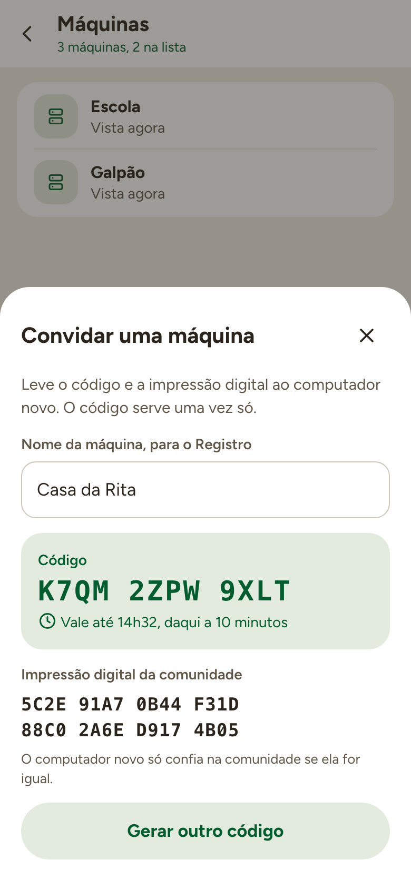 | 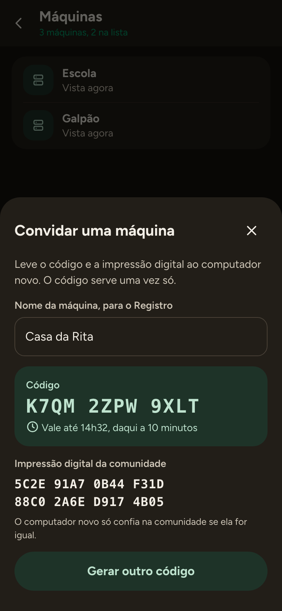 |

**What the person sees.** A sheet "Convidar uma máquina" with "Leve o código e a impressão digital ao computador novo. O código serve uma vez só." The name the machine will have in the log. The code, large, and until when it works: ten minutes. The fingerprint of the community, and "O computador novo só confia na comunidade se ela for igual." The button "Gerar outro código".

**What they can do.** Name the machine, read the code and the fingerprint to whoever is at the new computer, and make a new code if the first one expires.

**States.**

- The code expired: "Este código venceu. Gere outro."
- The machine that counts cannot be reached: "Agora não dá para convidar uma máquina. Isso depende da ligação com toda a comunidade, e uma parte dela está sem ligação agora. Tente de novo daqui a pouco."
- The new machine joined: the sheet closes and the list shows it, with "Entrou agora".

**Who may.** Administrators.

**Journal.** Writes `machine.added` when the new machine spends the code. **Built.** The code itself is kept only as its hash, and is removed when it is used (**Built**). An expired code stays until a new one replaces it; removing it when it expires is **Proposed**.

**Many machines.** Waits for the machine that counts (**Built**) and for the listed machines (**Proposed**).

What the new computer shows while it joins is **Not decided**: today a person runs `-join` there with the address, the code and the fingerprint.

## Take a machine off

A sheet over the page of one machine, `/admin/machines/<name>`. **Proposed.** Taking a machine off, or its token away, is not built.

| Light | Dark |
| --- | --- |
| 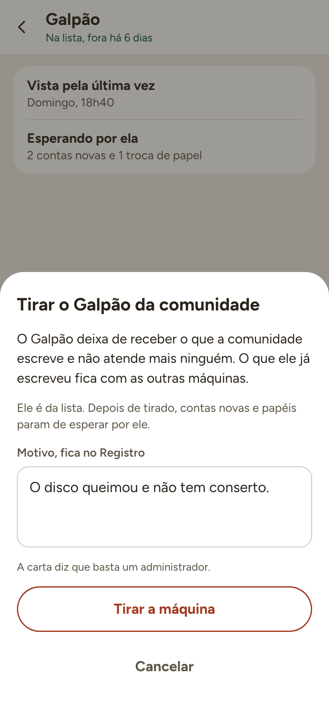 | 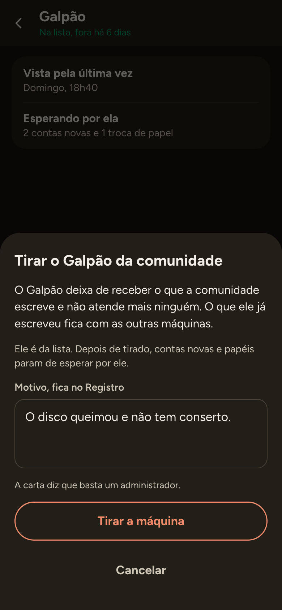 |

**What the person sees.** Behind the sheet, the machine's page: when it was last seen and what waits for it. The sheet "Tirar o Galpão da comunidade", with what happens: "O Galpão deixa de receber o que a comunidade escreve e não atende mais ninguém. O que ele já escreveu fica com as outras máquinas." For a listed machine, "Depois de tirado, contas novas e papéis param de esperar por ele." The field "Motivo, fica no Registro", the line "A carta diz que basta um administrador.", the button "Tirar a máquina", drawn as one that cannot be undone, and "Cancelar".

**What they can do.** Write the reason and take the machine off.

**States.**

- No reason: "Escreva o motivo. Ele fica no Registro."
- The machine is the only one left: the button is not offered, and the sheet says "É a única máquina da comunidade."

**Who may.** Administrators, as many as the charter asks; one by the maintainer's decision.

**Journal.** Writes `machine.removed` with the reason (working name). The other machines stop following it and refuse its token.

**Many machines.** The architecture says that when a listed machine died for good, an administrator takes it off the list, and that is an act of a person, recorded. That cannot wait for the machine being taken off. Its risk table also says two people on the two sides of a split could each take the other's machine off. Whether taking a machine off waits for the other listed machines is **Not decided**, and so is how a machine that was taken off could come back.

## Caretaker

`/caretaker`. **Proposed.**

| Light | Dark |
| --- | --- |
| 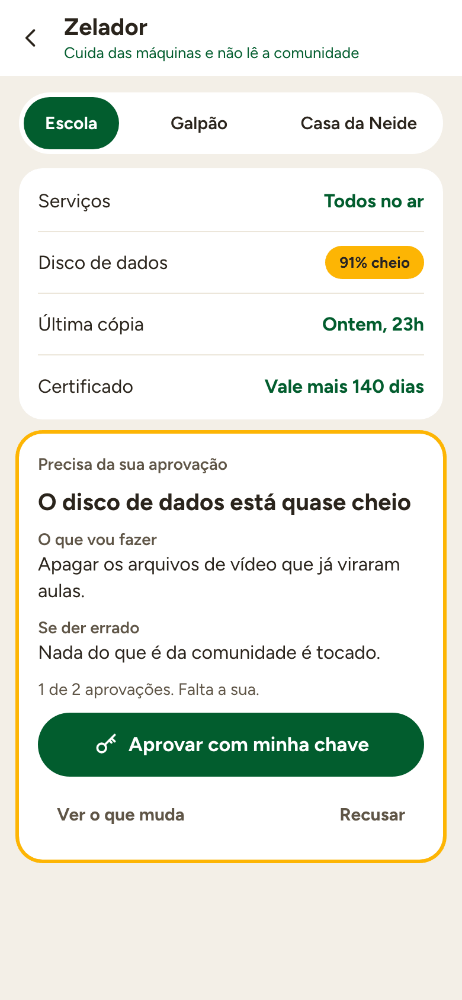 | 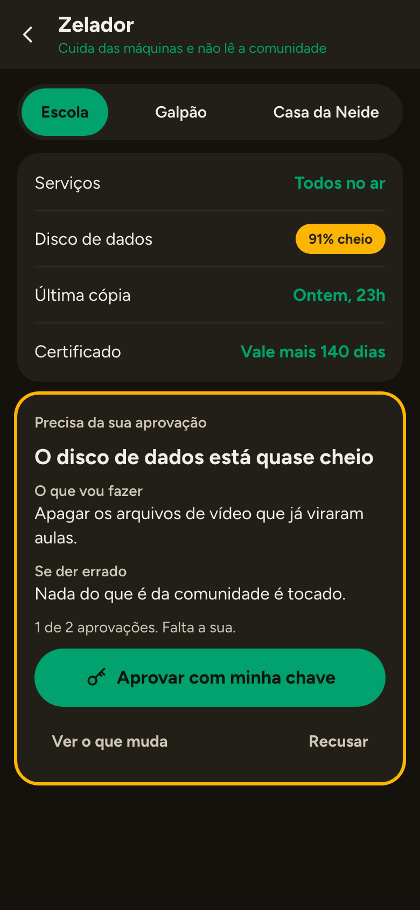 |

**What the person sees.** The inner header "Zelador" with "Cuida das máquinas e não lê a comunidade". A choice of machine, one per machine of the community. The state of that machine in plain words: services, data disk, last copy, certificate; a value that needs attention carries the sun and a word, such as "91% cheio". Then each problem found, as a card with the sun's ring: what is wrong, "O que vou fazer", "Se der errado", how many approvals it has and how many it needs, "Aprovar com minha chave", "Ver o que muda" and "Recusar".

**What they can do.** See the state of each machine; approve or refuse a fix; open the change to see exactly what it does.

**States.**

- All well: "Tudo em ordem na Escola." and the last time the probes ran.
- A fix the caretaker does alone, because it changes no data and no code (restart a service, rebuild an index, renew the certificate): it appears as done, "Reiniciei o serviço de vídeo às 3h12, depois de duas falhas seguidas.", with no button.
- A machine away: "A Casa da Neide está fora. O último estado é de há 3 horas."
- The system read-only after a disk error: the card says which line of the journal is damaged and offers to restore that file from a copy; with no copy, an administrator approves going on with the loss.
- Approving cannot be done now: "Agora não dá para aprovar a mudança. Isso depende da ligação com toda a comunidade, e uma parte dela está sem ligação agora. Tente de novo daqui a pouco."

The probes and what each warns about come from the architecture: free disk below 10%, memory near its limit for ten minutes, a service that fails twice in a row, any error in the journal's chain, indexes more than a thousand entries behind, a copy older than seven days, a certificate with fewer than thirty days. The fixes it knows are a closed list: restart a service, clear old work and snapshots, rebuild an index, renew the certificate, go back to the previous version, apply a system update after a snapshot. The caretaker reads nothing of the community: fixed scripts measure the machine, and the model only explains in Portuguese and picks a known fix.

**Who may.** Whoever the charter names to approve a change on the machine; the suggested rule is two people. A child never.

**Journal.** Writes `change.proposed`, `change.approved`, `change.applied` and `change.undone` (working names). Reads the probes of each machine. The technical record of each machine, which carries no content, no resident's name and no device address, stays out of the journal.

**Many machines.** The state of each machine is read where it is. Approving a change on the machine is counted and waits for the listed machines, as the maintainer accepted on 2026-11-13. Whether one approval applies to every machine, or each machine's caretaker proposes its own, is **Not decided**.

## A change on the machine

`/caretaker/change/<number>`. **Proposed.**

| Light | Dark |
| --- | --- |
| 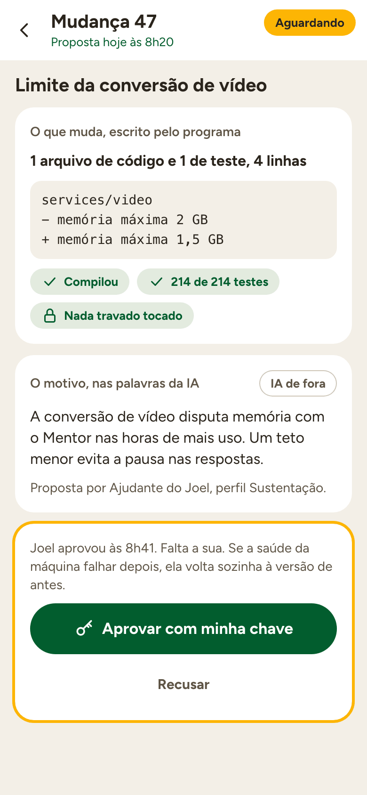 |  |

**What the person sees.** The inner header with the number of the change, when it was proposed, and its state in the sun color, "Aguardando". Its title. A card "O que muda, escrito pelo programa": how many files and lines, the lines themselves, and the checks: it compiled, the tests passed, and no locked place was touched. A card "O motivo, nas palavras da IA", marked "IA de fora" when another AI proposed it, with who proposed it and with which profile; a change the caretaker proposed says so instead. A card with the sun's ring: who already approved and when, what happens if the machine is not healthy afterwards, "Aprovar com minha chave" and "Recusar".

**What they can do.** Read what changes and why; approve with their own key, on their own device; refuse.

**States.**

- Applied: "Aplicada às 9h02. A máquina ficou saudável."
- Undone by itself: "Desfeita. A máquina não ficou saudável em 2 minutos e voltou à versão de antes."
- Refused: "Recusada por Ana às 9h10."
- Waiting for the count: the notice of what waits, as on the caretaker.
- A local version installed: the screen warns from then on "O código desta máquina é diferente da versão publicada."

**Who may.** Whoever the charter names to approve. An AI never: it has no one's key.

**Journal.** Writes `change.approved` with the signature, then `change.applied` or `change.undone`. Reads the proposed change, its checks and the approvals.

**Many machines.** Approving waits for the listed machines, as on the caretaker.

Each approval signs the number of the change, the action and the exact digest of what will be applied, and a number already used is refused. A change that touches the caretaker itself, the encryption in the browser, the permission table, the checking of signatures or the AI server is refused before anyone sees it: such a change only comes in a signed version of the project. What changes is written by a program; the reason is the proposer's words, marked as such. A core that was broken into could still show a false screen and lead someone to sign, and that stays a risk.

## Copies

`/caretaker/copies`. **Proposed** for the screen; **Built** for the copies, their format and the test.

| Light | Dark |
| --- | --- |
| 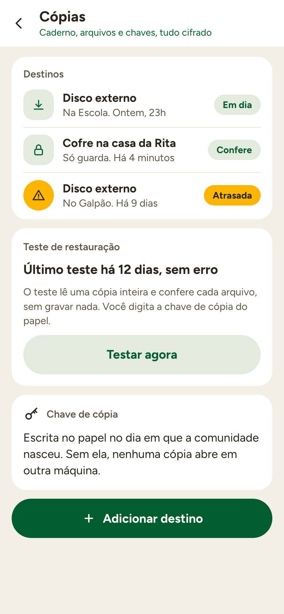 | 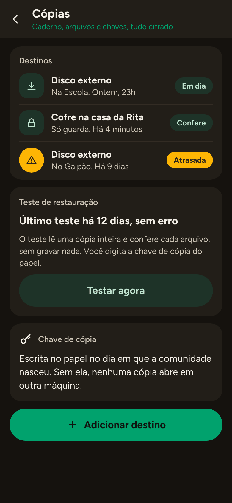 |

**What the person sees.** The inner header "Cópias" with "Caderno, arquivos e chaves, tudo cifrado". The destinations, each with where it is, when the last copy was made and a word: "Em dia", "Confere" for a second machine whose seal matches, or "Atrasada" in the sun color. A card "Teste de restauração" with when the last test was and how it went, what the test does, and "Testar agora". A card "Chave de cópia": "Escrita no papel no dia em que a comunidade nasceu. Sem ela, nenhuma cópia abre em outra máquina." The button "Adicionar destino".

**What they can do.** See each destination; make a copy now; test a copy; add a destination: an external disk, or a second machine that only keeps an encrypted copy, in this house or another; pair or unpair a second machine.

**States.**

- No destination: "Nenhuma cópia ainda. Se o disco morrer, tudo se perde." drawn with the sun, and "Adicionar destino".
- A copy older than seven days: "Atrasada", and the same on the overview.
- Never tested: "Esta cópia nunca foi testada. Cópia que não foi testada não conta."
- A second machine whose history does not match: "A história da Escola não é a que o cofre seguia. O cofre guardou o que tinha à parte e recebeu tudo de novo."
- A folder that holds other things: "Esta pasta tem outras coisas. Escolha uma pasta vazia ou uma que já tenha uma cópia." **Built** as a refusal of the command line, in English; this sentence on the screen is **Proposed**.

**Who may.** Administrators.

**Journal.** A copy writes nothing in the journal. Where the date and the result of each test are kept is **Not decided**. Reads the destinations, the manifest of each copy and the seal a second machine reports.

**Many machines.** Each machine makes its own copy every night, after the night's erasure, and that copy carries its copies of the other machines' journals and their addresses, so a machine restored from it comes back whole. **Built.** The screen shows the copies of every machine, with the machine's name.

A copy holds only what cannot be rebuilt: the journal and the secrets, which include the copy key. The indexes are rebuilt, and the collection comes back from elsewhere. **Built.** Whether this screen can show the copy key again after the day the community is born is **Not decided**; today `-print-copy-key` shows it.

## Test a copy

A sheet over `/caretaker/copies`. **Proposed** for the screen; **Built** for the test.

| Light | Dark |
| --- | --- |
| 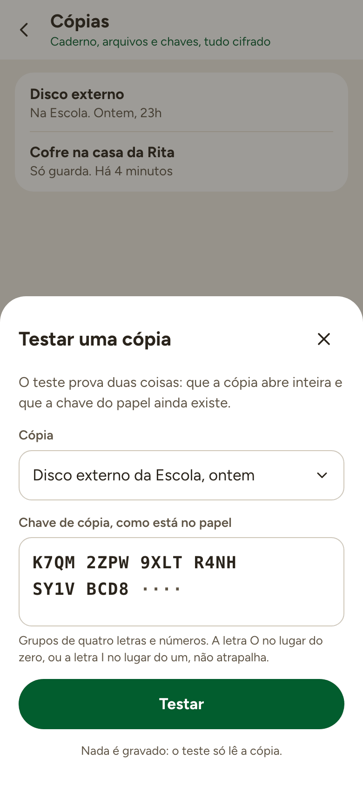 | 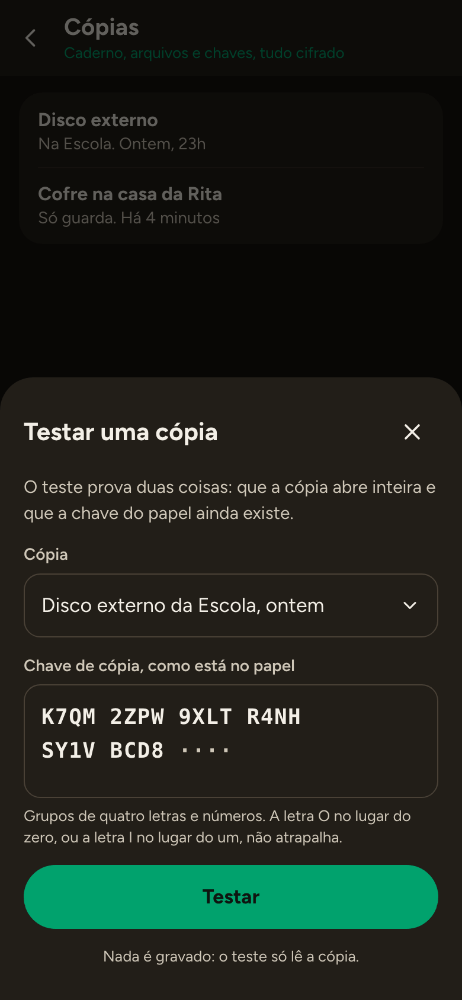 |

**What the person sees.** A sheet "Testar uma cópia" with "O teste prova duas coisas: que a cópia abre inteira e que a chave do papel ainda existe." A choice of copy. The field "Chave de cópia, como está no papel", in groups of four letters and digits, and "A letra O no lugar do zero, ou a letra I no lugar do um, não atrapalha." The button "Testar", and "Nada é gravado: o teste só lê a cópia."

**What they can do.** Choose a copy, type the key from the paper, and test.

**States.**

- Testing: "Conferindo a cópia. Pode levar alguns minutos." with how far it is.
- Passed: "Cópia conferida, sem erro. Ela restaura a comunidade inteira."
- Wrong key: "Esta chave não abre a cópia. Confira o papel."
- A damaged file: "Um arquivo da cópia não confere. Faça uma cópia nova e teste de novo."

**Who may.** Administrators.

**Journal.** Writes nothing. Reads the whole copy and checks every file against the manifest. **Built** as `Check`.

**Many machines.** Never waits. The test runs on the machine that holds the copy, or on the one the disk is plugged into.

Once a month the copies screen offers the test, and the overview reminds of it.

## Doors to the internet

`/caretaker/doors`. **Proposed.**

| Light | Dark |
| --- | --- |
| 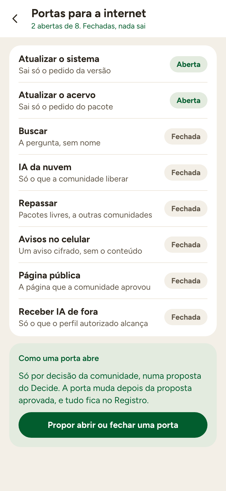 | 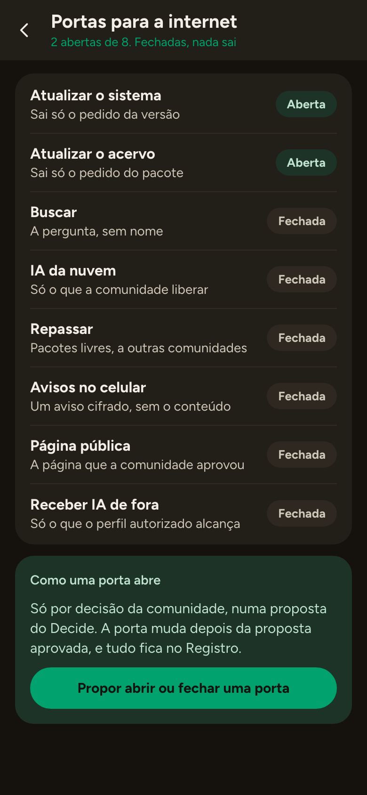 |

**What the person sees.** The inner header "Portas para a internet" with how many are open and "Fechadas, nada sai". Each door with what may go out through it and its state, "Aberta" or "Fechada":

| Door | What goes out |
| --- | --- |
| Atualizar o sistema | Only the request for the version |
| Atualizar o acervo | Only the request for the package |
| Buscar | The question, with no name, to a closed list of sources |
| IA da nuvem | Only the kinds of data the community allows |
| Repassar | Only packages that may be passed on, to other communities |
| Avisos no celular | An encrypted alert, with no content |
| Página pública | The page the community approved |
| Receber IA de fora | Only what the authorized profile reaches |

A quiet panel, "Como uma porta abre": "Só por decisão da comunidade, numa proposta do Decide. A porta muda depois da proposta aprovada, e tudo fica no Registro." with "Propor abrir ou fechar uma porta".

**What they can do.** See the doors; open a door to see what goes out and, for the cloud AI, which kinds of data may go: technical records, questions with no name, content of the community; propose opening or closing a door, which opens a proposal in Decide.

**States.**

- All closed, after the setup: "Todas fechadas. Nenhum pacote sai da comunidade."
- A door being voted: its row carries "Em votação".
- An approved door waiting for the count: the notice of what waits.

**Who may.** Administrators see the doors. Opening one takes the community's decision; no role opens a door alone.

**Journal.** Writes `door.changed` (working name) when the approved result is counted. Reads the doors and what each lets out. What is personal never goes out, because no machine can read it.

**Many machines.** The vote that opens a door waits for the count, as every vote does. Which machine goes out through an open door is **Not decided**.

The ordinary internet of the residents does not pass through Earthler; the router looks after it.

## Connected AIs

`/caretaker/ais`. **Proposed.** The AI server comes installed and off, by the maintainer's decision, and each community decides whether to turn it on.

| Light | Dark |
| --- | --- |
| 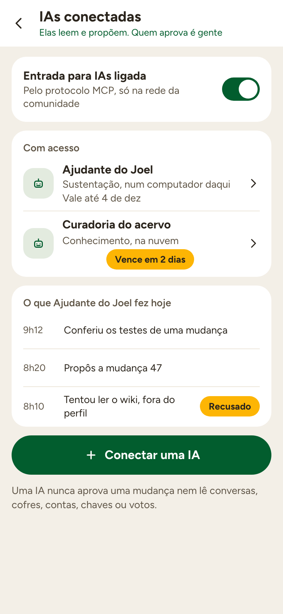 | 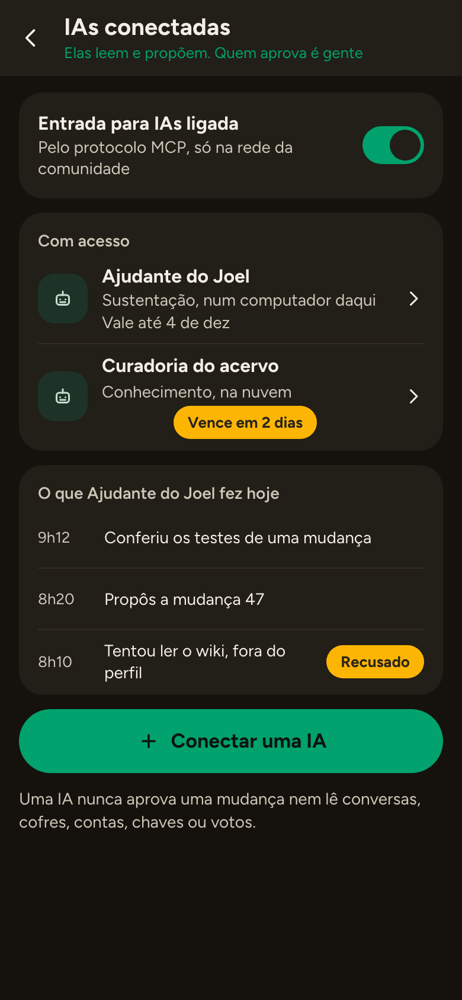 |

**What the person sees.** The inner header "IAs conectadas" with "Elas leem e propõem. Quem aprova é gente". The switch "Entrada para IAs", with the way it is reached: "Pelo protocolo MCP, só na rede da comunidade". The AIs with access, each with its name, its profile, where it runs, until when it is valid, and a mark in the sun color when it is about to expire. What one AI did today, in plain words, with each refusal marked "Recusado". "Conectar uma IA", and "Uma IA nunca aprova uma mudança nem lê conversas, cofres, contas, chaves ou votos."

**What they can do.** Turn the server on or off; open an AI to see every call, renew it or revoke it; connect a new AI.

**States.**

- Server off: "A entrada para IAs está desligada. Nenhuma IA alcança a comunidade." and the switch.
- No AI: "Nenhuma IA conectada."
- An AI expired: "Venceu em 13 de nov. Para voltar, renove."
- A refused call: wrong token, token of another profile, a false origin, a request for personal data or an attempt to approve; each appears here and in the technical record.

**Who may.** Administrators. Authorizing an AI follows the charter's rule; the suggested one is two people.

**Journal.** Writes `ai.authorized` and `ai.revoked` (working names), which appear in the log for everyone, and once a day the total of calls per tool. Each call goes to the technical record, with the token, the tool, the result and the time, never the content.

**Many machines.** The server runs on a machine and reaches the community through it. Which machine an AI connects to, with many machines, is **Not decided**. Whether authorizing an AI waits for the listed machines is **Not decided**.

## Connect an AI

`/caretaker/ais/new`. **Proposed.**

| Light | Dark |
| --- | --- |
| 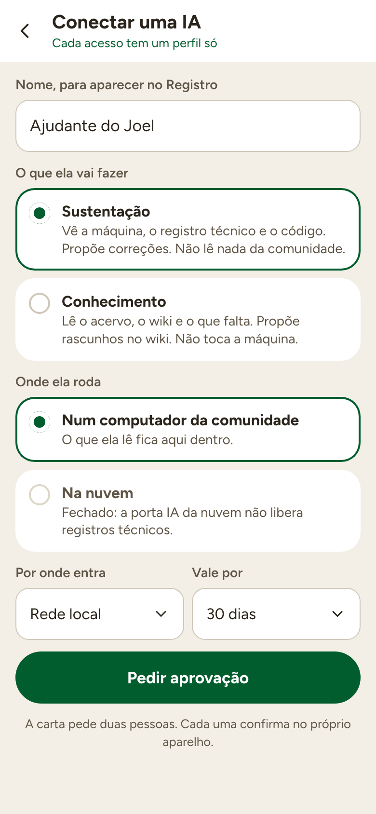 | 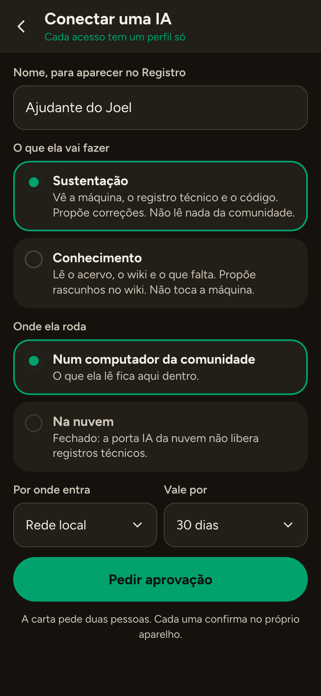 |

**What the person sees.** The inner header "Conectar uma IA" with "Cada acesso tem um perfil só". The name that will appear in the log. "O que ela vai fazer", two profiles, one to choose: "Sustentação", which sees the machine, the technical record and the code and proposes fixes, and reads nothing of the community; "Conhecimento", which reads the collection, the wiki and what is missing and proposes drafts for the wiki, and does not touch the machine. "Onde ela roda": on a computer of the community, the suggestion, or in the cloud. "Por onde entra": the local network, the terminal, or the internet. "Vale por": thirty days, at most ninety. The button "Pedir aprovação", and "A carta pede duas pessoas. Cada uma confirma no próprio aparelho."

**What they can do.** Fill in the access and ask for approval. Once approved, the screen shows the address and the token once, to copy into the AI's program, with "Aparece uma única vez" in the sun color.

**States.**

- The cloud not available: "Fechado: a porta IA da nuvem não libera registros técnicos." The same for Conhecimento when the door does not allow the community's content. A profile is only offered for an AI in the cloud if its kind of data may go out, because everything the AI reads leaves through the computer where it runs.
- The internet way in, with the door "Receber IA de fora" closed: "A porta Receber IA de fora está fechada. Só a comunidade abre."
- Waiting for the second approval: "Joel aprovou. Falta uma pessoa."
- A second token for the same AI: the screen warns "Quem lê a comunidade não deve poder mexer na máquina. Não entregue dois acessos à mesma IA." The system cannot prevent it, and what still holds is the signed approval.

**Who may.** Administrators ask; whoever the charter names approves.

**Journal.** Writes `ai.authorized` once approved. The token is kept only as its hash.

**Many machines.** As on connected AIs.

The computer of the AI must trust the community certificate, as any device does.

## Flows

### Approving a resident

**Proposed.**

1. Under the charter's rule of entry by approval, a person creates an account. The name is counted, because names are unique. **Built** for the count. The person sees that the account waits for approval; see [account](account.md).
2. The overview shows "Pedido para entrar", and the residents screen shows the card with who invited them.
3. An administrator taps "Aprovar". The person can come in, and the log says who approved whom.
4. "Recusar" closes the request. Whether a reason is asked, and what happens to the name, is **Not decided**.

### Giving a role

**Built**, except the sheet and the shape of the choice.

1. On the residents screen, the administrator opens a resident and chooses a role.
2. The screen asks the permission table, and the change goes to the machine that counts.
3. If it cannot be reached, the sheet says "Agora não dá para trocar o papel…", and nothing waits in a hidden queue. Today the page says it after about ten seconds; saying it at once is **Proposed**.
4. The last administrator cannot step down. A role given to someone who already has it writes nothing.
5. `role.changed` goes into the journal, and the log says "Ana deu o papel de Moderador a Bia."

### Removing content

**Built** for the removal at the message; **Proposed** for flags and the moderation screen.

1. A resident flags a message, a comment or a page, with a reason.
2. The flag appears on the moderation screen, and the count on the overview.
3. A moderator reads it, writes the reason, and removes it, or keeps it.
4. `message.deleted` with the reason goes into the journal; the text leaves the screens at once, and the night's erasure takes it out of every machine's journal. The log shows who removed whose message and why.
5. Nothing waits: any machine takes the removal alone.

### Adding a machine

**Built** on the command line, where, with the machine that counts away, joining fails with an error instead of a screen that says not now; **Proposed** on the screens.

1. On the machines screen, the administrator taps "Convidar uma máquina" and names it. The machine that counts makes a code that works once, for ten minutes, and shows the fingerprint of the community root.
2. At the new computer, with an empty data folder, a person gives the address, the code and the fingerprint. The new machine trusts the community only if the fingerprint matches.
3. The machine that counts spends the code, gives the next number, writes `machine.added`, and hands over the community's secrets.
4. The new machine reads the others' journals and starts serving, as an image of the others. It appears on the machines screen.
5. Adding a machine is counted: with the machine that counts away, the screen says not now.

### Taking a machine off

**Proposed.** Not built.

1. On the machines screen, the administrator opens a machine and taps "Tirar da comunidade".
2. The sheet says what happens and asks for the reason.
3. `machine.removed` goes into the journal with the reason, and the log shows it.
4. The others stop following that machine and refuse its token. If it was listed, what is counted stops waiting for it.

### Approving a change on the machine

**Proposed.**

1. A probe finds a problem. The caretaker picks a known fix, or prepares a change in the code in a separate folder, with no network, and compiles it and runs the tests there; another AI can propose a change the same way, through the AI server.
2. Only a change that compiles and passes the tests, and touches no locked place, becomes a proposal, `change.proposed`.
3. The caretaker and the change screens show what changes, written by a program, and the reason, in the proposer's words.
4. Each person the charter names approves with their own key, on their own device. Approving is counted, and waits for the listed machines.
5. The caretaker program checks the signatures, takes a snapshot, applies, and checks the machine's health for two minutes. If the health fails, it goes back by itself and records why.
6. The change screen shows the result, and the log shows who approved.

### Testing a copy

**Built** for the test; **Proposed** for the screens.

1. Once a month, the copies screen offers the test; any day, "Testar agora" does the same.
2. The administrator chooses a copy and types the copy key from the paper.
3. The test reads the whole copy and checks every file against the manifest, writing nothing.
4. The screen says the copy passed, or which key or which file failed. A copy that was never tested does not count.

## Who may do what

| Action | Resident | Child | Moderator | Administrator | Mark |
| --- | --- | --- | --- | --- | --- |
| Read the log | Yes | Yes | Yes | Yes | Built |
| See the residents and their roles | No | No | No | Yes | Built |
| Give a role | No | No | No | Yes | Built |
| Remove what someone else wrote, with a reason | No | No | Yes | Yes | Built |
| Flag content | Yes | Not decided | Yes | Yes | Proposed |
| Approve a request to join | No | No | No | Yes | Proposed |
| Reset an account | No | No | No | Yes | Proposed |
| Read a child's protected conversation | Only the child's guardian | No | No | Not decided | Proposed |
| Change the charter | By a vote in Decide, as the charter says | By a vote, at the voting age | By a vote | By a vote | Proposed |
| Approve a change on the machine | As the charter says | No | As the charter says | As the charter says | Proposed |
| Open a door to the internet | No | No | No | Only with the community's decision | Proposed |
| Add or remove a machine | No | No | No | Yes, with a record; one is enough | Proposed, decided on 2026-11-13 |
| Turn on the AI server and authorize an AI | No | No | No | As the charter says | Proposed |
| Manage the collection and the copies | No | No | No | Yes | Proposed |

"As the charter says" means the community chooses in the setup and can change it by a vote. The guardian is not a role: it is a resident who looks after a child's account.

## Not decided

- Whether a person who comes with an invitation also waits for an administrator's approval, or only under the rule of entry by approval.
- Whether approving a resident is counted and waits for the listed machines; whether refusing asks for a reason, and what happens to the name.
- Whether resetting an account is counted.
- Whether roles are shown in the person's grammatical gender, such as "Moderadora".
- Whether an administrator may open a child's protected conversation: the architecture allows it when necessary, with a record the guardian sees, and the principles say only the guardian sees it. If it may, whether that access also appears in the open log.
- Whether authorizing an adult for a child waits for the listed machines.
- Whether a moderator sees who flagged, and whether a child may flag.
- Whether every resident reads the charter, and whether here or in Decide.
- Which machine carries each package of the collection, and whether the administrator chooses it.
- Whether a machine is put on the list when it is invited or later; how far apart two clocks must be for the warning.
- Whether taking a machine off waits for the other listed machines, and how a machine taken off could come back.
- What the new computer shows while it joins.
- Whether one approval of a change applies to every machine, or each machine's caretaker proposes its own.
- Where the date and result of each restore test are kept, and whether the copies screen can show the copy key again.
- Which machine goes out through an open door, and which machine an AI connects to, with many machines.
- Whether authorizing an AI waits for the listed machines.
- The words of every "Agora não" sentence. The two built ones, for creating an account and changing a role, also wait for the maintainer's approval, with the four notices.
- The dark palette, which waits for the maintainer's visual approval, as every screen's does.
