# Ask

Ask is the app where a resident puts a question to the Mentor, the community's local artificial intelligence, and gets an answer made only from what the community holds: the approved wiki and the downloaded collection. Every citation in an answer is checked against its source, what was deduced is marked as a deduction, and the care a source asks for is copied word for word. When nothing in the collection answers, the Mentor says it does not know, and the question, with no name, joins the list of what the collection is missing, so that whoever curates the collection knows what to bring.

**Proposed**: nothing of Ask is built. The search of what the community wrote, which Ask offers when the Mentor is off, is **Built**, at `/search`.

## The Mentor in a few rules

These rules shape every screen below. They are **Proposed** unless marked otherwise.

- **The model only writes.** Programs with no artificial intelligence classify the risk of a question, search the wiki and the collection, choose the passages, check every citation letter by letter and decide what reaches the person. A citation that does not match its passage leaves the answer.
- **An answer has three parts.** What the collection says, each claim with its citation. What was deduced by crossing sources, always marked as a deduction. The care to take, copied from the source.
- **No text before it is checked.** While an answer is being made, the person sees the place in the queue and what is being read, never a text that has not been checked yet.
- **Risk subjects.** Health, medicine, pregnancy, children, electricity, gas, poison, pesticides, and wild plants or mushrooms to eat. A fixed list of words decides what counts as risk, with no model involved, and a doubtful case counts as risk. On a risk subject an answer only comes out with a source, a dose or a care only appears copied from it, and the passage that warns against a use has to come from the same document. Without it, the Mentor says it does not know.
- **Children.** The maintainer decided that a child's questions carry no name and that the guardian does not see them, and that on a risk subject the Mentor guides the child to a trusted adult and gives no dose and no instruction.
- **Two ways of working.** The maintainer decided that a strong machine runs the Mentor as a conversation and a simple one as question and answer. In question and answer, each question is new and the person asks again, more precisely, from the answer. In a conversation, the three previous questions and answers go with the new one. The setup measures the machine and chooses; the speed that separates the two is **Proposed**.
- **What is personal stays out.** Personal conversations and the vault are encrypted on the device, so the Mentor, like the search, cannot read them.
- **Not essential, lives where it fits.** The Mentor is heavy, so it runs only on a machine that can carry it. When that machine is off, only the Mentor is off: conversations, the wiki, the collection and the search go on. See [many machines](../design/many-machines.md).

## How a question stays without a name

A question needs a signed in device, for two reasons only: only residents ask, and a child's account changes the rule on risk subjects. The core reads the session to check both and then lets go of it. The question enters the queue with three things held in memory and nowhere else: a random delivery id, the mark that it comes from a child, and a count per person that keeps one resident from filling the queue. All three disappear when the answer is delivered. **Proposed.**

Nothing about who asked is written in the journal or in any index. The answer travels back to the device that holds the delivery id and is kept there, in the storage of the Ask app; the machine keeps no copy tied to anyone. In a conversation, it is the device that sends the three previous questions and answers with the new one, so the machine needs nothing to link them. **Proposed**, the last point a reading of the design to be confirmed when it is built.

The text of a question without an answer goes to the usage record and to "O que falta" with no name. A child's question never goes to either, and never leaves the community through the search door or to an artificial intelligence outside it. The technical log carries no content, no name and no address of a device.

The design has a limit and the screens respect it: in a small community, the words of a question can point to a person by themselves. So the screens say "sem o seu nome" and never promise more than that.

## Screens

The four apps share the header, the bar, the buttons, the cards and the four notices; see [principles](principles.md) and [visual identity](visual.md). Ask's cover is dark, its bar has three parts, "Perguntar", "Respostas" and "O que falta", and the community's name at the top leads to the portal.

### Home: asking

**Path:** `/ask/`. **Proposed.**

| Light | Dark |
| --- | --- |
| 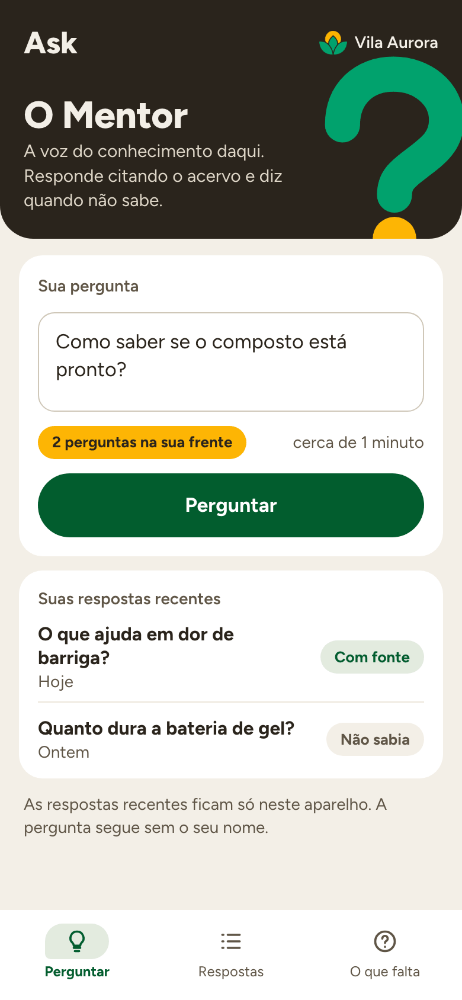 | 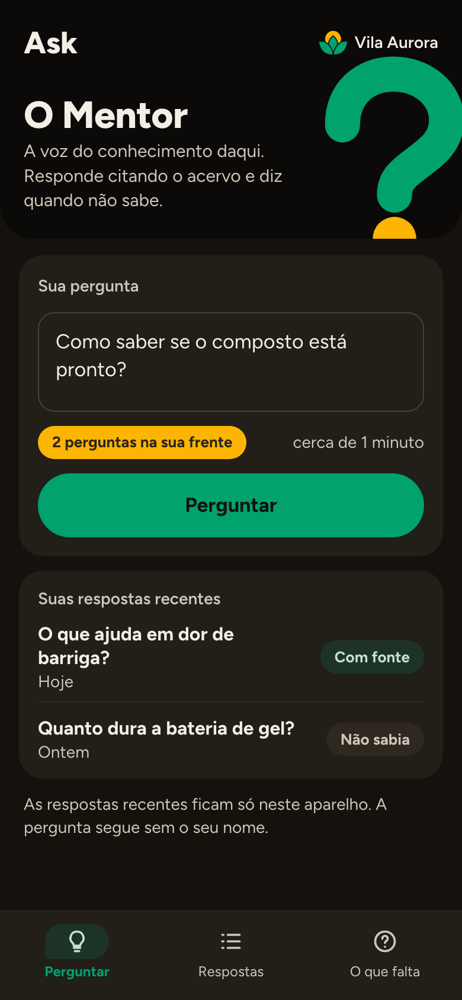 |

**What the person sees.** The dark cover with the Ask glyph, the title "O Mentor" and the line "A voz do conhecimento daqui. Responde citando o acervo e diz quando não sabe." Under it, a card with the field "Sua pergunta", the queue as it stands now, "2 perguntas na sua frente", with a rough time beside it, "cerca de 1 minuto", and the button "Perguntar". Then "Suas respostas recentes", each with its time and a mark: "Com fonte", "Não sabia" or "Da internet". At the bottom, the sentence "As respostas recentes ficam só neste aparelho. A pergunta segue sem o seu nome."

**What they can do.** Write a question and send it, which opens the answer in its writing state. Open a recent answer. Go to "Respostas" or "O que falta" by the bar, or to the portal by the community's name.

**States.**

- Nobody in the queue: the chip reads "Ninguém na sua frente".
- The Mentor is getting ready after starting: "O Mentor está se preparando. Pode perguntar: a pergunta espera na fila."
- The queue is paused because a large meeting is using the smallest machine: "A fila está parada enquanto acontece uma reunião da comunidade. Sua pergunta não perde o lugar."
- The Mentor is off: the next section.
- The person already has a question waiting: "Espere a resposta da sua pergunta anterior." How many questions one person may have waiting is **Not decided**.
- No answers on this device yet: "Suas respostas vão aparecer aqui, só neste aparelho."
- No link with the community: the notice "Sem ligação com a comunidade." in its fixed place. The recent answers can still be read, and the field keeps what was written. Whether a question written with no link waits in the outbox and goes by itself is **Not decided**.

The question never meets the notice "Agora não dá para…": asking counts nothing and has one owner, so it never waits for the machines of the list.

**Who may.** Residents, moderators, administrators and curators ask with the same rules. A child asks too, with the rule for children on risk subjects.

**Writes and reads.** Asking writes nothing in the journal. It reads the length of the queue from the machine that carries the Mentor, and the recent answers from the device.

**Many machines.** The page is light and every machine serves it. The queue lives with the Mentor: the core of the machine the device reaches passes the question to the machine that carries the Mentor and brings the answer back. If more than one machine can carry it, the question goes to whichever is up. **Proposed.**

### Mentor unavailable

**Path:** `/ask/`, as a state of the home. **Proposed.**

| Light | Dark |
| --- | --- |
| 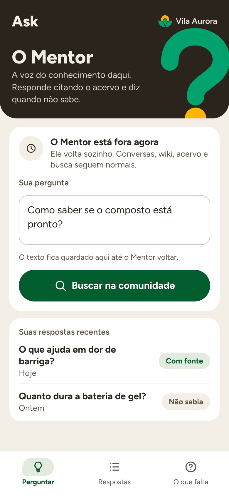 | 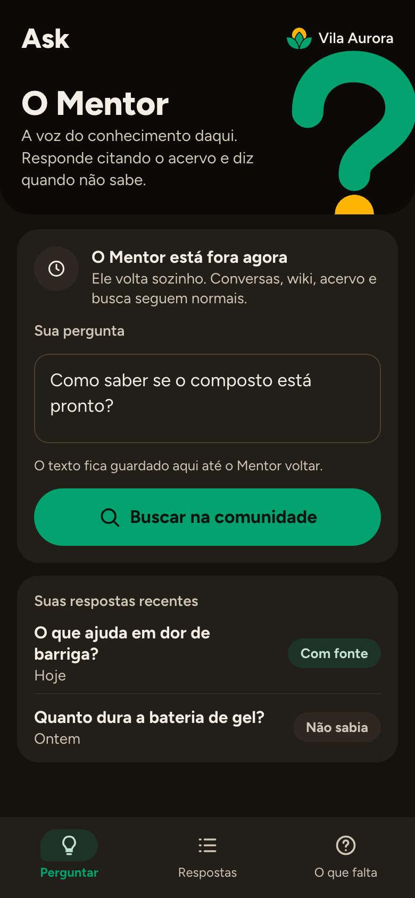 |

**What the person sees.** The same home, with the state at the top of the card: "O Mentor está fora agora", and under it "Ele volta sozinho. Conversas, wiki, acervo e busca seguem normais." The field keeps the question, with the line "O texto fica guardado aqui até o Mentor voltar." The main button becomes "Buscar na comunidade". The recent answers stay in sight, because they live on the device.

**What they can do.** Search the community with the words of the question, which opens the search of the whole community. Read the recent answers. Come back later: the home changes back by itself when the Mentor returns, and the question is still in the field.

**States.** The core knows the Mentor is up by asking it for a sign of life. When the machine that carries it does not answer, the home shows this state. When the Mentor answers that it is still loading, the home shows "O Mentor está se preparando" instead. Whether a question written now can be left to go by itself when the Mentor returns is **Not decided**; the drawing keeps the text in the field and sends nothing.

**Who may.** Everyone who may ask.

**Writes and reads.** Nothing is written. The search reads the search index on the machine the device reaches. The search of what people wrote in conversations is **Built**; the search of the wiki and the collection is **Proposed**.

**Many machines.** This is the state the rule of many machines produces: the machine that carries the Mentor is off, so only the Mentor is off. With the community split in two, the side where the Mentor lives asks as usual and the other side sees this state. The screen never names a machine.

### An answer being written

**Path:** `/ask/answers/<id>`, where the id is local to the device. **Proposed.**

| Light | Dark |
| --- | --- |
| 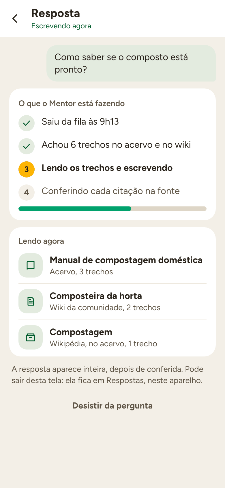 | 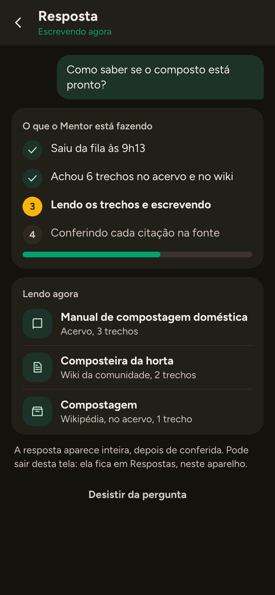 |

**What the person sees.** The inner header "Resposta" with "Escrevendo agora" under it, the question as a bubble, and a card "O que o Mentor está fazendo" with four steps: out of the queue, passages found, "Lendo os trechos e escrevendo", and "Conferindo cada citação na fonte", with a bar of progress. Under it, "Lendo agora": the titles of what is being read and where each comes from, such as "Manual de compostagem doméstica, Acervo, 3 trechos" and "Composteira da horta, Wiki da comunidade, 2 trechos". Then "A resposta aparece inteira, depois de conferida. Pode sair desta tela: ela fica em Respostas, neste aparelho."

**What they can do.** Wait, leave, or "Desistir da pergunta", which takes it out of the queue. Leaving loses nothing: when the person comes back to Ask, the device fetches the answer with its delivery id.

**States.**

- In the queue: the first step reads "2 perguntas na sua frente" and the header "Na fila".
- The queue is paused by a large meeting: the same sentence as on the home.
- The Mentor went off before finishing: "O Mentor saiu do ar antes de terminar. Sua pergunta continua aqui. Toque em Perguntar quando ele voltar."
- The answer is ready: the screen becomes the answer, whole.

How long the machine holds a finished answer that the device has not fetched is **Not decided**, and so is whether the device is notified when Ask is closed.

**Who may.** The person who asked, on the device that asked. Nobody else can open it, because nothing outside that device knows the id.

**Writes and reads.** Nothing in the journal. The device keeps the question and the delivery id until the answer arrives.

**Many machines.** The steps come from the machine that carries the Mentor. If the device moves to another machine while it waits, the answer still comes back through the core of whichever machine it reaches. **To prove.**

### A full answer

**Path:** `/ask/answers/<id>`. **Proposed.**

| Light | Dark |
| --- | --- |
| 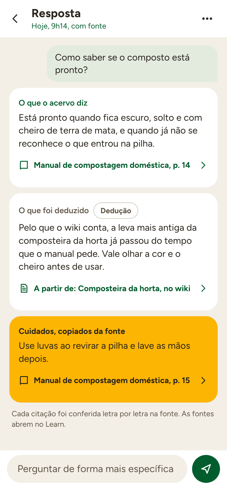 | 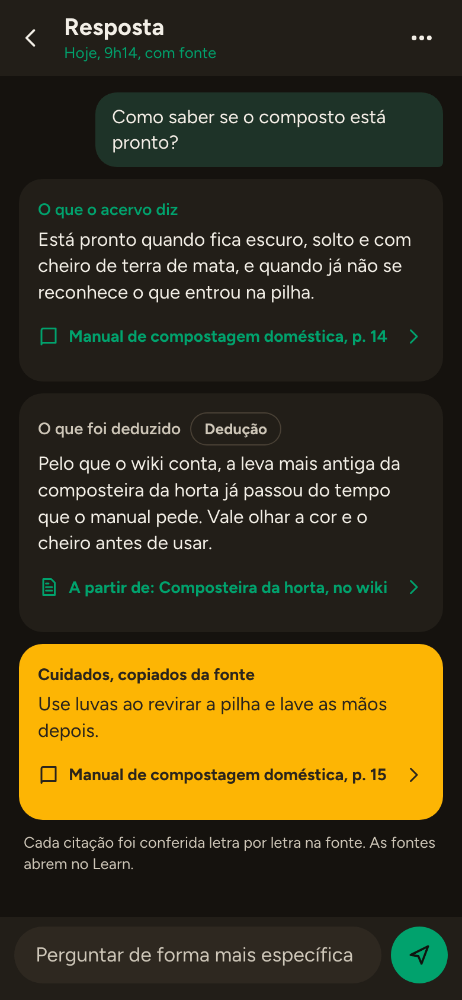 |

**What the person sees.** The header "Resposta" with the time and "com fonte". The question. Then the three parts, each in its card:

- "O que o acervo diz": the claims, each followed by its source as a link, such as "Manual de compostagem doméstica, p. 14".
- "O que foi deduzido", with the mark "Dedução": what comes from crossing sources, followed by "A partir de:" and the sources it was drawn from.
- "Cuidados, copiados da fonte", in the sun color with dark text, followed by the source they were copied from.

Under them, "Cada citação foi conferida letra por letra na fonte. As fontes abrem no Learn." At the bottom, the field "Perguntar de forma mais específica", or "Continuar a conversa" when the Mentor works as a conversation.

**What they can do.** Open a source, which opens Learn at the cited passage: the reader of the collection for a book or a manual, the page of the wiki for a wiki source. Ask again from the answer. Delete this answer from the device, from the menu at the top.

**States.**

- A part has nothing in it: the card does not appear. An answer with only deductions keeps the mark "Dedução" on all of it.
- The checker took a claim out: the hint adds "Uma parte saiu porque não estava na fonte."
- The checker took every claim out: the answer becomes "Não sei", as in the next section.
- A risk subject for an adult, with the warning passage in the same document: the three parts as drawn, with "Assunto de saúde" or the subject's name in the header, and any dose only inside the care, copied from the source.
- A risk subject with no warning passage: "Não sei", and the question goes to "O que falta".

A citation can exist and still not support the conclusion. The checker cannot see that; the test of real questions with known answers measures it. **To prove.**

**Who may.** The person who asked, on this device.

**Writes and reads.** The answer, with its sources, is kept on the device. Opening a source reads the wiki or the collection like any other page of Learn.

**Many machines.** Once on the device, the answer opens with no machine at all. A source opens on any machine that carries that part of the collection; the wiki is on every machine.

### An answer with no source

**Path:** `/ask/answers/<id>`. **Proposed.**

| Light | Dark |
| --- | --- |
| 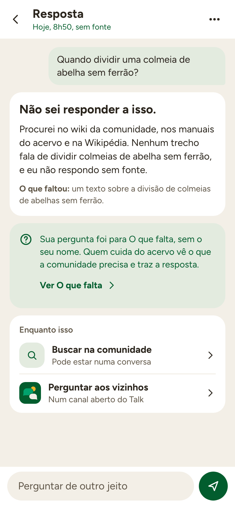 | 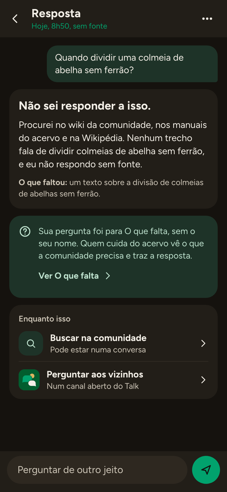 |

**What the person sees.** The header with "sem fonte". A card that starts with "Não sei responder a isso.", says where the Mentor looked, the wiki, the manuals of the collection and the encyclopedia, and that it does not answer without a source. Then "O que faltou:", in the Mentor's words, what kind of text would have answered. A soft card says "Sua pergunta foi para O que falta, sem o seu nome. Quem cuida do acervo vê o que a comunidade precisa e traz a resposta.", with the link "Ver O que falta". Under "Enquanto isso", two ways on: "Buscar na comunidade", because someone may have spoken of it in a conversation, and "Perguntar aos vizinhos", in an open channel of Talk. At the bottom, "Perguntar de outro jeito".

**What they can do.** See "O que falta", search the community, open Talk, or ask in other words.

**States.**

- A child asked: the soft card is not shown, because a child's question never goes to "O que falta".
- The search door is open and the subject is not a risk subject: the Mentor looks outside before saying it does not know, and the answer becomes the one in the section on the internet.

For a common subject with no source and no internet, the vision of the project lets the Mentor answer with a warning that it did not come from the collection, while the path of a question only lets a claim with no citation in as a deduction. Which one holds is **Not decided**. The drawing shows the strict reading.

**Who may.** Everyone who may ask.

**Writes and reads.** The question goes, with no name, to the usage record that feeds "O que falta". Nothing goes in the journal.

**Many machines.** As for every answer. Where "O que falta" lives with many machines is **Not decided**; see that screen.

### A risk subject, for a child

**Path:** `/ask/answers/<id>`. **Proposed**, on the maintainer's decision about children and the Mentor.

| Light | Dark |
| --- | --- |
| 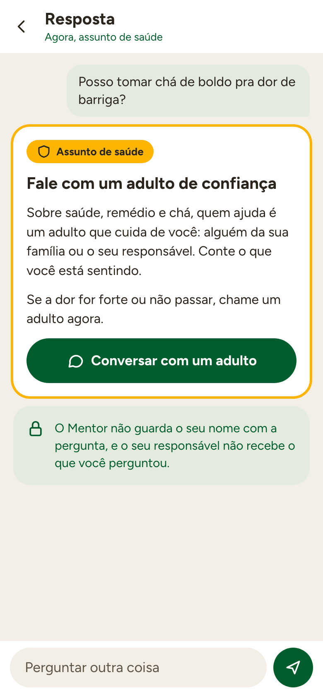 | 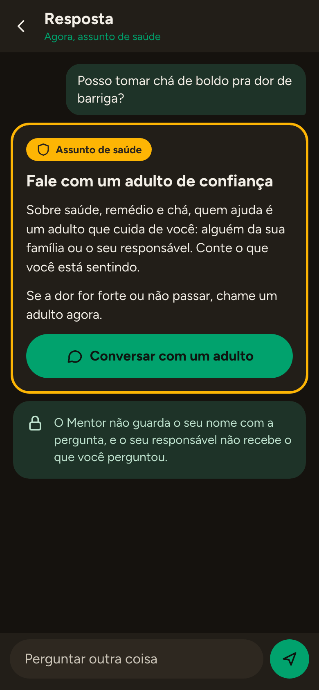 |

**What the person sees.** The header with "assunto de saúde". The question. One card, ringed in the sun color, with the chip "Assunto de saúde", the title "Fale com um adulto de confiança", the sentence that the person who helps with health, medicine and teas is an adult who looks after the child, someone of the family or the guardian, and "Se a dor for forte ou não passar, chame um adulto agora." The button "Conversar com um adulto" opens Talk, where a child only sees the adults the guardian authorized. A soft card says "O Mentor não guarda o seu nome com a pergunta, e o seu responsável não recebe o que você perguntou." There is no dose, no instruction and no source to open.

**What they can do.** Open a conversation with an authorized adult in Talk, or ask something else.

**States.** The sentence names the subject the list of risk words found: health, electricity, gas, poison and the others. The same card appears whether or not the collection has a source, because a child never receives the instruction. If the child's account cannot reach any authorized adult in Talk, the button is not shown and the sentence stays.

**Who may.** It appears only for a child's account. An adult who asks the same question gets the answer of the previous sections.

**Writes and reads.** Nothing in the journal, nothing in the usage record and nothing in "O que falta". The mark of child lives in memory until the answer is delivered and then disappears. The answer is kept on the device like any other.

**Many machines.** As for every answer.

### An answer from the internet

**Path:** `/ask/answers/<id>`. **Proposed.**

| Light | Dark |
| --- | --- |
| 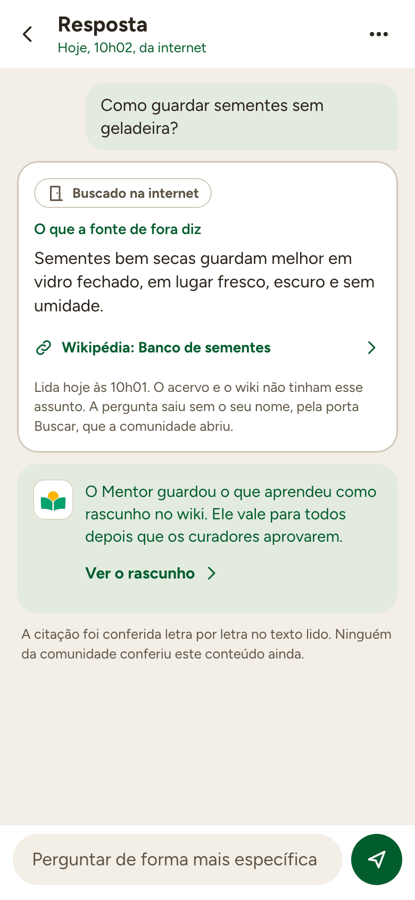 | 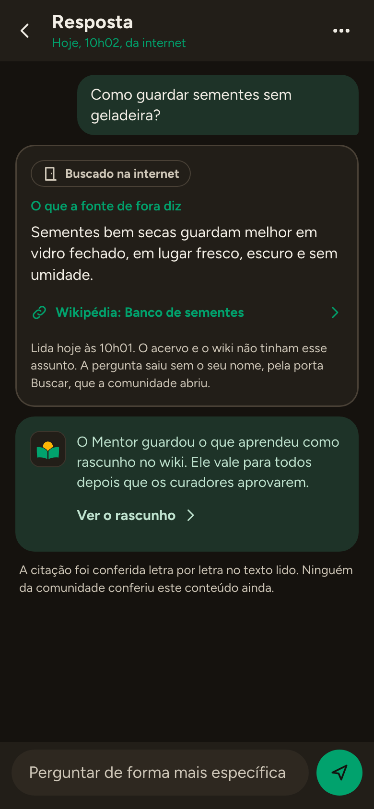 |

**What the person sees.** The header with "da internet". The card is drawn with a border and starts with the mark "Buscado na internet". The first part is called "O que a fonte de fora diz" instead of "O que o acervo diz", followed by the outside source as a link, and the line "Lida hoje às 10h01. O acervo e o wiki não tinham esse assunto. A pergunta saiu sem o seu nome, pela porta Buscar, que a comunidade abriu." A soft card says "O Mentor guardou o que aprendeu como rascunho no wiki. Ele vale para todos depois que os curadores aprovarem.", with "Ver o rascunho". The last line says the citation was checked letter by letter in the text that was read, and that nobody in the community has checked the content yet.

**What they can do.** Open the outside source, which shows the text as it was read and kept with the draft, so it opens with no internet. Open the draft. Ask again.

**States.**

- The door "Buscar" is shut: this answer never appears, and the question with no source gets "Não sei".
- A risk subject: an outside text carries none of the marks a curated pack puts on its warning passages, so by the rule of risk subjects it cannot answer one, and the Mentor says it does not know. **Proposed**, a reading of that rule.
- A child asked: the question never goes out.
- The outside source also had nothing: "Não sei", as in the section on no source.

**Who may.** Everyone who may ask, except a child, whose question never leaves the community. Opening the door is a decision of the community, carried out by an administrator; see [administration](admin.md).

**Writes and reads.** A program with no artificial intelligence searches a closed list of sources the community approved and hands the text to the Mentor as one more passage. Only the question goes out, with no name. The program writes a draft in the wiki, in the Mentor's own words, with the sources and the date they were read. That draft is an entry in the journal, authored by the Mentor and not by the person who asked.

**Many machines.** The search goes out through the machine whose door is open. With many machines, which machine that is, and whether it must be the one that carries the Mentor, is **Not decided**. Writing the draft in the wiki never waits.

### Answers

**Path:** `/ask/answers`. **Proposed.**

| Light | Dark |
| --- | --- |
| 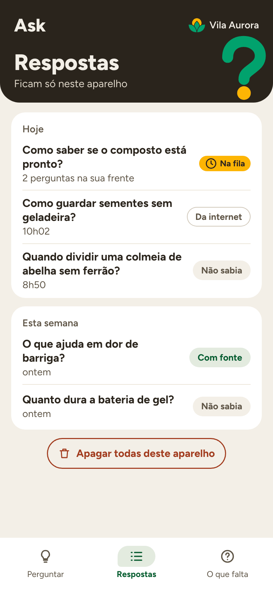 | 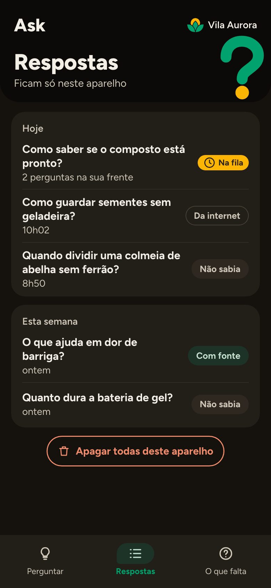 |

**What the person sees.** A slim cover with "Respostas" and "Ficam só neste aparelho". The answers grouped by "Hoje" and "Esta semana", each with the question, its time and a mark: "Na fila", with the place in the queue under the question, "Da internet", "Não sabia" or "Com fonte". At the end, the button "Apagar todas deste aparelho", drawn with the border of what cannot be undone.

**What they can do.** Open an answer, or one still in the queue. Delete all answers from the device: the button asks first, "As respostas somem deste aparelho e não voltam.", with "Apagar todas" and "Cancelar".

**States.**

- Empty: "Nenhuma resposta neste aparelho ainda."
- No link with the community: the notice, and the list opens as usual, because it lives on the device.
- A question written with no link, if the outbox takes questions: it would show "Ainda não enviada" where the time is. **Not decided.**

How long answers stay and how many are kept is **Not decided**. So is whether they are encrypted with the passphrase or kept in the vault, which would let them survive a lost phone and follow the person to another device. Today's design keeps them in the device's storage, where anyone holding the unlocked device can read them.

On the iPhone, each icon has storage of its own, so the answers asked from the Ask icon stay in that icon, and those asked in Safari stay in Safari. **Inference**, from the test on a real iPhone described in [apps on one address](../design/apps.md).

**Who may.** The person holding the device. No other person and no administrator can see this list, because it exists only on the device.

**Writes and reads.** It reads and deletes only the device's storage. Nothing in the journal.

**Many machines.** It needs no machine.

### O que falta

**Path:** `/ask/gaps`, and `/ask/gaps/<group>` for one group. **Proposed.**

| Light | Dark |
| --- | --- |
| 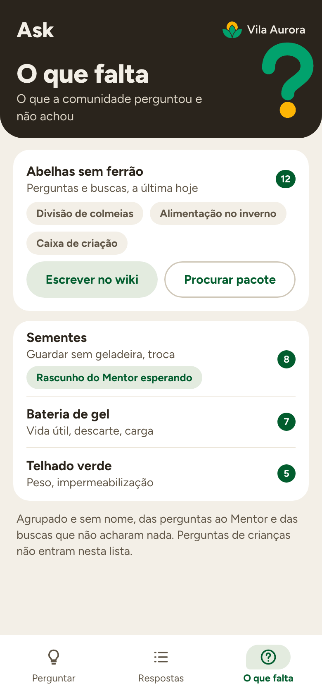 | 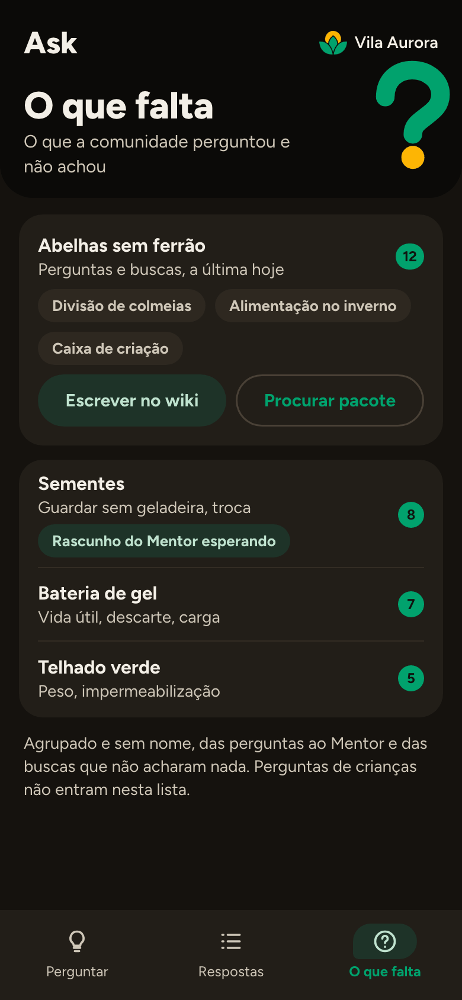 |

**What the person sees.** A slim cover with "O que falta" and "O que a comunidade perguntou e não achou". The groups, most asked first, each with a subject, a few words for what people wanted to know and the number of questions and searches in it. The group drawn open, "Abelhas sem ferrão", shows its points as chips, "Divisão de colmeias", "Alimentação no inverno", "Caixa de criação", and two buttons, "Escrever no wiki" and "Procurar pacote". A group can carry the mark "Rascunho do Mentor esperando" when the Mentor already proposed a text for it. At the end, "Agrupado e sem nome, das perguntas ao Mentor e das buscas que não acharam nada. Perguntas de crianças não entram nesta lista."

**What they can do.** Open a group. Write a wiki page for it, which opens the editor of the wiki in Learn with the subject filled in. Look in the catalog for a pack that covers it, which opens the collection in administration. Open the Mentor's draft for a group that has one.

**States.**

- Empty: "Nada faltando agora. Quando o Mentor ou a busca não acharem algo, aparece aqui."
- A group with a draft waiting: the mark, and the draft opens from the group.
- The Mentor is off: the list still opens if it lives in the journal, and is off with the Mentor if it lives in the usage record of its machine. Which one is **Not decided**.

How questions are grouped, and when a group leaves the list, after a page is approved or a pack arrives, is **Not decided**. Whether a curator sees the words of each question or only the grouped subjects is **Not decided**; the drawing shows only the subjects, because the words of a question can point to a person.

**Who may.** Every resident, moderator, administrator and curator reads the list. Whether a child reads it is **Not decided**. Anyone who may write in the wiki may write from here. Adding a pack to the collection is for the administrator; whether a curator may also do it is **Not decided**.

**Writes and reads.** It reads the questions with no answer and the searches that found nothing, without names. It writes nothing; writing happens in Learn or in administration.

**Many machines.** It depends on where the list lives, **Not decided** as above. The searches that feed it happen on every machine.

### A draft the Mentor proposes

**Path:** `/ask/drafts/<id>`. The approval itself happens in Learn's drafts of the wiki; see [Learn](learn.md). **Proposed.**

| Light | Dark |
| --- | --- |
| 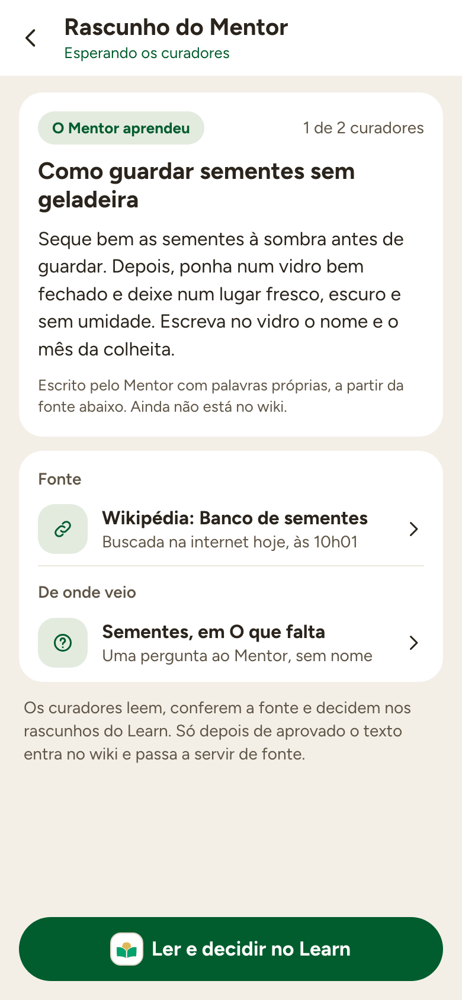 | 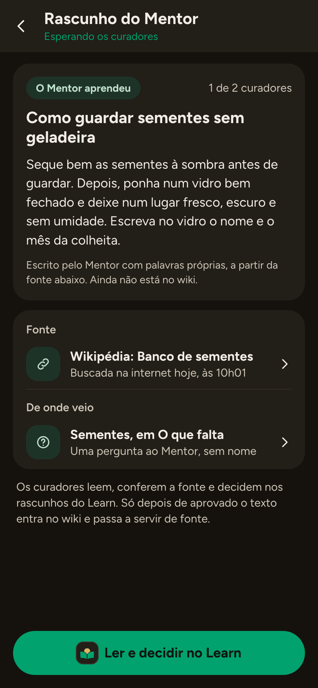 |

**What the person sees.** The inner header "Rascunho do Mentor" with "Esperando os curadores". A card with the mark "O Mentor aprendeu", how many curators approved so far, such as "1 de 2 curadores", the title and the text the Mentor wrote, and "Escrito pelo Mentor com palavras próprias, a partir da fonte abaixo. Ainda não está no wiki." Then "Fonte", the outside source with the day and hour it was read, and "De onde veio", the group of "O que falta" it answers and "Uma pergunta ao Mentor, sem nome". The sentence "Os curadores leem, conferem a fonte e decidem nos rascunhos do Learn. Só depois de aprovado o texto entra no wiki e passa a servir de fonte." At the bottom, "Ler e decidir no Learn".

**What they can do.** Read the draft and its source. A curator opens it in Learn's drafts to approve or refuse. A resident who is not a curator sees the same screen with "Ver nos rascunhos do Learn".

**States.**

- Waiting: as drawn.
- Approved: "Aprovado. Já está no wiki.", with a link to the page, which from then on is a source like any other.
- Refused: "Recusado pelos curadores. O assunto continua em O que falta."

How many curators must approve is **Not decided**; the drawing shows two as an example.

**Who may.** Every resident reads it; whether a child does is **Not decided**. Approving and refusing are given by the community's charter.

**Writes and reads.** It reads the draft from the wiki in the journal. It writes nothing; each approval is written in Learn, with the name of the curator who gave it.

**Many machines.** The draft is in the wiki, so every machine shows it, with or without the Mentor.

## Flows

### Asking

1. Ana opens Ask from its icon. The home shows "2 perguntas na sua frente".
2. She writes "Como saber se o composto está pronto?" and taps "Perguntar". The device sends the question over its signed in connection; the core checks that she may ask and whether her account is a child's, and passes the question on with a random delivery id.
3. The screen becomes the answer in its writing state, and "Respostas" shows the question as "Na fila".
4. The question leaves the queue. The program finds passages in the wiki and the collection, the Mentor reads them and writes in a fixed format, and the checker compares each citation with its passage.
5. The answer appears whole and is kept on her device. The delivery id, the child mark and her count in the queue disappear from the machine.

If Ana closes Ask at step 3 or 4, her device fetches the answer with the delivery id the next time she opens it. If the Mentor is off at step 2, the home shows the state of the Mentor unavailable and offers the search instead.

### An answer with sources

1. The answer shows "O que o acervo diz", "O que foi deduzido" and "Cuidados, copiados da fonte", each followed by its source.
2. Ana taps "Manual de compostagem doméstica, p. 14". Learn opens the reader of the collection at the cited passage.
3. Back in Ask, she writes in "Perguntar de forma mais específica". In question and answer, it is a new question. In a conversation, her device sends the three previous questions and answers with it, and the new answer passes through the same checker.

### A question with no answer feeding "O que falta"

1. Bia asks "Quando dividir uma colmeia de abelha sem ferrão?". No passage answers it.
2. The answer reads "Não sei responder a isso.", says where the Mentor looked and what was missing, and that the question went to "O que falta" without her name.
3. The question's text joins the group "Abelhas sem ferrão", next to other questions and to searches that found nothing. Bia's name never travels with it.
4. Neide, who curates the collection, opens "O que falta", sees the group at the top and taps "Escrever no wiki". She writes the page in Learn, and it follows the wiki's approval.
5. Once the page is in the wiki, the next person who asks gets an answer with a source.

If Bia's account were a child's, step 3 would not happen.

### Approving a draft of the Mentor

1. The community opened the door "Buscar". Caio asks "Como guardar sementes sem geladeira?". Nothing in the wiki or the collection answers.
2. A program with no artificial intelligence searches the closed list of approved sources, sending only the question, and hands the text it found to the Mentor as one more passage.
3. Caio gets an answer marked "Buscado na internet", with the source and the hour it was read.
4. The program writes a draft in the wiki, in the Mentor's own words, with the source. The group "Sementes" in "O que falta" shows "Rascunho do Mentor esperando".
5. Rita, a curator, opens the draft from Ask or from Learn, reads the source and approves in Learn's drafts. Joel, another curator, does the same. Each approval is an entry with the curator's name.
6. With the approvals the charter asks for, the draft becomes a wiki page and a source for the next answers. If the curators refuse, it stays out and the subject stays in "O que falta".

An approval is a fact that stacks, like a vote in the open, so it never waits for the machines of the list. **Proposed**, a reading of the rule of [many machines](../design/many-machines.md); the screen of approval belongs to [Learn](learn.md).

## Who may do what

Curator is a role **Proposed** for the people the charter lets approve what the Mentor and others propose to the wiki. It is not one of the four roles the code knows today.

| Action | Resident | Child | Moderator | Administrator | Curator |
| --- | --- | --- | --- | --- | --- |
| Ask the Mentor | Yes | Yes, with the rule for children on risk subjects | Yes | Yes | Yes |
| Read and delete the answers on one's own device | Yes | Yes | Yes | Yes | Yes |
| Read "O que falta" | Yes | Not decided | Yes | Yes | Yes |
| Write in the wiki from "O que falta" | Yes | By the charter | Yes | Yes | Yes |
| Add a pack to the collection | No | No | No | Yes | Not decided |
| Read a draft of the Mentor | Yes | Not decided | Yes | Yes | Yes |
| Approve or refuse a draft of the Mentor | By the charter | No | By the charter | By the charter | Yes |
| Open the door "Buscar" | No | No | No | Only with the community's decision | No |

## Not decided

- The models the Mentor runs at each level of machine. The choice comes from a test of real questions in Portuguese with known answers, including questions the collection cannot answer.
- How long the answers stay on the device, and how many are kept.
- Whether the answers are encrypted with the passphrase or kept in the vault.
- How long the machine holds a finished answer that the device has not fetched, and whether the device is notified when Ask is closed.
- How many questions one person may have waiting at once.
- Whether a question written with no link, or while the Mentor is off, waits on the device and goes by itself later.
- Whether, on a common subject with no source and no internet, the Mentor may add what it thinks, marked as not coming from the collection.
- Which sources the door "Buscar" may reach.
- With many machines, which machine opens the door "Buscar", and whether it must be the one that carries the Mentor.
- How many curators approve a draft.
- How "O que falta" groups questions, and when a group leaves the list.
- Whether a curator sees the words of each question in "O que falta", or only the grouped subjects.
- Whether "O que falta" is written in the journal, so every machine shows it, or kept in the usage record of the machine that carries the Mentor, so it is off with the Mentor.
- Whether a child reads "O que falta" and the drafts of the Mentor.
- Whether a curator may add a pack to the collection.
- Where the button to add Ask to the phone sits inside the app. The approved home has none; the portal carries it.

## To prove

- The time of an answer on the smallest machine that runs the Mentor, and how many questions a day it takes.
- The test of real questions: right citations, right refusals, conclusions the citations support, and speed on each machine.
- On the iPhone, that the answers asked from the Ask icon stay in that icon across days.
- An answer that returns through another machine when the device moved while waiting.
