# Notices and behavior

This document is how every screen behaves, whatever app it belongs to: what a person sees when the device has no link to the community, what happens to what they write meanwhile, how a page stays current, what waits for the machines and what never does, how deletion looks, in what order messages appear, what a page does when the system cannot write, how an app gets onto the phone, and the accessibility rules every screen keeps. Each area document refers here instead of repeating it.

The rules come from [principles](principles.md), and the mechanisms behind them from the design notes: [the core](../design/core.md), [how the machines live together](../design/machines.md), [many machines, one community](../design/many-machines.md) and [four apps on one address](../design/apps.md). Every claim carries its mark: **Built**, **Proposed**, **To prove** or **Not decided**.

## The four notices

| Notice | Shows when | Goes away when | What it says | Where |
| --- | --- | --- | --- | --- |
| No link with the community | The device cannot reach the community | The device reaches it again, by itself | "Sem ligação com a comunidade." | A band under the header of the page |
| Not sent yet | A message is in the device's outbox | The community has written it | "Ainda não enviada" | Where the message's time would be |
| Arrived later | A message joined a conversation after messages written later were already there | **Not decided** | "Chegou depois" | Beside the message's time |
| Not now | Something counted cannot be done now | The person tries again and it works, or leaves the page | "Agora não dá para…", why, and what happens next | At the top of the form or the action that was refused |

None of them mentions a machine. Each keeps its sentence and its place in the four apps, on the portal and on the pages of no app. Their words, like every text, live in the [locales](../../locales). **Proposed** as a whole; the sentences of "Not now" for creating an account and changing a role are **Built**, and with the four notices they wait for the maintainer's visual approval.

### No link with the community

**Path:** any page. Drawn on a personal conversation in Talk, `/talk/` and the conversation with Marta.

| Light | Dark |
| --- | --- |
| 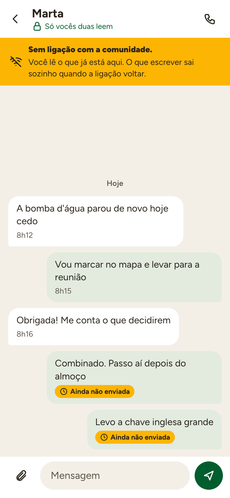 | 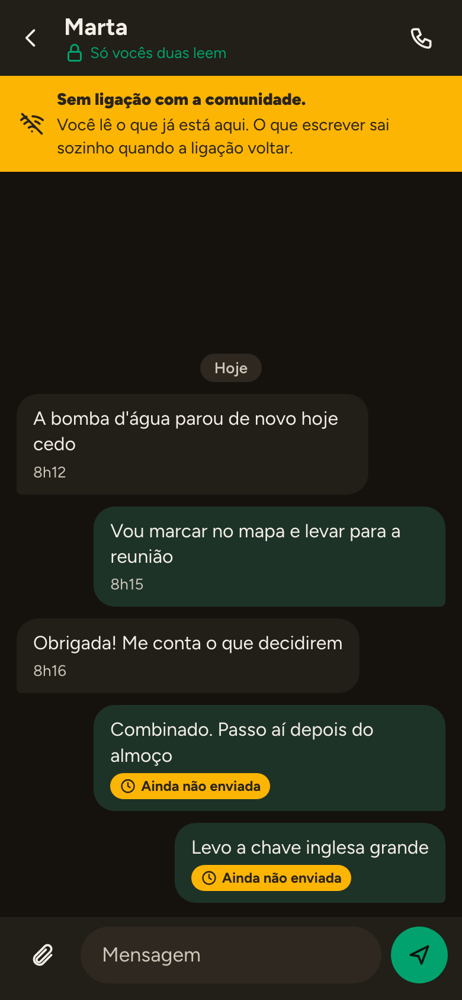 |

**What the person sees.** The conversation's inner header. Right under it, a full band in the sun color with dark text: the no link icon, "Sem ligação com a comunidade." in bold, and under it "Você lê o que já está aqui. O que escrever sai sozinho quando a ligação voltar." Then the conversation as it was, and at its end the two messages Bia wrote since the link dropped, each with "Ainda não enviada" where the time would be. The field to write stays open.

**What they can do.** Read everything already on the device. Write: what they send goes to the outbox and shows in the conversation at once. Delete a message that has not gone out. What needs the community, such as starting a call, asking the Mentor or creating an account, cannot be done; how each such control answers is **Not decided**, and the rule is that it never fails without a word.

**States.**

- Showing: the band appears under the header of whatever page is open, and stays in place while the page scrolls. **Proposed.**
- Going away: when a request reaches the community again, or the live connection reopens, the band leaves by itself and the outbox starts going out. Nobody presses anything. **Proposed.**
- On the portal and on a page of no app, the band sits under the community's header. **Proposed.**

**How the device knows.** **Proposed.** The device has no link when its live connection dropped and reopening it failed, or when a request to the community's address got no answer at all. A refusal with an answer, such as a page that says the system is read-only, is not a lack of link. The browser's own online flag is not enough on its own: a phone on the community's Wi-Fi often says it has no internet while it reaches the community well, and a phone on mobile data can say it is online while the community is out of reach. How long the device waits before showing the band, so a drop of a second does not make it blink, is **Not decided**.

**Who may.** Everyone sees it, on every role.

**What it writes and reads.** Nothing on any machine. On the device, it reads what the device keeps (see [a device with no link](#a-device-with-no-link)).

**Many machines.** The band means that no machine of the community answers the device. While any machine answers, the band does not show, even if other machines are away: what the person can or cannot do then is the business of "Not now".

### Not sent yet, and arrived later

**Path:** any conversation. Drawn on the open channel Horta coletiva, in Talk, a moment after the link returned.

| Light | Dark |
| --- | --- |
| 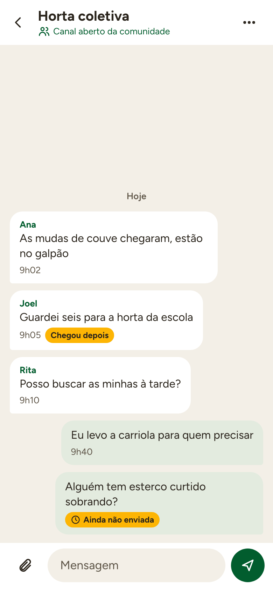 | 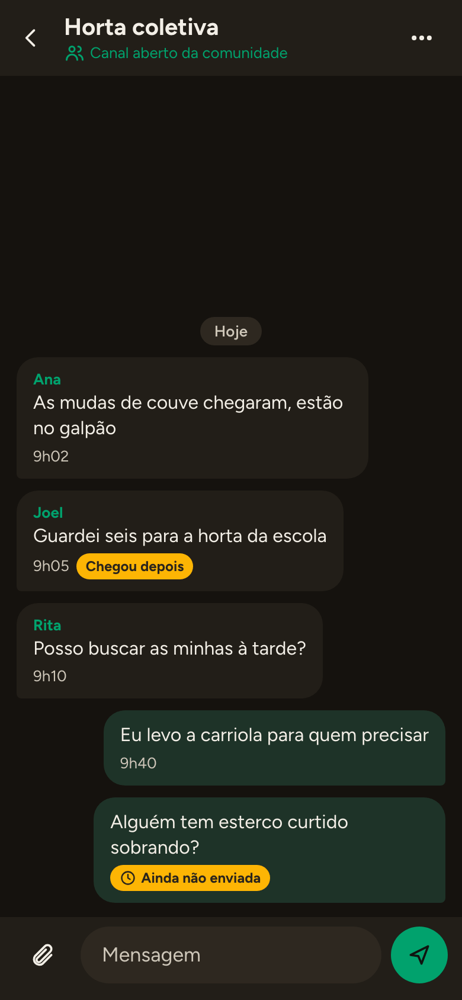 |

**What the person sees.** The band is gone, because the link is back. Joel's message, written at 9h05 on the other side of a split, arrived after Rita's message of 9h10 was already on the screen: it sits in its place by time, between Ana's and Rita's, with "Chegou depois" in the sun color beside its time. Bia's first message from the outbox has just gone out and shows its time, 9h40, the moment the community wrote it. Her second one is still going out and keeps "Ainda não enviada", in a quiet chip with a clock.

**What they can do.** Read and write as always. The marks are information, not buttons.

**States.**

- "Ainda não enviada": from the moment a message goes into the outbox until the community has written it. Then the mark becomes the time. **Proposed.**
- The message is refused when it goes out: it stays on the device, the mark becomes "Não foi enviada" with the reason, and the person can copy the text or delete it. Nothing a person wrote is dropped in silence. **Proposed**; the words are **Not decided**.
- "Chegou depois": the message takes its place by its time, which is **Built** on the page and in the index. The mark itself is **Proposed**. Whether it is decided by each machine, when it applies the entry, or by each device, from what that person had already seen, is **Not decided**, and so is how long the mark stays.

**Who may.** Everyone who can read the conversation.

**What it writes and reads.** The outbox message becomes a `message.created` entry when it goes out (**Built** for messages sent with a link). The mark "Chegou depois" writes nothing: it is computed. The order reads the time of each entry (**Built**).

**Many machines.** "Chegou depois" exists because of them: a message written on a machine that was away, or on the other side of a split, reaches the others later and goes into its place. **Built** for the place; see [picking up live](../design/machines.md#picking-up-live).

The kit draws "Ainda não enviada" as a quiet chip, while principles give the four notices the sun color. Which holds is **Not decided**, with the visual approval of the notices.

### Not now

**Path:** any form whose act is counted. Drawn on creating an account, `/sign-up`.

| Light | Dark |
| --- | --- |
| 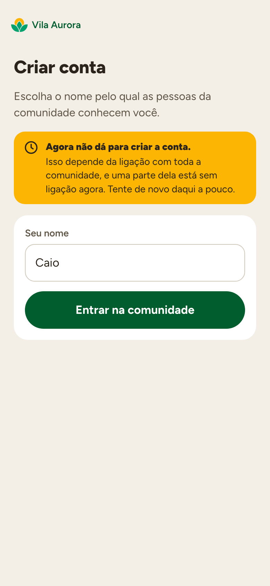 | 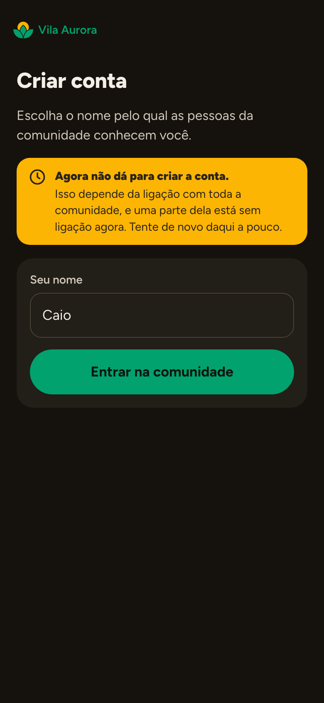 |

**What the person sees.** The community's header, the title "Criar conta" and its line. Then, before the form, a card in the sun color with a clock: "Agora não dá para criar a conta." in bold, and "Isso depende da ligação com toda a comunidade, e uma parte dela está sem ligação agora. Tente de novo daqui a pouco." Under it the form, with the name Caio typed still in the field, and "Entrar na comunidade".

**What they can do.** Try again, with what they typed kept. Leave. Nothing was saved and nothing is waiting in a queue.

**States.**

- Creating an account: the sentence above. **Built**.
- Changing a role: "Agora não dá para trocar o papel. Isso depende da ligação com toda a comunidade, e uma parte dela está sem ligação agora. Tente de novo daqui a pouco." **Built**.
- Closing and counting a vote, a secret ballot, changing the charter, adding a machine, approving a fix to the machine: the same shape, "Agora não dá para…", why, and what happens next. **Proposed**; each sentence belongs to the area of the act. For a vote whose deadline passed, the next step is that the result shows when the link returns, and no vote is lost.
- The answer was lost on the way: the act may have been done. A sign up carries a random mark, so the machine that asked looks for an account with it, and for a role it looks for the role; it says not now only when that does not arrive. **Built**.

**Who may.** Whoever may do the act. A person who may not do it gets the refusal of their role, "Seu papel não permite isso." (**Built**), never "Not now".

**What it writes and reads.** Nothing, when it says not now. That is the point of it.

**Many machines.** The act waits for the machines that count. Today that is machine 0 alone (**Built**); with listed machines, it is every listed machine able to see the others (**Proposed**). See [many machines](#many-machines).

## The outbox

The outbox is the part of the device that keeps what the person wrote while there was no link, and sends it when the link returns. It is how "nothing a person wrote is lost" holds. None of it is built: the device keeps nothing today. **Proposed**, from [principles](principles.md#nothing-a-person-wrote-is-lost) and [many machines](../design/many-machines.md#the-computers-of-a-community).

**What goes in.** Messages, in open channels and in personal conversations, written while the device has no link. A personal message goes in already encrypted, because what is personal is encrypted on the device before it leaves it. What is counted never goes in: an account, a role, the close of a vote, a secret ballot, the charter, a machine. Those answer with "Not now", because nothing sits in a hidden queue. Whether the other acts that never wait go in too, a wiki edit, a report on the map, a note in the collection, an open vote, an alert to everyone, is **Not decided**; so is whether attachments go in, and how large.

**How it is shown.** In the conversation where it was written, at the end, in the order of writing, with "Ainda não enviada" where the time would be. In the list of conversations, the row shows the person's last message with the same mark. Whether there is also a screen that lists the whole outbox is **Not decided**.

**When it goes out.** By itself, as soon as the device reaches the community, in the order it was written, one message after the other. It goes out while a page or the icon of that app is open: a browser on the iPhone gives a page no time in the background, and whether to use the background sending that Chrome on Android offers is **Not decided**. Each message carries a random mark chosen by the device, so a message sent twice after a dropped Wi-Fi is written once; the architecture asks for it and messages do not carry it yet. The machine writes the message with its own time, later than everything it has seen (**Built** for every entry), so a message written offline at 9h12 and sent at 9h40 shows 9h40, and goes under the messages that reached the conversation meanwhile. Whether the device also keeps and shows the time it was written is **Not decided**.

**When it fails.** A message that the machine refuses when it goes out, because the person may no longer write there or the content is refused, stays on the device with "Não foi enviada" and the reason, and the person copies or deletes it. A failure of the link while sending only leaves it in the outbox, to go out at the next link. The rest of the outbox goes on behind it. **Proposed.**

**Where it lives.** In the browser's storage for the community's address. On Android, the browser and the four icons share that storage, so one outbox serves them. On the iPhone, each icon has its own storage, apart from Safari's and from the other icons' (shown on one iPhone with test pages kept outside this repository, see [what a real iPhone showed](../design/apps.md#what-a-real-iphone-showed); nothing of the icons is built), so a message written in the Talk icon goes out from the Talk icon. Safari can delete a site's stored data after seven days without use; whether an icon escapes that is **To prove**, and what the screen says about a message lost that way is **Not decided**.

## A device with no link

With no link, the device is all there is. **Proposed**, from [many machines](../design/many-machines.md#each-part-of-the-system).

**What can be read.** What is personal to the person, kept on the device and encrypted with their key: their conversations between two people, their closed groups, their files. The page already open, as it is. The screens of each app the device has opened, because each app keeps its own static files so its screens open even when the network fails. No data of the community is kept with those files, so an open channel that was not open, a lesson or a page of the wiki cannot be read with no link. Whether the device keeps a copy of part of the community layer for reading with no link is **Not decided**.

**What can be written.** Messages, into the outbox. Nothing counted.

**What cannot be done.** A call, because two phones need a machine between them to find each other (a limit of the browser). The Mentor, search, lessons, films and the collection, which live on the machines. Signing in on a new device, which needs the encrypted package from a machine.

## Live updates and picking up after a dropped Wi-Fi

**Built**, see [the core](../design/core.md#live-updates). A page that is open keeps one connection to the server, and the server sends on it each change the page should show: a new message, a deletion. An open page learns of a message before the page that sent it. When the Wi-Fi drops, the browser reopens the connection by itself and says how far it had seen, as a position in each machine's journal; the server sends what came after, from whichever machine the device reaches. A page more than 500 changes behind reloads instead. A connection that falls more than 32 messages behind is dropped, and its browser reconnects and catches up the same way. A comment line every 25 seconds keeps the connection open and lets the browser notice a dead one. A message that arrives after messages written later goes in its place by time. Every page also works without the script; it only saves the reload.

What the person sees during a short drop is nothing: the page catches up when the connection returns, with what it missed in place. During a longer one, the "No link" band shows (**Proposed**). Today every change is sent to every signed in page, because every channel is open (**Built**). Once there are conversations that are not, the permission table will decide who receives what (**Proposed**).

## Many machines

The resident never sees a machine, never chooses one and never reads a machine's name or number. Machines are a matter for the administrator's screens. **Proposed**, see [principles](principles.md). What changes with many machines is only what has to wait, and the rule for that is the maintainer's, accepted on 2026-11-13:

| What | Examples | What the person sees |
| --- | --- | --- |
| Never waits | An alert to everyone and the siren. A message in an open channel or a personal conversation. A call of up to five. Reading everything there is. A report on the map, a note in the collection, writing in the wiki. Proposing and voting in the open. Deleting one's own message. Flagging content, and removal by a moderator. Signing in with the passphrase on another device | It works on whatever machine the device reaches |
| Waits for the listed machines | A new account, because names are unique. A change of role. Closing and counting a vote. A secret ballot. Changing the charter. Adding a machine. Approving a fix the caretaker proposes | "Not now" when the machines that count cannot see each other, at once, in one sentence |
| Lives where it fits | The Mentor. Publishing and converting a lesson. Films. A large meeting. Search by meaning | It works while the machine that carries it is up; otherwise the app says that part is off for now, and the rest goes on |

**Built** today: what is counted, a new account and a change of role, goes to machine 0, and a screen on another machine says not now when machine 0 cannot be reached. **Proposed**: the listed machines, and the other counted acts. The sentence each app shows when a part that lives where it fits is off belongs to that app's document; the Mentor's is in [Ask](ask.md).

When a community splits in two and joins again, each side kept what never waits, and the messages of the other side take their place in the order with "Chegou depois". If two people changed the same page of the wiki, both versions stay and the screen says so; that belongs to [Learn](learn.md). **Proposed.**

A machine with another version of the screens follows the journals but does not serve residents until it is updated, so a device never meets two faces of the same app. **Proposed.**

## Deletion and erasure, as the person sees them

**Built** for messages in the open channel, see [the core](../design/core.md#deletion). When the author deletes a message, it leaves the screen at once and "Mensagem apagada." stays in its place, in every open page, which hears of it live. A moderator or an administrator removes someone else's message with a reason of up to 200 letters, and the removal goes to the log that every resident can read. The text leaves the indexes at once; the night's work then takes it out of the journal on every machine, which also erases in the copies it keeps of the other machines' journals. A machine that restarts, or comes back from a copy, erases what it already holds before it serves any screen. A removal written elsewhere while a machine was away hides the text there as soon as it arrives, and leaves that machine's disk at its next night's work or restart; erasing before serving in that case is **Proposed**.

**Proposed** on top of that. A button that deletes asks before it acts, as every action that cannot be undone does; today the delete button acts at once. A message deleted while it is still in the outbox never reached any machine and leaves no trace. A personal message deleted is taken off the devices that kept it when they next reach the community, and a device that stays away keeps it until it returns. The screen says a message was deleted, never more than that, because the disk can keep an old block until it is reused.

What happens to a person's messages when they leave the community is in [account](account.md).

## Time and order of messages

**Built**, see [the core](../design/core.md#events). Inside one machine's journal, the order is the order of the entries, so a wrong clock cannot scramble it. Across machines, the order is the time, with one rule: a machine never writes a time earlier than its own last entry, and always one later than every entry it has seen from another machine. So an answer always comes after its question, even with a wrong clock, and every machine builds a conversation in the same order: by time, then by id. A message that arrives late goes in its place.

**Proposed.** Times are written as people say them: "9h40" inside a conversation, "há 2 horas", "ontem", "seg" in lists. Today the conversation shows a fixed day and hour. With no internet, a machine only has its own clock, set from the administrator's phone during the setup; when two machines meet, they compare clocks and warn an administrator if the difference is large. A clock far ahead carries the times of every machine with it until that warning exists. Messages written during a split can show out of the order people wrote them; nothing is lost.

## The read-only state

**Path:** any page that writes. Drawn on the open channel Geral, in Talk, after a refused message.

| Light | Dark |
| --- | --- |
| 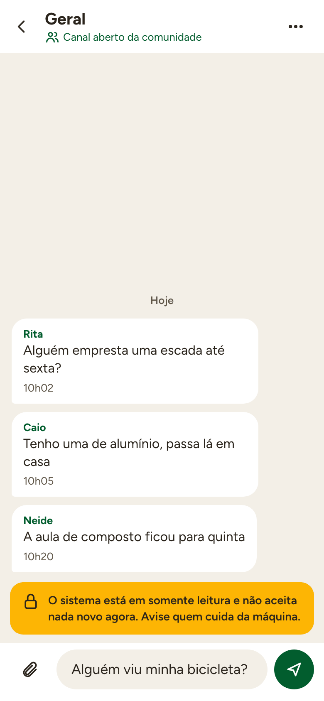 | 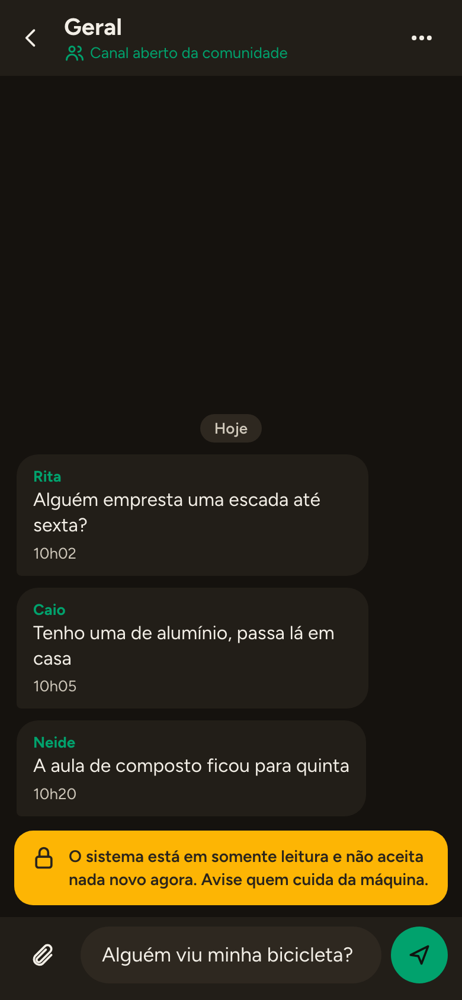 |

**What the person sees.** The conversation as it was. Above the field to write, a card in the sun color: "O sistema está em somente leitura e não aceita nada novo agora. Avise quem cuida da máquina." In the field, the message Bia tried to send, kept as she wrote it.

**What they can do.** Read everything. Keep the text and send it again later. Warn whoever looks after the machine.

**States.**

- A write refused: the page answers with the sentence above and keeps what the person wrote. **Built**, for messages and for creating an account.
- Before writing: the page says it in the band under the header, so people know before they type. **Proposed**, from the architecture, which asks the system to warn.
- Back to normal: after the machine restarts and brings its indexes level with its journal. Then the band leaves and writing works again. **Built** for the restart; **Proposed** for the band.

**When it happens.** When the journal refuses a write, or an index fails after the journal accepted the entries, the scribe stops and the machine stays read-only until it is restarted. **Built**, see [the core](../design/core.md#the-path-of-a-write). A journal damaged in the middle stops the machine from starting at all, with an error that names the entry, and the administrator restores it from a copy (**Built**); that screen is in [administration](admin.md).

This is not one of the four notices. It mentions the machine, because only the person who looks after it can bring writing back.

**Who may.** Everyone reads. Nobody writes.

**What it writes and reads.** Nothing is written. Reading goes on from the indexes.

**Many machines.** Only the machine whose scribe stopped is read-only. Whether a device on that machine turns to another one that writes, and whether a write it refused goes to the outbox to leave from another machine, is **Not decided**, and depends on the network, which is **To prove**.

## Adding an app to the home screen

Each app has its own button to add it to the home screen, with no app store: on the [portal](portal.md), and inside the app, as a card at the top of its home when it is open in the browser. The icon is a shortcut to the app in the browser, and it opens full screen, with no browser bar. **Proposed**, see [four apps on one address](../design/apps.md#the-add-button). None of it is built.

The way in is the same on every device: the poster, the community certificate, the account and the passphrase, then the icon. The button never shows on a page served without the certificate, because Chrome only installs a site with a secure connection, and because the icon keeps the address it was added from, which has to be the secure one. **Proposed.**

What the button does depends on the device, which the page learns from what the browser says about itself, as the welcome pages already do (**Built** there), and from whether the browser offered to install. The button is never hidden because of a guess: when the page cannot tell, it shows the steps through the browser's menu. **Proposed.**

| Device | What the button does | Mark |
| --- | --- | --- |
| Android, Chrome | Opens Chrome's own confirmation, "Instalar aplicativo" and "Instalar" | **Proposed**, words from Chrome's translation files; **To prove** on a device |
| iPhone, Safari | Shows the four taps of Safari | **Proposed**; the icon carrying the sign in was shown on one iPhone, with test pages outside this repository |
| iPhone, another browser | Sends the person to Safari | **Proposed**; **To prove** whether other browsers can add an icon that opens signed in |
| A browser that does not install by itself | Shows where the option is in its menu | **Proposed**; the menu words **To prove** per browser |
| Opened from the icon | No card and no button | **Proposed** |

The card that invites has two buttons, "Adicionar" and "Depois". The second word is not "Agora não", so that phrase stays with the notice. Once dismissed, the card does not come back in that app on that device. Where the button lives inside an app after that is **Not decided**.

### Android: Chrome's confirmation

**Path:** the home of each app, `/talk/`, `/learn/`, `/decide/`, `/ask/`, open in Chrome.

| Light | Dark |
| --- | --- |
| 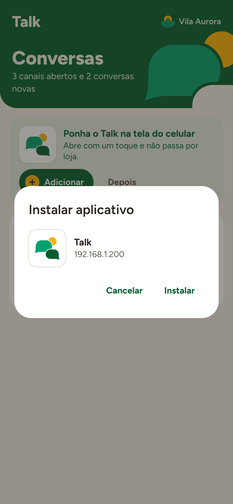 | 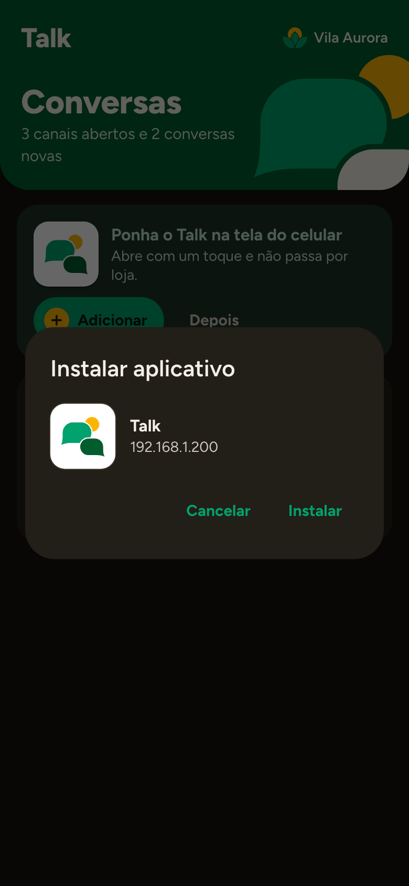 |

**What the person sees.** The home of Talk, with the invitation card at the top: the app's icon, "Ponha o Talk na tela do celular", "Abre com um toque e não passa por loja.", and the buttons "Adicionar" and "Depois". Over it, Chrome's own dialog, drawn after Chrome: "Instalar aplicativo", the icon, the name Talk and the address, "Cancelar" and "Instalar". The dialog is Chrome's, not Earthler's, and its look follows the phone.

**What they can do.** Install, and the icon goes to the home screen. Cancel, and the card stays.

**States.** After installing, the card leaves the page in the browser too, because Chrome tells the page. **Proposed.** On Android, the browser and the icons share the sign in and the storage, so the icon opens signed in to the four apps (**To prove**).

**Who may.** Anyone signed in.

**What it writes and reads.** Nothing on the machines. Each app has its own manifest, with its own name, icon, start and scope, so each becomes an icon of its own. **Proposed.**

**Many machines.** The icon keeps the community's address, the same on every machine, so it opens on whichever machine is near (**Proposed**, depends on the network, **To prove**).

### iPhone: the four taps of Safari

**Path:** the home of each app, open in Safari.

| Light | Dark |
| --- | --- |
| 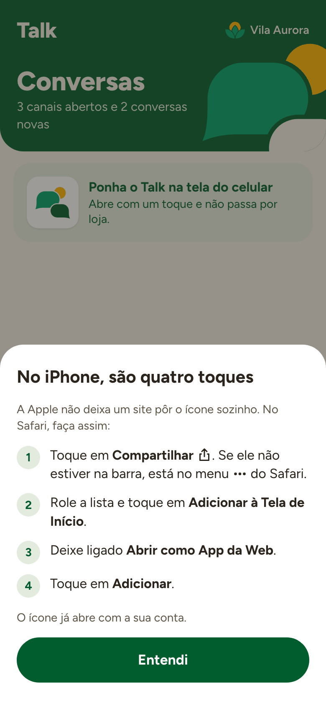 | 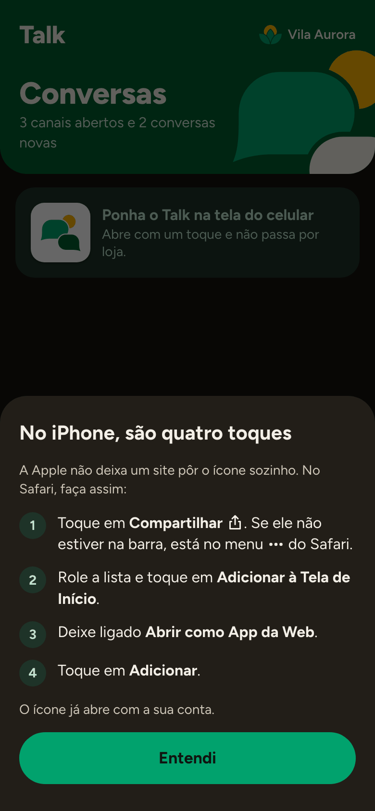 |

**What the person sees.** A sheet over the page: "No iPhone, são quatro toques", the line that Apple does not let a site add itself, and four numbered steps with Safari's own words: tap "Compartilhar", which is in Safari's menu when it is not on the bar; scroll and tap "Adicionar à Tela de Início"; keep "Abrir como App da Web" on; tap "Adicionar". Then "O ícone já abre com a sua conta." and "Entendi".

**What they can do.** Follow the steps in Safari, and close the sheet.

**States.** Safari tells the page nothing when an icon is added, so the page in the browser cannot know it happened. How the card stops inviting in Safari after the icon exists is **Not decided**.

**Who may.** Anyone signed in.

**What it writes and reads.** Nothing. The words are Apple's, from its guide in Portuguese.

**Many machines.** As on Android.

On one iPhone, on 2026-11-15, the sign in went with each icon, the rest of the storage did not, and the icons do not see each other afterwards (see [what a real iPhone showed](../design/apps.md#what-a-real-iphone-showed)). That proof ran over plain HTTP; repeating it with the certificate and the real session cookie is **To prove**, and so is an icon left unopened for more than seven days.

### iPhone, another browser: to Safari

**Path:** the home of each app, open in another browser on the iPhone.

| Light | Dark |
| --- | --- |
| 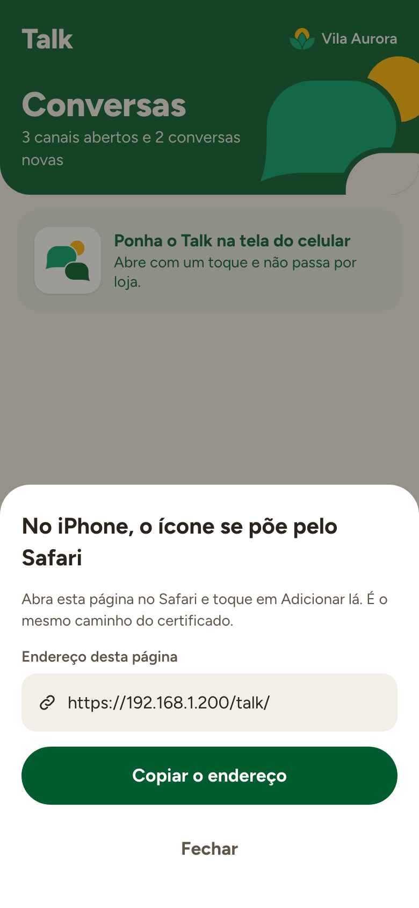 | 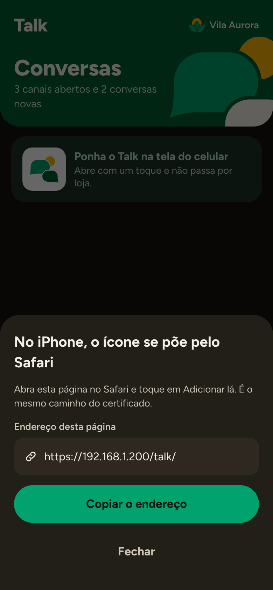 |

**What the person sees.** A sheet: "No iPhone, o ícone se põe pelo Safari", the line to open this page in Safari and tap Adicionar there, which is the same way the certificate went, the address of the page in a field that can be copied, "Copiar o endereço" and "Fechar".

**What they can do.** Copy the address, open Safari, and add the app from there.

**States.** If the person is not signed in in Safari, Safari asks them to sign in with the passphrase first; that screen is in [account](account.md).

**Who may.** Anyone.

**What it writes and reads.** Nothing.

**Many machines.** None.

The reason is the proof: the sign in going with the icon was shown in Safari only. The certificate already takes the same way, because only Safari hands a profile to the Settings app (**Built**). Whether Chrome, Firefox or Edge on the iPhone can add an icon that opens signed in, as their makers describe differently, is **To prove**; when it is, this sheet may give their own steps instead.

### A browser that does not install by itself

**Path:** the home of each app, open in a browser that does not offer the page a way to install, such as some browsers on Android and on computers.

| Light | Dark |
| --- | --- |
| 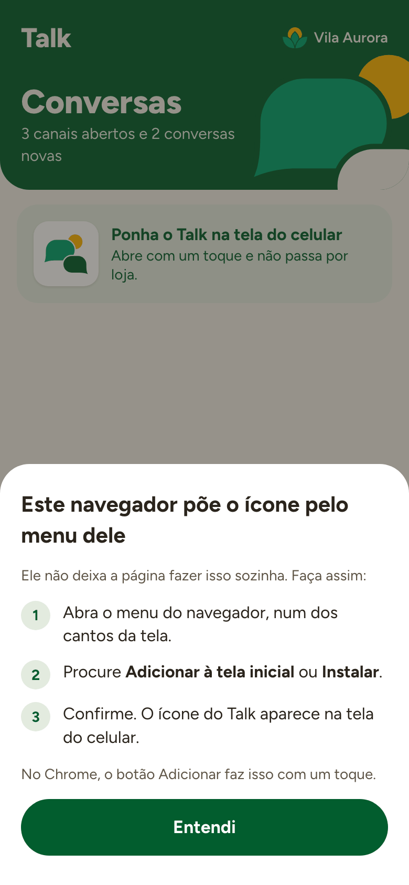 | 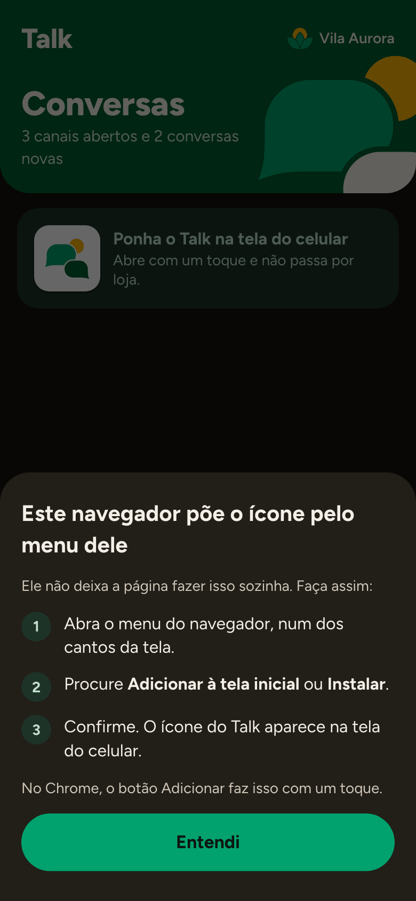 |

**What the person sees.** A sheet: "Este navegador põe o ícone pelo menu dele", the line that it does not let the page do it, and three steps: open the browser's menu, in one of the corners of the screen; look for "Adicionar à tela inicial" or "Instalar"; confirm. Then "No Chrome, o botão Adicionar faz isso com um toque." and "Entendi".

**What they can do.** Follow the steps, or open the address in Chrome.

**States.** None of its own.

**Who may.** Anyone signed in.

**What it writes and reads.** Nothing.

**Many machines.** None.

The words of each browser's menu have not been checked on a device and are **To prove**; the sheet names the two most common. Whether the button shows on computers at all is **Not decided**.

### An app opened from its icon

**Path:** the start of each app, opened from the home screen. Drawn on Talk, on an iPhone, the first time its icon opens.

| Light | Dark |
| --- | --- |
| 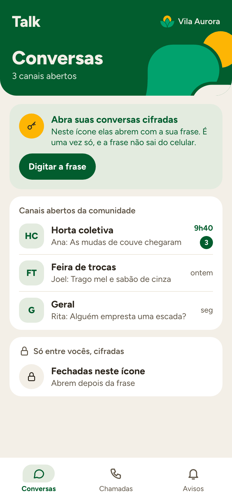 | 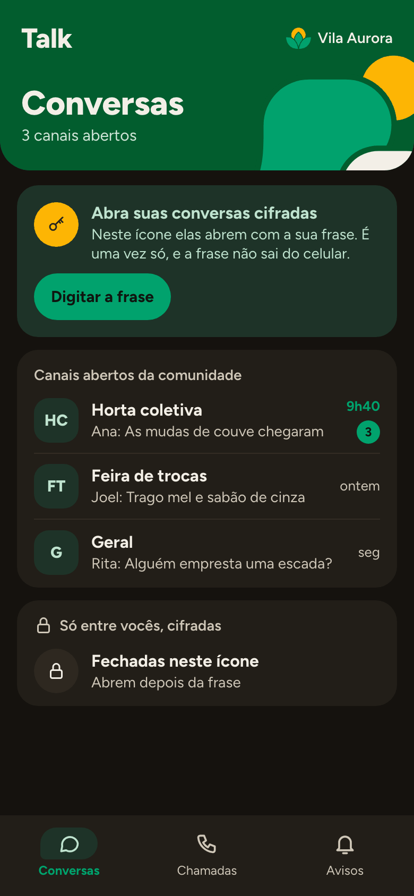 |

**What the person sees.** The app full screen, with no browser bar and no card inviting to add it. On the iPhone, the first time Talk opens from its icon, a quiet card with a key in the sun color: "Abra suas conversas cifradas", the line that in this icon they open with the person's passphrase, once, and that the passphrase does not leave the phone, and "Digitar a frase". Under it the open channels, already there, and the personal conversations, closed in this icon until the passphrase.

**What they can do.** Read and write in the open channels at once. Type the passphrase once to open the personal conversations in this icon.

**States.**

- On the iPhone, the icon opens signed in, because Safari copied the sign in to it; its storage starts empty, so Talk asks for the passphrase once and fetches the encrypted package from a machine. The maintainer decided this on 2026-11-15, after the proof. The passphrase never passes through the machine.
- After the passphrase, Talk opens straight into the conversations. That it keeps doing so on later openings has not shown in the records yet and is **To prove**.
- Learn and Decide keep nothing personal and ask for nothing. Ask keeps the person's recent answers in its own icon. **Inference** in the design notes, to check when each app's screens are settled.
- On Android, the icon shares the browser's storage and opens straight. **To prove.**

**Who may.** Anyone signed in.

**What it writes and reads.** Reads the encrypted package from a machine. Writes the key in the icon's own storage. The passphrase screen is in [account](account.md).

**Many machines.** The icon reaches whichever machine is near, at the same address. The encrypted package is on every machine. **Proposed.**

## Accessibility on every screen

The rules of [principles](principles.md#accessible-as-drawn) hold on every screen. What they mean in practice, for every developer:

- **Touch.** Every target is at least 44 by 44 pixels; main buttons are 54 pixels tall. A sheet's buttons are full width.
- **Contrast.** Text keeps 4.5 to 1 against its background in light and in dark mode. The sun color always carries dark text, in both modes.
- **Never color alone.** Every state also has a word: the marks say "Ainda não enviada" and "Chegou depois" in text, and a test that passed says "Passou".
- **Real controls.** Buttons are buttons, links are links, fields are fields with labels. A control drawn with an icon alone has a name a screen reader reads, such as "Voltar às conversas" or "Enviar".
- **The notices to a screen reader.** The "No link" band is a status, announced once when it appears, without moving the focus. "Not now" and a refused write are alerts, announced at once, next to the form that kept what the person typed. The marks are part of the message and are read with it, after its text. Whether the return of the link is announced is **Not decided**. Whether new messages in an open conversation are announced is **Not decided**.
- **Order.** The order of reading follows the order on the screen: header, notice, content, the field to write, the bar.
- **Sheets.** A sheet over the page keeps the focus inside it, closes with the Escape key and with its own button, and gives the focus back to the button that opened it. The page under it is hidden from screen readers while it is open.
- **Times.** Every time is written in a time element with the full date and hour behind it, so a screen reader can say more than "9h40".
- **Size.** Text can grow to twice its size without being cut or overlapping: lists wrap, no box of text has a fixed height. The drawings have a fixed size only to make pictures.
- **Motion.** Nothing needs an animation to be understood, and the system's preference for less motion is followed.
- **Gestures.** Nothing depends on a gesture with no other way to do it.
- **Language.** Every page declares its language, `pt-BR` first. Whether the app names under the icons are translated is **Not decided** (see [principles](principles.md#not-decided)).

**Proposed** as rules for the screens to come. The built pages already use real controls and labels, and most refusals show as an alert on the page; a few still answer with a bare page of text, such as a message that is not yours to remove or a page the role may not open.

## What each state allows

| State | Read | Write a message | Counted acts | Calls and the Mentor |
| --- | --- | --- | --- | --- |
| Linked, every machine together | Everything | Yes | Yes | Yes |
| Linked, a listed machine away | Everything the machines near hold | Yes | "Not now" | Yes, where they live |
| No link | What is on the device | Into the outbox | No | No |
| The machine is read-only | Everything | Refused, text kept | Refused | Reading goes on; what else goes on is **Not decided** |

## Not decided

- How long the device waits before showing "Sem ligação com a comunidade", and how a control that needs the community answers with no link.
- Whether "Chegou depois" is decided per machine or per device, and how long it stays.
- Whether "Ainda não enviada" is drawn in the sun color, as principles say of the four notices, or as the quiet chip the kit draws.
- The words of a message refused when it leaves the outbox.
- What goes into the outbox besides messages: wiki edits, reports on the map, notes, open votes, alerts to everyone, attachments.
- Whether there is a screen for the whole outbox.
- Whether the outbox sends in the background where the browser allows it.
- Whether the device keeps and shows the time a message was written offline.
- What the screen says when the browser deleted the device's data with an outbox in it.
- Whether the device keeps part of the community layer for reading with no link.
- On a read-only machine, whether the device turns to another machine and whether refused writes go to the outbox.
- Where the add button lives inside an app once the card is dismissed; how the card in Safari stops inviting once the icon exists; whether the button shows on computers.
- Whether the return of the link, and new messages in an open conversation, are announced to a screen reader.
- Whether the app names under the icons are translated.
