# Decide

Decide is the app where the community makes its decisions together and keeps an eye on its own place. A resident proposes something with a deadline, reads what the Mentor says it changes, and votes, or lets the person they lent their vote to in that subject vote for them. When the deadline passes, the votes are counted and the result stays in sight for everyone. The same app holds the map of the community: problems and resources that residents report, proposals tied to a place, and decisions once they are made.

**Proposed**: nothing of Decide is built. It stands on pieces that are **Built**: the journal and its ids, accounts and roles, the log every resident can read, machines that follow each other's journals, and a machine that counts, which today decides new accounts and changes of role.

## Decide in a few rules

These rules shape every screen below.

- **Liquid democracy.** The maintainer chose liquid democracy. Each person votes directly, or lends their vote, by subject, to someone they trust. A lent vote can be taken back at any time, and a direct vote always prevails over the lent one. **Proposed.**
- **Open or secret, by the charter.** The maintainer decided that each community chooses in its charter whether the vote is open or secret, and that the setup suggests open. In an open vote everyone can see how each person voted.
- **The charter says who.** Who may propose and vote, the voting age, the participation and majority a proposal needs, and how long a lent vote lasts are rules of each community's charter. The suggestions the setup offers are in [setup](setup.md), marked **Proposed** there; none of the values is the maintainer's decision.
- **Weight in sight.** Everyone can see how many votes each person carries, and lent votes expire and ask to be renewed, so power gathered through lending stays visible and has to be confirmed. **Proposed.**
- **The Mentor explains, it never decides.** The Mentor writes a summary of each proposal and the consequences it can deduce, always marked as deduced. It is not essential: a proposal without a summary can still be voted. **Proposed.**
- **The map is the community's.** The map of Decide is a view of [Maps](maps.md), the map every app shares: here it shows problems, resources, proposals and decisions, and a point opens in Decide. The maintainer first decided that houses and people never become markers; on 2026-11-15 he changed that for houses: each resident may mark their own house, with a name every resident sees, and people still never become markers. See [your house](maps.md#your-house).
- **What waits, and what never waits.** Proposing, voting in an open vote and reporting on the map never wait: any machine accepts them alone. Closing and counting a vote, and voting by secret ballot, wait until every listed machine can see the others. The maintainer accepted that list on 2026-11-13. See [many machines](../design/many-machines.md#essential-and-not-essential) and [notices and behavior](behavior.md).

## Screens

The four apps share the header, the bar, the buttons, the cards and the four notices; see [principles](principles.md) and [visual identity](visual.md). Decide's cover is the soft color, its bar has three parts, "Decisões", "Mapa" and "Votos", and the community's name at the top leads to the portal.

Every path below is **Proposed**:

| Path | Screen |
| --- | --- |
| `/decide/` | Home, open decisions |
| `/decide/closed` | Home, closed decisions |
| `/decide/proposal/<id>` | A proposal: open, secret, waiting for its result, or closed |
| `/decide/new` | New proposal |
| `/decide/delegations` | Lent votes |
| `/decide/delegations/new` | Lending a vote, as a sheet over the lent votes |
| `/decide/map` | The map |
| `/decide/map/new` | New report |
| `/decide/map/<id>` | A point on the map |

### Home: open decisions

**Path:** `/decide/`. **Proposed.**

| Light | Dark |
| --- | --- |
| 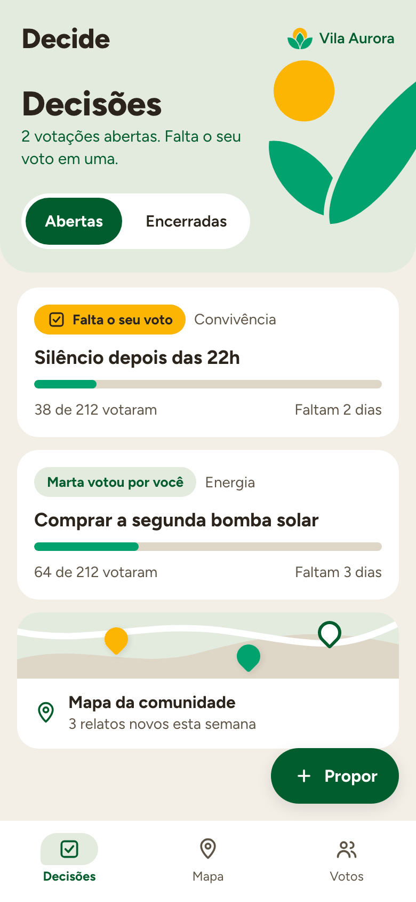 | 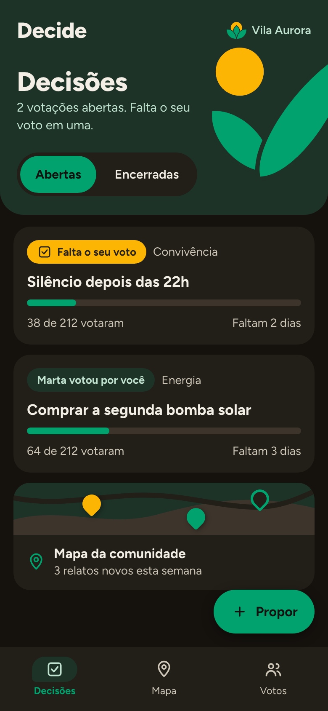 |

**What the person sees.** The soft cover with the Decide glyph, the title "Decisões" and a line that counts the open votes and how many still miss the person's vote: "2 votações abertas. Falta o seu voto em uma." Under it, two tabs, "Abertas" and "Encerradas". Then one card per open proposal, the nearest deadline first. Each card carries a mark of where the person stands, the subject, the title, a bar of participation with "38 de 212 votaram" under it, and the time left, "Faltam 2 dias". After the proposals, a card with a piece of the map and "Mapa da comunidade, 3 relatos novos esta semana". The button "Propor" floats over the bottom right.

The mark on each card says what counts for the person in that vote, in words:

| Mark | When |
| --- | --- |
| "Falta o seu voto", in the sun color | No vote counts for the person yet: they have not voted, and nobody they lent their vote to in that subject has voted |
| "Marta votou por você", soft | The person did not vote, and the person they lent their vote to voted |
| "Você votou", soft | The person voted directly |

The sun color is kept for what asks for the person's action, so it marks only the missing vote. **Proposed.**

**What they can do.** Open a proposal. Switch to the closed decisions. Open the map. Tap "Propor" to write a proposal, which opens the new proposal or, for someone the charter does not let propose, the page that explains why. Go to "Mapa" or "Votos" by the bar, or to the portal by the community's name.

**States.**

- No open vote: "Nenhuma votação aberta agora." with "Propor" under it.
- A child under the voting age of the charter, or a resident the charter does not let vote: the cards carry no mark, and the line under the title only counts the open votes.
- No link with the community: the notice "Sem ligação com a comunidade." in its fixed place. What the device already has can be read. Whether a vote can be cast with no link, and wait in the outbox, is **Not decided**, because a vote has a deadline.

**Who may.** Everyone reads, children included.

**Writes and reads.** It writes nothing. It reads the open proposals, how many voted in each, the person's own vote and the person's lent votes with their delegates' votes.

**Many machines.** Reading never waits. Each machine shows what has reached it, so during a split each side sees the votes cast on its own side, and the count of who voted grows by itself when the sides meet. No machine is ever named.

### Home: closed decisions

**Path:** `/decide/closed`. **Proposed.**

| Light | Dark |
| --- | --- |
| 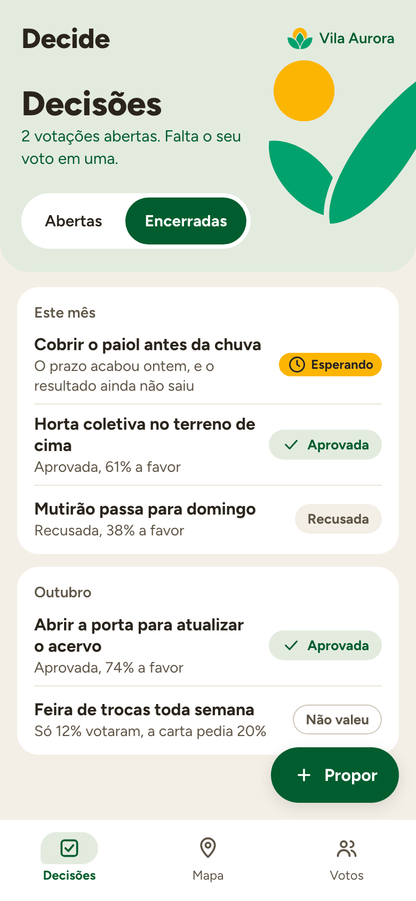 | 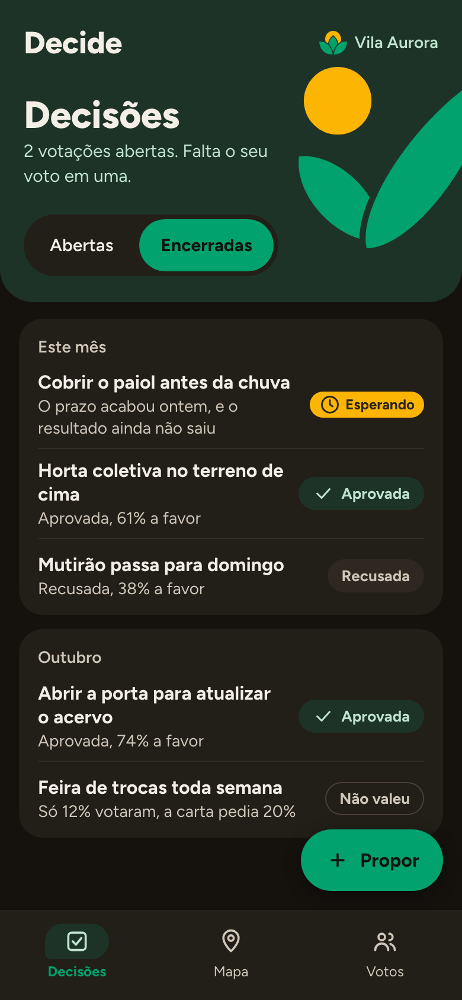 |

**What the person sees.** The same cover with "Encerradas" chosen. The closed proposals grouped by month, each with its title, its result in words on the second line and a mark on the right: "Aprovada", "Recusada", "Não valeu" when participation stayed under what the charter asks, as in "Só 12% votaram, a carta pedia 20%", and "Esperando" with a clock when the deadline passed and the result has not come out yet.

**What they can do.** Open a closed proposal to see its result, or one still waiting to see why. Switch back to the open ones, or propose.

**States.** Nothing closed yet: "Nenhuma decisão encerrada ainda."

**Who may.** Everyone reads, children included.

**Writes and reads.** It writes nothing. It reads the results the machine that counts wrote, and the proposals whose deadline passed without a result.

**Many machines.** A result is written once, by the machine that counts, and read on every machine. "Esperando" shows for every resident, on every side, while a listed machine is away.

### A proposal open for voting

**Path:** `/decide/proposal/<id>`. **Proposed.**

| Light | Dark |
| --- | --- |
| 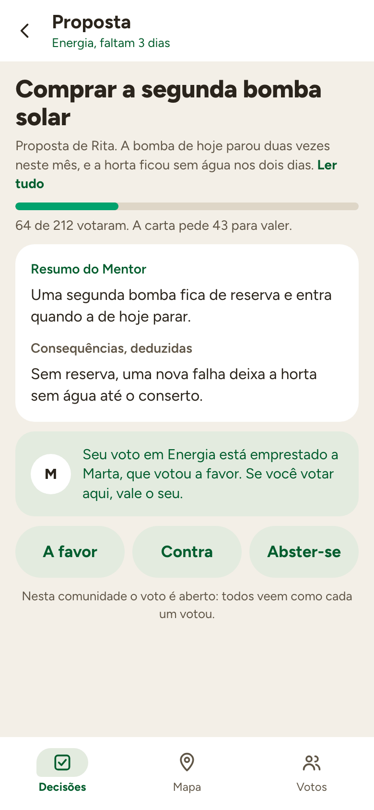 | 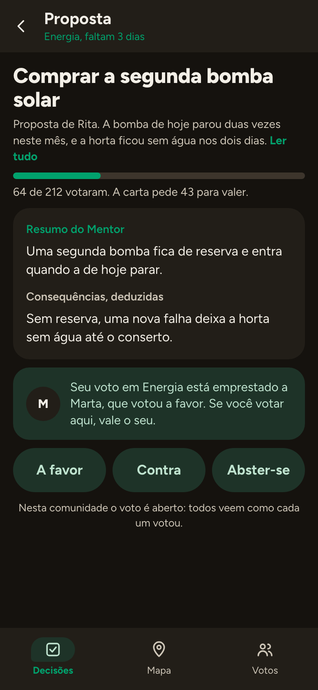 |

**What the person sees.** The inner header "Proposta" with the subject and the time left under it, "Energia, faltam 3 dias". The title, who proposed it and the start of the text, with "Ler tudo". The bar of participation and the line "64 de 212 votaram. A carta pede 43 para valer.", where the number comes from the community's charter. A card with the Mentor's work: "Resumo do Mentor", and under "Consequências, deduzidas" what the Mentor deduced. When the person lent their vote in that subject, a soft card says who carries it and, because the vote is open, how that person voted: "Seu voto em Energia está emprestado a Marta, que votou a favor. Se você votar aqui, vale o seu." Then three buttons, "A favor", "Contra" and "Abster-se", drawn alike so the screen pushes no choice, and the line "Nesta comunidade o voto é aberto: todos veem como cada um votou."

**What they can do.** Read the whole text. Vote with one tap. After voting, the chosen button shows a check and stays marked, and the soft card says "Você votou a favor." Whether a person can change an open vote before the deadline is **Not decided**. Go back to the decisions.

**States.**

- The person lent the vote and the delegate has not voted yet: "Seu voto em Energia está emprestado a Marta, que ainda não votou. Se você votar aqui, vale o seu."
- The person carries other people's votes in that subject: "Você carrega 3 votos em Terra: o seu, o de Neide e o de Dani." Their vote counts for all three.
- The Mentor has not summarized the proposal, because it is off or still busy: "O Mentor ainda não resumiu esta proposta." Voting goes on without it. **Proposed.**
- The Mentor found no consequence to deduce: the second part of the card does not appear.
- A child under the voting age, or a resident the charter does not let vote: the buttons give way to "Você acompanha esta votação. Votar fica para quando você tiver a idade de votar." or, for the second case, "Pela carta da comunidade, você acompanha esta votação sem votar."
- The deadline passed while the page was open: "O prazo desta votação acabou." and the page becomes the waiting state or the result.
- No link with the community: the notice "Sem ligação com a comunidade."; casting a vote with no link is **Not decided**.

**Who may.** Whoever the charter lets vote: every resident who votes, or a group, and a child only from the voting age the charter sets. A moderator and an administrator vote like anyone else; a role gives no extra vote and no power over anyone's vote.

**Writes and reads.** A vote writes `vote.cast` with the proposal and the choice, and, like every entry, the account and the device. **Proposed**; the name follows the [glossary](../glossary.md)'s rule and enters it when the code takes it. It reads the proposal, the Mentor's summary, how many voted, the person's lent vote in that subject and the delegate's vote.

**Many machines.** Voting in an open vote never waits: any machine accepts the vote alone, and it reaches the others when they meet. If the same person voted on two sides of a split, both entries exist, and which one the count takes follows the rule on changing a vote, which is **Not decided**.

### A proposal with a secret ballot

**Path:** `/decide/proposal/<id>`, in a community whose charter chose the secret ballot. **Proposed.**

| Light | Dark |
| --- | --- |
| 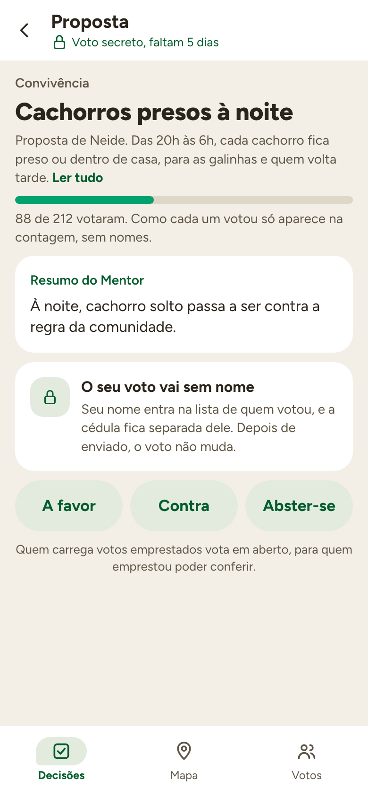 | 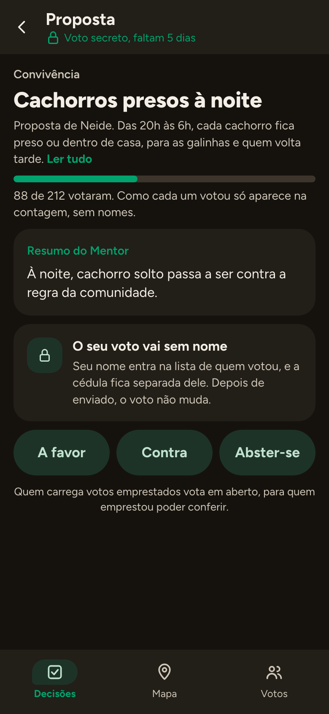 |
| 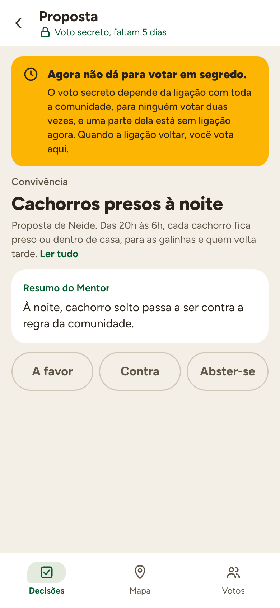 | 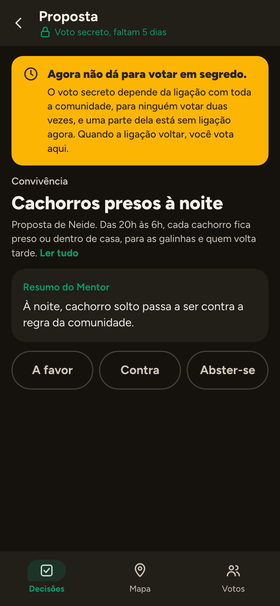 |

**What the person sees.** The header says "Voto secreto" with a lock. The bar of participation counts who voted and never how: "88 de 212 votaram. Como cada um votou só aparece na contagem, sem nomes." A card explains the ballot in plain words: "O seu voto vai sem nome. Seu nome entra na lista de quem votou, e a cédula fica separada dele. Depois de enviado, o voto não muda." Under the three buttons, "Quem carrega votos emprestados vota em aberto, para quem emprestou poder conferir."

**What they can do.** Vote once. Because the vote cannot change, the tap opens a sheet that repeats the choice in words and asks to confirm before sending. **Proposed.**

**States.**

- Not now: when a listed machine is away, the notice reads "Agora não dá para votar em segredo." and "O voto secreto depende da ligação com toda a comunidade, para ninguém votar duas vezes, e uma parte dela está sem ligação agora. Quando a ligação voltar, você vota aqui." The buttons are off until then (second row of pictures). What happens when the deadline passes while a listed machine is away, and secret votes could not be cast, is **Not decided**.
- Already voted: "Você votou. A sua cédula está guardada, sem o seu nome." The choice is not shown again, not even to the person.
- The person carries lent votes in that subject: the card says their vote is open, and the sheet says so again before sending.

**Who may.** As in an open vote, by the charter.

**Writes and reads.** The journal gets `vote.registered` with the account and no choice, so everyone can see who voted. The ballot, with no name, goes to the machine that counts, which keeps it apart from the journal, writes it to disk before the screen answers, and includes it in the copies. At the close, the machine that counts shuffles the ballots and writes one `ballot.recorded` for each, with no account, no device and the time of the close; the number of ballots has to match the number of registered votes. A person who carries lent votes votes in the open with `vote.cast`, because the count has to follow the lending. **Proposed.** The limit of this design: the operator of the machine that counts could match registrations and ballots by their order of arrival, and the design does not prevent it.

**Many machines.** A secret ballot waits for every listed machine. A ballot carries no name, so if the same person voted on both sides of a split, there would be no way to find one of the two ballots and undo it. The screen says "Agora não dá para…" at once, and never names a machine.

### A result that waits for the machines to meet

**Path:** `/decide/proposal/<id>`, after the deadline. **Proposed.**

| Light | Dark |
| --- | --- |
| 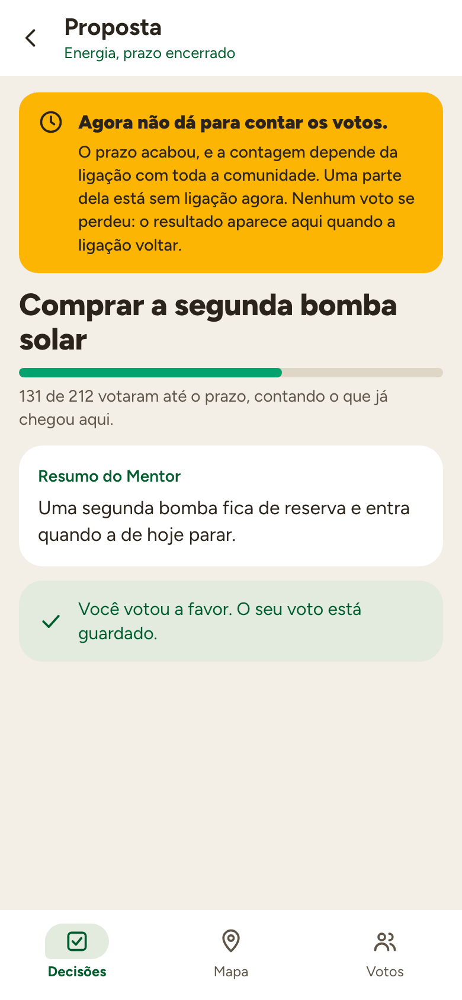 | 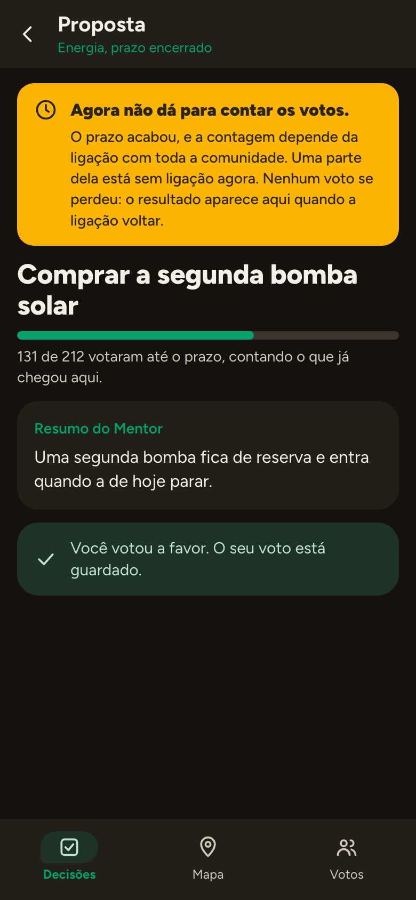 |

**What the person sees.** The notice "Agora não dá para…" at the top, in its fixed place and in the sun color: "Agora não dá para contar os votos." and "O prazo acabou, e a contagem depende da ligação com toda a comunidade. Uma parte dela está sem ligação agora. Nenhum voto se perdeu: o resultado aparece aqui quando a ligação voltar." Under it, the title, the participation until the deadline, "131 de 212 votaram até o prazo, contando o que já chegou aqui.", the Mentor's summary, and the person's own vote: "Você votou a favor. O seu voto está guardado."

**What they can do.** Read. Nothing can be voted any more. The page turns into the result by itself, through the live updates, when the count is written.

**States.** In a secret ballot the person's line reads "Você votou. A sua cédula está guardada, sem o seu nome." A person who did not vote reads "Você não votou nesta proposta."

**Who may.** Everyone reads.

**Writes and reads.** It writes nothing. It reads the proposal, the votes that have arrived and the person's own vote.

**Many machines.** Closing and counting wait for every listed machine, and it is always the same machine that counts, as it is today for accounts and roles. When every listed machine can see the others again, the count runs with the votes and the lent votes as they stood at the deadline, by the time of each entry. A vote cast on the other side before the deadline arrives late and still counts. If a listed machine never returns and an administrator takes it off the list, the count goes ahead without what was written only on that machine. **Proposed.**

### A closed proposal with its result

**Path:** `/decide/proposal/<id>`, once counted. **Proposed.**

| Light | Dark |
| --- | --- |
| 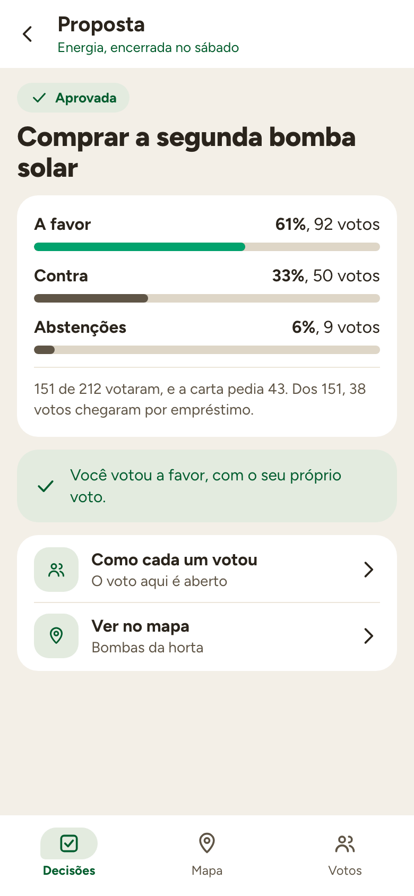 | 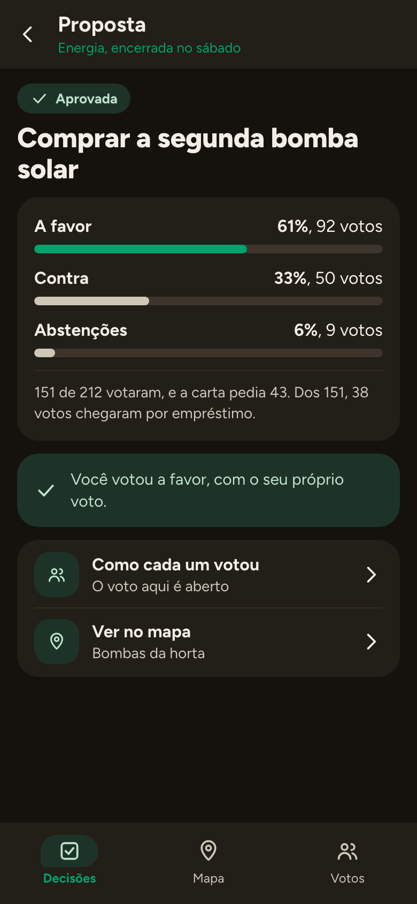 |

**What the person sees.** The header with the subject and the day it closed. A mark with the result in a word, "Aprovada", "Recusada" or "Não valeu", and the title. A card with one bar per choice, each with its share and its number of votes, "61%, 92 votos". Under the bars, the participation against what the charter asks and how many votes came through lending: "151 de 212 votaram, e a carta pedia 43. Dos 151, 38 votos chegaram por empréstimo." A soft card with the person's own vote and how it counted: "Você votou a favor, com o seu próprio voto.", or "O seu voto foi por Marta, a favor." Then, in an open vote, "Como cada um votou", and "Ver no mapa" when the proposal is tied to a place.

**What they can do.** See how each person voted, in an open vote. Open the place on the map. Go back.

**States.** "Não valeu": participation stayed under the charter's rule, and the bars still show how the votes went. In a secret ballot "Como cada um votou" does not exist; the card says "Voto secreto: a contagem não tem nomes." Whether abstentions count toward participation is **Not decided**.

**Who may.** Everyone reads, children included.

**Writes and reads.** The close writes `proposal.closed`, by the machine that counts, with the votes for each choice after following the lending, the participation, and whether the proposal reached the charter's rule. The result can also appear on the map as a decision. **Proposed.**

**Many machines.** The result is written once and read on every machine. Reading never waits.

### New proposal

**Path:** `/decide/new`. **Proposed.**

| Light | Dark |
| --- | --- |
| 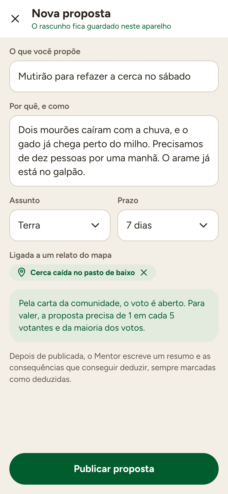 | 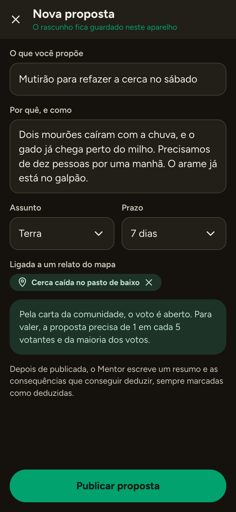 |

**What the person sees.** The inner header "Nova proposta", with a way to close and the line "O rascunho fica guardado neste aparelho". The fields "O que você propõe", "Por quê, e como", "Assunto" and "Prazo". "Ligada a um relato do mapa", filled when the proposal starts from a point on the map, with a way to remove the tie. A soft card with what the charter says about voting: "Pela carta da comunidade, o voto é aberto. Para valer, a proposta precisa de 1 em cada 5 votantes e da maioria dos votos." A line that the Mentor will write a summary and the consequences it can deduce, marked as deduced. The button "Publicar proposta".

**What they can do.** Write, choose a subject and a deadline, tie or untie a report on the map, and publish. Closing keeps the draft on the device. **Proposed**, from the rule that nothing a person wrote is lost.

**States.**

- No title: "Escreva o que você propõe."
- No link with the community: the notice "Sem ligação com a comunidade." The draft stays on the device. Whether a proposal written with no link waits in the outbox and goes out by itself is **Not decided**; see [the outbox](behavior.md#the-outbox).
- The charter does not let the person propose: the next section.

**Who may.** Whoever the charter lets propose: every resident who votes, or a group the community chose. A child only from the voting age.

**Writes and reads.** Publishing writes `proposal.created` with the title, the text, the subject, the deadline and, when there is one, the report it is tied to. When the Mentor has read it, an entry `proposal.summarized` carries the summary and the deduced consequences, marked as the Mentor's. **Proposed**; this second entry is new to the design. It reads the charter's rules on voting and the list of subjects.

**Many machines.** Proposing never waits: any machine accepts the proposal alone. The Mentor's summary is written by whichever machine carries the Mentor, when it is up.

### New proposal refused by the charter

**Path:** `/decide/new`, as a state. **Proposed.**

| Light | Dark |
| --- | --- |
| 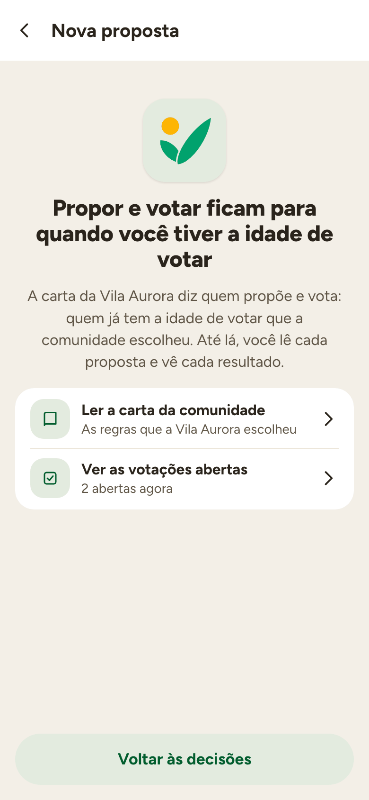 | 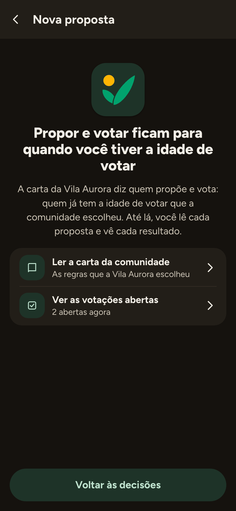 |

**What the person sees.** The Decide tile, and one sentence that says what the rule is and what the person can still do. For a child under the voting age: "Propor e votar ficam para quando você tiver a idade de votar" and "A carta da Vila Aurora diz quem propõe e vota: quem já tem a idade de votar que a comunidade escolheu. Até lá, você lê cada proposta e vê cada resultado." For a resident where the charter gives proposing to a group: "Na Vila Aurora, quem propõe é um grupo escolhido pela comunidade" and "Leve a sua ideia a uma das pessoas do grupo. Votar continua com você." Under it, "Ler a carta da comunidade" and "Ver as votações abertas", and the button "Voltar às decisões".

**What they can do.** Read the charter, go to the open votes, or go back.

**States.** None of its own.

**Who may.** Shown to whoever the charter does not let propose. The button "Propor" stays on the home for everyone, and this page explains the rule instead of hiding it. **Proposed.**

**Writes and reads.** It writes nothing. It reads the charter's rules on who proposes and the voting age.

**Many machines.** Reading never waits.

### Lent votes

**Path:** `/decide/delegations`. **Proposed.**

| Light | Dark |
| --- | --- |
| 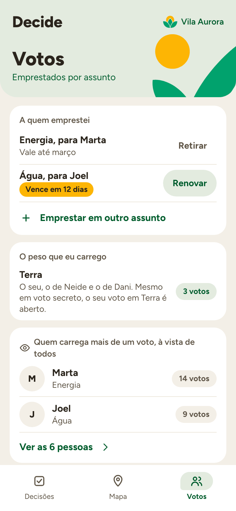 | 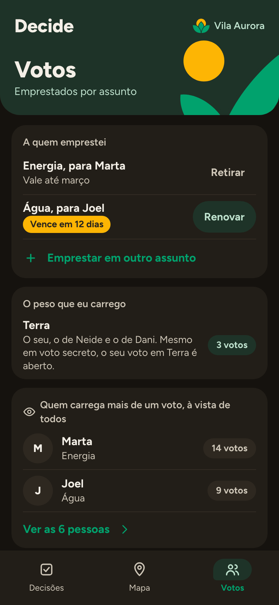 |

**What the person sees.** The cover "Votos", "Emprestados por assunto". Three parts:

- "A quem emprestei": one row per subject, with the person who carries the vote and how long it lasts, "Energia, para Marta, vale até março", and "Retirar". A lent vote close to its end carries the mark "Vence em 12 dias" in the sun color and the button "Renovar". Under them, "Emprestar em outro assunto".
- "O peso que eu carrego": per subject, how many votes the person carries and whose. "Terra, 3 votos. O seu, o de Neide e o de Dani. Mesmo em voto secreto, o seu voto em Terra é aberto."
- "Quem carrega mais de um voto, à vista de todos": every person who carries more than one vote, by subject, the most first, with the number. "Ver as 6 pessoas" opens the whole list.

**What they can do.** Take a lent vote back, renew one, lend in another subject, see who carries what.

**States.**

- Nothing lent: "Você vota sempre com o seu próprio voto. Se quiser, empreste o voto num assunto a quem você confia."
- The person carries nobody's vote: the second part does not appear.
- A lent vote expired: "Seu voto em Água voltou para você." in place of the row, with "Emprestar de novo".
- Taking back a vote during an open vote in that subject: "A partir de agora, nesta votação, vale só o seu voto." The delegate's vote no longer counts for the person.

**Who may.** Whoever has a vote: lending needs the right to vote, so a child under the voting age has no vote to lend and sees this page without the first part. Everyone sees the third part.

**Writes and reads.** Lending writes `delegation.created`, with the subject and the person; taking back writes `delegation.withdrawn`; renewing writes `delegation.renewed`. **Proposed.** A daily routine checks which lent votes reached their end, and from then the vote returns to its owner. How long before the end the mark appears is **Not decided**.

**Many machines.** The list the maintainer accepted on 2026-11-13 does not name lending a vote. By its rule, lending and taking back are facts a person states, so they would never wait, and the count would take each person's last lending by time. That is a reading to be confirmed: **Not decided**.

### Lending a vote

**Path:** `/decide/delegations/new`, as a sheet over the lent votes. **Proposed.**

| Light | Dark |
| --- | --- |
| 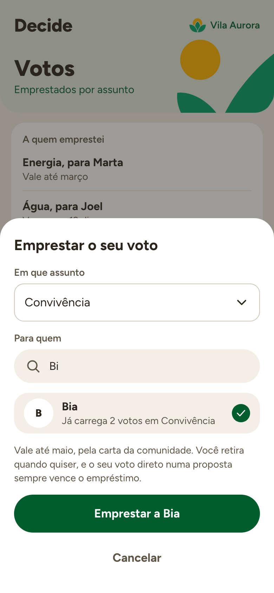 | 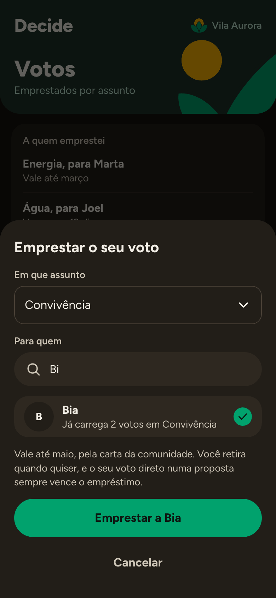 |

**What the person sees.** A sheet, "Emprestar o seu voto", over a veil. "Em que assunto", with the list of subjects. "Para quem", a search by name, with each person's current weight in that subject under the name, "Já carrega 2 votos em Convivência", so nobody lends without seeing how much the other already carries. The line "Vale até maio, pela carta da comunidade. Você retira quando quiser, e o seu voto direto numa proposta sempre vence o empréstimo." The button "Emprestar a Bia" and "Cancelar".

**What they can do.** Choose a subject and a person, and lend. Lending in a subject where a vote is already lent replaces it, and the sheet says so first: "Hoje o seu voto em Água está com Joel. Ao emprestar a Bia, ele deixa de carregar o seu voto."

**States.** A person with no vote does not appear in the search, with the line "Só aparece quem pode votar." Nobody can lend to themselves.

**Who may.** Whoever has a vote.

**Writes and reads.** `delegation.created`. It reads the subjects, the residents who can vote and the weights.

**Many machines.** As for the lent votes.

### The map

**Path:** `/decide/map`. **Proposed.**

| Light | Dark |
| --- | --- |
| 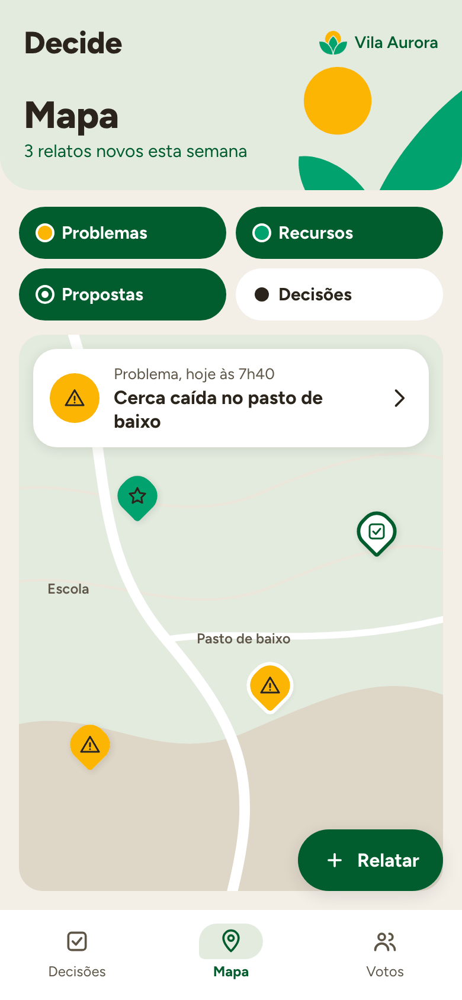 | 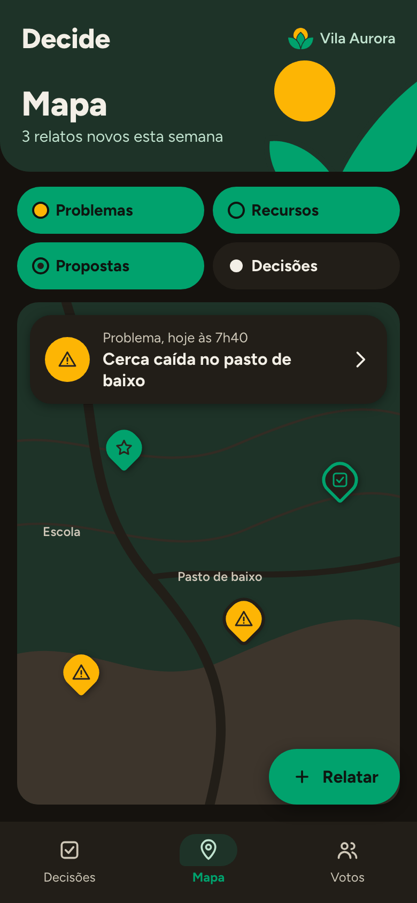 |
| 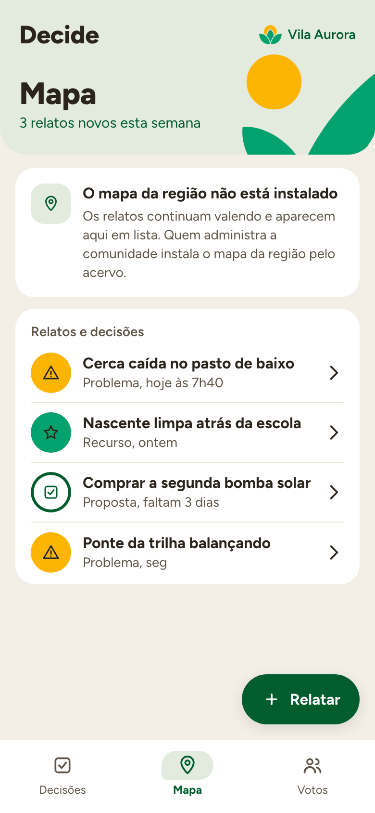 | 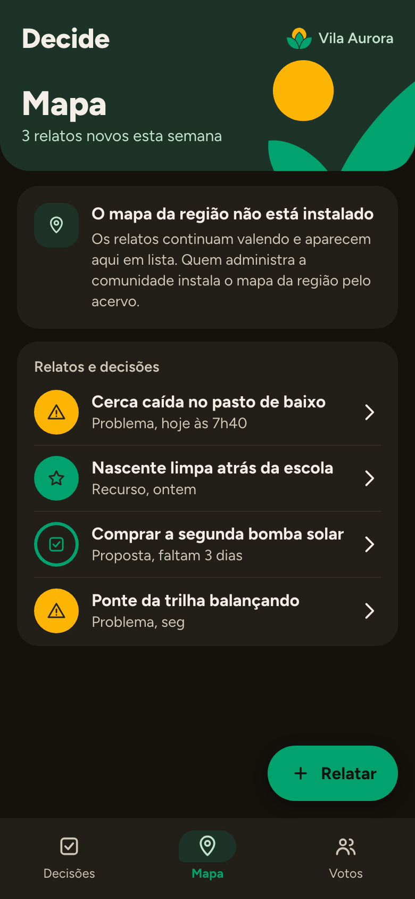 |

**What the person sees.** The cover "Mapa", "3 relatos novos esta semana". Four filters, "Problemas", "Recursos", "Propostas" and "Decisões", each a button that is on or off and carries the mark of its kind. Then the map of the region with its points. Each point is a pin whose color and sign together say what it is, so color never carries the meaning alone:

| Kind | Pin |
| --- | --- |
| Problem | Sun, with a warning sign |
| Resource | Leaf, with a star |
| Proposal | A ring of the primary color, with a ballot |
| Decision | The text color, with a check |

Tapping a pin marks it and shows a card at the top of the map with its kind, its time and its title, "Problema, hoje às 7h40, Cerca caída no pasto de baixo", which opens the point. The button "Relatar" floats over the bottom right. The base of the map is the region cut from OpenStreetMap into one file of the collection, read straight by the browser with no internet; it is the map of [Maps](maps.md#the-tools), with only the layers of Decide. **Proposed.**

**What they can do.** Turn kinds on and off, move and zoom the map, open a point, report.

**States.**

- The region map is not installed (second row of pictures): "O mapa da região não está instalado" and "Os relatos continuam valendo e aparecem aqui em lista. Quem administra a comunidade instala o mapa da região pelo acervo." The points come as a list, each with the mark of its kind.
- Nothing on the map yet: "Nenhum relato ainda. Toque em Relatar para marcar um problema ou um recurso."
- Every filter off: "Ligue um dos filtros para ver os pontos."
- No link with the community: the notice "Sem ligação com a comunidade." over what the device already has.

**Who may.** Everyone sees the map, children included.

**Writes and reads.** It writes nothing. It reads the reports, the proposals tied to a place and the decisions.

**Many machines.** The map is essential and lives on every machine, the same. Reading never waits.

### New report

**Path:** `/decide/map/new`. **Proposed.**

| Light | Dark |
| --- | --- |
| 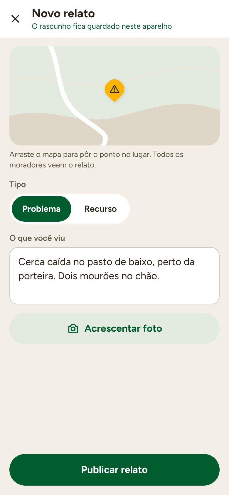 | 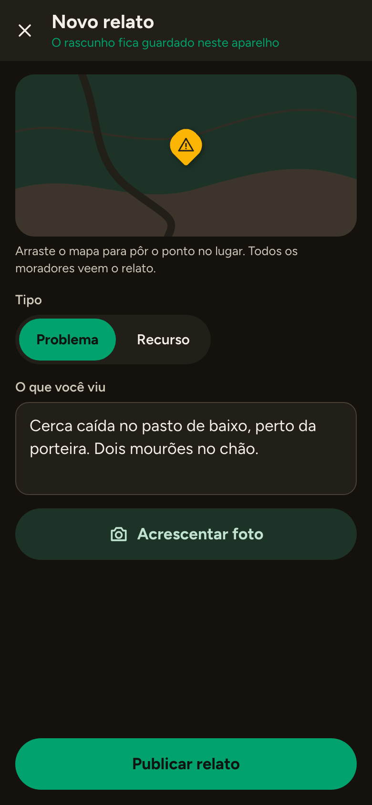 |

**What the person sees.** The inner header "Novo relato", with a way to close and "O rascunho fica guardado neste aparelho". A piece of the map with the pin in the middle, and "Arraste o mapa para pôr o ponto no lugar. Todos os moradores veem o relato." "Tipo", with "Problema" and "Recurso". "O que você viu", a text. "Acrescentar foto". The button "Publicar relato".

**What they can do.** Place the point, choose the kind, write, add a photo and publish. After publishing, the map opens on the new point.

**States.**

- No text: "Conte o que você viu."
- A photo still going up: "Enviando a foto…" with its progress; the upload resumes where it stopped if the Wi-Fi drops, as every upload of the system does. **Proposed.**
- No link with the community: the notice "Sem ligação com a comunidade." The draft stays on the device. Whether a report written with no link waits in the outbox, with "Ainda não enviada", and goes out by itself is **Not decided**; see [the outbox](behavior.md#the-outbox).
- No region map installed: the place is marked where the person is, with the phone's location, as in [Maps](maps.md#no-region-map). **Proposed.**

**Who may.** Residents, moderators and administrators. A child as the charter says.

**Writes and reads.** Publishing writes `report.created` with the place, the kind, the text and the photo, which is stored as a file of the system. **Proposed.**

**Many machines.** Reporting never waits: any machine accepts the report alone.

### A point on the map

**Path:** `/decide/map/<id>`. **Proposed.**

| Light | Dark |
| --- | --- |
| 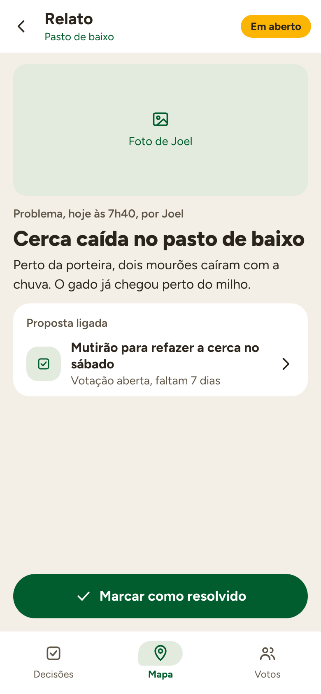 | 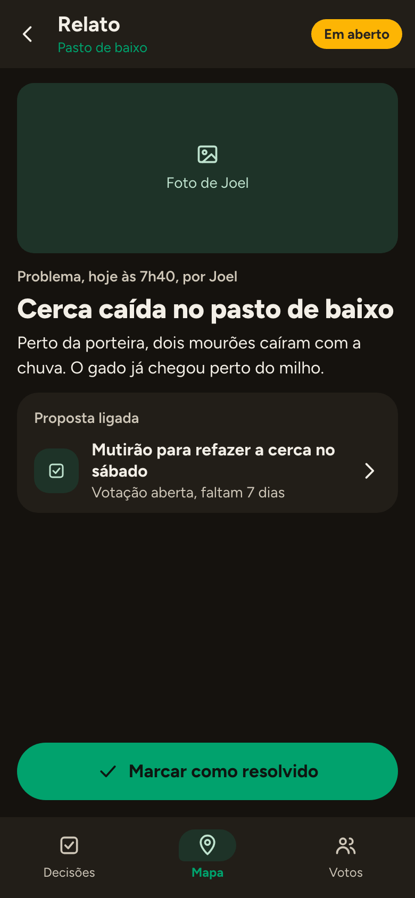 |
| 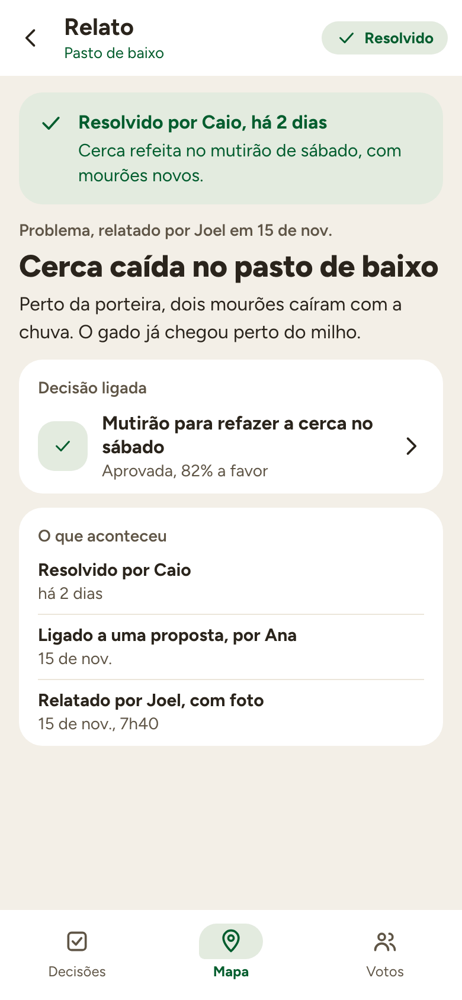 | 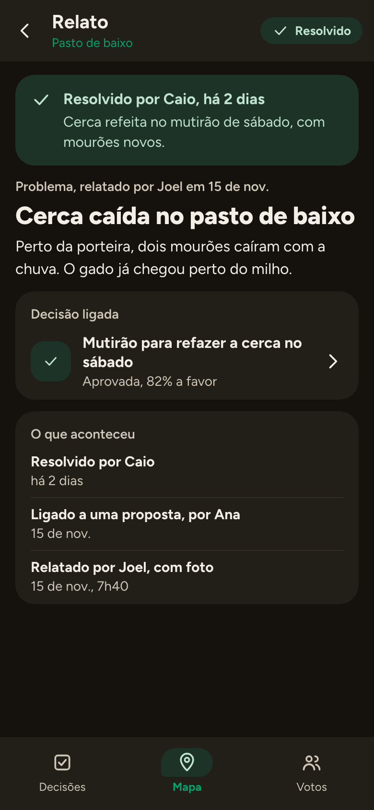 |

**What the person sees.** The inner header "Relato", with the place under it and the status on the right: "Em aberto" in the sun color for a problem. The photo, with who took it. The kind, the time and who reported, the title and the text. "Proposta ligada", with the proposal's state, "Votação aberta, faltam 7 dias". The button "Marcar como resolvido".

Resolved (second row of pictures): the status reads "Resolvido". A soft card at the top says who resolved it, when, and their note: "Resolvido por Caio, há 2 dias. Cerca refeita no mutirão de sábado, com mourões novos." "Decisão ligada" shows the result of the tied proposal. "O que aconteceu" lists each change with who made it and when.

**What they can do.** Open the tied proposal. Mark the point as resolved, with a short note. When nothing is tied, "Propor algo sobre isto" opens a new proposal already tied to the point. Whether a resolved point can be opened again is **Not decided**.

**States.**

- A resource: the status reads "Recurso" and the button to resolve does not appear.
- The tied proposal closed: its row shows the result, and the point appears on the map as a decision.
- Two people changed the same point during a split: both versions stay and the screen says so: "Duas pessoas mudaram este relato ao mesmo tempo. As duas versões estão aqui." **Proposed**, as for the wiki.
- Removed by a moderator: "Este relato foi removido por um moderador.", with the reason in the log.

**Who may.** Everyone reads. Who may mark a point resolved, any resident, the person who reported, or a moderator, is **Not decided**. A moderator or an administrator may remove a report, with a reason that goes to the log.

**Writes and reads.** Tying a proposal and other changes write `report.changed`; resolving writes `report.resolved` with the note. **Proposed.** It reads the report, its history, the tied proposal and its result.

**Many machines.** Changes on the map never wait, like writing in the wiki.

## Flows

### Making a proposal

1. On the home, the person taps "Propor". If the charter does not let them propose, the page says why, and the flow ends there.
2. They write what they propose and why, choose a subject and a deadline, and, if it starts from a point on the map, keep the tie.
3. They publish. Any machine accepts it alone, with no wait. With no link, the draft stays on the device; whether it goes to the outbox is **Not decided**.
4. The proposal appears on every home with "Falta o seu voto" for whoever can vote and has no vote counting yet.
5. When the Mentor has read it, its summary and the deduced consequences appear on the proposal. Voting does not wait for them.

### Voting

1. The person opens a proposal, reads the text, the summary and the consequences, and, if they lent their vote in that subject, how the person carrying it voted.
2. They vote directly, which prevails over the lending until the deadline, or let the lending count.
3. In an open vote, any machine accepts the vote at once. In a secret ballot, the screen asks to confirm, and the vote waits until every listed machine can see the others; while it waits, the screen says "Agora não dá para votar em segredo."
4. The mark on the home becomes "Você votou".

### Lending a vote

1. On "Votos", the person taps "Emprestar em outro assunto".
2. They choose the subject and the person, seeing how many votes that person already carries.
3. The lending counts in every vote of that subject where the person does not vote directly, until it ends. The new weight of the delegate shows for everyone.
4. Before the end, the row is marked in the sun color with "Renovar". Without renewal, the vote returns to its owner.
5. The person takes it back at any time with "Retirar".

### Closing a vote

1. The deadline passes. Nobody closes a vote by hand.
2. If every listed machine can see the others, the machine that counts runs the count: direct votes, then each lent vote that was not replaced by a direct vote, as they stood at the deadline. In a secret ballot it also shuffles and records the ballots.
3. It writes the result, which reaches every machine, and the proposal shows it. A proposal tied to a place appears on the map as a decision.
4. If a listed machine is away, the proposal says "Agora não dá para contar os votos.", why, and that the result appears when the link returns. Nothing sits in a hidden queue.

### Reporting on the map

1. The person taps "Relatar" on the map.
2. They place the point, choose problem or resource, write what they saw and may add a photo.
3. They publish. Any machine accepts it alone. With no link, the draft stays on the device; whether it goes to the outbox is **Not decided**.
4. The point appears on the map for everyone. Whoever acts on it ties it to a proposal or marks it resolved.

## Who may do what

The table of the system is [`core/permissions`](../../core/permissions). "Charter" means the community's charter decides.

| Action | Resident | Child | Moderator | Administrator |
| --- | --- | --- | --- | --- |
| Read proposals, results, the weights and the map | Yes | Yes | Yes | Yes |
| Propose and vote | Charter | Charter, from the voting age | Charter | Charter |
| Lend a vote, and take it back | With a vote | With a vote, from the voting age | With a vote | With a vote |
| Report on the map | Yes | Charter | Yes | Yes |
| Mark a point resolved | **Not decided** | **Not decided** | **Not decided** | **Not decided** |
| Remove a report, with a reason in the log | No | No | Yes | Yes |
| Remove a proposal open for voting | No | No | **Not decided** | **Not decided** |
| Close or count a vote by hand | No | No | No | No |
| Change anyone's vote | No | No | No | No |

Every row is **Proposed**, except where marked.

## Not decided

- The values the setup suggests for the voting age, the participation and majority a proposal needs, and how long a lent vote lasts. [Setup](setup.md) lists suggestions as **Proposed**; how long a lent vote lasts is an open question of the maintainer.
- Whether a charter can ask for a secret ballot on some subjects only, instead of for every vote.
- Whether abstentions count toward participation.
- Whether a person can change an open vote before the deadline, and, with it, which vote counts when the same person voted on two sides of a split.
- Whether a lent vote goes further when the delegate lent their own vote in the same subject, how far, and what happens with a circle of lending. One suggestion on the table is to stop at five steps and ignore circles.
- Whether everyone can see who lent to whom, or only how many votes each person carries.
- Whether lending and taking back a vote ever wait for the listed machines. The accepted list does not name them.
- How long before the end a lent vote is marked as expiring.
- Who defines the list of subjects.
- The shortest and longest deadline, and whether a proposal can be edited or withdrawn after it is published.
- Whether the author sees the Mentor's summary before everyone, or can ask for it to be written again.
- Whether the share of each choice shows while an open vote is still running. The drawings show only how many voted.
- What goes to the outbox from Decide: a proposal, a report, a change to a point, an open vote. For a vote, also how the deadline applies to it. See [notices and behavior](behavior.md#the-outbox).
- What happens to a secret ballot whose deadline passes while a listed machine is away.
- Where a child's age comes from, so the charter's voting age can apply.
- Who may mark a point resolved, and whether a resolved point can be opened again.
- Whether a moderator may remove a proposal open for voting, and what happens to its votes.

## To prove

- That the count gives the same result on every machine after a split, with votes and lending written on both sides.
- The map read straight from one file of the collection in the browser of a cheap phone, with no internet.
