# Learn

Learn is the app where a community keeps what it knows and passes it on. A resident films what they know how to do and publishes it as a lesson, so a neighbour can watch it and ask under the video. The community writes its own wiki together, page by page, with every version kept. The downloaded collection, encyclopedias and manuals chosen when the community was set up, opens with no internet, and the community can write local notes over a book without changing a word of it. The cinema shows films, cartoons and documentaries that anyone may show. Everything starts from one question, "O que você quer saber?", and one search.

There is no feed, no like and no social comment in Learn. A lesson is there to teach, and whoever has a doubt asks under the video. The wiki is also the memory of the Mentor: what the Mentor learns from outside becomes a draft, and only enters the wiki after the community's curators approve it.

**Built** on `main`: the search of what residents wrote in the open channels, at `/search`, which reduces Portuguese words to their root and ignores accents, so "plantas", "Plantar" and "planta" meet ([the core](../design/core.md#search)). A first Learn home, with the question, the search field and a sentence saying that lessons, the wiki, the collection and the cinema are still to come, is written and waits for the maintainer's review; it is not on `main`, so it is marked **Proposed** below like the rest of this document.

## What Learn holds

These rules shape every screen below. They are **Proposed** unless marked otherwise.

- **Light and heavy.** The wiki, the notes in the collection, the questions under a lesson and the description of every lesson and film are entries in the journal, so every machine of the community holds them and shows them. Video lessons, films and the downloaded collection are heavy: they live on the machines that have disk for them. When a machine leaves, only what was on that machine alone is missing, until it returns ([many machines](../design/many-machines.md)).
- **Writing never waits.** Writing in the wiki, writing a note in the collection and asking or answering under a lesson are facts a person says, so any machine accepts them alone. Two of them at the same time stack; they never cancel each other. Learn has nothing counted, so the notice "Agora não dá para…" never appears in it.
- **Publishing and converting a lesson live where they fit.** They work while a machine that carries the video service is up. A lesson that was sent but not yet converted waits and goes on by itself.
- **Nothing personal.** Learn keeps nothing personal on the machines. What a person watched, for "Continuar de onde parou", stays on their device, in Learn's own storage. **Not decided** whether it stays there; see the end.
- **The collection is never changed.** A book of the collection is shown exactly as it was downloaded. What the community adds, notes, lives beside it.
- **A page can have a place.** A page of the wiki, such as the calendar of the garden or how the pump works, can be tied to a place on [Maps](maps.md). The page shows its place, and the place lists the page. **Proposed**, approved with the drawings of Maps on 2026-11-15.
- **What waits says so.** A lesson or a film that is out of reach, a lesson still converting and an upload that paused each say it in one sentence, on the screen where the person is.

## Screens

The four apps share the header, the bar, the buttons, the cards and the four notices; see [principles](principles.md) and [visual identity](visual.md). Learn's cover is the surface color with dark text, and its home starts with the question "O que você quer saber?" and the search. Its bar has five parts: "Assuntos", "Aulas", "Wiki", "Acervo" and "Cinema". The community's name at the top of each part leads to the portal.

Pages for reading, such as a lesson, a wiki page or a film, keep the bar with the part they belong to marked, so a person moves through Learn without going back. Pages for a task, publishing a lesson, editing a page, deciding between two versions and reading a book, take the whole screen and have a way back. **Proposed.**

### Home: what do you want to know

**Path:** `/learn/`. **Proposed.**

| Light | Dark |
| --- | --- |
| 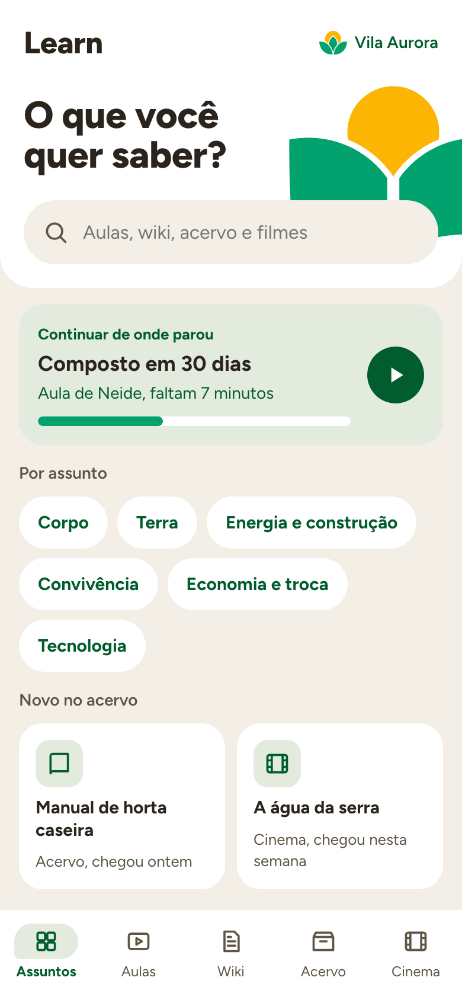 | 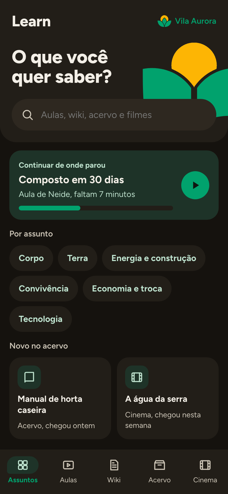 |

**What the person sees.** The cover, white in light mode, with "Learn", the community's name and mark, the Learn glyph drawn large and cut by the corner, the question "O que você quer saber?" and a search field that reads "Aulas, wiki, acervo e filmes". Under the cover, a soft card "Continuar de onde parou" with the last lesson the person left halfway, its author, how much is left, a progress bar and a round button to play. Then "Por assunto", the subjects as pills, such as "Corpo", "Terra", "Energia e construção", "Convivência", "Economia e troca" and "Tecnologia". Then "Novo no acervo", two cards with what arrived last in the collection and in the cinema, with where each came in and when.

**What they can do.** Search, which opens the results inside Learn. Go back to the lesson they left, at the minute they stopped. Open a subject. Open what is new. Move to the other parts by the bar, or to the portal by the community's name.

**States.**

- Nothing watched on this device: the card "Continuar de onde parou" is not shown, and the subjects move up.
- Nothing new in the collection: the section "Novo no acervo" is not shown.
- A community with no lessons yet: the subjects still show, each opening its empty page, and the bar leads to "Publicar aula".
- No link with the community: the notice "Sem ligação com a comunidade." in its fixed place. What the device already has open can be read; the search waits for the link.

**Who may.** Every resident, child, moderator, administrator and curator sees the same home.

**Writes and reads.** Nothing is written. It reads the subjects and what is new from the indexes of the machine the device reaches, and the lesson to continue from the device.

**Many machines.** The page is light, so every machine serves it. A new item whose file is on a machine that is off still shows, and opens to the state of something out of reach.

### Search inside Learn

**Path:** `/learn/search?q=`. **Proposed**; the search itself is **Built** for the open channels at `/search`.

| Light | Dark |
| --- | --- |
| 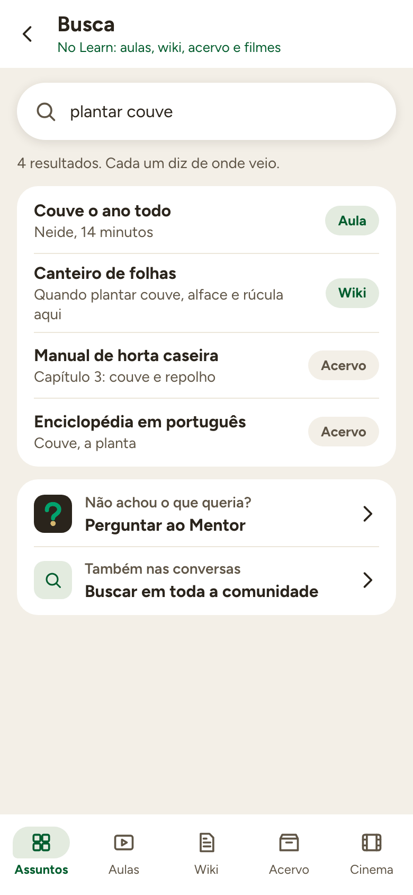 | 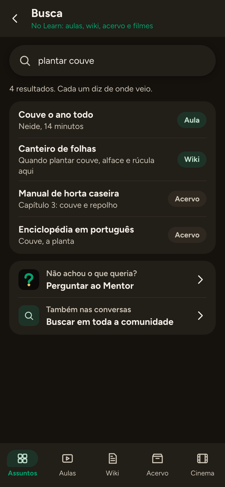 |

**What the person sees.** The inner header "Busca" with "No Learn: aulas, wiki, acervo e filmes", the field with the words typed, a line with how many results there are, "4 resultados. Cada um diz de onde veio.", and the results in one list. Each result has its title, a second line with what it is, such as the author and the length of a lesson or the chapter of a book, and a chip with where it came from: "Aula", "Wiki", "Acervo" or "Filme". Under the results, two ways onward: "Perguntar ao Mentor", which opens Ask with the same words, and "Buscar em toda a comunidade", which opens the search of the portal, where the conversations are too.

**What they can do.** Open a result: a lesson opens on its page, a wiki page on its page, a book of the collection in the reader at the passage found. Change the words and search again without leaving Learn. Ask the Mentor. Search the whole community.

**States.**

- Nothing typed: "Escreva no campo acima o que você procura."
- Nothing found: "Nada encontrado no Learn para essa busca.", with the two ways onward in larger type. The words, with no name, join the record of searches that found nothing, which feeds "O que falta" in [Ask](ask.md). A child's search never joins it. **Proposed**; this record is not built.
- Part of the collection out of reach: a line over the results, "Parte do acervo está fora de alcance agora, e a busca não olhou nela." The results that are reachable still show.
- No link with the community: the notice "Sem ligação com a comunidade.", and the field keeps the words.

Words are matched the way the built search matches them: reduced to their root, lowercase, with no accents. A lesson and a film are found by their title and description; what is said inside a video is not searched in this version.

**Who may.** Everyone. A child's results follow what the child may see.

**Writes and reads.** Nothing is written in the journal. The record of searches that found nothing keeps the words with no account, no device and no address, and the day only. The search reads the community's search index, and the search of the collection asks the program that serves the collection, one language at a time.

**Many machines.** Every machine searches the wiki, the lessons and the films by their texts, because they are in the journal. The search inside the books of the collection reaches only the machines that hold each book. With the community split in two, each side searches what it has.

### A subject

**Path:** `/learn/subjects/<subject>`. **Proposed.**

| Light | Dark |
| --- | --- |
| 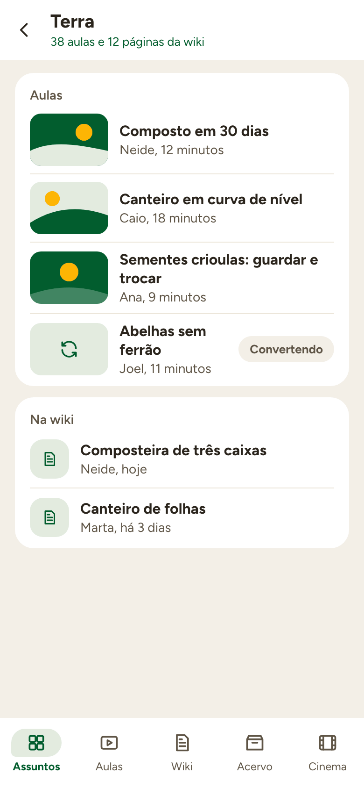 | 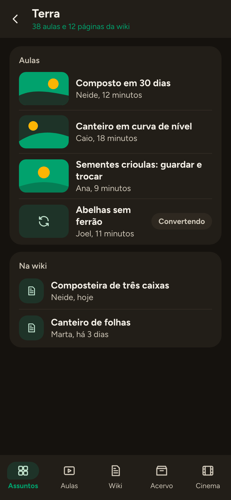 |

**What the person sees.** The inner header with the subject's name, "Terra", and how much it holds, "38 aulas e 12 páginas da wiki". A list "Aulas", each lesson with a drawn picture, its title, its author and its length. A lesson still converting shows a picture with the sign of conversion and the chip "Convertendo". Then a list "Na wiki" with the pages of that subject, each with who changed it last and when.

**What they can do.** Open a lesson or a page. Go back to the home.

**States.**

- A subject with nothing yet: "Ainda não há aulas de Terra. Quem sabe alguma coisa pode ensinar.", with the button "Publicar aula".
- A lesson whose video is out of reach: it stays in the list with the chip "Fora de alcance" and opens to its page, where the text and the questions can be read.

**Who may.** Everyone.

**Writes and reads.** Nothing is written. It reads the lessons and the pages of the subject from the indexes.

**Many machines.** The list comes from the journal, so it is the same on every machine. Only the videos depend on where they are kept.

Whether a wiki page and a pack of the collection carry a subject, so the subject page can list them, is **Not decided**. The drawing shows wiki pages as the proposal.

### Lessons

**Path:** `/learn/lessons`. **Proposed.**

| Light | Dark |
| --- | --- |
| 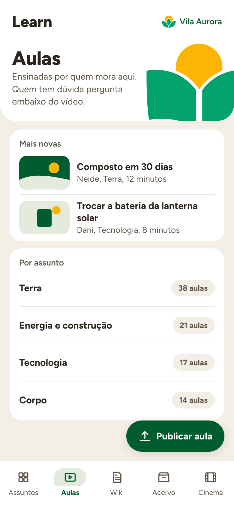 | 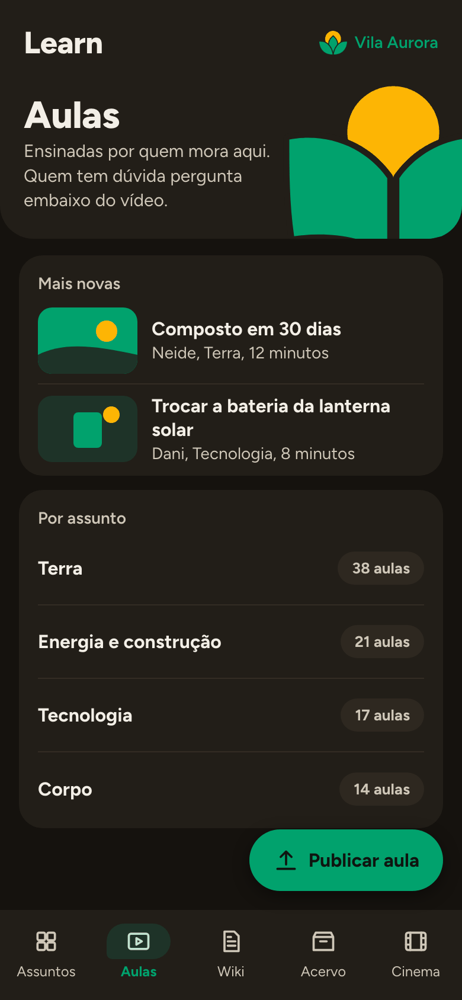 |

**What the person sees.** The cover with the title "Aulas" and the line "Ensinadas por quem mora aqui. Quem tem dúvida pergunta embaixo do vídeo." A list "Mais novas", with the last lessons published, each with its picture, title, author, subject and length. A list "Por assunto", each subject with how many lessons it has. A floating button "Publicar aula".

**What they can do.** Open a lesson. Open a subject. Publish a lesson.

**States.**

- No lessons in the community: "Ninguém publicou uma aula ainda. A primeira pode ser sua.", with "Publicar aula".
- A person who may not publish, such as a child where the charter does not allow it: the floating button is not shown.

**Who may.** Everyone watches. Publishing follows the table at the end.

**Writes and reads.** Nothing is written here. It reads the lessons index.

**Many machines.** The library is the same on every machine; a lesson whose video is on a machine that is off shows "Fora de alcance" in place of its length.

### A lesson

**Path:** `/learn/lessons/<id>`. **Proposed.**

| Light | Dark |
| --- | --- |
| 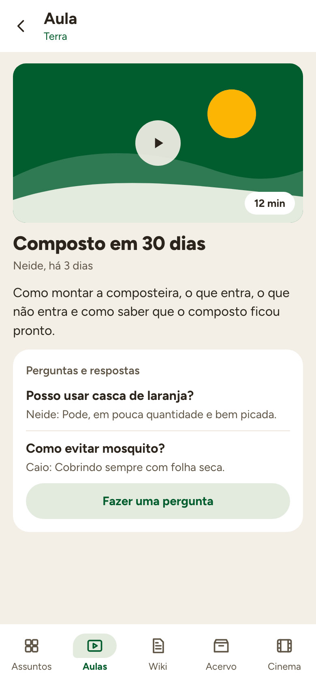 | 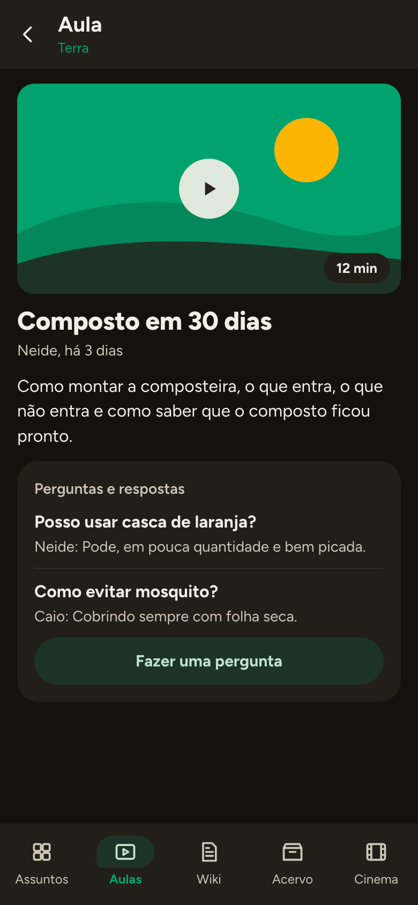 |

**What the person sees.** The inner header "Aula" with the subject. The video, with a button to play in the middle and its length in a corner. The title, "Composto em 30 dias", the author and when it was published, and the description of what the person will learn. Then a card "Perguntas e respostas", each question with its answer and who answered, and the button "Fazer uma pergunta".

**What they can do.** Play the video, pause it, move through it and see it full screen. Switch to the lighter size of the video when the Wi-Fi is weak. Ask a question, which opens a field with "Sua pergunta" and "Enviar". Answer a question. The author removes their own lesson from a menu, and the screen asks first: "Tirar esta aula? As perguntas e respostas saem junto."

**States.**

- Converting: the next section.
- Out of reach: the place of the video reads "Fora de alcance agora" and "Esta aula está guardada num computador da comunidade que está desligado. Volta sozinha quando ele ligar." The title, the description and the questions still show, and a question can still be asked.
- No questions yet: "Ninguém perguntou ainda."
- A question written with no link: it stays under the video with the mark "Ainda não enviada" and goes by itself when the link returns. **Proposed**; the outbox needs the device's part, which is not built.
- A question that arrived late, after others written later: it takes its place by the time it was written, with the mark "Chegou depois".
- Removed by a moderator: "Esta aula foi tirada por um moderador.", with the reason, which also goes to the log.

The video is a common file that any browser plays, served in parts, in two sizes. Which size starts is **Not decided**.

**Who may.** Everyone watches. Asking and answering: residents, moderators, administrators and curators; whether a child asks under a lesson is **Not decided**. Removing someone else's lesson or question: moderators and administrators, always with a reason.

**Writes and reads.** A question writes `lesson.asked`, an answer `lesson.answered`, a removal `lesson.removed`. It reads the lesson and its questions from the lessons index, the video from a machine that keeps it, and the minute where the person stopped from the device, which it also updates there.

**Many machines.** The lesson's text and its questions are in the journal and every machine shows them; asking never waits. The video comes from whichever machine keeping it is up.

### A lesson being converted

**Path:** `/learn/lessons/<id>`, as a state of the lesson. **Proposed.**

| Light | Dark |
| --- | --- |
| 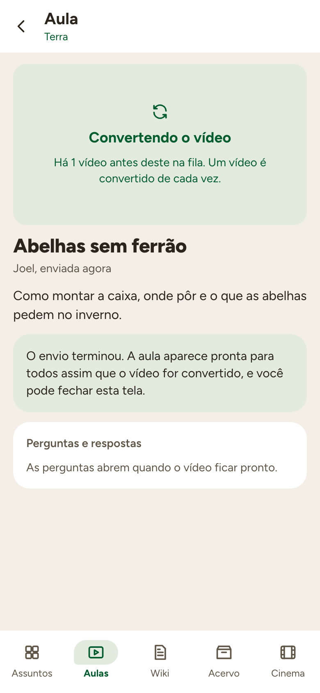 | 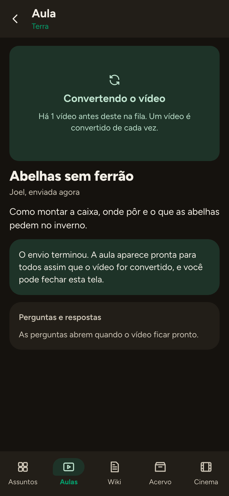 |

**What the person sees.** In the place of the video, the sign of conversion, "Convertendo o vídeo" and the place in the line, "Há 1 vídeo antes deste na fila. Um vídeo é convertido de cada vez." Then the title, the author with "enviada agora", the description, and a soft card for the author: "O envio terminou. A aula aparece pronta para todos assim que o vídeo for convertido, e você pode fechar esta tela." The card "Perguntas e respostas" reads "As perguntas abrem quando o vídeo ficar pronto."

**What they can do.** Close the screen; the conversion goes on by itself. The author can still remove the lesson.

**States.**

- First in line: "Convertendo agora."
- The conversion is stopped because no machine that converts is up: "A conversão está parada agora e continua sozinha."
- The video could not be converted: "Não foi possível converter este vídeo. Tente enviar de novo, de preferência gravado pelo próprio celular." The lesson is not shown to others, and the space it took returns to the quota. **Proposed**; the sentence waits for the maintainer.
- When the conversion ends, an open page shows the video by itself.

**Who may.** Everyone who opens it sees the state. Only the author sees the card about the upload.

**Writes and reads.** Nothing is written by the person. When the video is ready, the core writes `lesson.converted`. It reads the line of conversion from the lessons index.

**Many machines.** The conversion runs on a machine that carries the video service, one job at a time. If that machine stops, the job returns to the line when it starts again, because a lesson sent and not converted goes back to the line after any restart. Splitting one conversion across machines is not proposed.

### Publishing a lesson

**Path:** `/learn/lessons/publish`. **Proposed.**

| Light | Dark |
| --- | --- |
| 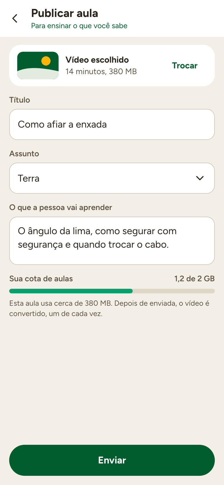 | 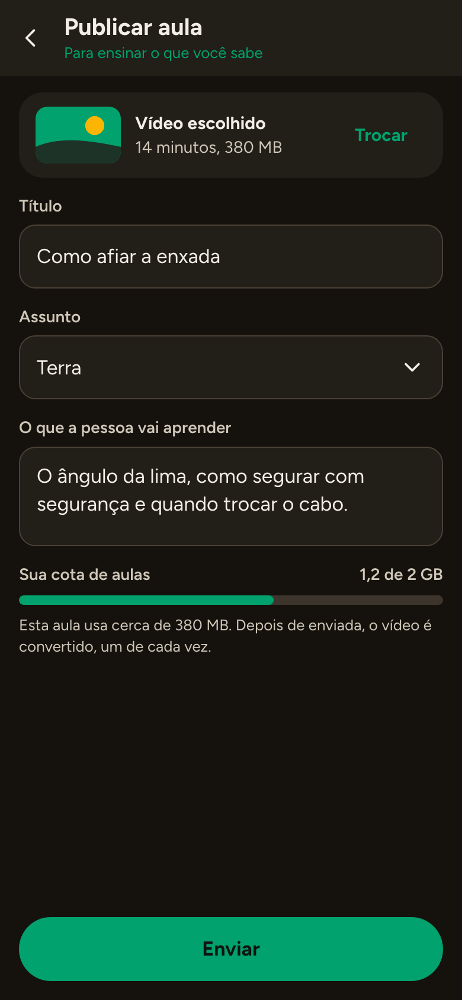 |

**What the person sees.** The inner header "Publicar aula" with "Para ensinar o que você sabe". A card with the video chosen, its picture, its length and its size, and the button "Trocar". The fields "Título", "Assunto", a list to choose from, and "O que a pessoa vai aprender". Then "Sua cota de aulas", with how much is used, "1,2 de 2 GB", a bar, and how much this lesson takes: "Esta aula usa cerca de 380 MB. Depois de enviada, o vídeo é convertido, um de cada vez." At the bottom, "Enviar".

**What they can do.** Choose a video from the phone or the computer, or record one where the device allows. Write the title and what the person will learn, choose the subject and send.

**States.**

- No video chosen yet: in place of the card, a large area "Escolher vídeo" with "Do celular ou do computador".
- A field left empty: "Dê um título para a aula." or "Escolha um assunto.", under the field, with everything written kept.
- A file that is not a video: "Este arquivo não é um vídeo."
- A video larger than one file may be: "Este vídeo passa do tamanho que a comunidade aceita para uma aula."
- Sending: see the next section. Quota full: see the one after.
- No place to keep lessons is up: "Agora não dá para enviar vídeos. O lugar onde as aulas ficam guardadas está desligado. O que você escreveu fica aqui." This is not the notice of what is counted; it is the state of a heavy service. **Not decided**, with the question of how a machine with no disk receives an upload.
- No link with the community: the notice "Sem ligação com a comunidade.", and "Enviar" waits for the link with the form kept.

**Who may.** Residents, moderators, administrators and curators, within the quota. A child, by the charter.

**Writes and reads.** Nothing is written until the upload ends. Before the first piece, the core checks the quota and the size. It reads the person's quota and the list of subjects.

**Many machines.** Publishing lives where it fits: the video goes to a machine that has disk for lessons. **To prove**: how the upload reaches that machine when the device is near another one.

### Sending

**Path:** `/learn/lessons/publish`, as a state. **Proposed.**

| Light | Dark |
| --- | --- |
| 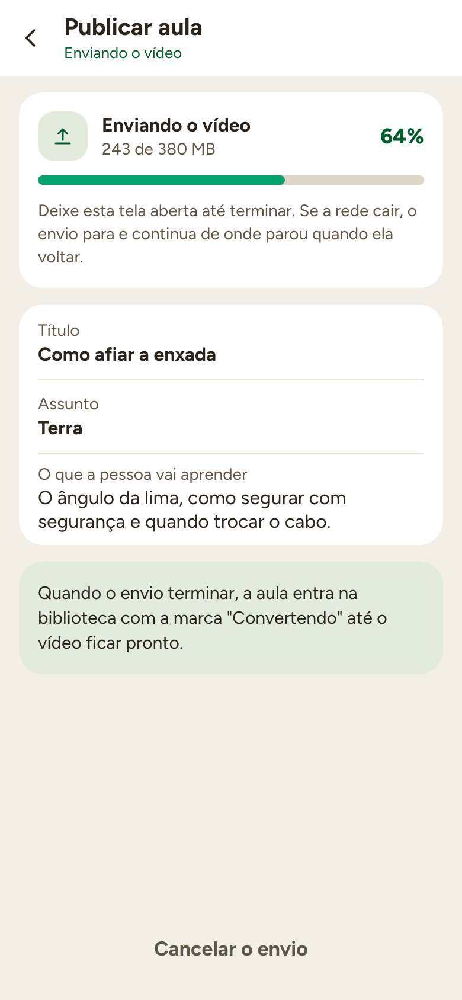 | 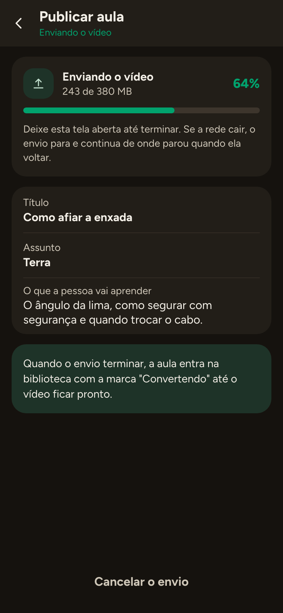 |

**What the person sees.** A card "Enviando o vídeo" with how much went, "243 de 380 MB", the percentage, a bar and the sentence "Deixe esta tela aberta até terminar. Se a rede cair, o envio para e continua de onde parou quando ela voltar." Under it, the title, the subject and the description as they were written. A soft card says what comes next: "Quando o envio terminar, a aula entra na biblioteca com a marca "Convertendo" até o vídeo ficar pronto." At the bottom, "Cancelar o envio".

**What they can do.** Wait. Cancel the upload, which asks first: "Cancelar o envio? O que já foi enviado é descartado." When it ends, the screen becomes the lesson in its converting state.

**States.**

- The Wi-Fi dropped: the notice "Sem ligação com a comunidade." and, in the card, "Envio parado. Continua de onde parou quando a ligação voltar."
- The screen was closed halfway: on return to "Publicar aula", "Há um envio pela metade: Como afiar a enxada.", with "Continuar" and "Descartar", as long as the device still has the video.
- The file arrived damaged: "O vídeo chegou com defeito. Envie de novo." The core compares the digest of what arrived with the one the device announced.

**Who may.** The person who is sending.

**Writes and reads.** The video goes in pieces, each with its position, so the upload continues where it stopped. At the end, the device gives the file's digest, the core checks it, keeps the file and writes `lesson.published`.

**Many machines.** The upload goes to one machine from start to end. **To prove**: whether a browser on the iPhone keeps sending with the screen locked; the drawing asks the person to keep it open.

### Quota full

**Path:** `/learn/lessons/publish`, as a state. **Proposed.**

| Light | Dark |
| --- | --- |
| 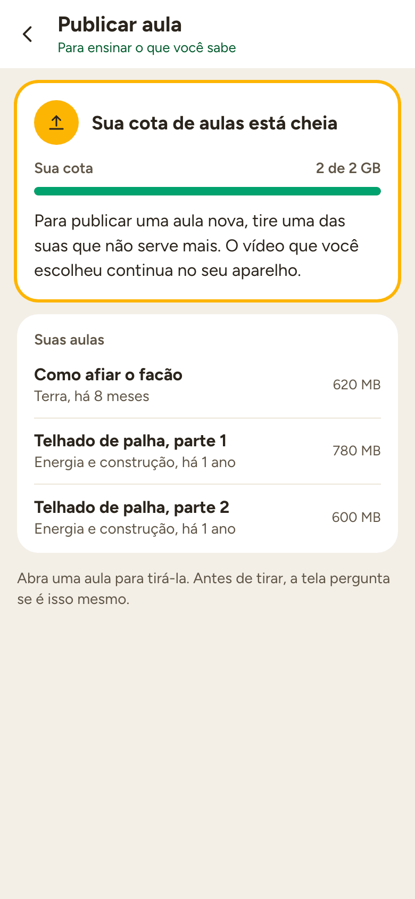 | 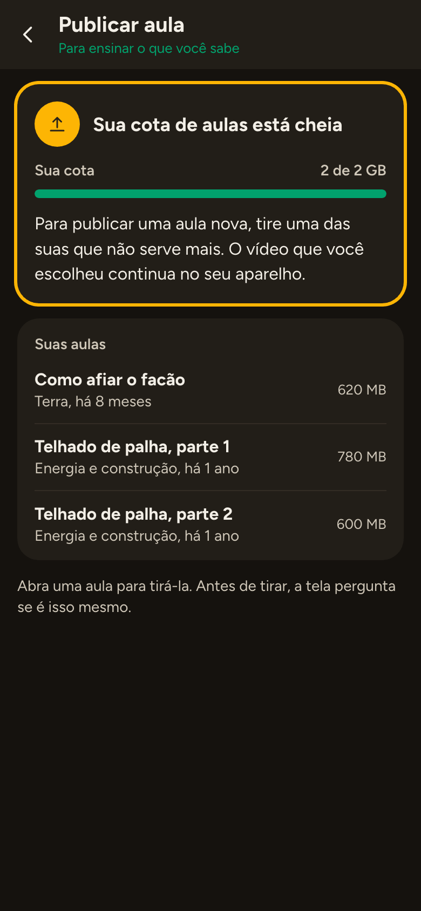 |

**What the person sees.** A card with a ring in the sun color, "Sua cota de aulas está cheia", the quota full, "2 de 2 GB", and "Para publicar uma aula nova, tire uma das suas que não serve mais. O vídeo que você escolheu continua no seu aparelho." Under it, "Suas aulas", each with its subject, its age and its size, and the sentence "Abra uma aula para tirá-la. Antes de tirar, a tela pergunta se é isso mesmo."

**What they can do.** Open one of their lessons and remove it, which frees its space. Go back.

**States.**

- The new video does not fit in what is left, though the quota is not full: "Esta aula usa cerca de 380 MB, e sobram 120 MB na sua cota."

**Who may.** The person whose quota it is.

**Writes and reads.** Nothing is written here. It reads the person's lessons and the space each one takes.

**Many machines.** The quota is counted from the journal, so every machine gives the same answer. Two uploads at the same moment on two machines could pass the quota together; **Not decided** how that is settled.

The quota per resident is a rule of the charter, chosen at setup. **Not decided**: the default, whether it counts the video sent or the converted one, and whether someone can raise the quota of one person.

### Wiki

**Path:** `/learn/wiki`. **Proposed.**

| Light | Dark |
| --- | --- |
| 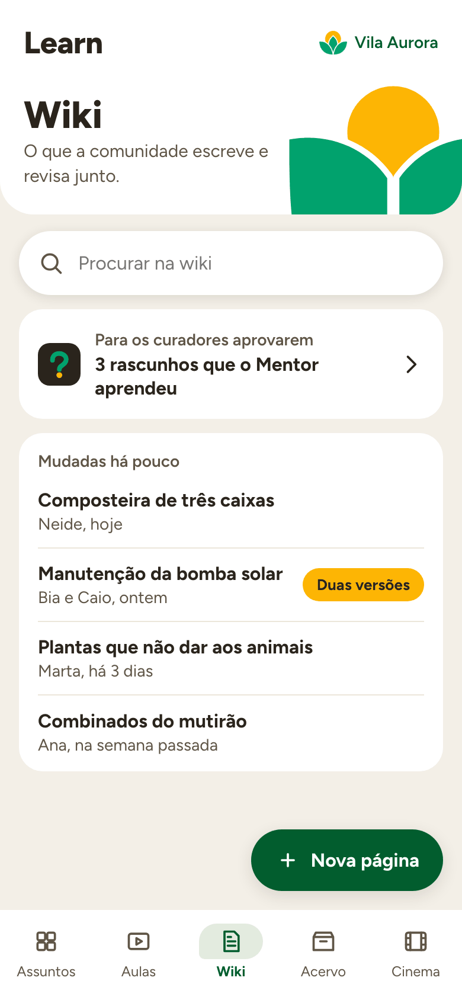 | 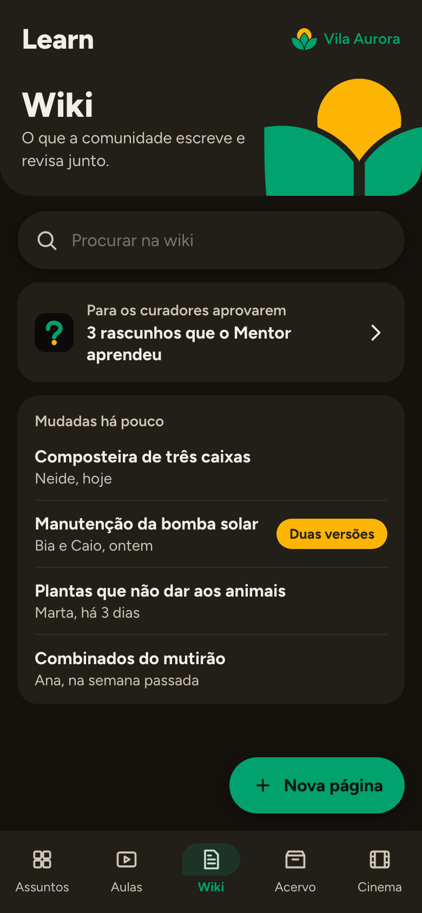 |

**What the person sees.** The cover with the title "Wiki" and the line "O que a comunidade escreve e revisa junto." A field "Procurar na wiki". For a curator, a card "Para os curadores aprovarem" with how many drafts wait, "3 rascunhos que o Mentor aprendeu". A list "Mudadas há pouco", each page with who changed it and when; a page that holds two versions shows the chip "Duas versões" in the sun color. A floating button "Nova página".

**What they can do.** Search the wiki. Open a page. Open the drafts. Start a new page, which opens the editor empty.

**States.**

- An empty wiki: "A wiki da comunidade ainda está vazia. Comece pelo que todo mundo pergunta.", with "Nova página".
- No drafts waiting: the card is not shown.
- A resident who is not a curator: the card reads "3 rascunhos esperam os curadores" and opens the list to read only.

**Who may.** Everyone reads. Writing follows the table at the end.

**Writes and reads.** Nothing is written here. It reads the wiki index: pages, versions and drafts.

**Many machines.** The wiki is essential: every machine holds all of it, and writing never waits.

### A wiki page

**Path:** `/learn/wiki/<page>`. **Proposed.**

| Light | Dark |
| --- | --- |
| 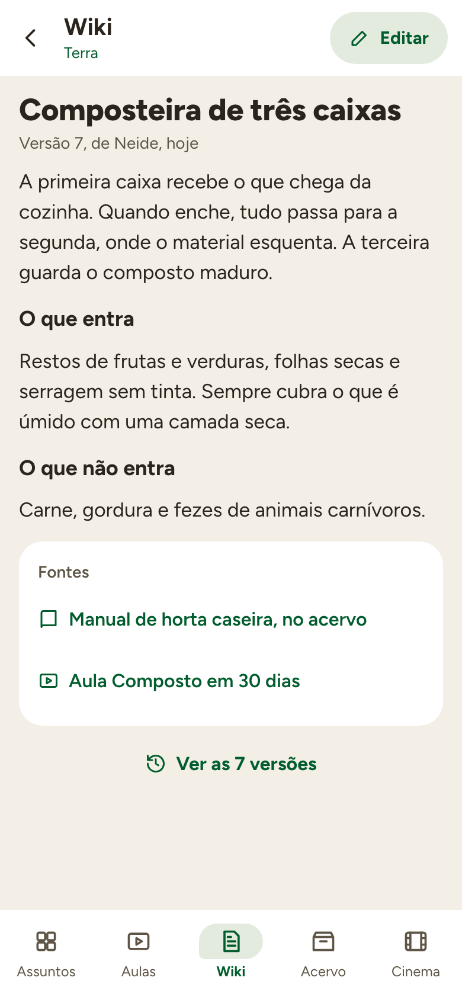 | 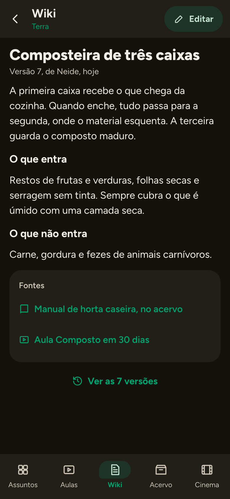 |

**What the person sees.** The inner header "Wiki" with the subject, and the button "Editar". The title, the version with who wrote it and when, "Versão 7, de Neide, hoje", and the text with its sections. A card "Fontes", where each source opens where it lives: a book of the collection in the reader, a lesson on its page, an outside source with the day it was read. At the end, "Ver as 7 versões".

**What they can do.** Read. Open a source. Edit. See the versions.

**States.**

- No approved version: the next section.
- Two versions: over the title, a card in the sun ring, "Esta página tem duas versões. Ver as duas.", while the page shows the version written later. **Proposed.**
- A version removed by a moderator: the page shows the version before it, and the versions keep "Versão tirada por um moderador", with the reason.
- A page that does not exist: "Esta página ainda não existe.", with "Escrever esta página".
- No link with the community: the notice "Sem ligação com a comunidade."; a page already open stays readable.

**Who may.** Everyone reads. Editing follows the table at the end.

**Writes and reads.** Nothing is written. It reads the page's version in use and its sources.

**Many machines.** Every machine shows the same page. When two versions exist, every machine shows the same one in use, because the order between machines comes from the time with its rule ([many machines](../design/many-machines.md)).

### A page with no approved version

**Path:** `/learn/wiki/<page>`, as a state. **Proposed.**

| Light | Dark |
| --- | --- |
| 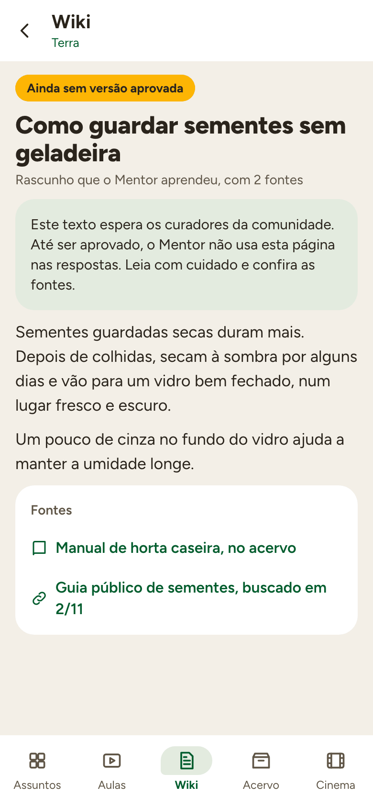 | 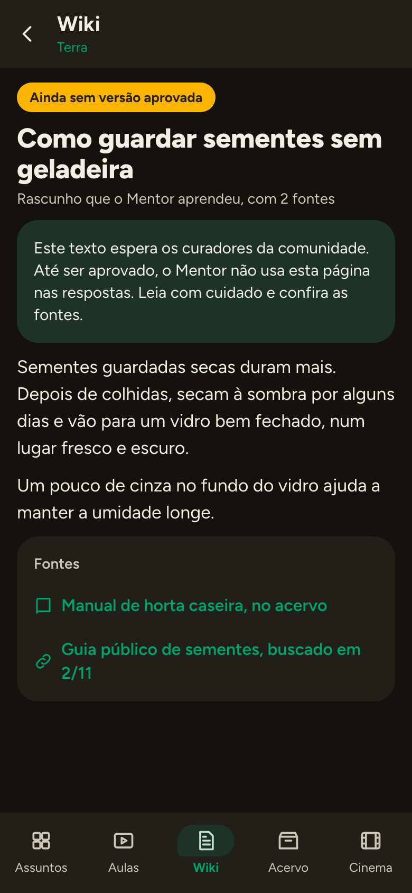 |

**What the person sees.** The chip "Ainda sem versão aprovada" in the sun color, the title, and "Rascunho que o Mentor aprendeu, com 2 fontes". A soft card: "Este texto espera os curadores da comunidade. Até ser aprovado, o Mentor não usa esta página nas respostas. Leia com cuidado e confira as fontes." Then the text of the draft and its sources.

**What they can do.** Read and open the sources. A curator approves or refuses from the drafts.

**States.**

- Approved: the page becomes an ordinary page, its first version marked "Mentor, aprovada por" and the names of the curators.
- Refused: "Os curadores recusaram este rascunho.", and the page leaves the wiki.

A page reaches this state when its only text is a draft from the Mentor or from an artificial intelligence the administration connected. The page is not listed among the wiki's pages until it is approved; a person meets it through a source of an answer, a search or a link.

**Who may.** Every resident reads it; whether a child does is **Not decided**, as in [Ask](ask.md). Approving and refusing are given by the charter.

**Writes and reads.** Nothing is written here. It reads the draft and its sources.

**Many machines.** The draft is in the journal, so every machine shows it, with or without the Mentor.

### Editing a page

**Path:** `/learn/wiki/<page>/edit`. **Proposed.**

| Light | Dark |
| --- | --- |
| 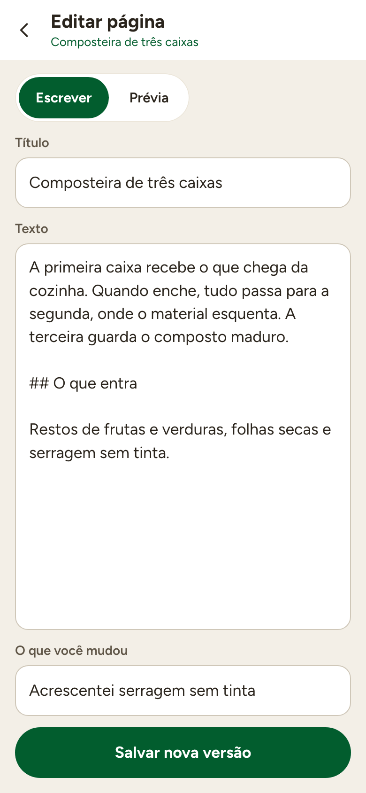 | 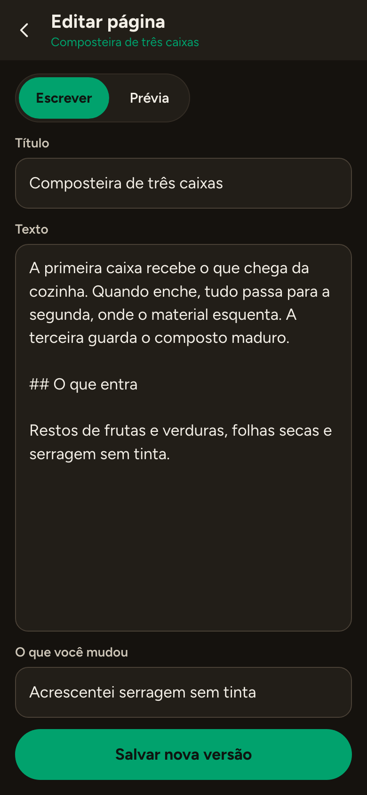 |

**What the person sees.** The inner header "Editar página" with the page's title. Two tabs, "Escrever" and "Prévia". The fields "Título" and "Texto", the text taking the rest of the screen, and "O que você mudou", a line that goes into the versions. At the bottom, "Salvar nova versão".

**What they can do.** Write. See the page as it will look, in "Prévia". Add a source: a book of the collection, a lesson or an outside source. Save, which opens the page with the new version.

**States.**

- A field left empty: "A página precisa de um título." and "Diga em poucas palavras o que você mudou.", with the text kept.
- Someone saved another version while the person was writing: the save goes through, both versions are kept, and the page opens on "Duas versões".
- Saved with no link: the page shows the new version with the mark "Ainda não enviada", and it goes by itself when the link returns. **Proposed**; the outbox is not built.
- Leaving with changes not saved: "Sair sem salvar? O que você escreveu se perde.", with "Continuar escrevendo" first.

**Who may.** Residents, moderators, administrators and curators. A child, by the charter.

**Writes and reads.** Saving writes `page.revised`, with the version it started from, the new text, the line of what changed and the author. It reads the version in use.

**Many machines.** Any machine accepts a new version alone, and the editor never waits. The way to write a heading, a list or a link in the text is **Not decided**; the drawing shows a heading started with "##".

### Two versions of a page

**Path:** `/learn/wiki/<page>/both`. **Proposed.**

| Light | Dark |
| --- | --- |
| 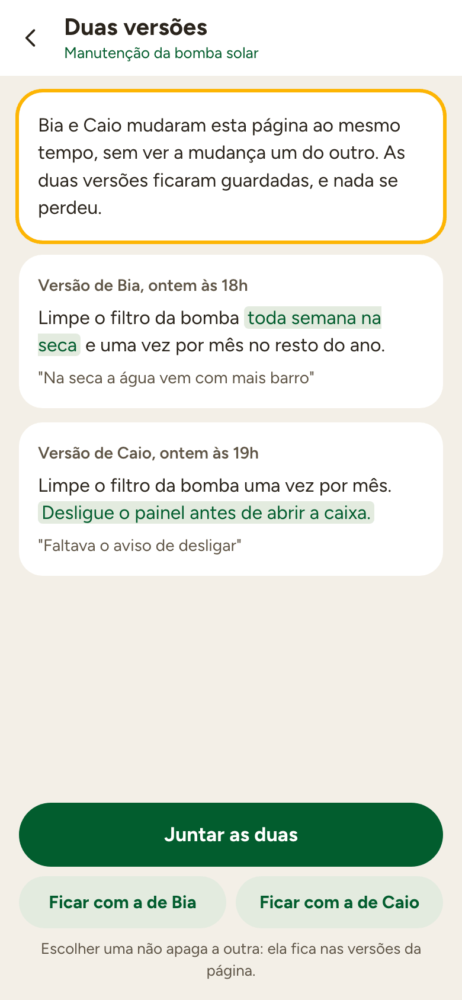 | 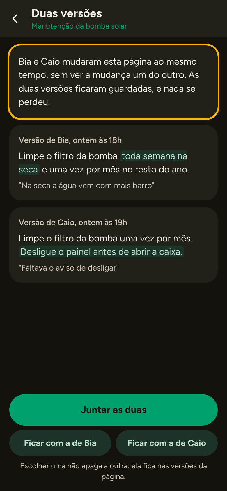 |

**What the person sees.** The inner header "Duas versões" with the page's title. A card in the sun ring: "Bia e Caio mudaram esta página ao mesmo tempo, sem ver a mudança um do outro. As duas versões ficaram guardadas, e nada se perdeu." Then each version in its card, with who wrote it and when, what is different marked, and the line each one wrote about the change. At the bottom, "Juntar as duas", and "Ficar com a de Bia" and "Ficar com a de Caio", with "Escolher uma não apaga a outra: ela fica nas versões da página."

**What they can do.** Join the two, which opens the editor with both texts, the differences marked. Keep one, which writes a new version with its text. Leave it for someone else; the page keeps showing the version written later, with the mark.

**States.**

- Three or more versions from the same starting point: the same screen, one card for each.
- Someone settled it meanwhile: "Esta página já tem uma versão que junta as duas.", with the way to the page.

The sentence never mentions a machine. It is the same whether the two people saved on the same machine a second apart or on two sides of a community that was split for a day.

**Who may.** Everyone who may edit the page.

**Writes and reads.** Joining or keeping writes `page.revised`, starting from both versions, so the mark leaves the page. It reads the versions that share the starting point.

**Many machines.** This is how the wiki keeps "writing never waits" true: two versions written apart both stay, and a person decides, never the machines ([many machines](../design/many-machines.md)). Which of the two the Mentor uses while both stand is **Not decided**.

### Page versions

**Path:** `/learn/wiki/<page>/versions`. **Proposed.**

| Light | Dark |
| --- | --- |
| 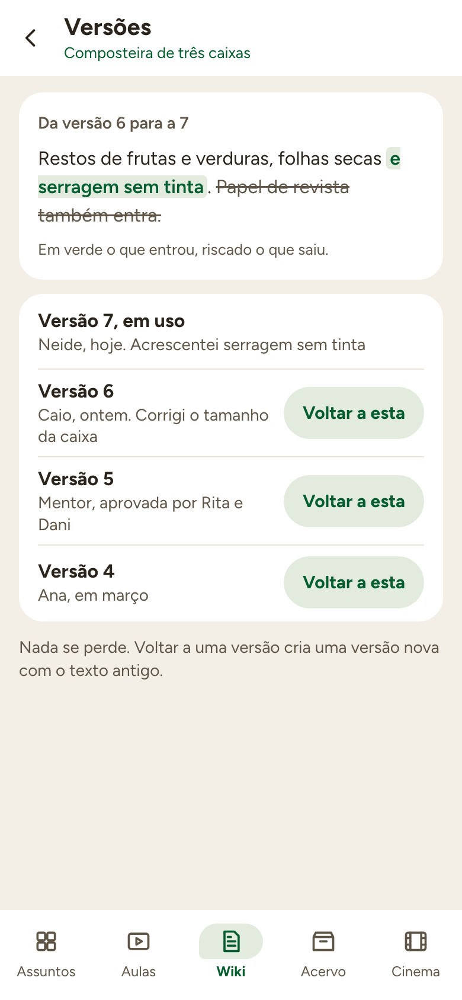 | 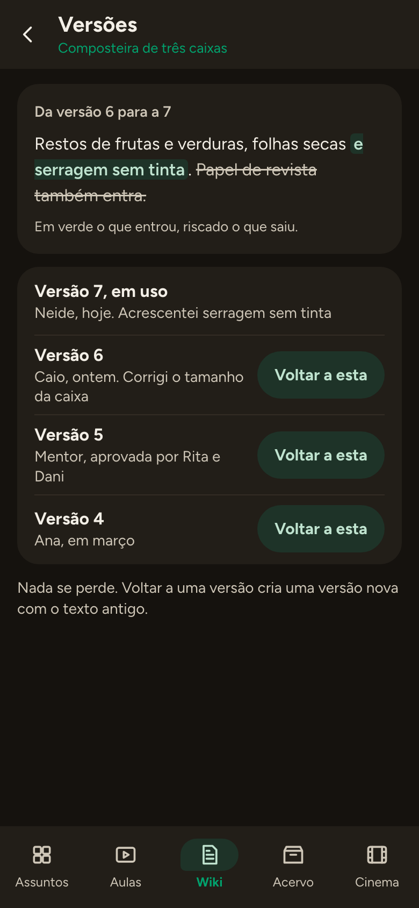 |

**What the person sees.** The inner header "Versões" with the page's title. A card comparing two versions, "Da versão 6 para a 7", with what came in marked in green and what went out struck, and "Em verde o que entrou, riscado o que saiu." Then the list of versions, newest first, each with its author, when, and the line about the change: "Versão 7, em uso", then the older ones, each with "Voltar a esta". A version that came from a draft says "Mentor, aprovada por Rita e Dani". At the end: "Nada se perde. Voltar a uma versão cria uma versão nova com o texto antigo."

**What they can do.** Compare any two versions. Go back to an older version, which asks first, "Voltar à versão 6? A versão 7 continua guardada.", and writes a new version.

**States.**

- One version only: "Esta é a primeira versão da página."
- A version removed by a moderator: it stays in the list as "Versão tirada por um moderador", with the reason and no text.

**Who may.** Everyone reads the versions. Going back: everyone who may edit.

**Writes and reads.** Going back writes `page.revised` with the old text. It reads all the versions of the page.

**Many machines.** The versions are in the journal; every machine shows the same list, in the same order.

### Drafts to approve

**Path:** `/learn/wiki/drafts`. **Proposed.**

| Light | Dark |
| --- | --- |
| 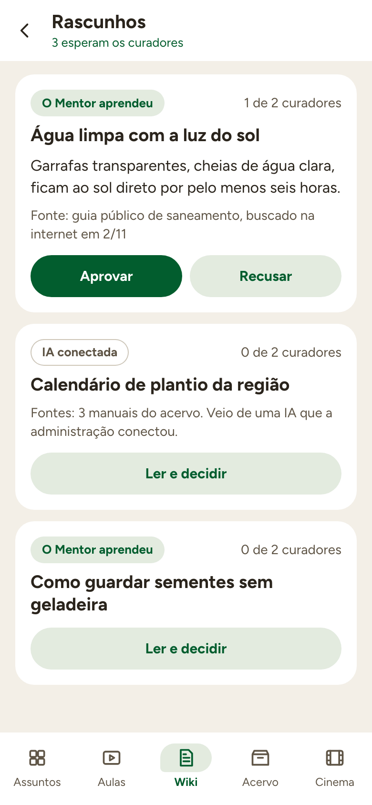 | 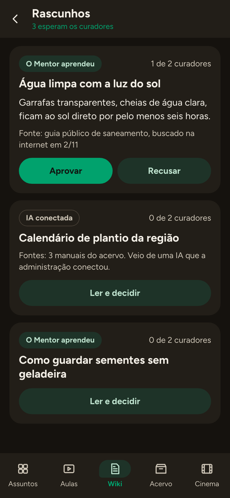 |

**What the person sees.** The inner header "Rascunhos" with "3 esperam os curadores". One card per draft. A mark says where it came from: "O Mentor aprendeu", for a text the Mentor wrote in its own words from an outside source, or "IA conectada", for a text proposed by an artificial intelligence the administration connected. Beside it, how many curators approved, "1 de 2 curadores". Then the title, the beginning of the text, the sources with the day they were read, and "Aprovar" and "Recusar", or "Ler e decidir" when the text is long.

**What they can do.** Read a draft whole, with its sources open. Approve. Refuse, with a reason if they want to give one. The page "Ler e decidir" shows the draft as it would enter the wiki and, when it changes an existing page, the comparison with the version in use.

**States.**

- The curator already approved: the card reads "Você aprovou. Falta 1 curador.", and the buttons leave.
- Approved by enough curators: the draft leaves the list and becomes a version of the page.
- Refused: the draft leaves the list. The subject stays in "O que falta", in [Ask](ask.md).
- No drafts: "Nenhum rascunho esperando."
- A resident who is not a curator: the same list, to read, with "Quem aprova são os curadores da comunidade."

**Who may.** Approving and refusing are given by the charter: curators, or the people the charter names. A child never approves.

**Writes and reads.** Approving writes `draft.approved` with the curator's name; refusing writes `draft.refused`. When the approvals reach what the charter asks, the core writes the draft as a version of the page. It reads the drafts written by `draft.proposed`.

**Many machines.** An approval is a fact that stacks, like a vote in the open, so it never waits for the machines of the list. **Proposed**, the same reading as in [Ask](ask.md). **Not decided**: what happens when one curator approves and another refuses while the community is split.

How many curators approve is **Not decided**; the drawing shows two as an example. The drafts proposed by a connected artificial intelligence depend on the doors and the connected AIs of the [administration](admin.md), and follow the same approval.

### Collection

**Path:** `/learn/collection`. **Proposed.**

| Light | Dark |
| --- | --- |
| 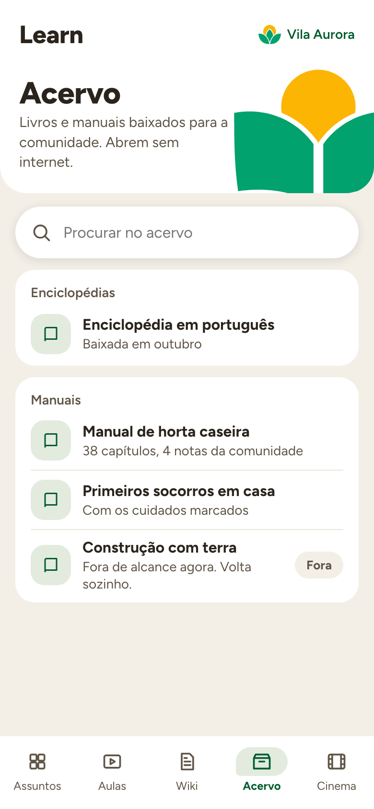 | 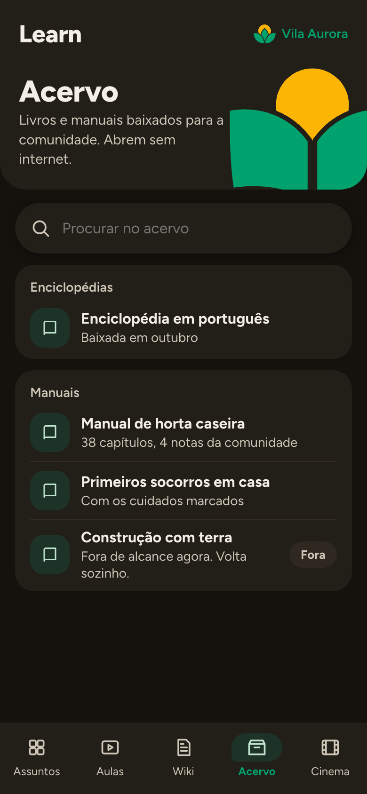 |

**What the person sees.** The cover with the title "Acervo" and the line "Livros e manuais baixados para a comunidade. Abrem sem internet." A field "Procurar no acervo". The books in groups, such as "Enciclopédias" and "Manuais", each with its name and a second line: when it was downloaded, how many chapters it has, how many notes the community wrote in it, or that its cautions are marked. A book on a machine that is off shows "Fora de alcance agora. Volta sozinho." and the chip "Fora".

**What they can do.** Search inside the collection. Open a book in the reader.

**States.**

- A collection with nothing installed: "O acervo ainda está vazio. Quem cuida da comunidade escolhe o que baixar."
- A book out of reach: it stays in the list with its mark, and opening it shows the same sentence.
- No link with the community: the notice "Sem ligação com a comunidade."

**Who may.** Everyone reads. Choosing what enters the collection belongs to the administrator's screens, in [administration](admin.md).

**Writes and reads.** Nothing is written here. It reads the list of packs installed, each with its name, language, license and origin, and the count of notes from the wiki index.

**Many machines.** The collection is heavy: each pack lives on the machines that have disk for it. The list of packs is the same everywhere; only the books on a machine that is off are out of reach. The collection does not go in the copies; a lost pack comes back from a USB stick, from the internet or from another community's disk.

### The reader

**Path:** `/learn/collection/<pack>/<path>`. **Proposed.**

| Light | Dark |
| --- | --- |
| 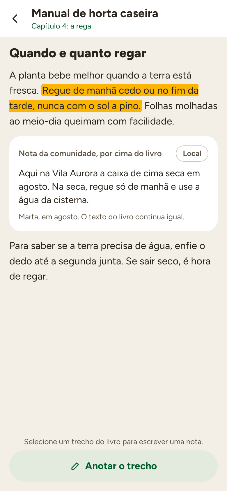 | 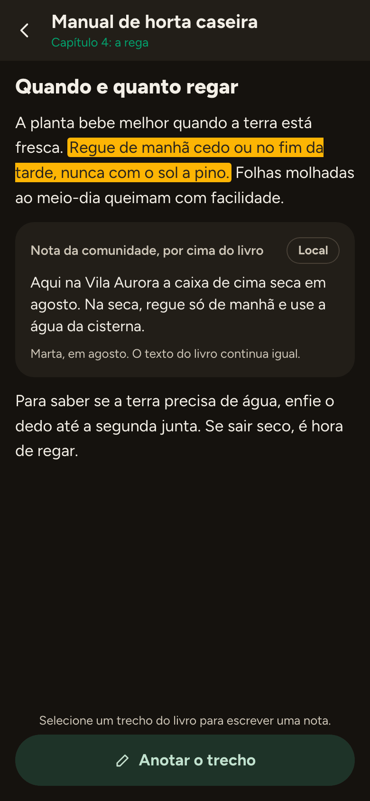 |

**What the person sees.** The inner header with the book's name, "Manual de horta caseira", and the chapter. The text of the book, exactly as it was downloaded. A passage that carries a note is marked in the sun color, and the note sits right after it, in a card: "Nota da comunidade, por cima do livro", the chip "Local", the note, and who wrote it and when, with "O texto do livro continua igual." At the bottom, "Selecione um trecho do livro para escrever uma nota." and the button "Anotar o trecho".

**What they can do.** Read and move through the book by its own links. Open a note's author. Select a passage and write a note. Edit a note they wrote.

**States.**

- A note whose passage is gone: see below.
- Opened from a source in Ask or in the wiki: the reader opens at the cited passage, marked.
- A book out of reach: "Este livro está guardado num computador da comunidade que está desligado. Volta sozinho quando ele ligar."
- No link with the community: the notice "Sem ligação com a comunidade."; the chapter already open stays readable.

**Who may.** Everyone reads. Writing a note follows the table at the end.

**Writes and reads.** Nothing is written by reading. It reads the book from the program that serves the collection, inside a closed frame, and the notes of that book and chapter from the wiki index.

**Many machines.** The book comes from a machine that keeps it. The notes are in the journal, so a note written on one machine shows over the same book on every other.

### Writing a note

**Path:** a sheet over `/learn/collection/<pack>/<path>`. **Proposed.**

| Light | Dark |
| --- | --- |
| 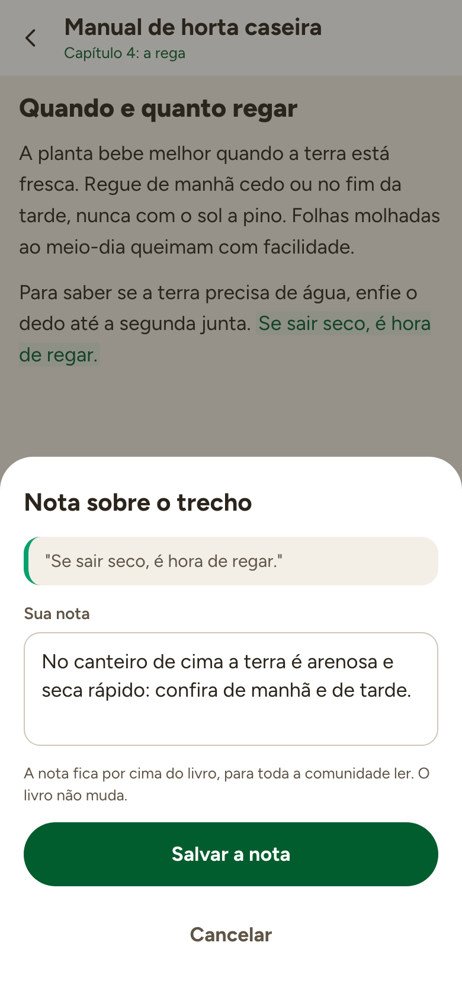 | 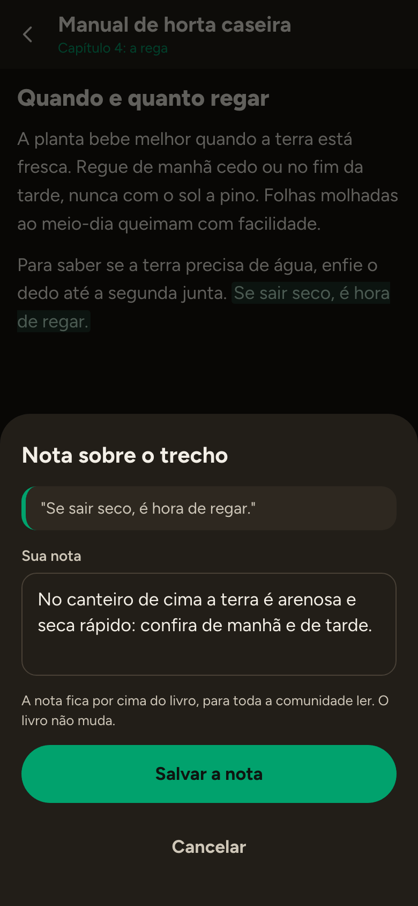 |

**What the person sees.** The book behind a veil, the passage selected marked. A sheet "Nota sobre o trecho", with the passage quoted, the field "Sua nota", the sentence "A nota fica por cima do livro, para toda a comunidade ler. O livro não muda.", "Salvar a nota" and "Cancelar".

**What they can do.** Write the note and save it, or cancel. The focus stays in the sheet while it is open and returns to the passage when it closes.

**States.**

- An empty note: "Salvar a nota" stays off until something is written.
- Saved with no link: the note shows over the book with the mark "Ainda não enviada" and goes by itself when the link returns. **Proposed**; the outbox is not built.

**Who may.** Residents, moderators, administrators and curators. A child, by the charter.

**Writes and reads.** Saving writes `note.created`, holding the book, the path inside it, the passage quoted with a little of the text around it, the note and the author. Editing later writes `note.edited`.

**Many machines.** A note is essential and never waits ([many machines](../design/many-machines.md)). Two people noting the same passage at the same time make two notes, both shown.

The passage reaches the screen through a small script that the core adds to every page of the collection it serves. The script sends only the selected text and its surroundings, the screen treats them as untrusted text, and nothing is written until the person taps "Salvar a nota". **Proposed.**

### A note whose passage is gone

**Path:** `/learn/collection/<pack>/<path>`, as a state. **Proposed.**

| Light | Dark |
| --- | --- |
| 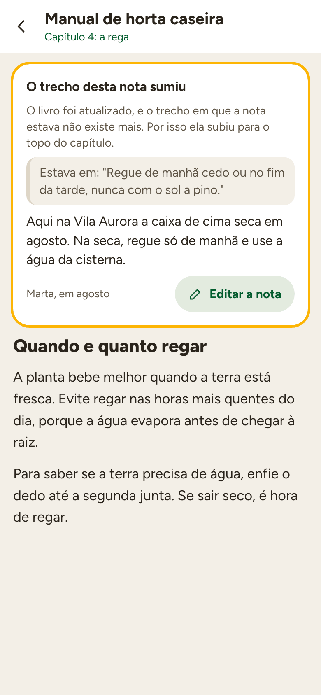 | 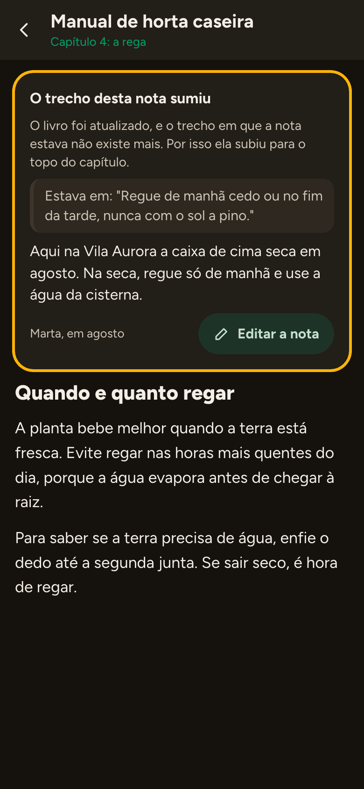 |

**What the person sees.** At the top of the chapter, before the text, a card in the sun ring: "O trecho desta nota sumiu", and "O livro foi atualizado, e o trecho em que a nota estava não existe mais. Por isso ela subiu para o topo do capítulo." The old passage quoted, "Estava em: …", the note, its author and "Editar a nota". Then the chapter as the new version of the book has it.

**What they can do.** Read the note and the chapter. The author edits the note.

**States.**

- Several notes lost their passage: each has its card at the top, in the order they were written.

**Who may.** Everyone reads. Editing: the author of the note.

**Writes and reads.** Nothing is written when the note rises: the core finds no passage that matches and shows the note at the top. Editing writes `note.edited`. **Not decided**: whether a person can attach the note to another passage, and whether the author can delete a note.

**Many machines.** Each machine that holds the book does the same search and shows the same result. A machine that still holds the old version of the book shows the note on its passage until it receives the new one.

### Cinema

**Path:** `/learn/cinema`. **Proposed.**

| Light | Dark |
| --- | --- |
| 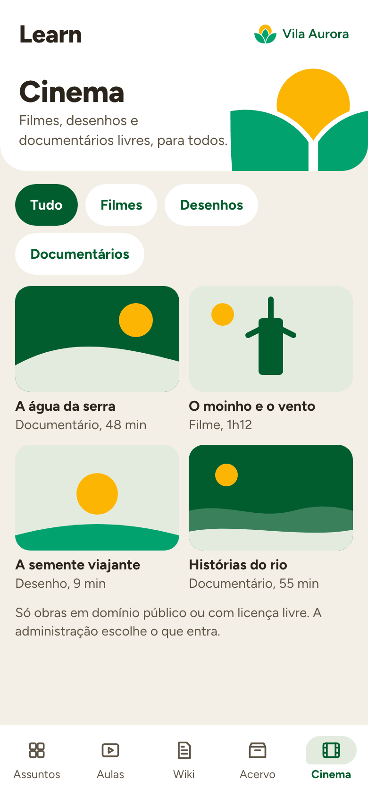 | 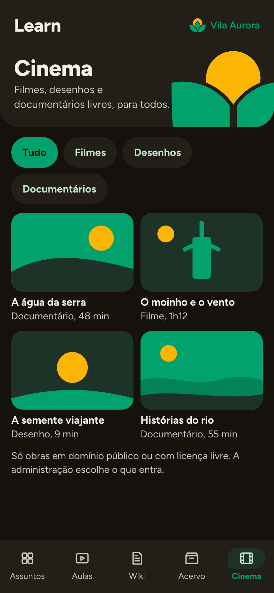 |

**What the person sees.** The cover with the title "Cinema" and the line "Filmes, desenhos e documentários livres, para todos." Choices of kind, "Tudo", "Filmes", "Desenhos" and "Documentários". The films in two columns, each with a drawn picture, its title and its kind and length. At the end: "Só obras em domínio público ou com licença livre. A administração escolhe o que entra."

**What they can do.** Choose a kind. Open a film.

**States.**

- No films: "O cinema ainda está vazio. Quem cuida da comunidade escolhe os filmes."
- A film out of reach: it stays in the grid with "Fora de alcance" in place of its length.

**Who may.** Everyone watches. What enters the cinema is chosen in the administrator's screens.

**Writes and reads.** Nothing is written. It reads the films added, each with its kind, length, license and origin.

**Many machines.** Films are heavy and live on the machines with disk for them. The list is the same on every machine.

### A film

**Path:** `/learn/cinema/<id>`. **Proposed.**

| Light | Dark |
| --- | --- |
| 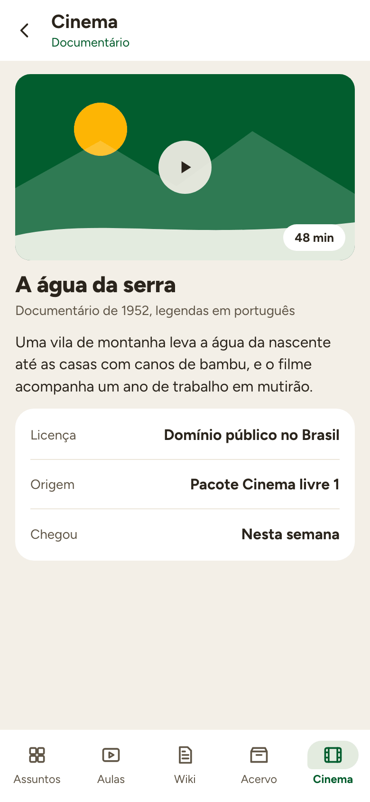 | 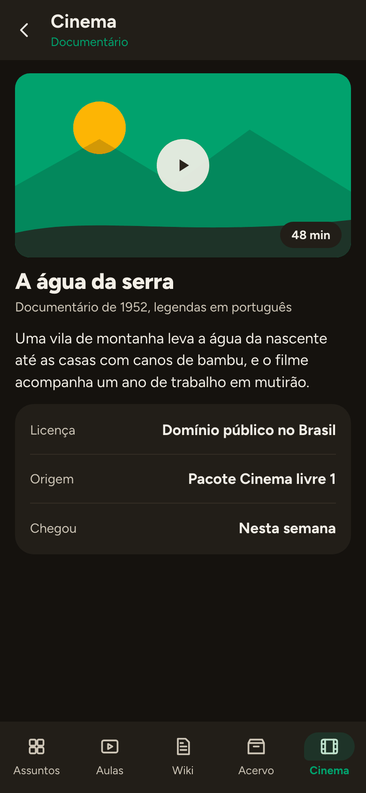 |

**What the person sees.** The inner header "Cinema" with the kind. The film, with a button to play and its length. The title, the year and the language of its subtitles, and a short description. Then the card of the film: "Licença", such as "Domínio público no Brasil", "Origem", the pack it came in, and when it arrived.

**What they can do.** Play, pause, move through the film and watch it full screen.

**States.**

- Out of reach: the next section.

**Who may.** Everyone. What a child sees in the cinema is **Not decided**.

**Writes and reads.** Nothing is written. It reads the film and its card, and the file from a machine that keeps it.

**Many machines.** The card is in the journal and shows everywhere. The file comes from whichever machine keeping it is up. How long a film is public in each country changes, so each pack says where its license holds, and the card shows it.

### A film out of reach

**Path:** `/learn/cinema/<id>`, as a state. **Proposed.**

| Light | Dark |
| --- | --- |
| 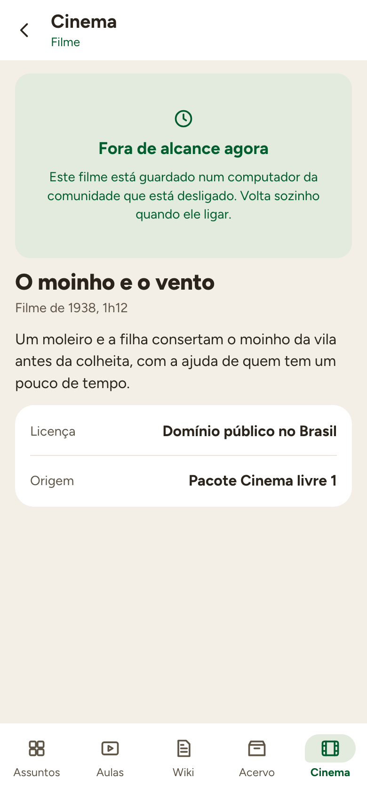 | 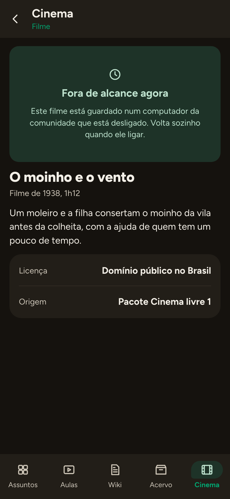 |

**What the person sees.** In the place of the film, "Fora de alcance agora" and "Este filme está guardado num computador da comunidade que está desligado. Volta sozinho quando ele ligar." Under it, the title, the description and the card of the film, as always.

**What they can do.** Read about the film. Come back later; the page changes by itself when the film is reachable again.

**States.** The same sentence serves a lesson and a book out of reach, with their own word.

**Who may.** Everyone.

**Writes and reads.** Nothing is written. It reads the card from the journal.

**Many machines.** This is the one place where Learn must say that something lives elsewhere. The sentence says that a computer of the community is off, never which one, and never asks the person to do anything. Its exact words are **Not decided**.

## Flows

### Publishing a lesson and its conversion

1. Joel opens "Aulas" and taps "Publicar aula". He chooses the video he recorded on his phone. The screen shows its length and size, his quota, "1,2 de 2 GB", and how much this lesson takes.
2. He writes the title, chooses the subject "Terra", says what the person will learn and taps "Enviar". Before anything goes, the core checks his quota and the size of the file and gives the upload an id.
3. The video goes in pieces. The screen shows how much went. When the Wi-Fi drops, the upload stops, the notice "Sem ligação com a comunidade." shows, and the upload continues from the last piece when the link returns, as long as the screen is open.
4. At the end, the device gives the file's digest. The core checks it, keeps the file under its digest and writes `lesson.published`. The lesson enters the library with the chip "Convertendo", and Joel's screen becomes the lesson in its converting state.
5. The video service converts it into two sizes that any browser plays and draws a cover picture, one job at a time. When it ends, the core writes `lesson.converted`, the lesson is ready for everyone, and the file sent is deleted.
6. Bia watches it and asks under the video. Joel, or anyone who knows, answers.

If the machine that converts stops at step 5, the job returns to the line when it starts again: a lesson sent and not converted goes back to the line after any restart. If no machine that keeps lessons is up at step 2, the screen says so and keeps what Joel wrote. **Proposed.**

### Editing the wiki

1. Caio opens "Manutenção da bomba solar" and taps "Editar". The editor opens with "Escrever" and "Prévia".
2. He adds that the panel must be switched off before the box is opened, writes "Faltava o aviso de desligar" in "O que você mudou" and taps "Salvar nova versão".
3. The machine his phone reaches accepts it alone and writes `page.revised`, saying which version he started from. The page opens on his version.
4. An hour earlier, on the other side of the community, which was split that day, Bia had saved her own version from the same starting point. When the two sides meet again, both versions are kept. Every machine shows the one written later, Caio's, with the card "Esta página tem duas versões".
5. Ana opens "Duas versões", taps "Juntar as duas", and saves a version that holds both changes. The mark leaves the page. Every version is still in "Versões".

With no link at step 3, Caio's version waits on his phone with "Ainda não enviada" and goes by itself; if someone changed the page meanwhile, step 4 applies. **Proposed.**

### Approving a draft of the Mentor

1. The community opened the door "Buscar". Someone asked the Mentor how to keep seeds without a fridge, and nothing in the wiki or the collection answered. A program with no artificial intelligence searched the closed list of approved sources, and the Mentor wrote a draft in its own words, with the source. The core wrote `draft.proposed`. The steps in Ask are in [Ask](ask.md).
2. The wiki shows the curators "3 rascunhos que o Mentor aprendeu". Rita opens "Rascunhos", reads the draft and its source and taps "Aprovar". The core writes `draft.approved` with her name, and the card shows "1 de 2 curadores".
3. Dani does the same. With the approvals the charter asks for, the core writes the draft as the first version of the page "Como guardar sementes sem geladeira", marked "Mentor, aprovada por Rita e Dani". From then on the Mentor uses it as a source.
4. Had a curator refused, the core would write `draft.refused`, the draft would leave the list, and the subject would stay in "O que falta".

An approval never waits for the machines of the list. **Proposed.**

### A local note in the collection

1. Marta opens "Manual de horta caseira", chapter 4, in the reader. She selects "Regue de manhã cedo ou no fim da tarde, nunca com o sol a pino." and taps "Anotar o trecho".
2. The sheet shows the passage quoted. She writes that the upper water tank runs dry in August and taps "Salvar a nota". Only then is the note written: `note.created`, with the book, the chapter and the passage with its surroundings.
3. The passage is marked in the sun color, and the note shows right after it for everyone, with the chip "Local". The book is not changed.
4. Months later, the administrator installs a new version of the manual, in which that sentence was rewritten. When the chapter opens, the core looks for the passage, does not find it, and shows the note at the top with "O trecho desta nota sumiu" and the old passage.
5. Marta taps "Editar a nota" and fits it to the new text.

Writing the note never waits; with no link, it waits on Marta's phone with "Ainda não enviada". **Proposed.**

## What Learn writes

Every change in Learn is an entry in the journal, and the indexes of lessons, of the wiki and of search are derived from it. The names follow the rule of the [glossary](../glossary.md), a noun and a verb in the past, and are **Proposed**: the list lives in [`core/event/types.go`](../../core/event/types.go) once they are built.

| Event | What it records |
| --- | --- |
| `lesson.published` | A lesson sent: its title, subject, description, author and the digest of the video |
| `lesson.converted` | The two sizes and the cover picture are ready |
| `lesson.asked` | A question under a lesson |
| `lesson.answered` | An answer to a question under a lesson |
| `lesson.removed` | A lesson removed by its author, or by a moderator with a reason |
| `film.added`, `film.removed` | A film entering or leaving the cinema, with its license and origin |
| `page.revised` | A new version of a wiki page, with the version or versions it started from |
| `draft.proposed` | A draft from the Mentor or a connected artificial intelligence, with its sources |
| `draft.approved`, `draft.refused` | A curator's decision, with the curator's name |
| `note.created`, `note.edited` | A note over a passage of the collection |
| `pack.installed`, `pack.removed` | A book or a set of books entering or leaving the collection, from the administrator's screens |

Nothing Learn writes is personal. What a person watched and where they stopped stays on the device. The searches that find nothing go to the usage record, with no name, and never to the journal.

## Who may do what

Curator is a role **Proposed** for the people the charter lets approve what the Mentor and others propose to the wiki. It is not one of the four roles the code knows today ([the core](../design/core.md#roles-and-permissions)). "By the charter" means the community's charter decides at setup.

| Action | Resident | Child | Moderator | Administrator | Curator |
| --- | --- | --- | --- | --- | --- |
| Read the wiki and the collection, watch lessons and films | Yes | Yes; what a guardian may limit is Not decided | Yes | Yes | Yes |
| Publish a lesson, within the quota | Yes | By the charter | Yes | Yes | Yes |
| Remove one's own lesson | Yes | By the charter | Yes | Yes | Yes |
| Ask and answer under a lesson | Yes | Not decided | Yes | Yes | Yes |
| Write and edit the wiki, go back to a version | Yes | By the charter | Yes | Yes | Yes |
| Write and edit a note in the collection | Yes | By the charter | Yes | Yes | Yes |
| Read a draft waiting for approval | Yes | Not decided | Yes | Yes | Yes |
| Approve or refuse a draft | By the charter | No | By the charter | By the charter | Yes |
| Remove someone else's lesson, question, version or note, with a reason that goes to the log | No | No | Yes | Yes | No |
| Add or remove a pack or a film | No | No | No | Yes | Not decided |

## Not decided

- Who makes the list of subjects, and whether a resident can add one when publishing. The subjects drawn are examples.
- Whether a wiki page and a pack of the collection carry a subject, so the subject page can list them.
- Where "Continuar de onde parou" is kept. The drawing keeps it on the device, so nothing of what a person watches reaches the machines; on the iPhone, that means it is kept per icon.
- The default quota of lessons per resident, whether it counts the video sent or the converted one, whether someone can raise one person's quota, and how two uploads at the same moment on two machines are counted against it.
- The largest video a lesson may have.
- How a machine with no disk for lessons receives an upload, and what the screen says when no machine that keeps lessons is up.
- Which size of a video starts playing.
- Whether a child asks and answers under a lesson, reads the drafts, and what a guardian may limit in the collection and the cinema.
- The way to write headings, lists and links in the wiki's editor.
- Who may delete a whole wiki page.
- Which of two versions the Mentor uses while both stand.
- How many curators approve a draft, and what happens when one approves and another refuses while the community is split.
- Whether a curator may add a pack or a film.
- Whether a person can attach a note whose passage is gone to another passage, and whether the author can delete a note.
- The sentence for a lesson, a book or a film out of reach. It is the one place where Learn says something is elsewhere.
- Whether the cinema announces showings for the community. The approved drawing of the home said "sessão no sábado"; this drawing says when the film arrived instead, because no screen of showings exists.
- Where the button to add Learn to the phone sits inside the app. The approved home has none; the portal carries it.

## To prove

- That an upload continues where it stopped after the Wi-Fi drops, on a real phone, and whether the iPhone keeps sending with the screen locked.
- The time to convert one hour of lesson in the two sizes on the smallest machine that carries the video service.
- How many people watch a lesson or a film at the same time over the community's Wi-Fi.
- That the reader keeps a note on its passage across a new version of a real book, and finds when the passage is gone.
- With two machines, that a lesson whose video is on the machine that left shows its text and questions on the other, and plays again when the machine returns.
- That two versions of a page written on the two sides of a split both appear when the sides meet, on every machine in the same order.
