# Maps

Maps is the community's map, and the fifth app. Everything that has a place shows on it, and each app puts its own there: an alert from Talk with the area it covers, a report, a proposal or a decision from Decide, a page or a note from Learn. Maps itself keeps what belongs to the land: houses, plantings, equipment, water, paths, notes left at a place, and the boundaries of the land. A resident opens it to find where something is, to see what is happening around them, to mark what they know, and to walk a boundary with the phone in hand.

The maintainer asked for it on 2026-11-15, after the other areas, with a ready-made tool that is free and works with no internet, and approved the plan and the drawings below on the same day. **Proposed**: nothing of Maps is built. It stands on pieces that are **Built**: the journal, accounts and roles, the log every resident can read, machines that follow each other's journals, and HTTPS with the community's own certificate, which the phone's location needs.

## Maps in a few rules

These rules shape every screen below. They are **Proposed** unless marked otherwise.

- **One map, many layers.** An alert stays an entry of Talk, a report an entry of Decide, a page an entry of Learn. Maps reads them and shows each one at its place, and a tap opens it in its own app. What only Maps holds, such as a house, a pump or a boundary, Maps writes.
- **Each place gathers what was said about it.** The page of a place lists everything the other apps tied to it, newest first: the open report about the pump, the vote on a second pump, the wiki page on how it works, the last alert.
- **Houses.** The maintainer decided on 2026-11-15 that each resident may mark their own house, with a name, and that every resident sees it. Whoever does not mark their house does not appear. Only the person who marked a house changes or removes it. People never become markers. This replaces the earlier rule that houses and people never become markers.
- **Who sees the map.** Only the community's residents. Nobody from outside ever sees it, and nothing of it leaves through a door to the internet. The map is part of the community's layer, like the open channels, so it is not encrypted: whoever looks after a machine can read it, as [many machines](../design/many-machines.md#what-remains-a-risk) says of every machine's operator.
- **A person's position never leaves the device.** The phone draws "you are here" and works out distances by itself. Marking a place sends only the place being marked; walking a boundary sends only its corners, once the person closes it. No track of where anyone went is ever written.
- **Marking never waits.** Marking, changing and removing a place, and drawing a boundary, are essential, like writing in the wiki: any machine accepts them alone. When two people change the same place or the same boundary on the two sides of a split, both versions stay and the screen says so.
- **A boundary is a record of the community.** It is not an official survey of the land, and the screens say so where a boundary is shown.
- **The face of Maps is the map.** Maps has no cover. The map runs from edge to edge, and the controls float over it; see [visual identity](visual.md#the-cover-of-each-app).

## The tools

Every piece is free to use and works with no internet once it is in the machines.

- **The base map** is OpenStreetMap, the open map made by volunteers, which asks for credit on the map. The setup cuts the community's region out of the whole map into one PMTiles file, kept with the collection. This was already the project's choice, and Decide's map was drawn on it.
- **The drawing on the screen** is MapLibre, in the browser. The machine serves the PMTiles file like any other file, and the phone reads the parts it needs and draws them, with no map server.
- **The style** is Earthler's own, in the Terra palette, light and dark, with water in a tone of its own so it is never read as a leaf.
- **The aerial photo** is the community's: photos taken with a drone, put together into one picture of the place with OpenDroneMap, and laid under the map as a layer. It shows the detail that OpenStreetMap does not have in the woods: roofs, plots, paths, fences.
- **The phone's location** comes from the browser, which only gives it on a secure page; the community's certificate makes the page secure. Under open sky a phone is usually right within a few meters, and less right under trees, so every screen that uses it shows how precise it is.
- **The drawing of a boundary** is done in the browser, with a finger on the map or by walking. The area and the length are worked out on the device. A boundary can be downloaded as a file that mapping programs open, to take to a professional.

## The screens

| Screen | Path |
| --- | --- |
| [The map](#the-map) | `/maps/` |
| [Layers](#layers) | A sheet over `/maps/` |
| [What to mark](#what-to-mark) | A sheet over `/maps/` |
| [Marking equipment](#marking-equipment) | `/maps/mark/equipment` |
| [Your house](#your-house) | `/maps/mark/house` |
| [A place](#a-place) | `/maps/places/<id>` |
| [Places](#places) | `/maps/places` |
| [Lands](#lands) | `/maps/lands` |
| [Demarcating by walking](#demarcating-by-walking) | `/maps/lands/walk` |
| [A land](#a-land) | `/maps/lands/<id>` |
| [Two versions of a boundary](#two-versions-of-a-boundary) | `/maps/lands/<id>` |
| [An alert on the map](#an-alert-on-the-map) | `/maps/?alert=<id>` |
| [Where a new alert is, in Talk](#where-a-new-alert-is-in-talk) | A step of `/talk/alerts/new` |
| [No region map](#no-region-map) | `/maps/` |
| [The map in administration](#the-map-in-administration) | `/admin/map` |

The paths are **Proposed**. The bar of Maps has three parts: "Mapa", "Lugares" and "Terras". The portal shows Maps as its fifth app; see [portal](portal.md#the-portal).

### The map

**Path:** `/maps/`. **Proposed.**

| Light | Dark |
| --- | --- |
| 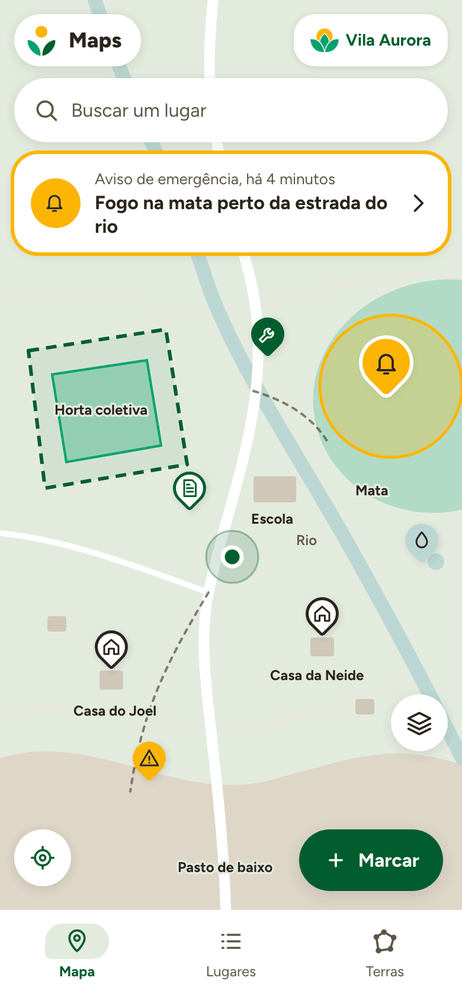 | 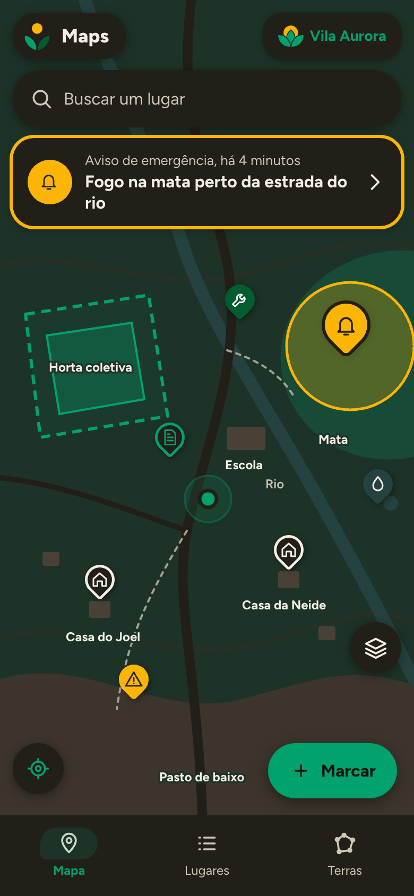 |

**What the person sees.** The map of the community from edge to edge. Over it, at the top, the name "Maps" with its glyph and the community's name, which leads to the portal; the field "Buscar um lugar"; and, while an emergency alert is in force, its card ringed in the sun color, "Aviso de emergência, há 4 minutos" and "Fogo na mata perto da estrada do rio". On the map: the area of the alert in the sun color with its pin; the houses that were marked, each with a white pin and its name, "Casa da Neide"; the community garden and its boundary; the pump, the spring, a report and a note, each with its own pin; and the dot of where the person is, with a ring that shows how precise it is. Over the bottom, the button for the layers, the button "Onde estou" and the button "Marcar". The bar, with "Mapa" chosen.

Each kind of point has a pin whose color and sign say what it is together, so color never carries the meaning alone:

| Kind | Pin |
| --- | --- |
| Alert, from Talk | Sun, larger, with a bell, and its area in the sun color |
| Problem, from Decide | Sun, with a warning sign |
| House | White, ringed in the text color, with a house |
| Equipment | The primary green, with a wrench |
| Water | The water tone, with a drop |
| Note or page, from Learn | White, ringed in the primary color, with a page |
| Planting, land | An area: a planting in leaf green, a boundary as a dashed line |

**What they can do.** Move and zoom the map, search for a place, open any point, open the alert, show where they are, choose the layers, and mark something.

**States.**

- No alert in force: the card does not show, and the map starts higher.
- The phone does not give its location: "Onde estou" shows the community instead, and the line "Este aparelho não está dando a localização. Você ainda pode marcar arrastando o mapa."
- No link with the community: the notice "Sem ligação com a comunidade." over what the device already has. The base map and the places the device saw stay in sight. Whether a place marked with no link waits in the outbox is **Not decided**; see [the outbox](behavior.md#the-outbox).
- The region map is not installed: [no region map](#no-region-map).

**Who may.** Every signed in resident, children included.

**Writes and reads.** It writes nothing. It reads the places of Maps, the alerts of Talk that carry a place, the reports, proposals and decisions of Decide, and the pages and notes of Learn that carry a place.

**Many machines.** The map is essential and lives on every machine, the same. Reading never waits. During a split, each side sees what was marked on its side, and the rest appears when the machines meet.

### Layers

A sheet over `/maps/`. **Proposed.**

| Light | Dark |
| --- | --- |
| 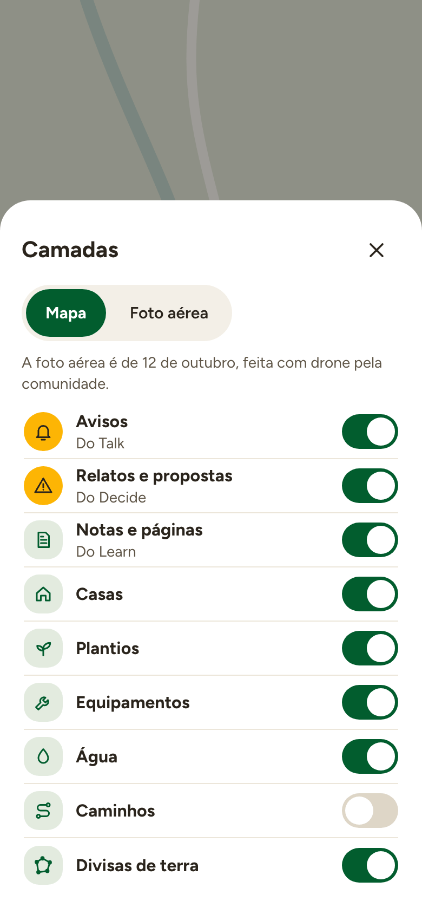 | 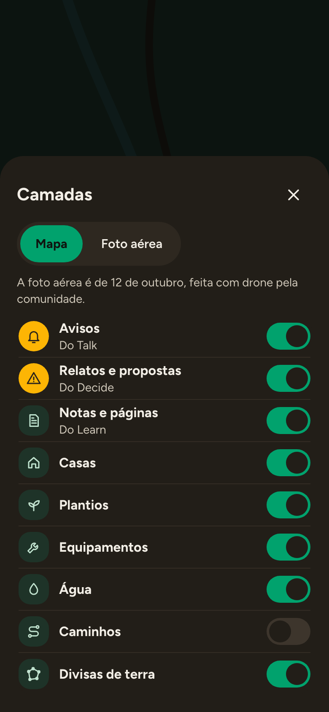 |

**What the person sees.** "Camadas". The background, "Mapa" or "Foto aérea", and under it the date of the aerial photo and who took it: "A foto aérea é de 12 de outubro, feita com drone pela comunidade." Then one switch per layer, each with its mark: "Avisos", from Talk; "Relatos e propostas", from Decide; "Notas e páginas", from Learn; "Casas"; "Plantios"; "Equipamentos"; "Água"; "Caminhos"; "Divisas de terra".

**What they can do.** Choose the background, turn each layer on and off, close.

**States.**

- No aerial photo yet: "Foto aérea" is off, with the line "A comunidade ainda não tem foto aérea."
- An emergency alert in force: the layer of alerts cannot be turned off while it lasts, and says so.

**Who may.** Everyone.

**Writes and reads.** The choices are kept on the device, never in the journal.

**Many machines.** Nothing to wait for.

### What to mark

A sheet over `/maps/`, from "Marcar". **Proposed.**

| Light | Dark |
| --- | --- |
| 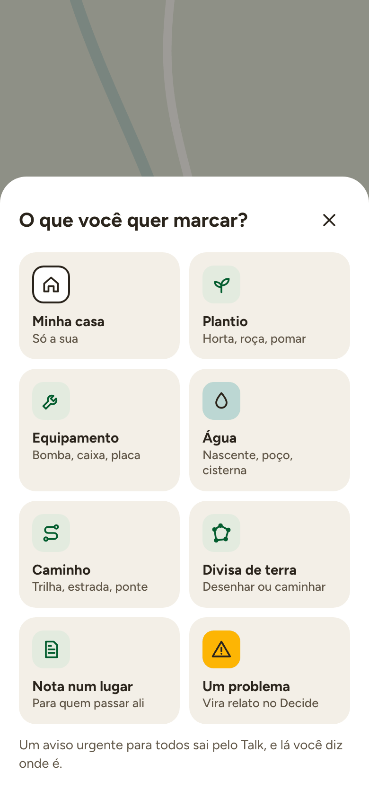 | 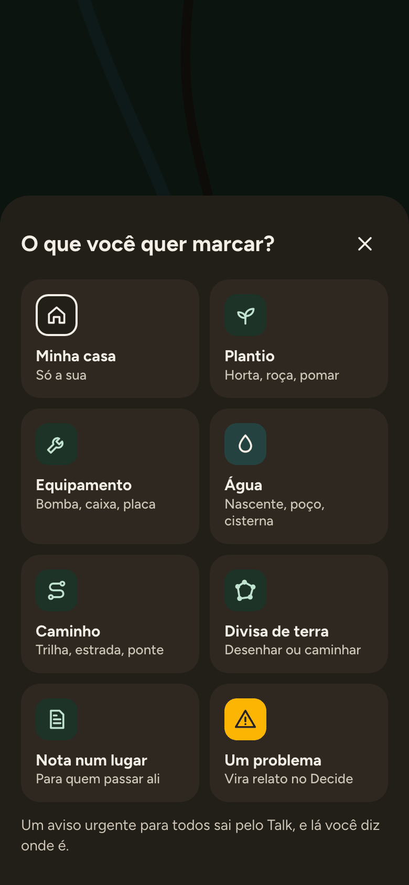 |

**What the person sees.** "O que você quer marcar?" and eight choices, each with its mark and a line: "Minha casa", "Só a sua"; "Plantio", "Horta, roça, pomar"; "Equipamento", "Bomba, caixa, placa"; "Água", "Nascente, poço, cisterna"; "Caminho", "Trilha, estrada, ponte"; "Divisa de terra", "Desenhar ou caminhar"; "Nota num lugar", "Para quem passar ali"; "Um problema", "Vira relato no Decide". Under them: "Um aviso urgente para todos sai pelo Talk, e lá você diz onde é."

**What they can do.** Choose what to mark. "Um problema" opens [a new report in Decide](decide.md#new-report), already at the place. "Minha casa" opens [your house](#your-house), or the house already marked. "Divisa de terra" opens [lands](#lands).

**States.** A child sees only what the charter lets a child do; see [who may do what](#who-may-do-what-in-maps).

**Who may.** Residents, moderators and administrators. Who may mark plantings, equipment, water and paths is **Not decided**.

**Writes and reads.** Nothing until a form is sent.

**Many machines.** Nothing to wait for.

### Marking equipment

**Path:** `/maps/mark/equipment`. **Proposed.** Plantings, water, paths and notes use the same form, with their own kinds; a path and a planting are drawn on the map instead of placed as a pin.

| Light | Dark |
| --- | --- |
| 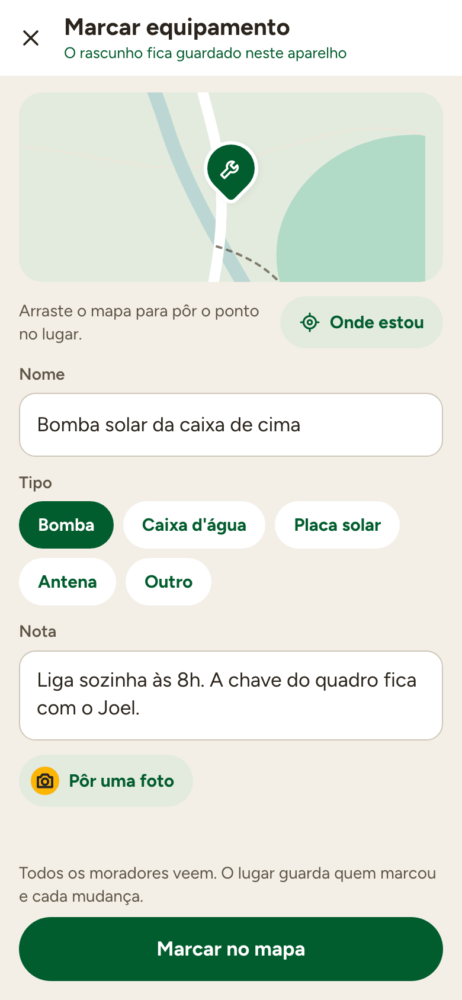 | 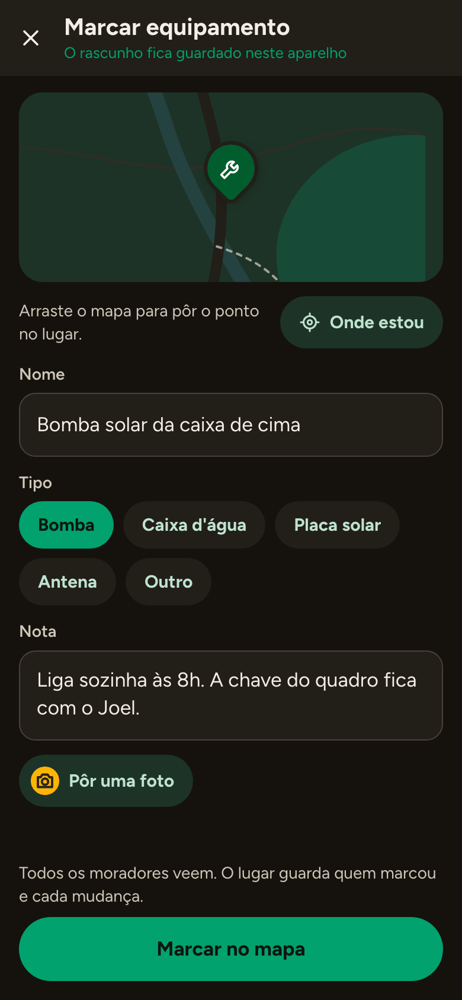 |

**What the person sees.** The inner header "Marcar equipamento", with a way to close and "O rascunho fica guardado neste aparelho". A piece of the map with the pin in the middle, "Arraste o mapa para pôr o ponto no lugar." and the button "Onde estou". "Nome", "Bomba solar da caixa de cima". "Tipo": "Bomba", "Caixa d'água", "Placa solar", "Antena" and "Outro". "Nota", "Liga sozinha às 8h. A chave do quadro fica com o Joel." The button "Pôr uma foto". At the bottom, "Todos os moradores veem. O lugar guarda quem marcou e cada mudança." and "Marcar no mapa".

**What they can do.** Place the point by dragging the map or with "Onde estou", name it, choose its kind, write a note, add a photo, and mark it. After marking, the map opens on the new place.

**States.**

- No name: "Dê um nome ao lugar."
- "Onde estou" with a weak signal: "A localização está com precisão de 30 metros. Arraste o mapa para acertar."
- A photo still going up: "Enviando a foto…", resuming where it stopped if the Wi-Fi drops, as every upload does.
- No link with the community: the notice "Sem ligação com a comunidade." The draft stays on the device.

**Who may.** As [what to mark](#what-to-mark) says.

**Writes and reads.** Marking writes a place, with its kind, name, note, photo, position and who marked it: `place.created`, a working name in the form the [glossary](../glossary.md) asks for. A change writes `place.changed`; a removal `place.removed`. **Proposed.**

**Many machines.** Never waits. Two changes to the same place on the two sides of a split both stay, as for the wiki.

### Your house

**Path:** `/maps/mark/house`. **Proposed.**

| Light | Dark |
| --- | --- |
| 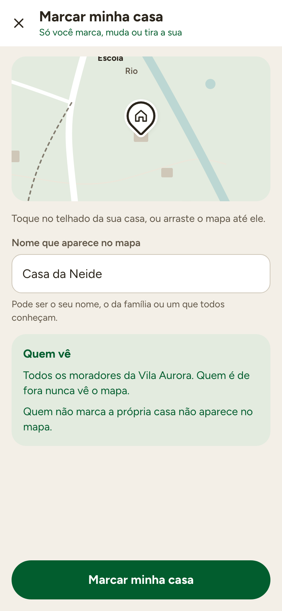 | 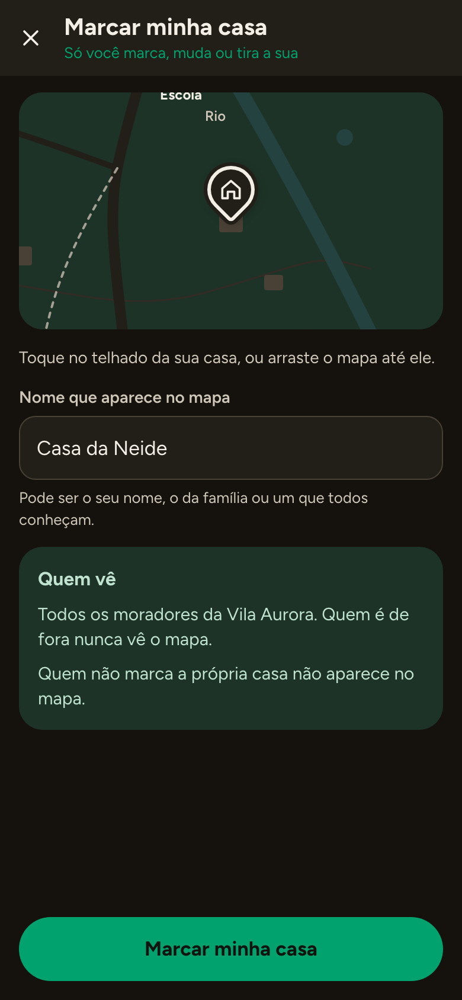 |

**What the person sees.** The inner header "Marcar minha casa", "Só você marca, muda ou tira a sua". A piece of the map with the house pin over a roof, and "Toque no telhado da sua casa, ou arraste o mapa até ele." "Nome que aparece no mapa", "Casa da Neide", with "Pode ser o seu nome, o da família ou um que todos conheçam." A soft card, "Quem vê": "Todos os moradores da Vila Aurora. Quem é de fora nunca vê o mapa." and "Quem não marca a própria casa não aparece no mapa." The button "Marcar minha casa".

**What they can do.** Place the house, name it, and mark it. Later, from the house's own page, change it or take it off the map.

**States.**

- The house is already marked: the same screen, with "Mudar" and "Tirar do mapa".
- Taking it off: "Tirar a sua casa do mapa? Ela some para todos." and the house leaves the map at once.

**Who may.** Each resident, for their own house only. A child does not mark a house. Whether several residents of one house share one mark is **Not decided**.

**Writes and reads.** Marking writes `house.marked`, a working name, with the position, the name and the account that marked it; taking it off writes `house.removed`. **Proposed.** Only the account that marked a house may change or remove it, and the indexes check that, as they check who changed a role.

**Many machines.** Never waits.

### A place

**Path:** `/maps/places/<id>`. **Proposed.**

| Light | Dark |
| --- | --- |
| 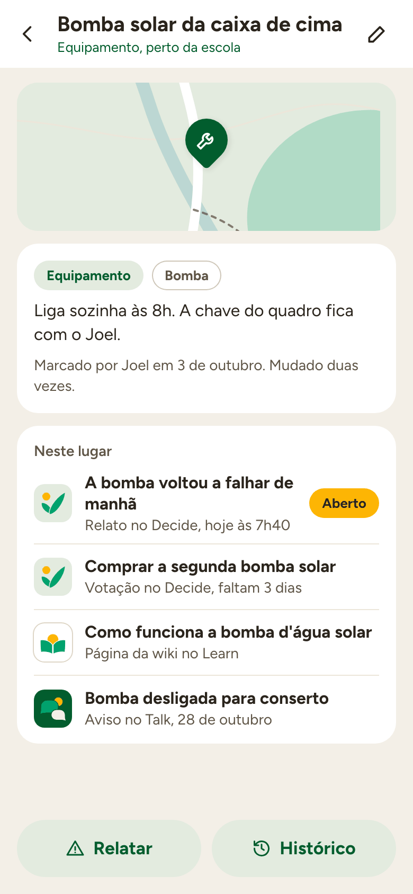 | 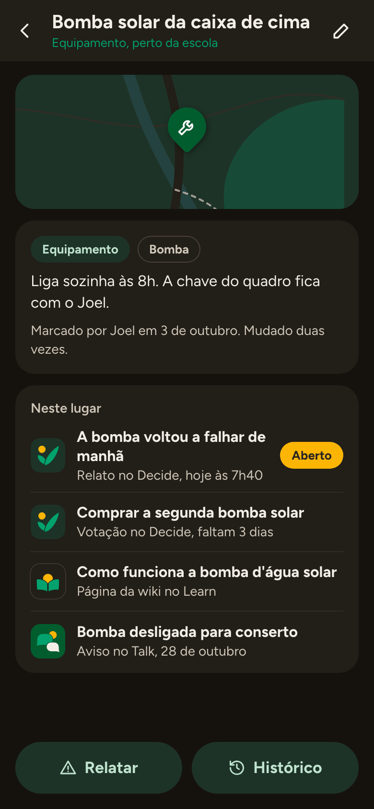 |

**What the person sees.** The inner header with the name, "Bomba solar da caixa de cima", its kind and where it is, "Equipamento, perto da escola", and the button to edit. A piece of the map with its pin. A card with the kind, the note, and "Marcado por Joel em 3 de outubro. Mudado duas vezes." Then "Neste lugar": what the other apps tied to it, each with the small tile of its app, such as "A bomba voltou a falhar de manhã", "Relato no Decide, hoje às 7h40", marked "Aberto"; "Comprar a segunda bomba solar", a vote; "Como funciona a bomba d'água solar", a page of the wiki in Learn; "Bomba desligada para conserto", an alert in Talk. At the bottom, "Relatar" and "Histórico".

**What they can do.** Open anything listed in its app. Report a problem at this place, which opens a new report in Decide already tied to it. See the history of changes. Edit the place.

**States.**

- Two versions after a split: "Duas pessoas mudaram este lugar ao mesmo tempo. As duas versões estão aqui."
- Removed by a moderator: "Este lugar foi removido por um moderador.", with the reason in the log.
- Nothing tied to it: "Neste lugar" does not show.

**Who may.** Everyone reads. Who may edit a place other than their house is **Not decided**. A moderator or an administrator may remove a place, with a reason that goes to the log.

**Writes and reads.** Reads the place, its history, and the entries of the other apps tied to it. Editing writes `place.changed`.

**Many machines.** Never waits.

### Places

**Path:** `/maps/places`. **Proposed.**

| Light | Dark |
| --- | --- |
| 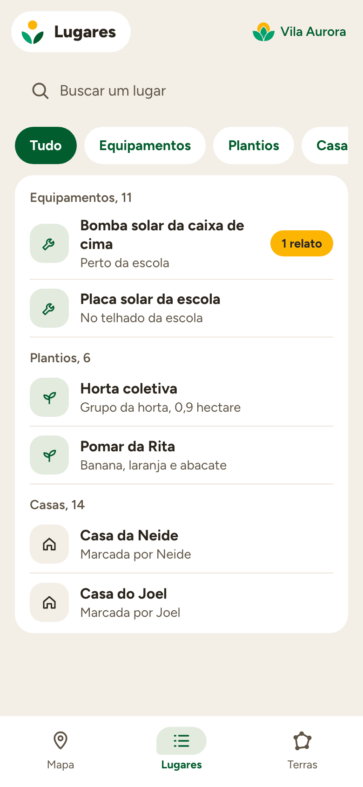 | 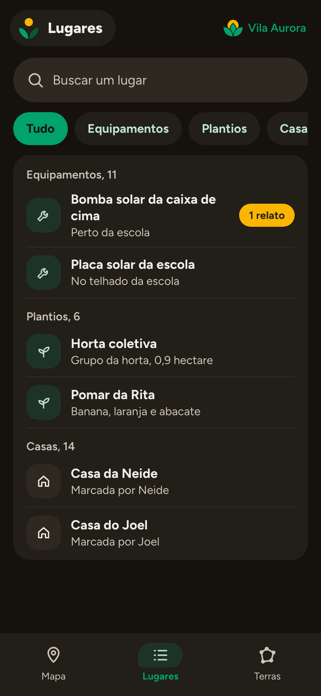 |

**What the person sees.** "Lugares", with the glyph of Maps, and the community's name. The field "Buscar um lugar". Filters: "Tudo", "Equipamentos", "Plantios", "Casas" and the others, sliding sideways. The places grouped by kind, with how many there are, "Equipamentos, 11", each with its mark, its name, where it is or who marked it, and a mark when something is open there, "1 relato".

**What they can do.** Search, filter, open a place. The list is what a screen reader offers in place of the map: every place on the map is in it.

**States.** Nothing marked yet: "Ainda não há lugares marcados. Toque em Marcar, no mapa."

**Who may.** Everyone.

**Writes and reads.** Reads the places.

**Many machines.** Never waits.

### Lands

**Path:** `/maps/lands`. **Proposed.**

| Light | Dark |
| --- | --- |
| 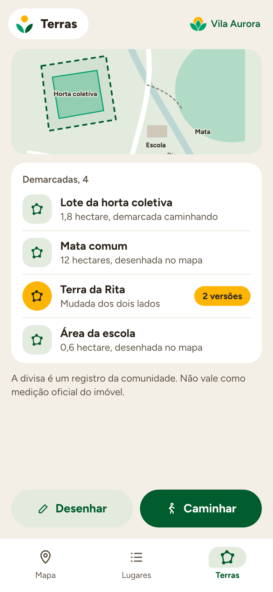 | 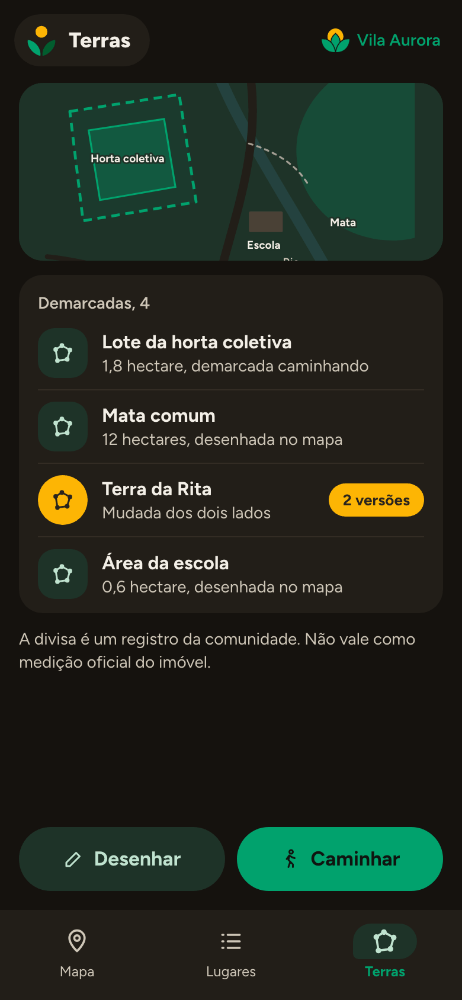 |

**What the person sees.** "Terras", a piece of the map with the boundaries, and "Demarcadas, 4": each land with its name, its area and how it was demarcated, "1,8 hectare, demarcada caminhando"; a land changed on both sides of a split is marked "2 versões". The line "A divisa é um registro da comunidade. Não vale como medição oficial do imóvel." At the bottom, two ways to demarcate: "Desenhar", with a finger on the map, and "Caminhar".

**What they can do.** Open a land, draw a new boundary, or walk one.

**States.** No land demarcated yet: "Nenhuma terra demarcada ainda."

**Who may.** Everyone reads. Who may demarcate is **Not decided**; the drawings assume every resident.

**Writes and reads.** Reads the lands.

**Many machines.** Never waits.

### Demarcating by walking

**Path:** `/maps/lands/walk`. **Proposed.**

| Light | Dark |
| --- | --- |
| 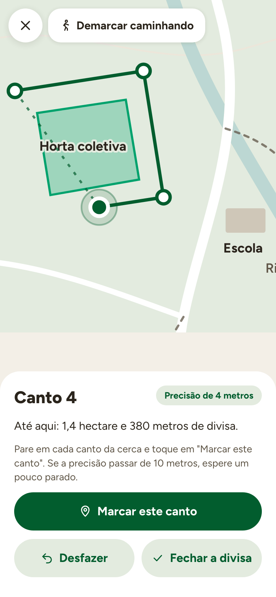 | 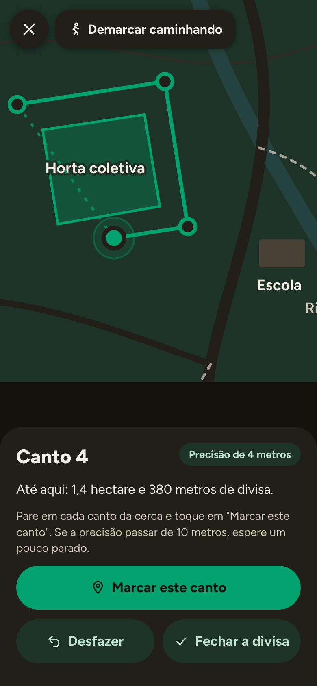 |

**What the person sees.** The map, with the corners already marked joined by a line, a dotted line from the last corner back to the first, and the person's dot with its ring. Over the top, a way to stop and "Demarcar caminhando". At the bottom: "Canto 4", with "Precisão de 4 metros"; "Até aqui: 1,4 hectare e 380 metros de divisa."; and the advice "Pare em cada canto da cerca e toque em "Marcar este canto". Se a precisão passar de 10 metros, espere um pouco parado." The button "Marcar este canto", and "Desfazer" and "Fechar a divisa".

**What they can do.** Walk to each corner and mark it, undo the last corner, and close the boundary, which opens a form for its name, use and who looks after it.

**States.**

- The precision is above 10 meters: "Marcar este canto" waits, and the line says "Espere a precisão baixar, ou marque assim mesmo."
- The phone does not give its location: "Este aparelho não está dando a localização. Você pode desenhar a divisa no mapa."
- The screen locks or the person leaves: the corners already marked stay on the device, and the walk goes on from there.

**Who may.** As [lands](#lands) says.

**Writes and reads.** Nothing until the boundary is closed and named. Then one entry, `land.created`, a working name, with the corners, the name, the use, how it was made and the precision of each corner. **Proposed.** The walk itself, between corners, is never written.

**Many machines.** Never waits.

### A land

**Path:** `/maps/lands/<id>`. **Proposed.**

| Light | Dark |
| --- | --- |
| 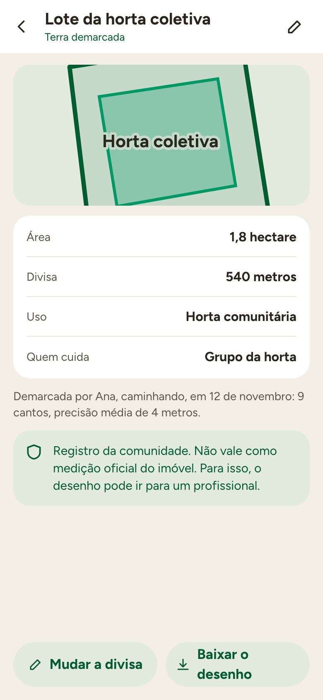 | 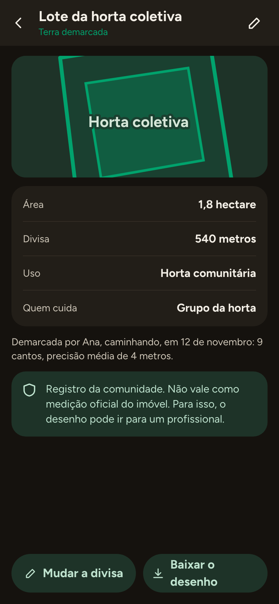 |

**What the person sees.** The inner header "Lote da horta coletiva", "Terra demarcada", and the button to edit. A piece of the map with the boundary. "Área", "1,8 hectare"; "Divisa", "540 metros"; "Uso", "Horta comunitária"; "Quem cuida", "Grupo da horta". "Demarcada por Ana, caminhando, em 12 de novembro: 9 cantos, precisão média de 4 metros." A soft card: "Registro da comunidade. Não vale como medição oficial do imóvel. Para isso, o desenho pode ir para um profissional." At the bottom, "Mudar a divisa" and "Baixar o desenho".

**What they can do.** Change the boundary, by moving its corners on the map or walking it again; change its name, use and who looks after it; download the drawing as a file that mapping programs open.

**States.** Two versions after a split: [two versions of a boundary](#two-versions-of-a-boundary).

**Who may.** Everyone reads. Who may change a boundary is **Not decided**.

**Writes and reads.** A change writes `land.changed`, keeping every earlier version in the history. **Proposed.**

**Many machines.** Never waits.

### Two versions of a boundary

**Path:** `/maps/lands/<id>`, when the land was changed on both sides of a split. **Proposed.**

| Light | Dark |
| --- | --- |
| 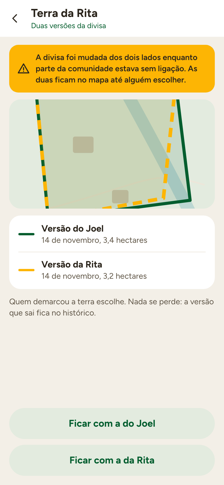 | 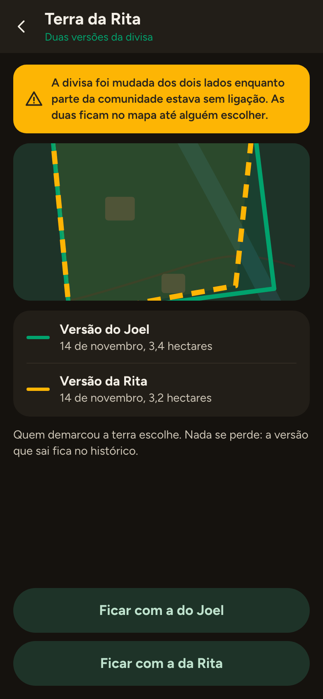 |

**What the person sees.** The inner header "Terra da Rita", "Duas versões da divisa". The notice in the sun color: "A divisa foi mudada dos dois lados enquanto parte da comunidade estava sem ligação. As duas ficam no mapa até alguém escolher." A piece of the map with both boundaries, one in the primary color and one in the sun color. Each version with its line, its author, its date and its area: "Versão do Joel, 14 de novembro, 3,4 hectares" and "Versão da Rita, 14 de novembro, 3,2 hectares". "Quem demarcou a terra escolhe. Nada se perde: a versão que sai fica no histórico." The buttons "Ficar com a do Joel" and "Ficar com a da Rita".

**What they can do.** Whoever may choose keeps one version; everyone else sees both until then.

**Who may.** The drawing shows whoever demarcated the land choosing. Who chooses is **Not decided**.

**Writes and reads.** Choosing writes `land.chosen`, a working name, naming the version kept. Both versions stay in the history. **Proposed.**

**Many machines.** Both versions reach every machine when the sides meet, in the same order on all of them, so every machine shows the same two. Choosing never waits.

### An alert on the map

**Path:** `/maps/?alert=<id>`, from the alert's card on the map. **Proposed.**

| Light | Dark |
| --- | --- |
| 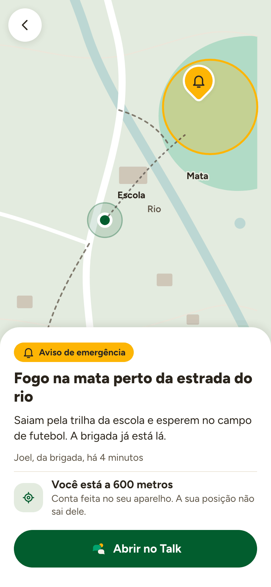 | 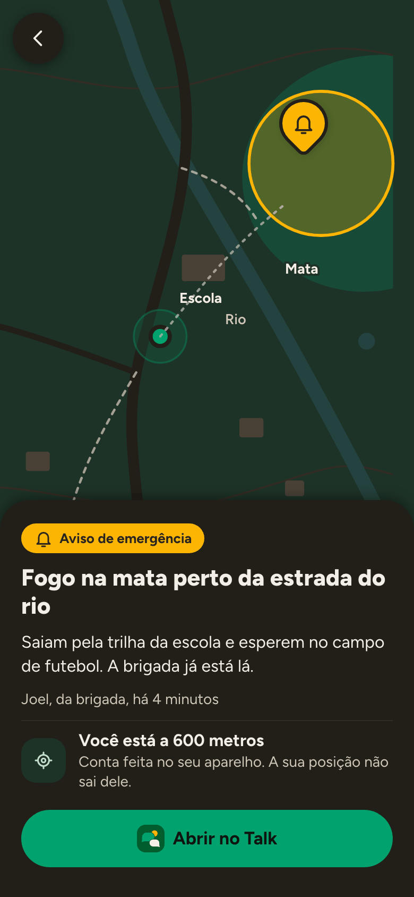 |

**What the person sees.** The map around the alert, with its area in the sun color, its pin, the person's dot and a dotted line between them. At the bottom: "Aviso de emergência", "Fogo na mata perto da estrada do rio", the text, "Saiam pela trilha da escola e esperem no campo de futebol. A brigada já está lá.", who sent it and when, "Joel, da brigada, há 4 minutos", and "Você está a 600 metros", with "Conta feita no seu aparelho. A sua posição não sai dele." The button "Abrir no Talk".

**What they can do.** See where the alert is and how far, open it in Talk, go back to the map.

**States.**

- The phone does not give its location: the line of the distance does not show.
- The alert ended: "Este aviso não está mais valendo.", and its area leaves the map.

**Who may.** Everyone, children included.

**Writes and reads.** Reads the alert from Talk. The distance is worked out on the device and written nowhere.

**Many machines.** As [Talk](talk.md#an-emergency-alert-received) says for every alert: it goes out from any machine alone, and reaches the other side of a split when the machines meet.

### Where a new alert is, in Talk

A step of `/talk/alerts/new`. **Proposed.**

| Light | Dark |
| --- | --- |
| 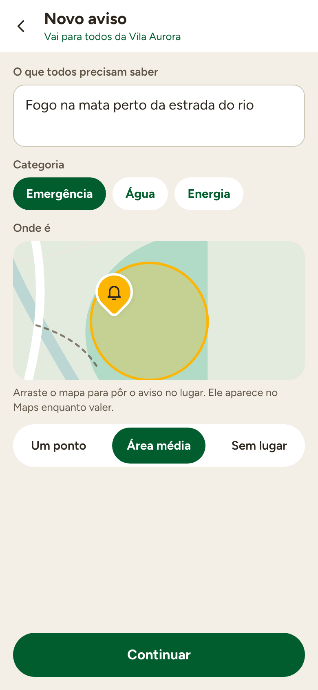 | 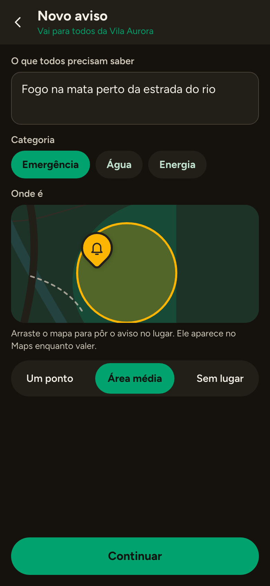 |

**What the person sees.** The form of [a new alert](talk.md#a-new-alert), with a new field, "Onde é": a piece of the map with the alert's pin and area, and "Arraste o mapa para pôr o aviso no lugar. Ele aparece no Maps enquanto valer." Under it, the size of the area: "Um ponto", "Área média" or "Sem lugar". The button "Continuar", which leads to the check before sending, as before.

**What they can do.** Place the alert and choose its area, or send it with no place.

**Who may.** Whoever the charter lets send an alert, as [Talk](talk.md) says.

**Writes and reads.** The alert's entry in Talk carries the place and the area when there is one. **Proposed.**

**Many machines.** Never waits, as every alert.

### No region map

**Path:** `/maps/`, when the region map is not installed. **Proposed.**

| Light | Dark |
| --- | --- |
| 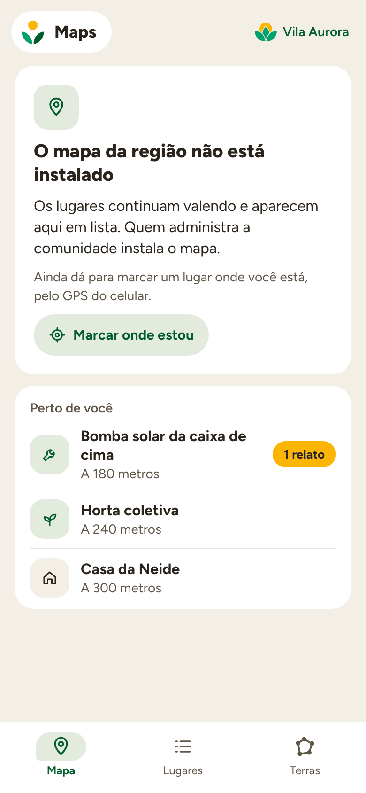 | 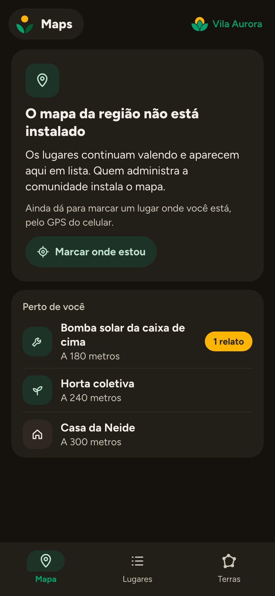 |

**What the person sees.** A card: "O mapa da região não está instalado", "Os lugares continuam valendo e aparecem aqui em lista. Quem administra a comunidade instala o mapa.", "Ainda dá para marcar um lugar onde você está, pelo GPS do celular." and the button "Marcar onde estou". Under it, "Perto de você": the places nearest, each with its distance, "A 180 metros", worked out on the device.

**What they can do.** Open a place, mark a place where they are.

**States.** The phone does not give its location: "Perto de você" becomes "Lugares", in alphabetical order, and "Marcar onde estou" does not show.

**Who may.** Everyone.

**Writes and reads.** As [marking equipment](#marking-equipment).

**Many machines.** Never waits.

### The portal with Maps

The portal shows Maps as its fifth app, after Ask, and "Agora na comunidade" can show a new place: "Pomar da Rita", "Lugar novo no Maps, ontem". The search of the whole community also finds places, under the filter "Lugares". See [portal](portal.md).

### The map in administration

**Path:** `/admin/map`. **Proposed.**

| Light | Dark |
| --- | --- |
| 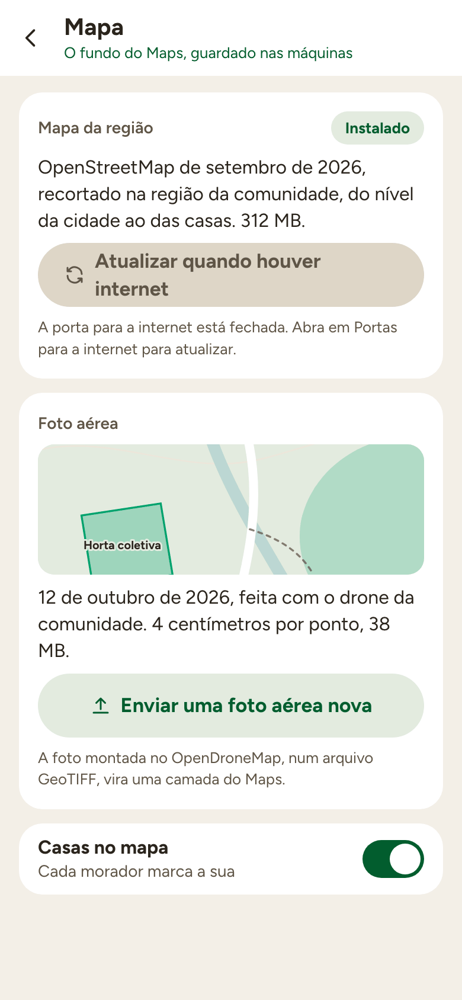 | 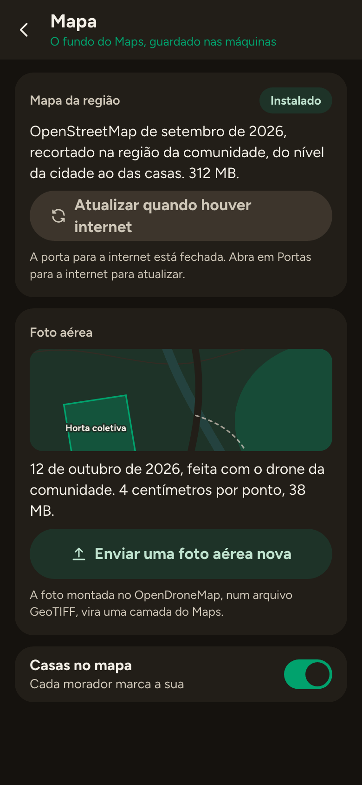 |

**What the person sees.** The inner header "Mapa", "O fundo do Maps, guardado nas máquinas". A card "Mapa da região", marked "Instalado": "OpenStreetMap de setembro de 2026, recortado na região da comunidade, do nível da cidade ao das casas. 312 MB." The button "Atualizar quando houver internet", off while every door to the internet is closed, with "A porta para a internet está fechada. Abra em Portas para a internet para atualizar." A card "Foto aérea", with the picture, "12 de outubro de 2026, feita com o drone da comunidade. 4 centímetros por ponto, 38 MB.", the button "Enviar uma foto aérea nova" and "A foto montada no OpenDroneMap, num arquivo GeoTIFF, vira uma camada do Maps." Then the switch "Casas no mapa", "Cada morador marca a sua".

**What they can do.** Update the region map when a door to the internet is open, send a new aerial photo, and turn houses on the map on or off for the whole community.

**States.**

- No region map: "Instalar o mapa da região", which needs a door to the internet or a file brought on a disk.
- An aerial photo that does not cover the community, or has no position: "Esta foto não tem a posição de onde foi feita. Ela precisa sair do OpenDroneMap com a posição."

**Who may.** Administrators.

**Writes and reads.** The files go with the collection, outside the journal. Turning houses off writes a change of the charter's setting. **Proposed.**

**Many machines.** The region map and the aerial photo are files the machines copy to each other, like the collection; a machine without them shows [no region map](#no-region-map) until it has them.

## Flows

### Marking a house

Neide opens Maps, taps "Marcar" and "Minha casa", touches her roof on the map, keeps "Casa da Neide" as the name and marks it. Her house appears for every resident, on every machine. Joel never marked his, so his does not appear. If Neide moves, she takes her house off the map from its page, and it disappears for everyone.

### A pump, a report and a vote

Joel marks the solar pump with a note about the key. Weeks later Rita finds it failing, opens its place and taps "Relatar"; the report in Decide is tied to the pump. Someone proposes buying a second pump from the report. The pump's page now lists the report, the vote and the wiki page on how the pump works, and the map shows the report's pin beside it.

### Demarcating the community garden

Ana opens "Terras" and "Caminhar", walks to each corner of the garden's fence and marks it, waiting where the trees make the signal weak. At the ninth corner she closes the boundary, names it and says who looks after it. The land shows its area and length, and the line that it is the community's record and not an official survey.

### An alert with a place

Joel sees fire in the woods. In Talk he writes the alert, marks its place and a medium area, checks it and sends it. Every resident gets the alert full screen, as Talk describes; on the map its area shows in the sun color, and each phone works out by itself how far away it is.

### Two versions after a split

The antenna between the two halves of the community falls. On one side Joel moves a corner of Rita's land; on the other Rita moves another. When the antenna returns, both versions reach every machine and the land shows "2 versões". Rita, who demarcated it, keeps one; the other stays in the history.

## Who may do what in Maps

| Action | Resident | Child | Moderator | Administrator |
| --- | --- | --- | --- | --- |
| See the map, places, lands and alerts | Yes | Yes | Yes | Yes |
| Mark, change or remove their own house | Yes | No | Yes | Yes |
| Mark plantings, equipment, water, paths and notes | Not decided | Not decided | Not decided | Not decided |
| Demarcate or change a boundary | Not decided | No | Not decided | Not decided |
| Choose between two versions of a boundary | Whoever demarcated, as drawn; Not decided | No | Not decided | Not decided |
| Remove someone else's place, with a reason in the log | No | No | Yes | Yes |
| Update the region map, send an aerial photo, turn houses off | No | No | No | Yes |

## What Maps writes in the journal

Every name below is a working name, a noun and a verb in the past as the [glossary](../glossary.md) asks; the name is chosen when the code is written. All are **Proposed**.

| Event | When |
| --- | --- |
| `place.created` | A planting, equipment, water, a path or a note is marked |
| `place.changed` | A place is changed: its position, name, kind, note or photo |
| `place.removed` | A place is removed, by whoever marked it or by a moderator with a reason |
| `house.marked` | A resident marks or changes their own house |
| `house.removed` | A resident takes their house off the map |
| `land.created` | A boundary is closed and named |
| `land.changed` | A boundary, its name, use or who looks after it changes |
| `land.chosen` | One of two versions of a boundary is kept |

An alert of Talk, a report of Decide and a page of Learn carry their place in their own entries. The aerial photo and the region map are files, outside the journal.

## Many machines, in one table

| What | With many machines |
| --- | --- |
| Reading the map | Never waits. Each machine shows what it holds |
| Marking, changing, removing a place or a house | Never waits. Any machine accepts it alone |
| Drawing, walking, changing a boundary | Never waits. Two versions after a split, both kept |
| Choosing a version | Never waits |
| An alert with a place | As every alert: never waits |
| The region map and the aerial photo | Files copied between machines, like the collection |

## Not decided

- Who may mark plantings, equipment, water, paths and notes: every resident, or groups the charter names.
- Who may demarcate and change a boundary, and who chooses between two versions. The drawing shows whoever demarcated choosing.
- Whether a boundary needs a neighbor to confirm it.
- Whether several residents of one house share one mark, and what happens to a house when the person who marked it leaves the community.
- Whether a child may leave a note at a place.
- Whether a place marked with no link waits in the outbox and goes out by itself.
- How the aerial photo becomes a layer the browser reads, and which library draws and measures a boundary in the browser.
- How large a region the setup cuts, down to which level of detail, and how often the region map is refreshed when a door is open.
- Whether a downloaded boundary carries the names of the houses near it.

## To prove

- MapLibre reading the community's PMTiles file in the browser of a cheap phone, with no internet.
- How precise a phone's location is under the community's trees, and how well a walked boundary matches the fence.
- An aerial photo of the community's size put together by OpenDroneMap on the community's machine, and how long it takes.
- Two versions of a boundary written on the two sides of a split, appearing the same on every machine when they meet.
