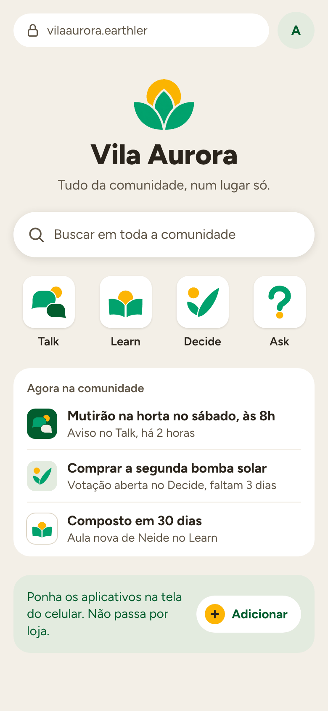
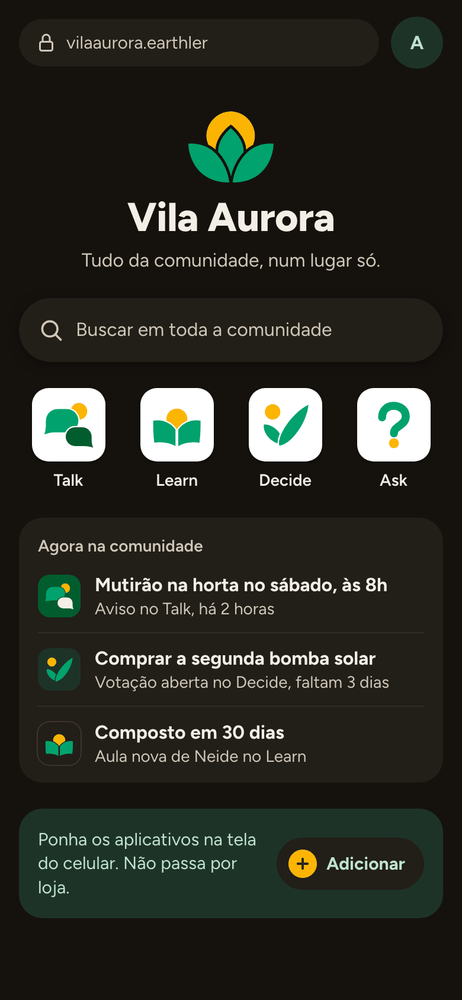
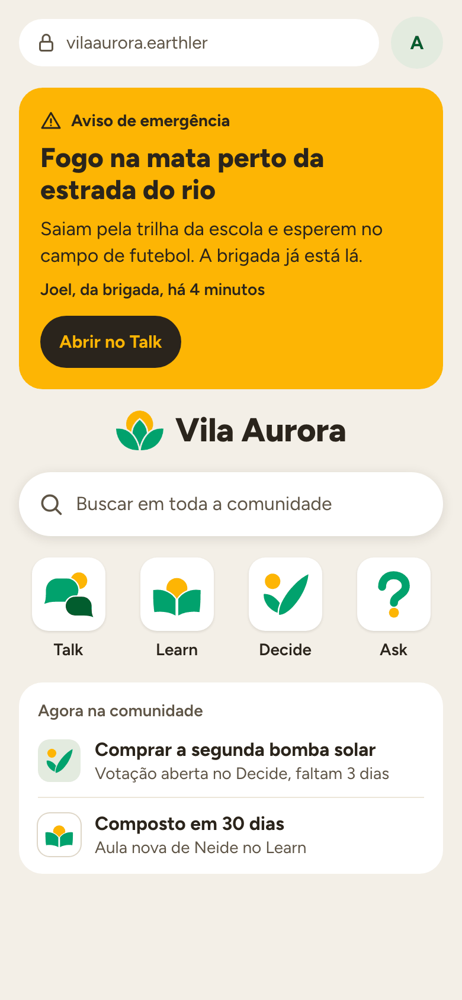
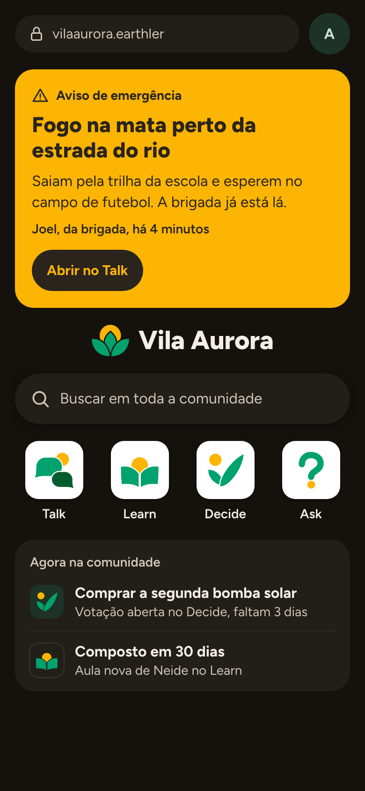
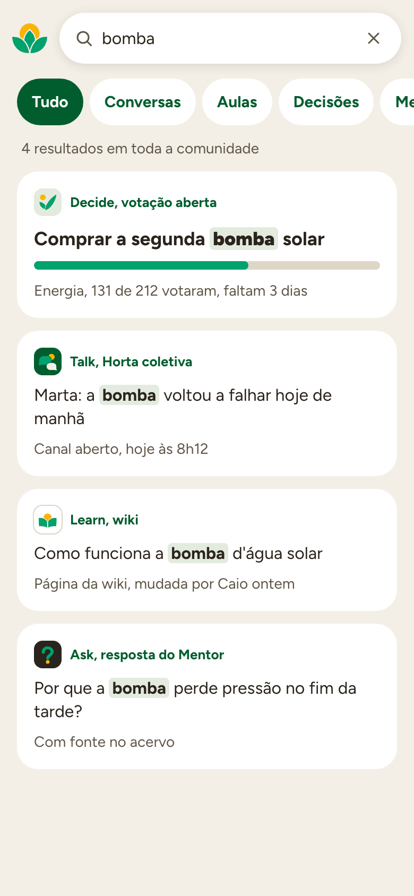
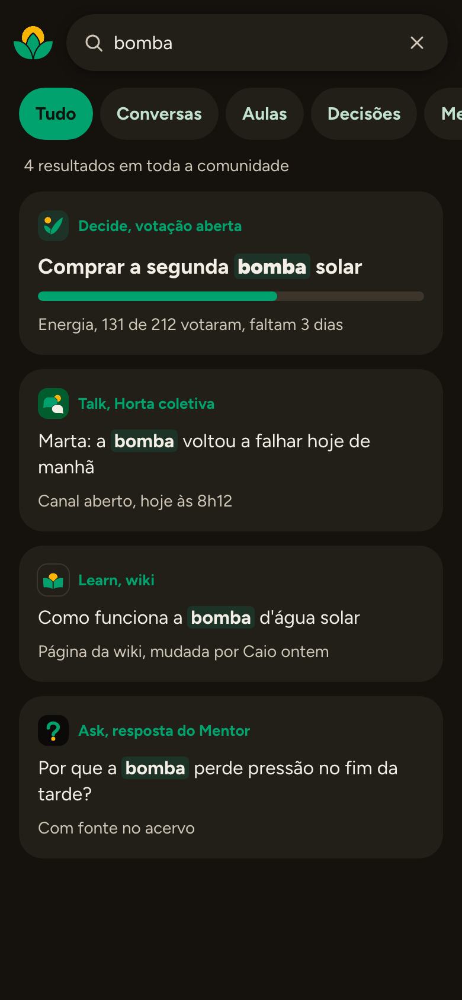
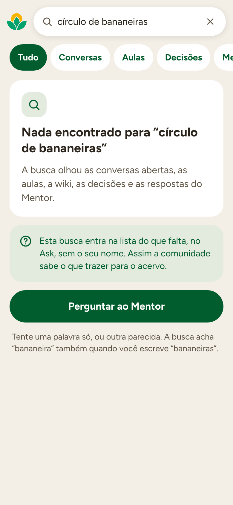
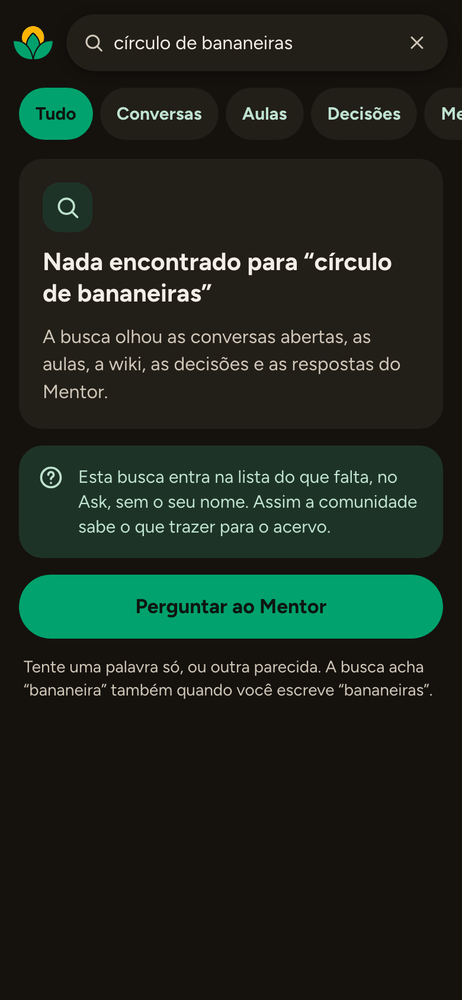

# Portal and search

The community's address opens the portal. It is the center of Earthler: one field that searches the whole community, the four apps, and what is happening now. A resident comes here to find something without knowing which app holds it, to open an app, or to see at a glance what the community is doing. The apps are parts of Earthler, and the portal is the whole; it never becomes an icon on the phone.

The maintainer approved this direction on 2026-11-15, with the look drawn below. **Proposed**: none of the portal is built. What exists today is a search of the open channels and a root address that sends a signed in resident straight to the conversation.

## The portal

`/` on the secure site, at the community's address.

| Light | Dark |
| --- | --- |
|  |  |

**What the person sees**, from top to bottom:

- The community's address in a pill with a lock, such as `vilaaurora.earthler`. It is the same on every machine, and it is the address printed on the poster, so a person learns it by seeing it.
- On the right of the address, a round button with the initial or the photo of the person. It leads to their account.
- The community's mark, its name in large type, and the line "Tudo da comunidade, num lugar só."
- The search field, "Buscar em toda a comunidade".
- The four apps as tiles on a white background, with their names under them: Talk, Learn, Decide and Ask. The tiles are the icons each app becomes on the phone.
- "Agora na comunidade": up to three things happening now, newest first, each with the small tile of the app it comes from, a title and one line that says what it is and when. Examples: a notice in Talk, an open vote in Decide, a new lesson in Learn.
- A quiet card, "Ponha os aplicativos na tela do celular. Não passa por loja.", with the button to add.

**What they can do:**

- Type in the search field and see [the results](#search-results) from every app.
- Tap a tile to open that app at its own path: `/talk/`, `/learn/`, `/decide/` or `/ask/`.
- Tap an item of "Agora na comunidade" to open it in its app, at that place.
- Tap their initial to open [their account](account.md#your-account). **Proposed**: the account, the vault, the devices and the trusted people are all reached from here. From inside an app, the community's name at the top leads back to the portal, and from the portal the account is one tap away.
- Tap "Adicionar" to put the apps on the phone. A sheet rises with the four apps, each with its own button to add. Choosing one opens that app's page, where the phone's own steps follow: on Android, Chrome's confirmation, "Instalar aplicativo"; on the iPhone, the steps in Safari. The portal itself offers nothing to install, so it never becomes an icon. **Proposed**, and **to prove** on Android. See [apps on one address](../design/apps.md#the-add-button).

**States:**

| State | What the person reads |
| --- | --- |
| Nothing new | "Agora na comunidade" shows "Nada novo por enquanto." |
| An emergency alert is active | The alert at the top of the portal, as in [the next section](#the-portal-with-an-emergency-alert) |
| No link with the community | The notice "Sem ligação com a comunidade." across the top. "Agora na comunidade" keeps what the device saw last, and the search answers "A busca precisa da ligação com a comunidade. Tente de novo quando ela voltar." **Proposed**: opening the portal with no link needs the device's part, which is not built |
| Someone asked for the person's help to recover an account | A small sun dot on the initial, and the request in [trusted people](account.md#trusted-people) |
| Not signed in | The address leads to [creating an account](account.md#create-an-account), which links to signing in. **Built**: the root address sends a visitor with no session to `/sign-up`, and a signed in resident to `/chat`, because the portal does not exist yet |

**Who may:** every signed in resident, whatever the role: resident, child, moderator, administrator. A child sees the same portal, and "Agora na comunidade" only shows what a child may read. A guardian sees what any resident sees.

**Journal:** the portal writes nothing. It reads the indexes of the apps for "Agora na comunidade" (alerts, open votes, new lessons) and the accounts index for the person's name and photo. Nothing personal appears on it: no personal conversation, no file of the vault.

**Many machines:** never waits. Any machine serves the portal, at the same address, and nothing on it names a machine. "Agora na comunidade" shows what the machine holds; during a split, each side sees its own side, and what happened on the other side appears when the machines meet. The same address on every machine is **proposed** and **to prove**: see [many machines](../design/many-machines.md#connection).

## The portal with an emergency alert

`/`, while an emergency alert is active.

| Light | Dark |
| --- | --- |
|  |  |

**What the person sees:** the address and the initial, as always. Then the alert, first on the page, in a card the color of the sun with dark text: the siren mark and "Aviso de emergência", the title in large type, the text of the alert, who sent it and when, such as "Joel, da brigada, há 4 minutos", and the button "Abrir no Talk". Under it, the rest of the portal, a little shorter: the mark and the name in one line, the search, the four apps and "Agora na comunidade", without the alert repeated in it.

**What they can do:** open the alert in Talk, where it lives with its conversation, and use the rest of the portal as usual.

**States:**

| State | What the person reads |
| --- | --- |
| The alert arrives while the portal is open | It first rises over the page, as [Talk](talk.md) describes for every alert. Once the person closes it, it stays at the top of the portal while it is active |
| More than one alert is active | The newest, and under it "Mais 1 aviso de emergência", which opens the alerts in Talk |
| No link with the community | The alerts the device already received stay at the top, under the notice "Sem ligação com a comunidade." |

**Proposed**, all of it.

**Who may:** everyone sees an active alert, children included. Who may send one is a rule of the community's charter, and the screen that sends it belongs to [Talk](talk.md).

**Journal:** writes nothing. It reads the alert's entry from the Talk index.

**Many machines:** never waits. An alert goes out from any machine, alone. In a split, each side warns its own side, and the alert reaches the other side when the machines meet; the siren sounds within reach of the machine that received the alert. See [many machines](../design/many-machines.md#each-part-of-the-system).

## Search results

`/search?q=bomba`

| Light | Dark |
| --- | --- |
|  |  |

**What the person sees:**

- At the top, the community's mark, which leads back to the portal, and the search field with the words typed and a button to clear them.
- A row of filters, "Tudo", "Conversas", "Aulas", "Decisões" and "Mentor", with "Tudo" chosen. The row slides sideways when it is wider than the screen. Each filter is one app: Conversas is Talk, Aulas is Learn (lessons, the wiki and the notes on the collection), Decisões is Decide (proposals and reports on the map), Mentor is Ask.
- How many results there are: "4 resultados em toda a comunidade".
- One card per result, the best first. Each card starts with the small tile of its app and where it comes from, such as "Talk, Horta coletiva" or "Learn, wiki". Then the text, with the word found marked on a soft background, and a line of context: when it was written, by whom, or how long a vote still runs. A vote also shows its progress bar.

**What they can do:**

- Change the words, or clear them.
- Choose a filter to see only one app.
- Tap a card to open the result in its app, at that place: the message in its channel, the page of the wiki, the proposal, the answer.
- Tap the mark to go back to the portal.

**States:**

| State | What the person reads |
| --- | --- |
| Nothing typed yet | "Escreva no campo acima o que você procura." **Built** |
| Nothing found | The screen of [the next section](#search-with-nothing-found) |
| Nothing in the chosen app | "Nada em Aulas para “bomba”." and a link "Ver em tudo" |
| No link with the community | "A busca precisa da ligação com a comunidade. Tente de novo quando ela voltar." |

**Built** today, at `/search`: one field, open to every signed in resident, that looks in the messages of the open channels and lists up to fifty of them, the best first, each with its origin ("Conversa"), its author, its time and its text. The words are reduced to their root with the Portuguese stemmer and stripped of accents, so `plantas`, `Plantar` and `planta` meet, and whatever is typed is read as words, never as an operator. Nothing personal ever enters the search index. See [the core](../design/core.md#search).

**Proposed:** the other three apps in the same search, the filters, the cards with the tile of each app and the word marked.

**Who may:** every signed in role. A child only gets results from what a child may read. Personal conversations, closed groups and the vault are never searched by the community's search: they are encrypted, and the machines cannot read them.

**Journal:** a search that finds something writes nothing. It reads the search index, which follows the journal like every index and is rebuilt from it.

**Many machines:** never waits. Each machine searches its own index, which holds every journal that machine has received. During a split, each side searches what it has, and the rest appears when the machines meet. The search by word is light and goes in every machine; a search by meaning would be heavy and live where it fits, and is not proposed here.

## Search with nothing found

`/search?q=círculo+de+bananeiras`, when nothing matches.

| Light | Dark |
| --- | --- |
|  |  |

**What the person sees:** the same top and filters as the results. Then a card: "Nada encontrado para “círculo de bananeiras”", and where the search looked, "A busca olhou as conversas abertas, as aulas, a wiki, as decisões e as respostas do Mentor." Under it a soft card: "Esta busca entra na lista do que falta, no Ask, sem o seu nome. Assim a comunidade sabe o que trazer para o acervo." Then the button "Perguntar ao Mentor" and a tip: "Tente uma palavra só, ou outra parecida."

**What they can do:**

- Ask the Mentor the same thing: the button opens Ask with the words already in the question.
- Try other words, or another filter.

**States:**

| State | What the person reads |
| --- | --- |
| A child searched | The soft card does not show, and the search goes into no list |
| The Mentor is not available | The button still leads to Ask, which says so, as [Ask](ask.md) describes |

**Built** today: the sentence "Nada encontrado para essa busca." The record of searches that found nothing is not built.

**Proposed:** everything else on this screen. A search that found nothing feeds "O que falta", the list in [Ask](ask.md) of what the collection is missing, grouped by subject, with the words and never the person.

**Who may:** every signed in role. Searches of a child never go into the list, as the rules for children in [account](account.md#children) say.

**Journal:** writes the words of the search into the list of what is missing, in an entry that carries no account and no device. **Proposed.** The operator of a machine could still match the time of that entry with a visit; that is the limit every operator has, described in [many machines](../design/many-machines.md#what-remains-a-risk).

**Many machines:** never waits. The list of what is missing joins the searches of every machine as the journals meet.

## Flows

### From a search to the collection

A resident searches and finds nothing. The words go into the list of what is missing, without their name, and the screen offers to ask the Mentor. In Ask, "O que falta" groups those words with other questions that had no answer, so the people who look after the collection know what to bring the next time there is a way to the outside. See [Ask](ask.md) and [administration](admin.md).

### From the portal to an icon on the phone

The person taps "Adicionar" on the portal, chooses an app, and lands on that app's page, where its own button to add follows the phone's steps. On the iPhone the sign in goes with the icon, and on Android the four icons share it. The way in that comes before, from the poster to the portal, is in [account](account.md#the-way-in).

## Who may do what

| Action | Resident | Child | Moderator | Administrator |
| --- | --- | --- | --- | --- |
| Open the portal | Yes | Yes | Yes | Yes |
| See an active emergency alert | Yes | Yes | Yes | Yes |
| Search the whole community | Yes | Only what a child may read | Yes | Yes |
| A search with nothing found goes into the list of what is missing | Yes, without the name | Never | Yes, without the name | Yes, without the name |
| Ask the Mentor from an empty search | As [Ask](ask.md) allows | As [Ask](ask.md) allows | As [Ask](ask.md) allows | As [Ask](ask.md) allows |

## Not decided

- The end of the community's address. The maintainer wrote `minhacomunidade.earthler`, and the screens are drawn the same way, with `vilaaurora.earthler`; today the community certificate only covers names that end in `.internal`. See [principles](principles.md#not-decided).
- Whether the names under the tiles stay Talk, Learn, Decide and Ask.
- Whether the filters of the search carry the names of the apps or the names of what they hold, as drawn.
- Which answers of the Mentor the search finds: only the ones the person asked, which Ask keeps on their device, or answers shared with the community.
- How long an emergency alert stays at the top of the portal, and who ends it.
