# Setup

The setup turns a machine into a community. Someone installs the system, opens the setup from a phone or a laptop on the same network, answers fifteen screens, and at the end has a community that works with the internet cut, a poster to hang on the wall and an account that looks after it. Residents never see these screens: they arrive later, through the poster, as [account](account.md) describes.

None of the setup screens are built. What is built is what they will drive: the community's name and short name, given on the command line when the community is born; the certificate chain, born with the community and with the root key thrown away; the fingerprint that the welcome pages show; the copy key, made at birth and printed by the program; and the rule that the first account is the administrator. Each section says which is which.

The setup is seen on the screen of whoever runs it: a phone or a laptop on the community's network, or a monitor and keyboard plugged into the machine. It is drawn here as a phone of 390 pixels, like every other screen, so the pieces stay the same; on a wider screen the same column sits in the middle.

## Before the setup: installing

There are three ways to put the system on a machine, all **Proposed**: a command on a clean Debian, a pen drive that partitions the disk and copies the system, or a machine prepared beforehand by someone the community trusts. Each ends the same way. The machine shows on its own monitor, or in the terminal for the command, the address of the setup and a code of 8 digits. The ready machine needs a monitor the first time it starts, and that is written on its box.

## The path

Until the certificate exists, the setup runs over plain HTTP on the local network and answers only to someone who typed the code. No passphrase is created in that stretch, because a page that arrives without HTTPS could have been changed on the way. **Proposed.**

| Step | Screen | What it does | Suggested | Drawn |
| --- | --- | --- | --- | --- |
| 1 | Boas-vindas | Checks the code shown on the machine | Nothing | [welcome](#1-welcome-and-the-machines-code) |
| 2 | Língua e hora | The language of the screens, and the time, taken from the phone | Portuguese | No |
| 3 | A máquina | Measures processor, memory and disk, and says what the machine can carry | Nothing | No |
| 4 | Rede | Finds the network's range and fixes the machine's number in it | The number, with the name off | No |
| 5 | A comunidade | The community's name, its short name, its place on the map and its biome | Biome from the place | [community](#5-the-community-name-and-short-name) |
| 6 | Certificado | Creates the chain, shows the fingerprint, installs it on this device | Nothing | [certificate](#6-the-certificate-is-born) |
| 7 | A carta | The rules for living together, one at a time | The table in [the charter](#the-charter) | [charter](#7-the-charter-first-rule) |
| 8 | Acervo | Suggests packs of the collection by place and space, with their licenses | By the machine | No |
| 9 | Mentor | Measures the speed and chooses the model and its mode | By the measure | No |
| 10 | Cópias | Chooses where copies go, and shows the copy key | External disk | [copy key](#10-the-copy-key-on-paper) |
| 11 | Portas para a internet | Each door to the outside, and what may go to the cloud | All closed | No |
| 12 | Administrador | The first account, its passphrase, and the second person who approves | Nothing | [administrator](#12-the-first-administrator) |
| 13 | Sirene | Connects and tests a siren, if there is one | No siren | No |
| 14 | A prova | Cuts the internet and tests conversation, a call, search, wiki, video and the Mentor | Nothing | [proof](#14-the-proof-with-no-internet) |
| 15 | Pronto | Says the community is ready and makes the poster | Nothing | [done](#15-done) and [poster](#the-poster) |

The steps are **Proposed**. One change from the order the architecture first gave: the community's name and short name come before the certificate, in step 5, because the certificate carries both. The root is named after the community, since that name is what a phone lists among its trusted certificates, and the chain is limited to the short name (**Built** in the code that makes the chain). The place and the biome stay on the same step.

On each screen the Mentor answers questions about the step, when the machine can run it. **Proposed.** Not drawn here.

## 1. Welcome and the machine's code

**Path:** `/setup/` on the machine's address, over plain HTTP. **Proposed.**

| Light | Dark |
| --- | --- |
| 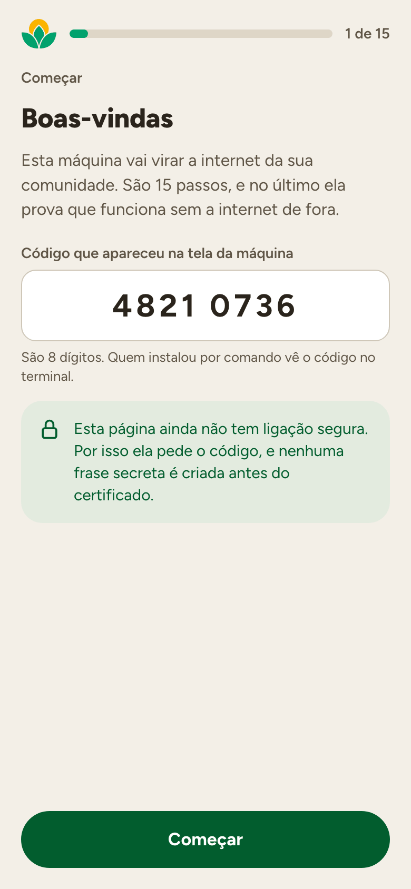 | 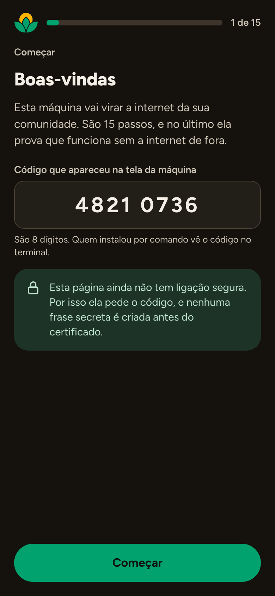 |

**What the person sees.** At the top of every setup screen: the Earthler mark, a progress bar and "1 de 15". Then the name of the step, "Começar", the title "Boas-vindas", and a line that says the machine is about to become the community's internet and that the last step proves it works without the internet from outside. A field for the code, written large and spaced, with a hint that a person who installed by command sees the code in the terminal. A quiet panel that explains why the code is asked: the page has no secure connection yet, and no passphrase is created before the certificate. At the bottom, "Começar".

**What they can do.** Type the code and start.

**States.**

- A wrong code: "Esse código não confere. Confira o número na tela da máquina." **Proposed.**
- Too many wrong codes: the setup stops answering that device for a while. How many tries and for how long is **Not decided**.
- The setup is already done: the address no longer shows the setup. It shows the community's welcome page, the one residents reach from the poster. **Proposed.**

**Who may.** Anyone who holds the code. There are no accounts yet.

**What it writes and reads.** Nothing in the journal. The code lives in the machine's memory until the setup ends.

**Many machines.** The setup is the setup of the first machine, which becomes machine 0. A machine that joins a community that already exists does not go through it: today it joins on the command line with an invitation code and the root's fingerprint (**Built**, see [how the machines live together](../design/machines.md#joining)). The screens for that are the administrator's, in [administration](admin.md), and are **Not decided**.

## 5. The community: name and short name

**Path:** `/setup/community`. **Proposed.**

| Light | Dark |
| --- | --- |
| 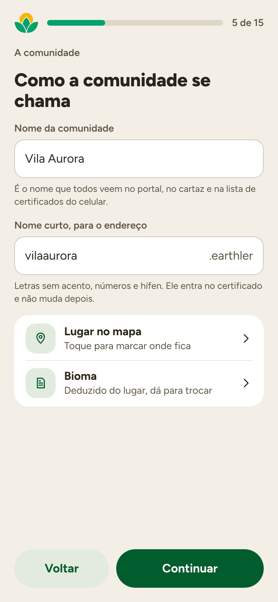 | 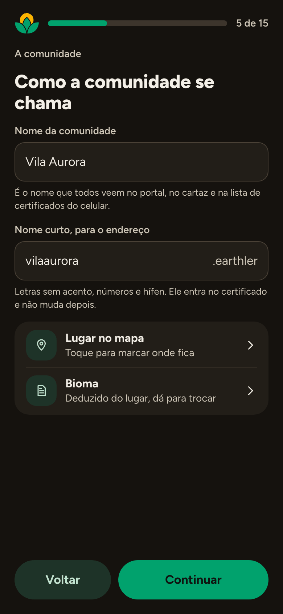 |

**What the person sees.** The step "A comunidade" and the title "Como a comunidade se chama". A field for the name, with a hint that it is the name everyone sees, on the portal, on the poster and in the phone's list of certificates. A field for the short name, with the end of the address written after it, and a hint that only letters without accents, digits and hyphens are taken, and that the short name goes into the certificate and never changes. Two rows: the place on the map, and the biome, which is guessed from the place and can be changed. At the bottom, "Voltar" and "Continuar".

**What they can do.** Write the name. Change the short name the screen suggests from it. Mark the place on a map and correct the biome. Go on.

**States.**

- No name: "Escreva o nome da comunidade para continuar." **Proposed.**
- A short name with other characters: the field shows the short name it would use and says why. **Proposed**; the sentence is **Not decided**.
- The short name is fixed once the certificate is born (**Built**: the program takes it once, when the community is born). Coming back to this screen after step 6 shows it without a field.

**Who may.** Whoever holds the code.

**What it writes and reads.** The community is born with its name: `community.created` carries the name today (**Built**). The short name goes into the certificate, as the only name it covers, and the machine reads it from there on every start (**Built**, from the command line). The place and the biome are kept for the collection's suggestions; where they are written is **Not decided**.

**Many machines.** The name and the short name are the community's, the same on every machine.

The address ends in `.earthler`, which this screen shows after the short name, and the certificate is limited to that one name (**Built**, from the command line). See [principles](principles.md#why-earthler).

## 6. The certificate is born

**Path:** `/setup/certificate`; the steps to install it are the welcome pages residents use, at `/certificate/<device>`. **Proposed** for the setup screen, **Built** for the welcome pages.

| Light | Dark |
| --- | --- |
| 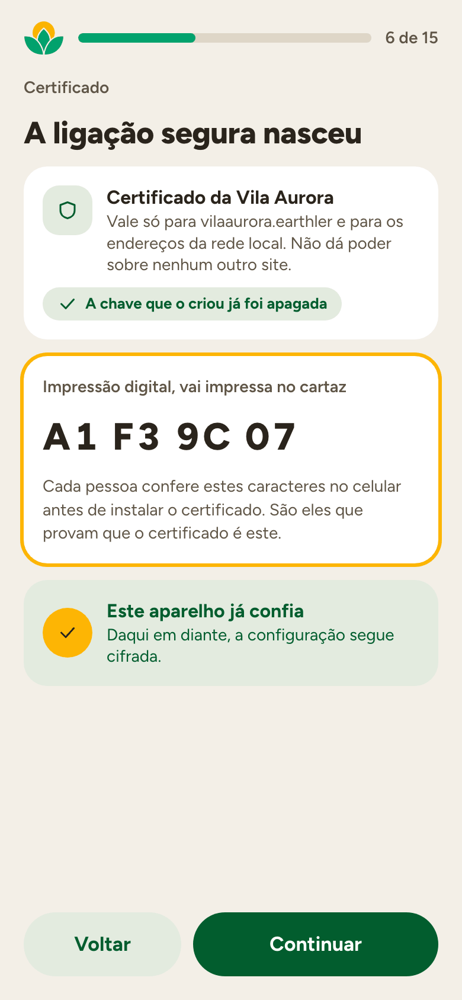 | 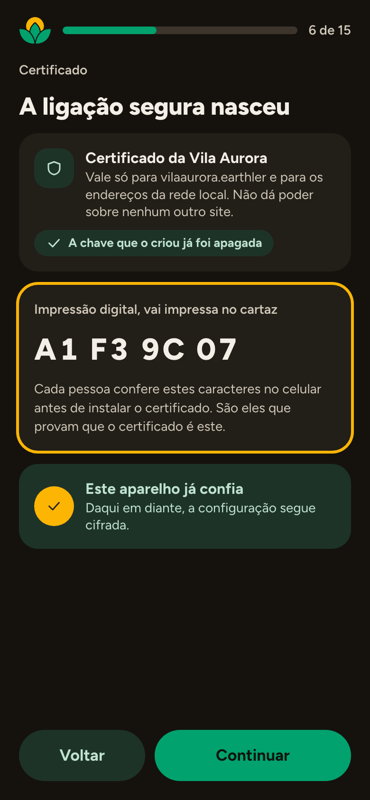 |

**What the person sees.** The step "Certificado" and the title "A ligação segura nasceu". A card that names the certificate after the community and says it is valid only for the community's address and the local network, and gives no power over any other site, with the mark "A chave que o criou já foi apagada". A card with a sun ring, because it asks for something: the fingerprint, the first eight characters in pairs, "A1 F3 9C 07", written large, with the line that it goes on the poster and that every person checks these characters on their phone before installing. Then the state of this device. At the bottom, "Voltar" and "Continuar".

**What they can do.** Install the certificate on the device they are using, by the same steps a resident follows. Go on once the device trusts it.

**States.**

- Before installing: the last card offers "Instalar neste aparelho", which opens the welcome page for this kind of device. **Proposed.**
- Waiting: "Este aparelho ainda não confia no certificado. Esta página confere de novo a cada poucos segundos." That sentence is the welcome page's (**Built**).
- Done, as drawn: "Este aparelho já confia", and the setup goes on over HTTPS. **Proposed.**
- The device cannot install it, such as an iPhone in a browser other than Safari: the welcome page sends it to Safari (**Built**).

**Who may.** Whoever holds the code.

**What it writes and reads.** The chain is made here: a root that devices install, valid for thirty years, and an issuer signed by it. Both are limited to the community's name and to private network addresses; the root key signs the issuer and is thrown away without touching the disk (**Built**, see [the core](../design/core.md#access)). The fingerprint is the SHA-256 of the root, shown in pairs (**Built**). The architecture also puts the fingerprint in the community's first entry; that is **Proposed**, and `community.created` carries only the name today.

**Many machines.** One chain for the whole community. A machine that joins receives it with the community's secrets, after checking the root's fingerprint (**Built**).

## 7. The charter: first rule

**Path:** `/setup/charter`, one rule after another. **Proposed.**

| Light | Dark |
| --- | --- |
| 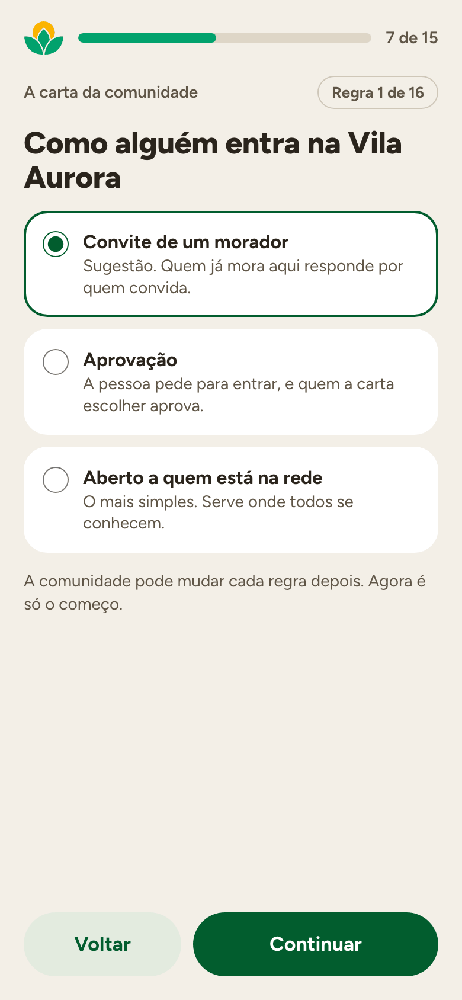 | 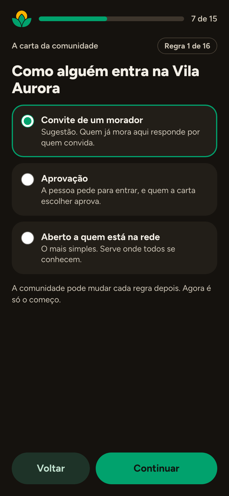 |

**What the person sees.** The step "A carta da comunidade" and "Regra 1 de 16". The first rule as a question, "Como alguém entra na Vila Aurora", and its options as cards with a real radio button each: an invitation from a resident, marked as the suggestion, approval, and open to whoever is on the network. A line that the community can change each rule later. At the bottom, "Voltar" and "Continuar".

**What they can do.** Choose one option per rule and go on. Every rule comes with the suggestion already chosen, so going on without changing anything gives the suggested charter.

**States.** A rule with a number, such as the voting age, shows a field with the suggestion in it. A number outside what the rule accepts: "Escolha um número entre {min} e {max}." **Proposed.**

**Who may.** Whoever holds the code.

**What it writes and reads.** The charter goes into the community's first entries. **Proposed**; the charter is not built, and the name of its event is **Not decided** (a word enters the [glossary](../glossary.md) when the code takes it).

**Many machines.** Changing the charter later is counted, and waits for the listed machines (see [behavior](behavior.md#many-machines)). During the setup there is one machine and nothing waits.

### The charter

Each community chooses and the system suggests. The suggestions below are **Proposed**, except three that come from the maintainer: the vote is open by default, nothing goes to the cloud by default, and one administrator is enough to add or remove a machine (decided on 2026-11-13).

| Rule | Options | Suggested |
| --- | --- | --- |
| How someone joins | Open on the network, invitation, or approval | Invitation from a resident |
| Identity | Real name or nickname | The name the person is known by |
| Moderation | Administrators, or chosen moderators | Three moderators |
| Who sends an alert to everyone | Administrators, or moderators too | Both |
| Voting age | Free | 16 |
| Who proposes | Every resident who votes, or a group | Every resident who votes |
| The vote | Open or secret | Open |
| A proposal passes with | Participation and majority | 20% participation and simple majority |
| A lent vote lasts | Months | 6 months |
| Who approves a change on the machine | One or two people | Two people |
| Who adds or removes a machine | One administrator or more | One administrator |
| Who approves a draft of the Mentor | Curators, or a vote | Two curators |
| Room for each resident's lessons | In GB | 2 GB |
| Who authorizes a connected AI | One or two people | Two people |
| Graded sanctions | Warning, suspension, leaving | Warning, then suspension |
| Conflicts | Agreed mediation, or a vote | Agreed mediation |

## 10. The copy key, on paper

**Path:** `/setup/copies`. **Proposed.**

| Light | Dark |
| --- | --- |
| 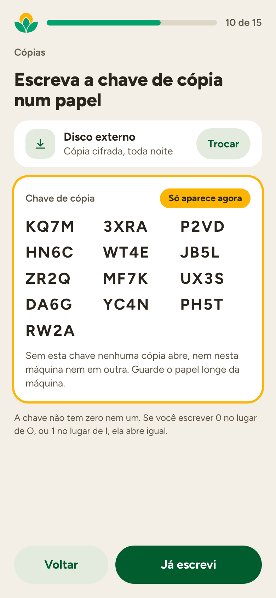 | 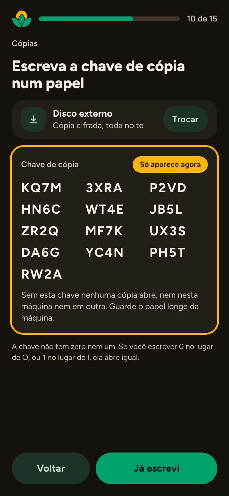 |

**What the person sees.** The step "Cópias" and the title "Escreva a chave de cópia num papel". A row with where the copies go, "Disco externo", one encrypted copy every night, and "Trocar". A card with a sun ring and the chip "Só aparece agora": the copy key, in thirteen groups of four letters and digits, large, and the line that without it no copy opens, on this machine or another, and that the paper stays away from the machine. Under it, a hint that the key has no zero and no one, and that typing 0 for O or 1 for I opens it the same. At the bottom, "Voltar" and "Já escrevi".

**What they can do.** Choose where the copies go: an external disk, or a second machine that keeps an encrypted copy, paired with a code. Write the key down. Go on.

**States.**

- No external disk plugged in: the row says so and offers the second machine, or going on without copies for now. **Proposed**; whether the setup lets someone finish with no copy at all is **Not decided**.
- After "Já escrevi" the key is never shown again on a screen. **Proposed**, as the architecture asks.

**Who may.** Whoever holds the code.

**What it writes and reads.** The copy key is made when the community is born and kept in the machine's secrets folder; the program writes it in groups of four letters and digits with no letter that looks like a digit, and reads it back forgiving case, spaces, hyphens, 0 for O and 1 for I (**Built**, see [copies](../design/copies.md)). The nightly copy into a folder is **Built**; the screen that chooses it is not. Pairing a second machine with a code is **Built** on the command line, see [the second machine](../design/replica.md).

**Many machines.** One key for the community. A machine that joins receives it with the community's secrets (**Built**), and the copies of every machine are opened with it.

Whether the setup shows the key as these groups or as words, as the architecture first asked, is **Not decided**: the code writes groups, and [copies](../design/copies.md) lists showing it as words as not built. Whether the setup asks the person to type back part of the key before going on is **Not decided** too.

## 12. The first administrator

**Path:** `/setup/administrator`, over HTTPS. **Proposed.**

| Light | Dark |
| --- | --- |
| 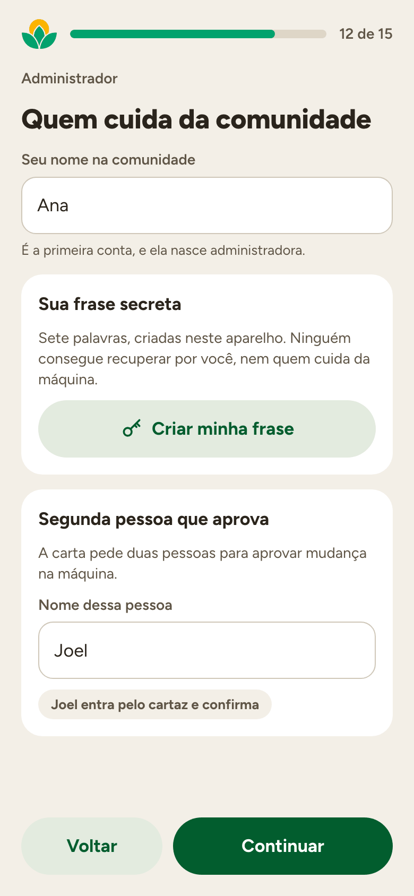 | 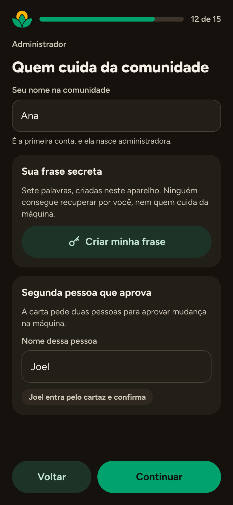 |

**What the person sees.** The step "Administrador" and the title "Quem cuida da comunidade". A field for the person's name, with the hint that this is the first account and that it is born an administrator. A card for the passphrase: seven words, made on this device, that nobody can recover for the person, not even whoever looks after the machine, and "Criar minha frase". A card for the second person who approves, shown because the charter asks two people to approve a change on the machine, with a field for that person's name and the chip that the person comes in through the poster and confirms. At the bottom, "Voltar" and "Continuar".

**What they can do.** Name themselves, create the passphrase by the same screens a resident uses (see [account](account.md)), and name the second person.

**States.**

- The charter asks one person: the second card does not show. **Proposed.**
- The passphrase is not created yet: "Continuar" says "Crie a sua frase para continuar." **Proposed.**
- A name that the account rules refuse: the sentences of creating an account, such as "O nome pode ter até 40 letras." (**Built**).

**Who may.** Whoever holds the code; after this step, the administrator.

**What it writes and reads.** `account.created` with its first device, in one entry (**Built**). The first account of a community is its administrator until the setup names one (**Built**). The passphrase is not built. How the second person is held until they arrive, and what they confirm, is **Not decided**.

**Many machines.** One machine; nothing waits. Later, changing a role is counted and waits (see [behavior](behavior.md#many-machines)).

## 14. The proof, with no internet

**Path:** `/setup/proof`. **Proposed.**

| Light | Dark |
| --- | --- |
| 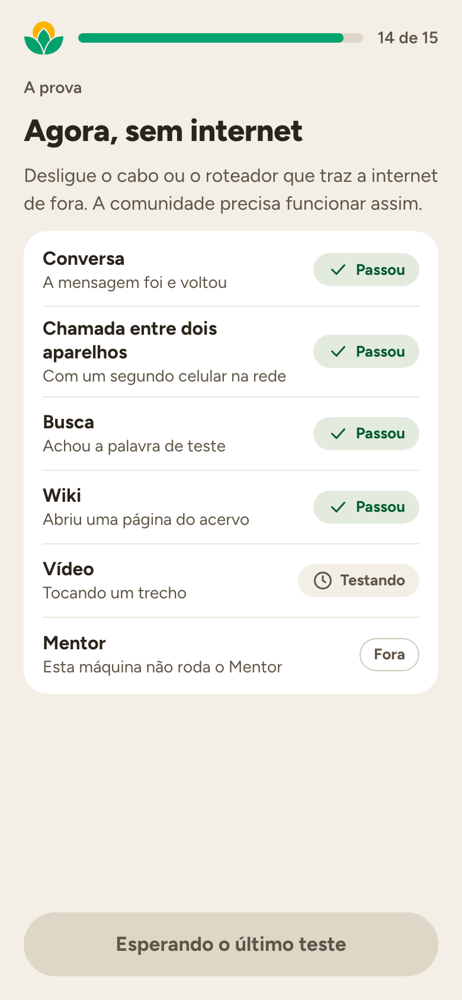 | 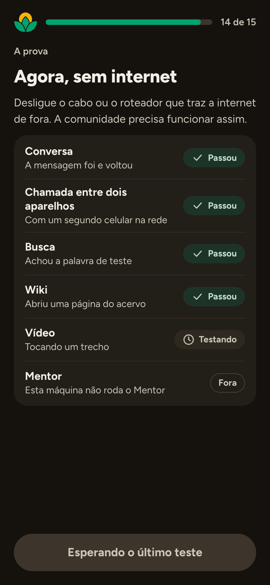 |

**What the person sees.** The step "A prova", the title "Agora, sem internet", and the instruction to unplug the cable or the router that brings the internet from outside. A list of tests, each with a line of what it checks and its state: "Passou", "Testando", or "Fora" for what this machine does not run. At the bottom, a button that waits for the last test.

**What they can do.** Cut the internet, open the address on a second phone for the call, and wait. Try a test again when it fails.

**States.**

- Each test passes, fails or is out. A call that fails: "A chamada não passou. A rede pode estar impedindo que os aparelhos se vejam." because an access point that isolates its clients breaks direct calls. **Proposed.**
- The internet is still on: "A internet de fora ainda está ligada. Desligue para a prova valer." **Proposed.**
- A part the machine does not carry, such as the Mentor on a machine without it, is out, and does not stop the setup. **Proposed.**

**Who may.** The administrator.

**What it writes and reads.** Test messages and searches, removed when the proof ends. **Proposed**; whether they leave entries in the journal is **Not decided**.

**Many machines.** One machine. Proving the network with two machines and two phones is **To prove**, see [many machines](../design/many-machines.md#connection).

## 15. Done

**Path:** `/setup/done`. **Proposed.**

| Light | Dark |
| --- | --- |
| 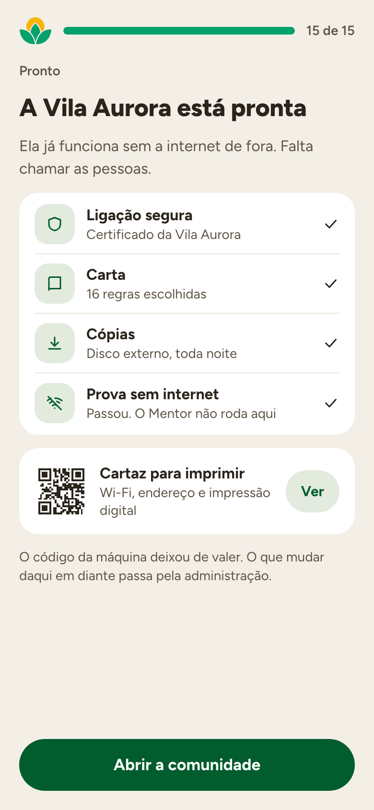 | 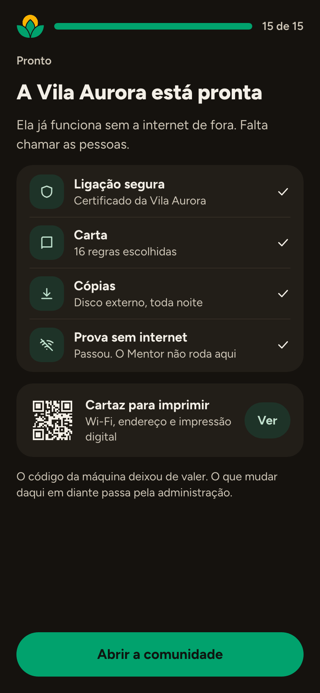 |

**What the person sees.** The full progress bar, the title "A Vila Aurora está pronta" and the line that it already works without the internet from outside, and that what is left is to call the people. A list of what is ready: the secure connection, the charter, the copies, and the proof. A card with the poster, "Ver". A line that the machine's code no longer works and that what changes from now on goes through administration. At the bottom, "Abrir a comunidade", which opens the [portal](portal.md).

**What they can do.** See and print the poster. Open the community.

**States.** None of its own. The setup cannot end without the proof. **Proposed.**

**Who may.** The administrator.

**What it writes and reads.** The end of the setup. Whether it is an entry of its own is **Not decided**.

**Many machines.** None.

## The poster

**Path:** `/setup/poster` during the setup, and from then on in [administration](admin.md). **Proposed.**

| Light | Dark |
| --- | --- |
| 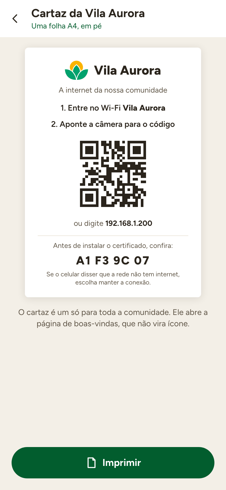 | 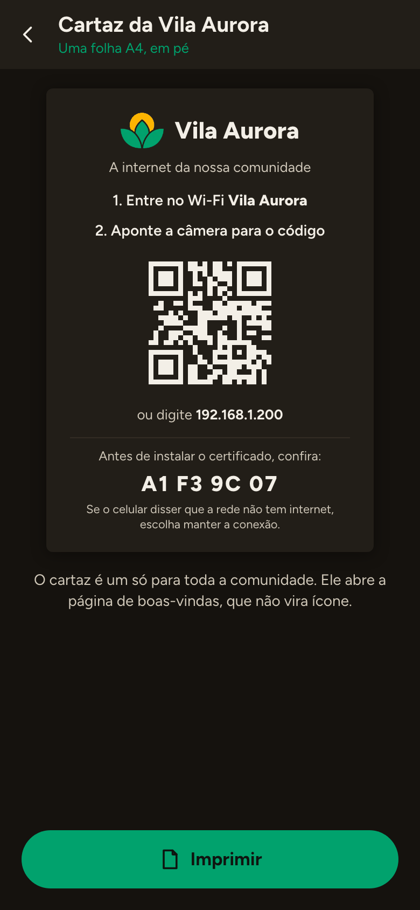 |

**What the person sees.** The inner header "Cartaz da Vila Aurora", an A4 sheet standing up, and the sheet itself: the mark and the community's name, two numbered lines, join the Wi-Fi and point the camera at the code, the QR code, the address to type instead, and at the foot the fingerprint to check before installing the certificate, with the advice to keep the connection when the phone says the network has no internet. Under the sheet, a line that the poster is one for the whole community and that it opens the welcome page, which never becomes an icon. At the bottom, "Imprimir".

The printed sheet is always light: dark mode only changes the preview.

**What they can do.** Print it.

**States.** A new poster is needed when the address or the certificate changes: a new range of the network gives a new number, and a new chain gives a new fingerprint. The administrator's screens say so. **Proposed.**

**Who may.** The administrator.

**What it writes and reads.** Reads the Wi-Fi name, the address and the fingerprint. Writes nothing.

**Many machines.** One poster for the community, the same on every machine. **Proposed.** Whether the address on it is a number or a name with many machines is **Not decided**, see [many machines](../design/many-machines.md#not-decided-not-proven).

The QR code opens the welcome page over plain HTTP, the only thing that port serves besides the certificate (**Built**). The drawing shows the machine's number, the default with one machine; the QR code in the drawing is an illustration and opens nothing.

## Flows

### From the first boot to the first resident

Ana installs the system on a small computer. The machine shows the setup's address and a code. On her phone, on the same Wi-Fi, she opens the address and types the code. She chooses Portuguese and takes the time from her phone. The machine measures itself and finds its number on the network. Ana names the community Vila Aurora, keeps the short name the screen suggests and marks the place on the map. The certificate is born; she installs it on her phone, the setup goes on over HTTPS, and the fingerprint is on the screen. She goes through the sixteen rules, keeping most suggestions. She picks the collection, the Mentor's mode if the machine can run it, and an external disk for the copies, and writes the copy key on paper. She keeps every door to the internet closed, creates her account and her passphrase, and names Joel as the second person who approves. She unplugs the router's internet cable and the proof runs. The community is ready; she prints the poster and hangs it by the door of the shared kitchen.

Joel is the first resident. He joins the Wi-Fi, points his camera at the poster and lands on the welcome page. He compares the fingerprint on his phone with the one on the poster, installs the certificate, creates his account through an invitation from Ana, as the charter asks, writes down his passphrase, and arrives at the portal, where he adds Talk to his phone. That part belongs to [account](account.md) and to [adding an app](behavior.md#adding-an-app-to-the-home-screen).

### Going back, and stopping in the middle

Every step has "Voltar". Two things cannot be undone by going back: the short name, once the certificate is born, and the copy key, once it was shown. What happens when the setup is interrupted, by a power cut or a closed tab, is **Not decided**: whether it resumes at the step where it stopped, and whether a chain made before the cut is kept or made again.

## Who may do what

| Action | Before step 12 | The administrator, during the setup | Anyone else |
| --- | --- | --- | --- |
| Open the setup | With the code | Yes | No |
| Name the community and choose the short name | With the code | Yes, until the certificate | No |
| Choose the charter | With the code | Yes | No |
| See the copy key | With the code, once | No, after it was shown | No |
| Run the proof | No | Yes | No |
| Print the poster | No | Yes, and later from administration | No |

## Not decided

- The paths of the setup: `/setup/...` is a proposal.
- How many wrong codes are allowed, and for how long a device is then refused.
- With many machines, whether the address is a number or a name.
- Where the place and the biome are written.
- The name of the charter's event, and whether the fingerprint and the charter go in the community's first entry.
- Whether the copy key is shown as groups of letters and digits, as the code makes it, or as words; whether the setup asks to type part of it back; whether the setup can end with no copy.
- How the second person who approves is held until they arrive, and what they confirm.
- Whether the proof leaves entries in the journal, and whether the end of the setup is an entry.
- What happens when the setup is interrupted.
- The screens of a machine that joins an existing community.
- Whether the poster carries the Wi-Fi password, if the network has one.
- The steps not drawn here: language and time, the machine, the network, the collection, the Mentor, the doors and the siren.
