# Talk

Talk is the app where the people of a community speak to each other. It holds three things, one per part of its bar: conversations, calls and alerts. Open channels are where the whole community talks, in the open, and anyone who lives there can read them. Conversations between two people and closed groups are encrypted on the device before they leave it, so only the people in them can read them, and no machine and no administrator can. A child talks only with the adults their guardian authorized, in a protected conversation the guardian can read. Calls of up to five people go straight from device to device, encrypted; large community meetings pass through a machine and say that they have no secrecy. Alerts reach everyone at once, and an emergency fills the screen and can sound the community's siren.

Talking never waits. Writing, deleting one's own message, a moderator's removal, a call of up to five and an alert are facts a person states, and any machine accepts them alone. What is written with no link to the community stays on the device, in sight, and goes out by itself when the link returns.

## What is built today

**Built**, at `/chat`, as a plain page of one site, before the apps exist:

- One open channel, "Geral", created together with the community. Every resident reads it.
- Writing a message of up to 4,000 letters, as the event `message.created`. A child's account reads and does not write.
- Deleting one's own message, as `message.deleted`. The text leaves the indexes at once, the conversation says "Mensagem apagada.", and the night's work erases the text from the journal of each machine and from the copies it keeps.
- Removing someone else's message, by a moderator or an administrator, with a reason of up to 200 letters, also as `message.deleted`. The removal is an act, and acts go to the Registro, at `/log`, which every resident may read.
- Live updates: an open page learns of a new message and of a deletion without reloading, over one connection, and picks up where it stopped after a dropped Wi-Fi. A page open on one machine hears what is written on another.
- The order of a conversation by the time each message was written, with the rule that an answer never gets a time before its question, so a message that arrives late from another machine takes its place.
- A page that refuses a message because it is too long, or because the system could not write it, shows it again with the text kept.

Everything else on this page is **Proposed**: the `/talk/` app and its look, more than one channel, editing, replying, forwarding, flagging, personal conversations, groups, the passphrase, the protected conversations of children, calls, meetings, alerts, the siren, the outbox and the marks "Ainda não enviada" and "Chegou depois".

## How Talk is laid out

Talk lives at `/talk/`. Its cover is the primary green with light text, with the Talk glyph drawn large and cut by the corner; see [visual identity](visual.md). Its bar has three parts, "Conversas", "Chamadas" and "Avisos", and the community's name at the top of every tab leads to the [portal](portal.md). A conversation, a form and a list of participants are drawn full, with the inner header: a way back, the title and one line under it. A call, an incoming call, a meeting and an emergency alert take the whole screen.

The paths below are **Proposed**. Sheets, such as the actions on a message, have no path of their own; they open over the page they belong to.

| Path | Screen |
| --- | --- |
| `/talk/` | Conversations, the home |
| `/talk/channels/<id>` | An open channel |
| `/talk/chats/<id>` | A conversation between two people, or a closed group |
| `/talk/chats/<id>/people` | Participants |
| `/talk/protected/<id>` | A child's protected conversation |
| `/talk/new` | New conversation |
| `/talk/calls` | Calls |
| `/talk/calls/<id>` | A call: incoming, ringing, in progress |
| `/talk/meetings/<room>` | A large community meeting |
| `/talk/alerts` | Alerts |
| `/talk/alerts/new` | New alert |
| `/talk/alerts/<id>` | One alert; an emergency shows full screen over any page |

## A conversation, in a few rules

These rules shape every conversation screen below. They are **Proposed** unless marked otherwise.

- **Balloons.** The person's own messages are on the right, in the soft green; everyone else's are on the left, on the surface, with the author's name on top in an open channel and in a group. Between two people the name is in the header and not on each balloon. Times are written as people say them: "8h15", "ontem", "seg".
- **What a conversation has.** The maintainer decided that a conversation has replies that quote, forwarding, deleting and editing, and has no read marks and no sign that someone is online.
- **Tapping a message opens what can be done with it**, in a sheet. Each message is offered to a screen reader as a button with that same sheet, so nothing depends on a long press.
- **Deleted and removed.** A message its author deleted leaves a quiet outline with "Mensagem apagada." in its place (**Built**, with that sentence). A message a moderator removed leaves "Mensagem removida pela moderação." and a link to its reason in the Registro. Today both read "Mensagem apagada." and the reason is only in the Registro.
- **Edited.** An edited message carries "editada" beside its time. The new text is a new entry, and the previous one leaves the journal in the night's work.
- **Attachments.** A photo, a voice message or a file goes up in pieces, so a Wi-Fi that drops does not start it over. In a personal conversation it is encrypted on the device before it leaves. The browser removes the place a photo was taken before sending. Only pictures and videos of common kinds open on the page; every other file is downloaded.
- **The unread count lives only on the device.**
- **The marks.** "Ainda não enviada" sits where the time would be, on a message still in the outbox, and becomes the time when it goes out. "Chegou depois" sits beside the time of a message that joined the conversation after others written later, so nobody thinks they missed something that was already there. Both are two of the [four notices](principles.md#four-notices-always-the-same). The order they rely on is **Built**; the marks are not.

## Screens

### Conversations, the home

**Path:** `/talk/`. **Proposed**; the one channel of today is at `/chat`, **Built**.

| Light | Dark |
| --- | --- |
| 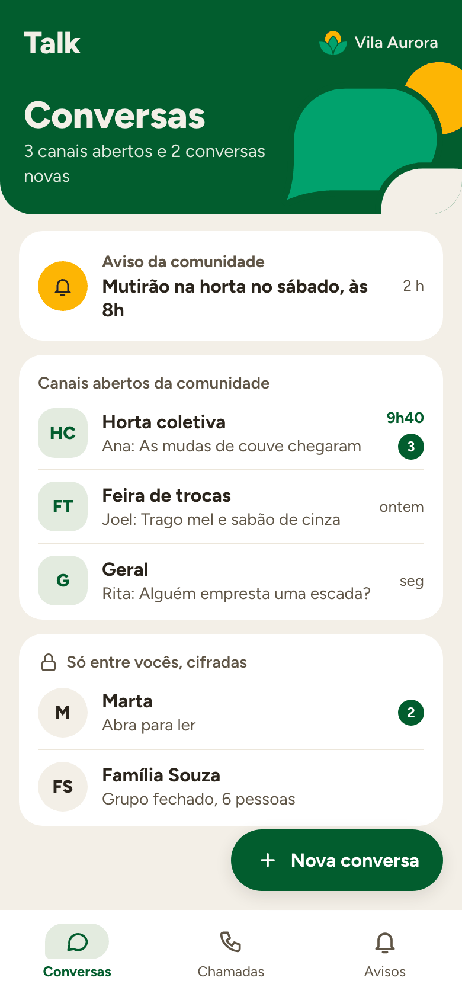 | 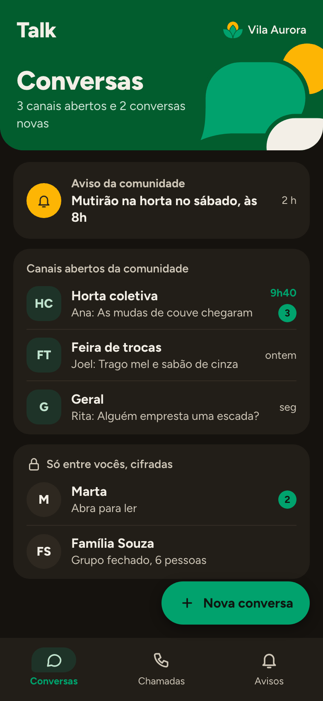 |

**What the person sees.** The green cover with "Talk", the community's name at the right, the title "Conversas" and a line that counts what is new, "3 canais abertos e 2 conversas novas". Under it, the latest alert of the community as a card with the sun bell, "Aviso da comunidade", its text and how long ago. Then the list "Canais abertos da comunidade", each channel with its initials on a soft square, the last message with its author, the time and the count of unread messages. Then the list "Só entre vocês, cifradas", with a lock: conversations between two people, which say "Abra para ler" instead of showing text, and closed groups, which say "Grupo fechado" and how many people. The button "Nova conversa" floats over the list. The bar, with "Conversas" marked.

**What they can do.** Open the alert, a channel, a conversation or a group. Start a new conversation. Go to "Chamadas" or "Avisos" by the bar, or to the portal by the community's name.

**States.**

- Nothing written yet in a channel: its line reads "Ninguém escreveu ainda." (**Built**, as the empty state of the channel).
- No personal conversation yet: the encrypted list reads "Suas conversas cifradas vão aparecer aqui."
- First opening of the Talk icon on an iPhone: the encrypted list asks for the passphrase; see [the passphrase in the Talk icon](#the-passphrase-in-the-talk-icon-on-an-iphone).
- No link with the community: see [no link with the community](#no-link-with-the-community).
- An emergency alert in force: it fills the screen; see [an emergency alert received](#an-emergency-alert-received).

**Who may.** Every resident, moderator and administrator. A child sees the open channels the guardian released and the protected conversations with the adults the guardian authorized, and no encrypted list.

**Writes and reads.** It writes nothing. It reads the channels and their last messages from the index of the community layer, and the personal conversations from the device, where they are kept encrypted and opened with the person's keys. The latest alert comes from the alerts.

**Many machines.** It never waits. Every machine carries the open channels and the alerts, and the personal conversations are first on the device.

### An open channel

**Path:** `/talk/channels/<id>`. **Proposed**; the one channel of today, **Built**, at `/chat`.

| Light | Dark |
| --- | --- |
| 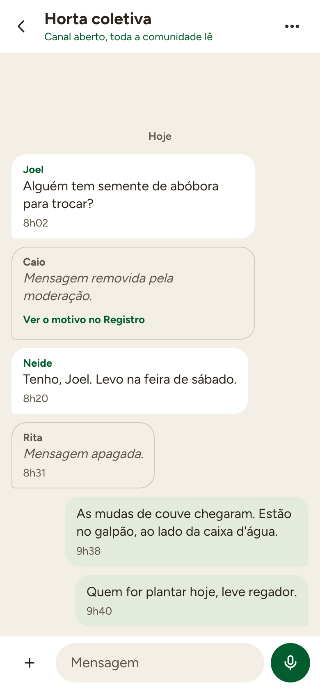 | 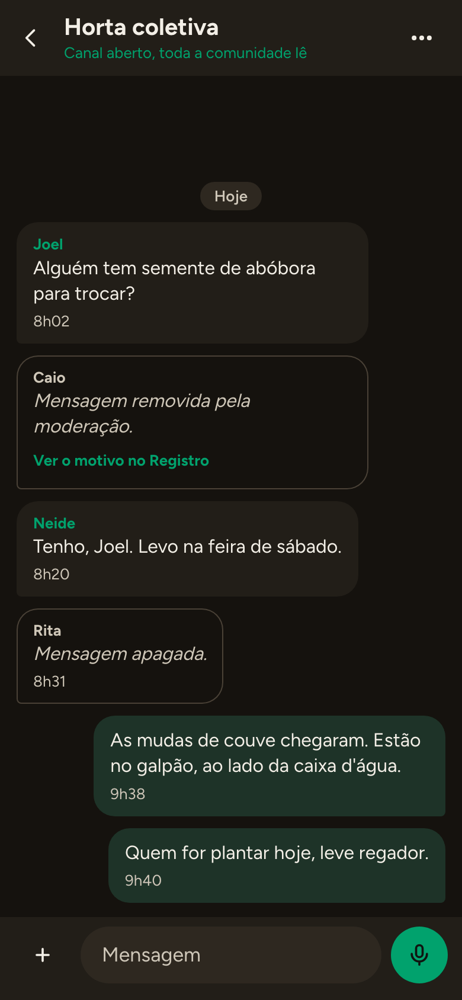 |

**What the person sees.** The inner header with the channel's name, "Horta coletiva", and the line "Canal aberto, toda a comunidade lê", so nobody mistakes it for a private place. The messages, oldest at the top, with a pill for the day, "Hoje". Other people's balloons on the left with the author's name; the person's own on the right. In the drawing, Caio's message was removed by a moderator and reads "Mensagem removida pela moderação." with "Ver o motivo no Registro"; Rita deleted her own and it reads "Mensagem apagada.". At the bottom, the field "Mensagem", a button to attach and a button to record a voice message, which turns into the button to send once there is text.

**What they can do.** Read, and write a message. Tap a message to reply, forward, edit or delete their own, flag someone else's, and, for a moderator or an administrator, remove it with a reason; see [what to do with a message](#what-to-do-with-a-message). Open the reason of a removal in the Registro. Attach a photo, a file or a voice message.

**States.** These sentences are **Built** unless marked:

- Empty: "Ninguém escreveu ainda."
- Empty message: "Escreva uma mensagem antes de enviar."
- Too long: "A mensagem pode ter até 4.000 letras.", with the text kept.
- Text the system cannot keep: "O texto tem caracteres que o sistema não consegue guardar."
- A child's account, in place of the field: "Esta conta só lê as conversas."
- The system read-only after a failure of the disk: "O sistema está em somente leitura e não aceita nada novo agora. Avise quem cuida da máquina.", with the text kept. This sentence names a machine, which the principles avoid on a resident's screen; changing it is **Proposed**.
- No link with the community: the notice in its fixed place, and what is written goes to the outbox with "Ainda não enviada". **Proposed.**
- A message that arrived from the other side of a split: "Chegou depois" beside its time. **Proposed.**

**Who may.** Residents, moderators and administrators read and write (**Built**). A child reads only the channels the guardian released and does not write (writing **Built**, the release **Proposed**). Who may open a new channel is **Not decided**.

**Writes and reads.** Writes `message.created` with the channel and the text, and `message.deleted` for a deletion (both **Built**); `message.edited` for an edit (**Proposed**). A reply is a `message.created` that carries the message it answers. It reads the channel's messages and the authors' names from the chat index, and follows new entries live.

**Many machines.** It never waits: any machine accepts a message alone. A page open on one machine hears what is written on another, and with one machine off the others go on (**Built**, with two machines). After a split, each side goes on writing, and when the sides meet the messages of the other side take their place by time (**Built**), with the mark "Chegou depois" (**Proposed**).

### A conversation between two people

**Path:** `/talk/chats/<id>`. **Proposed.**

| Light | Dark |
| --- | --- |
| 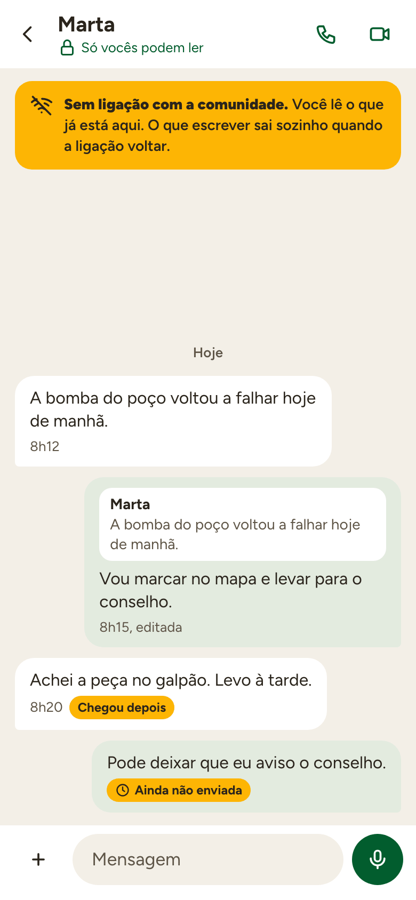 | 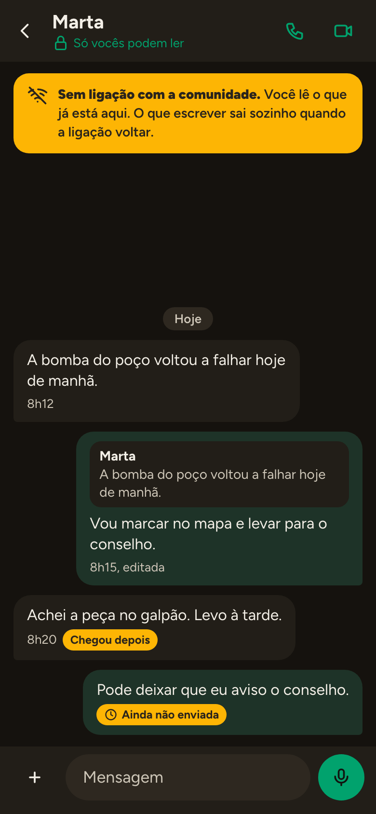 |

**What the person sees.** The inner header with the other person's name, "Marta", and, with a lock, "Só vocês podem ler". Buttons for a voice call and a video call. The drawing shows the device with no link, so the notice "Sem ligação com a comunidade. Você lê o que já está aqui. O que escrever sai sozinho quando a ligação voltar." sits in its fixed place under the header. The person's reply quotes Marta's message inside the balloon and carries "8h15, editada". A message of Marta's carries "Chegou depois" beside "8h20": it was written during an earlier split and joined later. The person's last message carries "Ainda não enviada" in place of its time, because it is in the outbox.

**What they can do.** Everything an open channel offers on one's own messages: reply, forward, edit, delete. Call, by voice or video. Open the participants, where the verification code is. Flagging inside a personal conversation is **Not decided**, because no moderator can read it.

**States.**

- First message: "Esta conversa é cifrada no seu aparelho. Só quem está nela pode ler."
- The other person's key changed: a line in the conversation, "A chave de Marta mudou. Confira o código antes de mandar algo importante.", leading to the participants.
- The key of this device is missing, after the browser lost its storage: "Para abrir as suas conversas neste aparelho, digite a sua frase.", as in [the passphrase in the Talk icon](#the-passphrase-in-the-talk-icon-on-an-iphone).
- No link: the notice and "Ainda não enviada", as drawn.

**Who may.** Residents, moderators and administrators. A child does not have personal conversations; a child talks in protected conversations.

**Writes and reads.** Writes `sealed.created`, `sealed.edited` and `sealed.deleted`: the content is a sealed block that only the participants open, signed by the author, with the digests of the attachments outside it so the machine knows which files are still referred to. Starting the conversation writes `chat.created` with the two participants and `chatkey.sealed`, the key of the conversation sealed for each of them. It reads the participants' public keys, published by the [account](account.md). All **Proposed**.

**What a machine sees.** It keeps the sealed package and cannot open it. It does see who writes to whom, when and how much; there is no screen for that, and whoever has access to a machine can look it up. That limit holds for every machine of the community. **Proposed**, as described in [many machines](../design/many-machines.md#what-remains-a-risk).

**Many machines.** It never waits. The conversation lives first on the device, and every machine keeps the sealed package, which works as mail and as a safe: someone who loses their phone signs in on another device with the passphrase and finds what is theirs. With every machine off, the person still reads their conversations and writes what will go out when a machine appears. **Proposed.**

### A closed group

**Path:** `/talk/chats/<id>`. **Proposed.**

| Light | Dark |
| --- | --- |
| 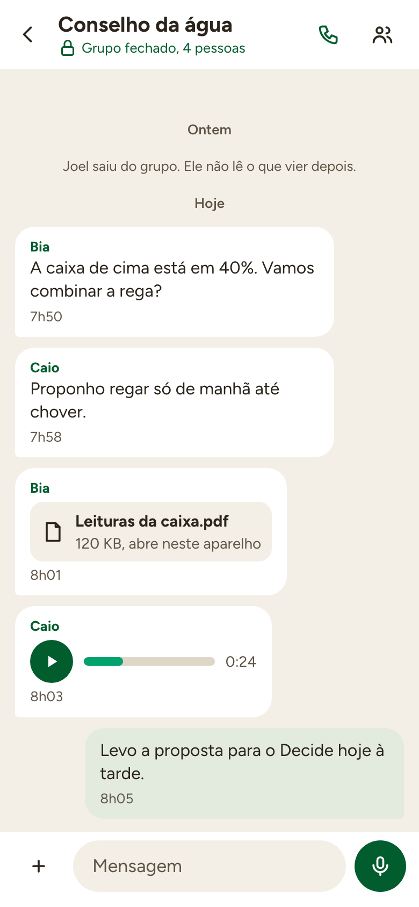 | 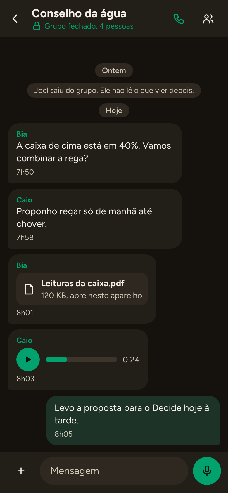 |

**What the person sees.** The inner header with the group's name, "Conselho da água", and, with a lock, "Grupo fechado, 4 pessoas"; the title leads to the participants, and so does the button with two people. A button calls the whole group. A quiet line in the middle of the conversation says when someone left: "Joel saiu do grupo. Ele não lê o que vier depois." Each balloon of someone else carries the author's name. A file arrives as a card with its name and size, "120 KB, abre neste aparelho"; a voice message as a play button, a bar and its length.

**What they can do.** The same as in a conversation between two people. Call the group, up to five people at once.

**States.**

- Someone joins or leaves: a quiet line in the conversation, as drawn.
- Someone's key changed: the same line as between two people, naming the person.
- The group is full for a call: "A chamada tem lugar para 5 pessoas. Para mais gente, abra uma reunião da comunidade."

**Who may.** Residents, moderators and administrators. Who may add people to a group, and how many people a group may hold, are **Not decided**.

**Writes and reads.** The same events as a conversation between two people. A change of members writes `chat.changed`, and a new key, sealed for those who remain, is written by the first participant who opens the conversation after someone left. **Proposed.**

**Many machines.** It never waits. If two new keys are born on the two sides of a split, which one holds when the sides meet is **Not decided**: with one journal the first one numbered won, and with a journal per machine that rule has to be made again.

### A child's protected conversation

**Path:** `/talk/protected/<id>`. **Proposed.**

| Light | Dark |
| --- | --- |
| 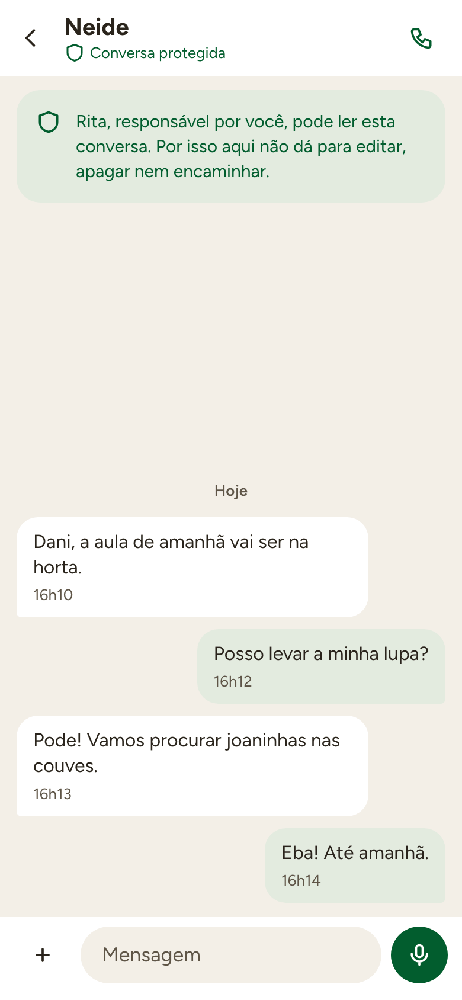 | 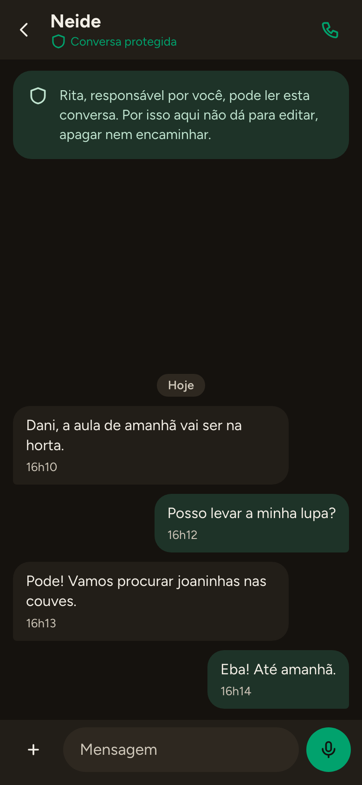 |

**What the person sees.** This is the child's own screen. The inner header with the adult's name, "Neide", and, with a shield, "Conversa protegida". A button to call, because a child may call an authorized adult. Under the header, a soft card that never goes away: "Rita, responsável por você, pode ler esta conversa. Por isso aqui não dá para editar, apagar nem encaminhar." Then the messages, and the field.

**What they can do.** Write, send a voice message, and call the adult. There is no edit, no delete and no forward, so the guardian keeps reading everything. Whether a child sends photos and files here is **Not decided**.

**States.**

- No authorized adult yet: the child's home shows "Quando Rita autorizar um adulto, a conversa com ele aparece aqui.", with the guardian's name.
- The guardian took the authorization away: the conversation stays for the guardian to read and the field closes with "Rita encerrou esta conversa."
- The adult's view: the same conversation, with the line "Conversa protegida. Rita, responsável por Dani, pode ler." under the header.

**Who may.** The child and each adult the guardian authorized. The guardian reads every protected conversation of the child, from the guardian's own screen in the [account](account.md). An administrator may open one when it is needed, and the system writes the access before showing it, in a line the guardian sees; see [administration](admin.md). A moderator cannot read it. Whoever controls a machine can read these conversations without that line: they are kept apart and every access is recorded, but they are not encrypted against the community's machines. **Proposed.**

**Writes and reads.** Writes `protectedchat.created` when the conversation starts and `protectedmessage.created` for each message, outside the personal encryption, in an index kept apart so that access to it is controlled and recorded. An administrator's access writes `protectedchat.opened`. It reads who the guardian authorized, from the account area. All **Proposed**.

**Many machines.** It never waits. The protected conversation is part of the community layer that every machine carries. **Proposed.**

### What to do with a message

No path: a sheet over the conversation. **Proposed**; deleting one's own message and removing someone else's are **Built**, as buttons on each message of `/chat`.

| Light | Dark |
| --- | --- |
| 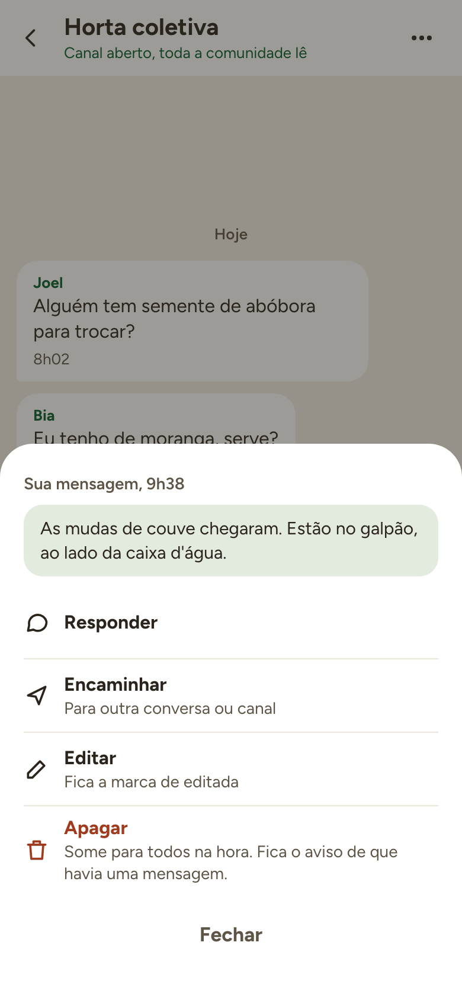 | 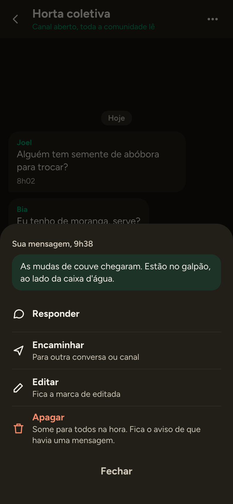 |
| 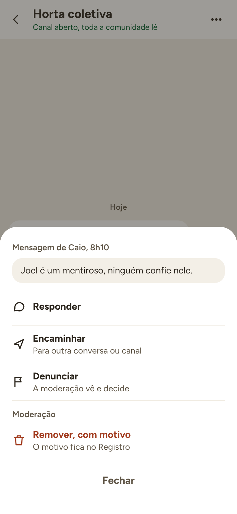 | 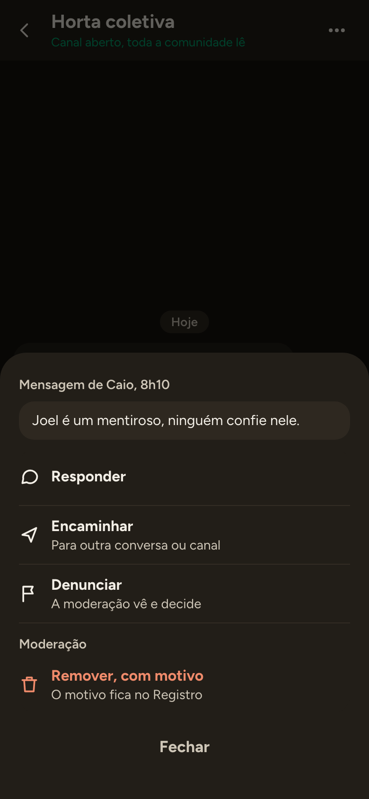 |

**What the person sees.** A sheet that rises over the conversation. At the top, who wrote the message and when, "Sua mensagem, 9h38", and the message itself. Then the actions, one per row, each at least 62 pixels tall. On one's own message: "Responder"; "Encaminhar", "Para outra conversa ou canal"; "Editar", "Fica a marca de editada"; and "Apagar", in the danger color, "Some para todos na hora. Fica o aviso de que havia uma mensagem." On someone else's message: "Responder", "Encaminhar" and "Denunciar", "A moderação vê e decide"; and, for a moderator or an administrator only, under "Moderação", "Remover, com motivo", "O motivo fica no Registro". At the bottom, "Fechar".

**What they can do.** Reply, which puts the message as a quote above the field. Forward, which opens the list of conversations and channels. Edit, which puts the text back in the field. Delete one's own message, which acts at once, because it can be undone by nobody and the sheet already said what happens. Flag, which asks for a reason from a short list. Remove, which opens [removing a message, with a reason](#removing-a-message-with-a-reason).

**States.**

- In a protected conversation the sheet has only "Responder".
- A message still in the outbox: "Apagar" takes it out of the outbox and nothing ever reaches the community.
- Someone else's message, already deleted: the sheet does not open.
- Trying to delete someone else's message without the role: "Só quem escreveu uma mensagem pode apagá-la." (**Built**).

**Who may.** Everyone replies and forwards. Only the author edits and deletes (**Built** for deleting). Residents, moderators and administrators flag; whether a child may flag is **Not decided**. Only moderators and administrators remove (**Built**).

**Writes and reads.** Edit writes `message.edited` or `sealed.edited`; delete writes `message.deleted` or `sealed.deleted` (`message.deleted` **Built**). Forward writes a new message in the other conversation: from a personal conversation, the device opens the message and seals it again with the other conversation's key. Flag writes `flag.created`, and the moderator's decision `flag.resolved`. **Proposed** except where marked.

**Many machines.** Every action here never waits. Two deletions of the same message written on two machines keep the earlier one (**Built**).

### Removing a message, with a reason

No path: a sheet over the open channel. **Built** as a field of reason and a button on each message, at `/chat`; the sheet is **Proposed**.

| Light | Dark |
| --- | --- |
| 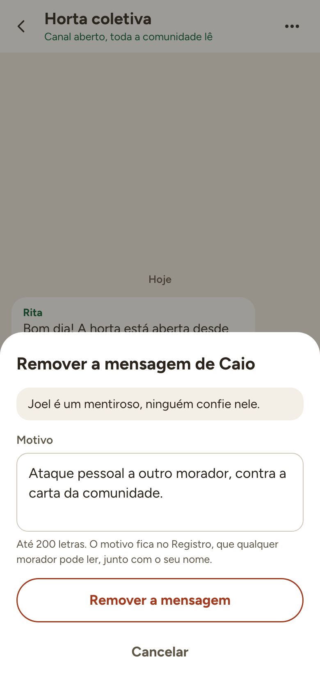 | 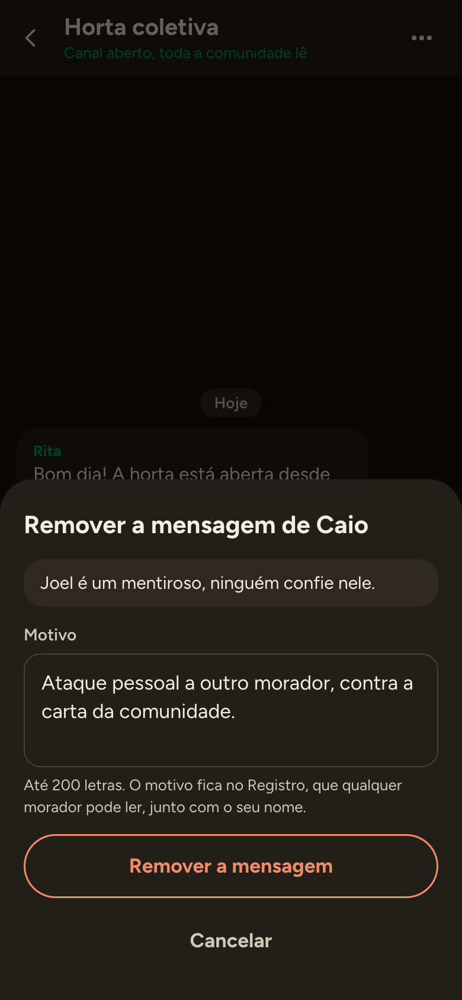 |

**What the person sees.** The title "Remover a mensagem de Caio", the message itself, the field "Motivo" and the line "Até 200 letras. O motivo fica no Registro, que qualquer morador pode ler, junto com o seu nome." The button "Remover a mensagem", drawn with the danger border because it cannot be undone, and "Cancelar".

**What they can do.** Write the reason and remove, or cancel.

**States.**

- No reason, or more than 200 letters: "Para remover a mensagem de outra pessoa, escreva o motivo, em até 200 letras. Ele fica no Registro." (**Built**).
- Done: the message becomes "Mensagem removida pela moderação." for everyone, with a link to the reason (**Proposed**; today it reads "Mensagem apagada.").
- In the Registro, the act reads with who removed, whose message it was and why: "Bia removeu uma mensagem de Caio. Motivo: Ataque pessoal a outro morador, contra a carta da comunidade." (**Built**).

**Who may.** Moderators and administrators (**Built**). Messages in personal conversations and groups cannot be removed by anyone but their author, because nobody else can read them.

**Writes and reads.** Writes `message.deleted` with the author of the message and the reason (**Built**). The screen checks the role before it writes, and the Registro reads the act from the journal (**Built**). For a change of role, the indexes check again that whoever wrote the entry had the power at that moment, so a forged entry changes nothing; a removal is not checked that way yet, and the same check is **Proposed**.

**Many machines.** It never waits: a removal is essential and any machine accepts it. Each machine erases the text in its own journal and in the copies it keeps (**Built**). A machine that restarts, or comes back from a copy, erases what it already holds before it serves any screen (**Built**). A removal written elsewhere while a machine was away reaches it through the journals, after it is already serving: the text leaves its indexes when the removal arrives, and leaves its disk at the next night's work or restart (**Built**). Erasing before serving in that case too is **Proposed**.

### New conversation

**Path:** `/talk/new`. **Proposed.**

| Light | Dark |
| --- | --- |
| 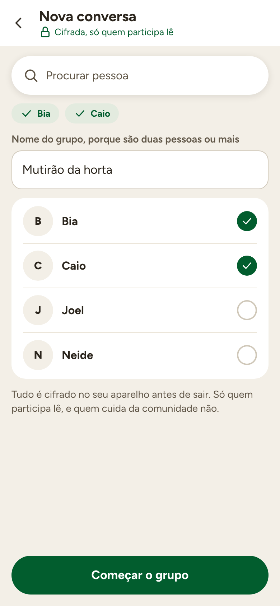 | 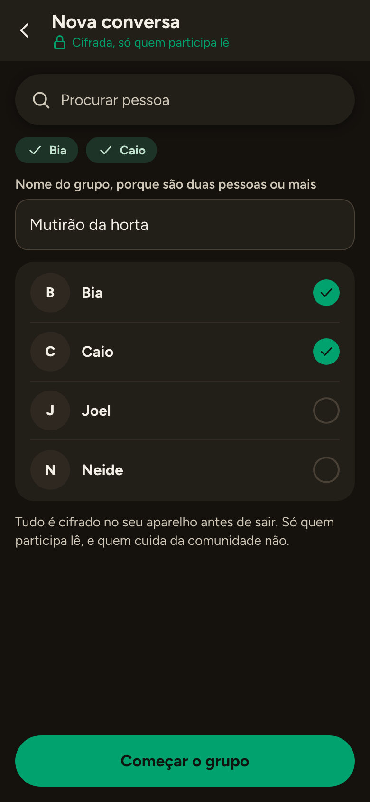 |

**What the person sees.** The inner header "Nova conversa", with a lock and "Cifrada, só quem participa lê". The field "Procurar pessoa". The people already chosen, as chips. When two people or more are chosen, the field "Nome do grupo, porque são duas pessoas ou mais". The list of residents, each with a round mark that fills when chosen. The line "Tudo é cifrado no seu aparelho antes de sair. Só quem participa lê, e quem cuida da comunidade não." The button, "Começar conversa" for one person and "Começar o grupo" for more.

**What they can do.** Search, choose one person or several, name the group and start.

**States.**

- Nobody found: "Ninguém com esse nome na comunidade."
- One person chosen with whom a conversation already exists: the button reads "Abrir a conversa" and opens it.
- A child's account: the list shows only the adults the guardian authorized, with the line "Você pode conversar com os adultos que Rita autorizou." Choosing one opens a protected conversation; there is no group.
- An adult and children: children do not appear in an adult's list, except for an adult the guardian authorized, and then the conversation is protected.
- No link: starting a conversation needs the other person's public key on the device. Whether a new conversation can be started with no link is **Not decided**.

**Who may.** Residents, moderators and administrators; a child as above.

**Writes and reads.** Writes `chat.created` and `chatkey.sealed`, or `protectedchat.created` for a child. Reads the list of residents and their public keys. **Proposed.**

**Many machines.** It never waits: a conversation has no single owner and nothing about it is counted. **Proposed.**

### Participants

**Path:** `/talk/chats/<id>/people`. **Proposed.**

| Light | Dark |
| --- | --- |
| 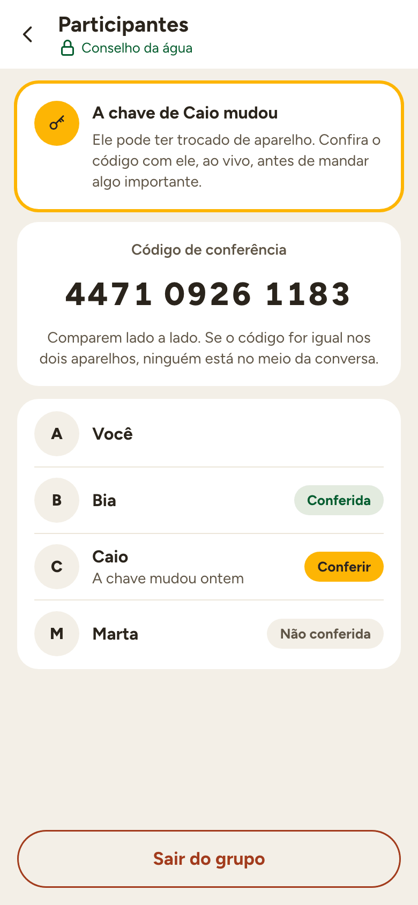 | 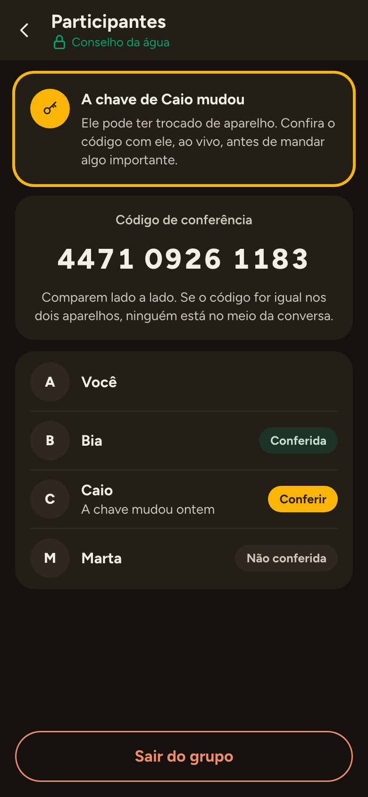 |

**What the person sees.** The inner header "Participantes" and the conversation's name. When someone's key changed, a card ringed in the sun color: "A chave de Caio mudou", "Ele pode ter trocado de aparelho. Confira o código com ele, ao vivo, antes de mandar algo importante." The card "Código de conferência", with twelve digits in groups of four and the line "Comparem lado a lado. Se o código for igual nos dois aparelhos, ninguém está no meio da conversa." The list of participants, each with a mark: "Conferida", "Conferir" in the sun color for a key that changed, or "Não conferida". At the bottom, "Sair do grupo", with the danger border.

**What they can do.** Compare the code with someone, side by side, and mark that person as verified. Leave the group, after a confirmation: "Você deixa de receber as mensagens novas do grupo. O que já está no seu aparelho continua aqui."

**States.**

- Between two people: the same screen with one other person and no button to leave.
- A key changed: the card and the mark, as drawn. A verified person whose key changes goes back to "Conferir".

**Who may.** Every participant.

**Writes and reads.** Leaving writes `chat.changed`. The mark of verified people stays on the device and writes nothing. The code is calculated on the device from the participants' public keys, which are in the journal for everyone to see, so the machine cannot invent it. **Proposed.**

**Many machines.** It never waits. **Proposed.**

### The passphrase in the Talk icon on an iPhone

**Path:** `/talk/`, as a state of the home. **Proposed**; the screen was shown on a real iPhone, see below.

| Light | Dark |
| --- | --- |
| 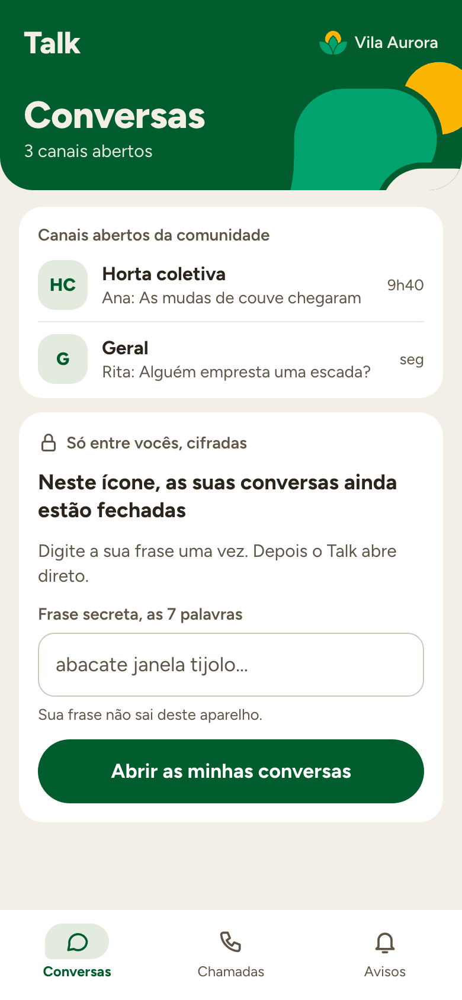 | 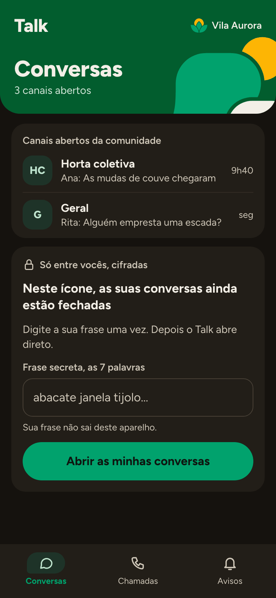 |

On an iPhone, each icon on the Home Screen is a separate app with storage of its own. The sign in goes with the icon when it is added, and the keys that open what is personal do not. On 2026-11-15 the maintainer decided that the Talk icon asks for the passphrase once, inside the icon, and fetches the sealed package from a machine; the passphrase never leaves the device. See [a portal and five apps on one address](../design/apps.md#what-a-real-iphone-showed).

**What the person sees.** The home as always, with the open channels readable, because they are not encrypted. In place of the encrypted list, a card with the lock and "Só entre vocês, cifradas", the sentence "Neste ícone, as suas conversas ainda estão fechadas", the line "Digite a sua frase uma vez. Depois o Talk abre direto.", the field "Frase secreta, as 7 palavras", the line "Sua frase não sai deste aparelho." and the button "Abrir as minhas conversas".

**What they can do.** Type the seven words and open the conversations, or read the open channels without typing anything.

**States.**

- Wrong passphrase: "Essas palavras não abrem as suas conversas. Confira e tente de novo." Attempts are limited by account and by device, with a growing wait, and the account is never locked.
- Opening: "Abrindo as suas conversas…", while the device derives the keys and fetches the package.
- No link: the package cannot be fetched: "Para abrir as conversas pela primeira vez neste ícone, o aparelho precisa de ligação com a comunidade."

**Who may.** Every resident with personal conversations. A child is never asked, because a child has none.

**Writes and reads.** Writes nothing. It asks a machine for the salt and the sealed package, and only the device opens it. **Proposed.**

**Many machines.** It never waits: signing in with the passphrase on another device is essential, and any machine hands out the sealed package. **Proposed.**

**To prove.** On one iPhone, test pages without the community certificate showed this screen, and the conversations opened with seven test words. That Talk then opens straight into the conversations, without asking again, has not shown in the records yet. Whether the icon still holds the key after seven days unused is not known. Learn and Decide keep nothing personal and would ask for nothing.

### Calls

**Path:** `/talk/calls`. **Proposed.**

| Light | Dark |
| --- | --- |
| 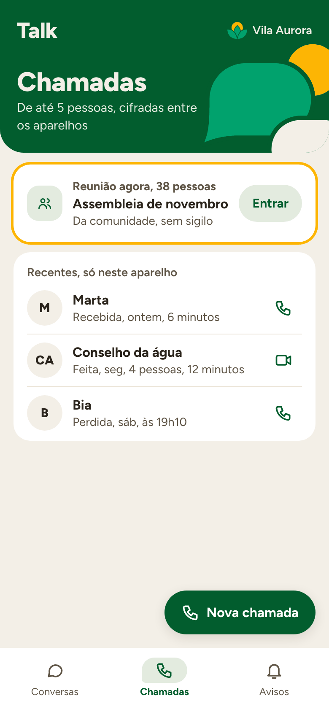 | 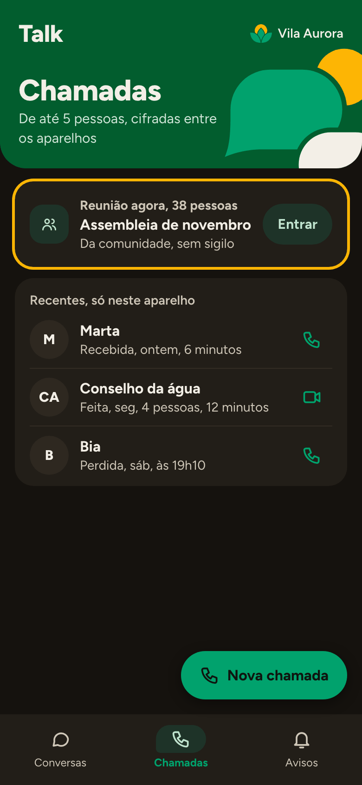 |

**What the person sees.** The cover with the title "Chamadas" and the line "De até 5 pessoas, cifradas entre os aparelhos". When a community meeting is happening, a card ringed in the sun color: "Reunião agora, 38 pessoas", its name, "Da comunidade, sem sigilo", and the button "Entrar". Then "Recentes, só neste aparelho": each call with the person or group, whether it was received, made or missed, when and how long, and a button to call again by voice or video. The button "Nova chamada" floats over the list. The bar, with "Chamadas" marked.

**What they can do.** Call someone again, start a new call by choosing people, or join the meeting.

**States.**

- No calls on this device: "As suas chamadas vão aparecer aqui, só neste aparelho."
- A missed call says "Perdida" in words, never by color alone.
- No link: "Sem ligação com a comunidade, não dá para chamar ninguém agora." under the notice. A call needs a machine to pass the invitation.

**Who may.** Residents, moderators and administrators. A child sees only the authorized adults.

**Writes and reads.** Writes nothing: a call is not written in the journal, and the list of recent calls lives only on the device. **Proposed.**

**Many machines.** The list is the device's. The meeting card shows only while some machine that carries the meeting service is up.

### An incoming call

**Path:** `/talk/calls/<id>`, as its first state. **Proposed.**

| Light | Dark |
| --- | --- |
| 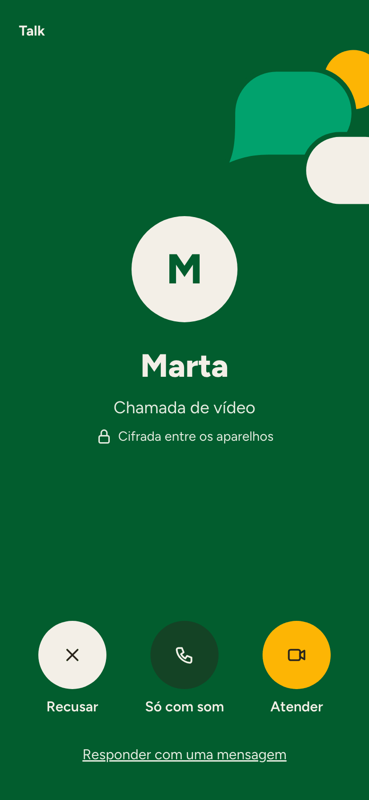 |  |

**What the person sees.** The whole screen in Talk's green, with the glyph at the corner. In the middle, the caller's initial in a large circle, "Marta", "Chamada de vídeo", and, with a lock, "Cifrada entre os aparelhos". At the bottom, three round buttons with their names under them: "Recusar", "Só com som" and "Atender", the last in the sun color. Under them, "Responder com uma mensagem".

**What they can do.** Answer with video, answer with sound only, decline, or decline and open the conversation to write.

**States.**

- Missed: the call goes to the list as "Perdida", and the conversation shows "Chamada perdida, 19h10".
- The caller gave up: the screen closes.
- Talk is closed: with no internet, a browser cannot wake a page that is not open, so a call rings only on a device with Talk open. With internet, the others get a notification that says only that there is something new, with no name and no content. **Proposed.**

**Who may.** Anyone who may be called. A child receives calls only from authorized adults.

**Writes and reads.** Writes nothing. The invitation travels live, not through the journal. **Proposed.**

**Many machines.** The invitation has to pass from the caller's machine to the machine of the person called, at once, without the journal. **To prove.**

### A call in progress

**Path:** `/talk/calls/<id>`. **Proposed.**

| Light | Dark |
| --- | --- |
| 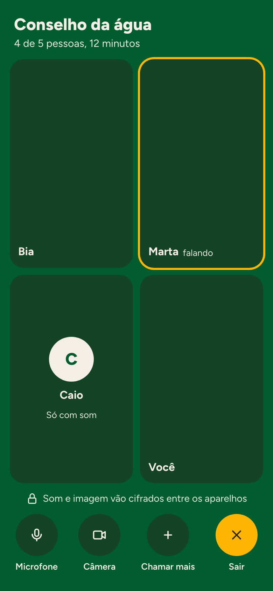 | 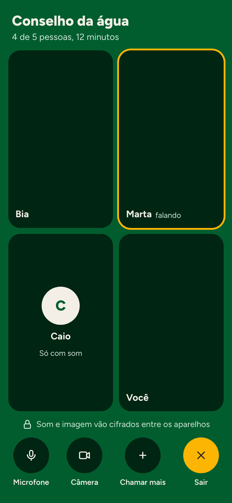 |

**What the person sees.** The whole screen in Talk's green. At the top, the name of the call, "Conselho da água", and "4 de 5 pessoas, 12 minutos". One tile per person, with the name at the bottom; whoever is speaking is ringed in the sun color, with "falando"; someone with the camera off shows their initial and "Só com som"; the person's own tile says "Você". Under the tiles, with a lock, "Som e imagem vão cifrados entre os aparelhos". At the bottom, round buttons with their names: "Microfone", "Câmera", "Chamar mais" and "Sair", in the sun color.

**What they can do.** Turn the microphone and the camera on and off, call one more person while there is room, and leave.

**States.**

- Calling: "Chamando Marta…", with "Cancelar".
- Five people: "Chamar mais" is gone, and the line "A chamada tem lugar para 5 pessoas." appears.
- The direct connection failed: "A rede não deixou os aparelhos se ligarem direto. Dá para continuar numa reunião da comunidade, mas ali não há sigilo.", with "Continuar numa reunião" and "Sair".
- A child in the call: the line "Esta chamada não é gravada. Rita, responsável por Dani, vê com quem e quando." for everyone in it.

**Who may.** Residents, moderators and administrators. A child only with authorized adults, never recorded, and the guardian sees with whom and when.

**Writes and reads.** Writes nothing, except a call with a child, which writes `call.logged` when it ends: who, when and for how long, never what was said. The devices exchange fingerprints signed with the participants' identity keys and then connect straight to each other, so the machine never touches the sound or the image and cannot put itself in the middle. **Proposed.**

**Many machines.** A call of up to five is essential: it goes on when a machine leaves, and with the community split in two it happens only between people on the same side. A call between devices that are on different machines needs a path between them. **To prove.**

### A large community meeting

**Path:** `/talk/meetings/<room>`. **Proposed.**

| Light | Dark |
| --- | --- |
| 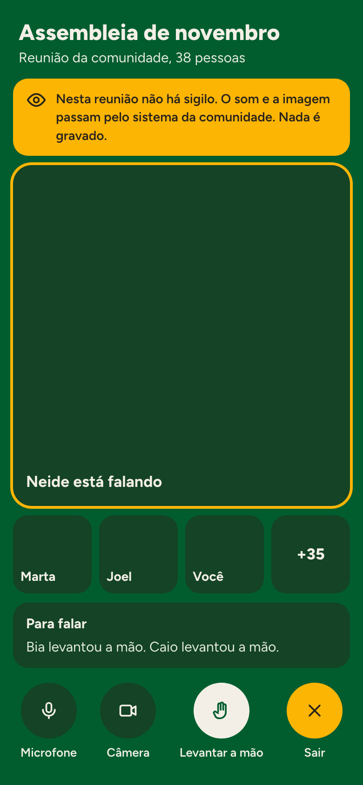 | 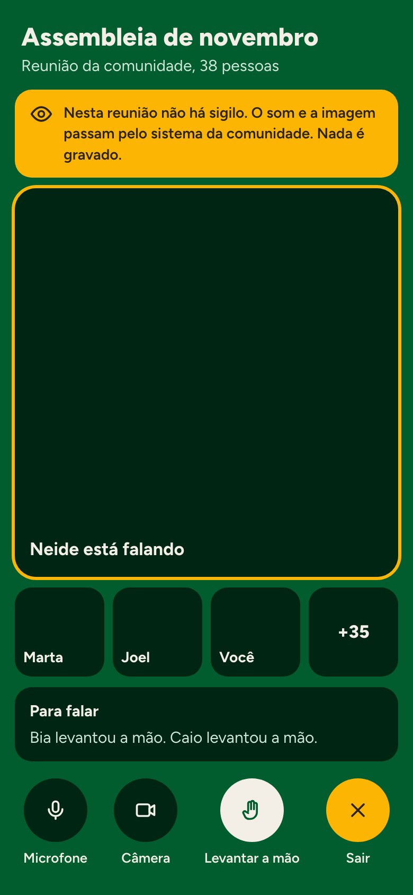 |

**What the person sees.** The whole screen in Talk's green. At the top, "Assembleia de novembro" and "Reunião da comunidade, 38 pessoas". Right under it, in the sun color, the warning that never goes away: "Nesta reunião não há sigilo. O som e a imagem passam pelo sistema da comunidade. Nada é gravado." The person speaking in a large tile, ringed in the sun color, "Neide está falando". A row of small tiles and how many more are there, "+35". A card "Para falar", with the hands raised in order: "Bia levantou a mão. Caio levantou a mão." At the bottom, "Microfone", "Câmera", "Levantar a mão" and "Sair".

**What they can do.** Listen and watch, raise a hand, speak when given the turn, turn the microphone and the camera on and off, and leave.

**States.**

- Full: "A reunião está cheia. Tente de novo daqui a pouco."
- No permission for the camera or microphone: "O aparelho não deixou usar a câmera. Dá para participar só ouvindo, ou liberar a câmera nos ajustes do navegador."
- The meeting service is off: "A reunião não está disponível agora. Chamadas de até 5 pessoas continuam."
- The connection dropped: the person comes back to the room by the same path, and a new pass is issued.

**Who may.** Residents, moderators and administrators. Whether a child may join is **Not decided**. Who may open a room is **Not decided**.

**Writes and reads.** Writes nothing. Sound and image pass through the meeting service, Galène, which runs on a machine that can carry it. The core gives the person a pass valid for a few seconds and sends them to the room; recording is off. **Proposed.**

**Many machines.** Not essential, lives where it fits. If the machine that carries the meeting leaves, the meeting drops and can start again on another machine that has the service. With a split, each side has its own. **Proposed.**

**Not decided.** The meeting service has a page of its own, at a separate origin from Talk's. Whether the meeting is drawn by Earthler, as here, or shown in the service's own page is not decided.

### Alerts

**Path:** `/talk/alerts`. **Proposed.**

| Light | Dark |
| --- | --- |
| 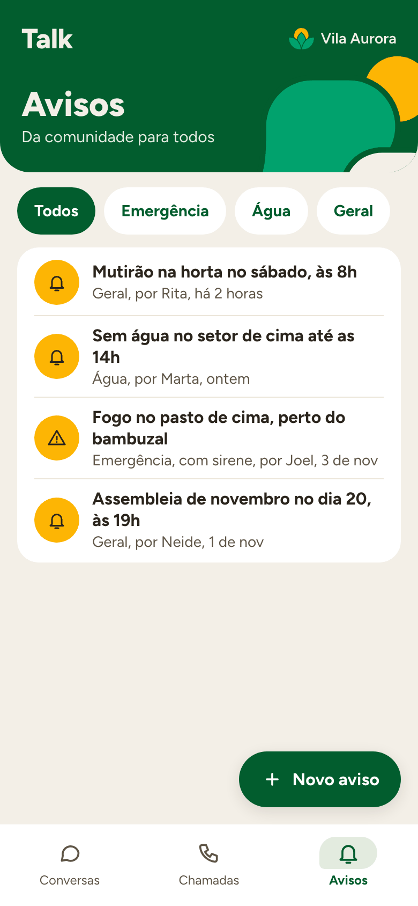 | 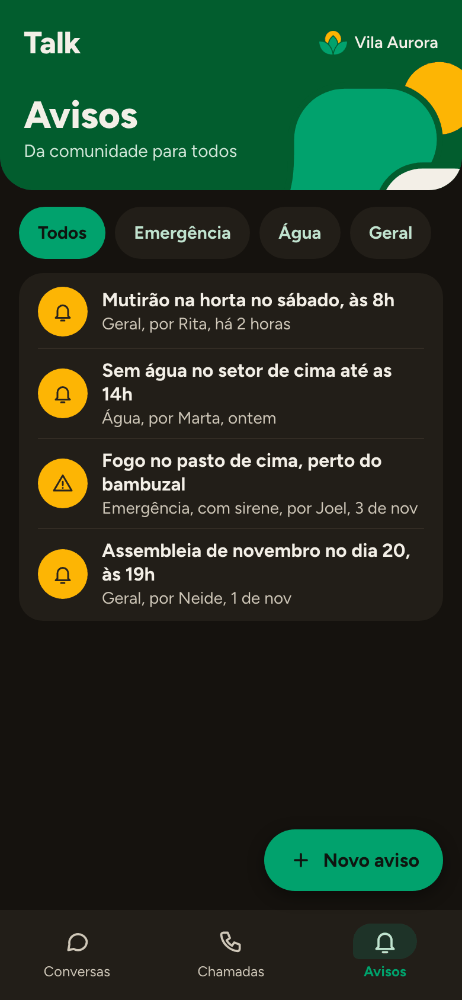 |

**What the person sees.** The cover with the title "Avisos" and the line "Da comunidade para todos". A row of choices to filter by category: "Todos", "Emergência", "Água", "Geral". The list of alerts, newest first, each with a sun round, a bell or, for an emergency, the siren sign; its text; its category, whether the siren sounded, who sent it and when: "Emergência, com sirene, por Joel, 3 de nov". The button "Novo aviso" floats over the list, only for those who may send one. The bar, with "Avisos" marked.

**What they can do.** Read the alerts, filter them, and, if allowed, write a new one.

**States.**

- No alerts yet: "Nenhum aviso ainda. Quando a comunidade avisar algo, aparece aqui."
- An emergency in force: it stays at the top, ringed in the sun color, until it ends.
- No link: the alerts already on the device can be read, under the notice.

**Who may.** Everyone reads, a child included. Who may send is the next section.

**Writes and reads.** Reads `alert.created` from the community layer. **Proposed.**

**Many machines.** It never waits. Every machine carries the alerts.

### A new alert

**Path:** `/talk/alerts/new`. **Proposed.**

| Light | Dark |
| --- | --- |
| 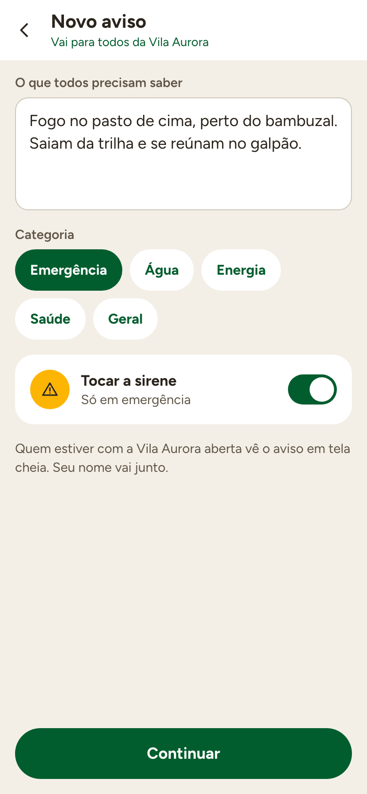 | 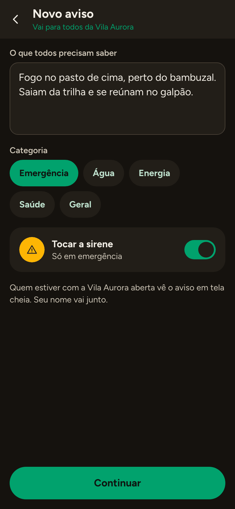 |
| 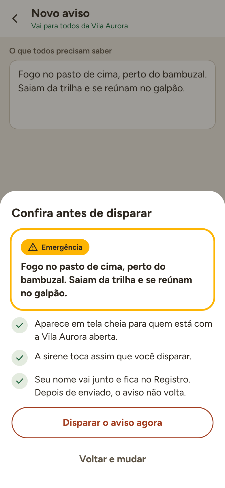 | 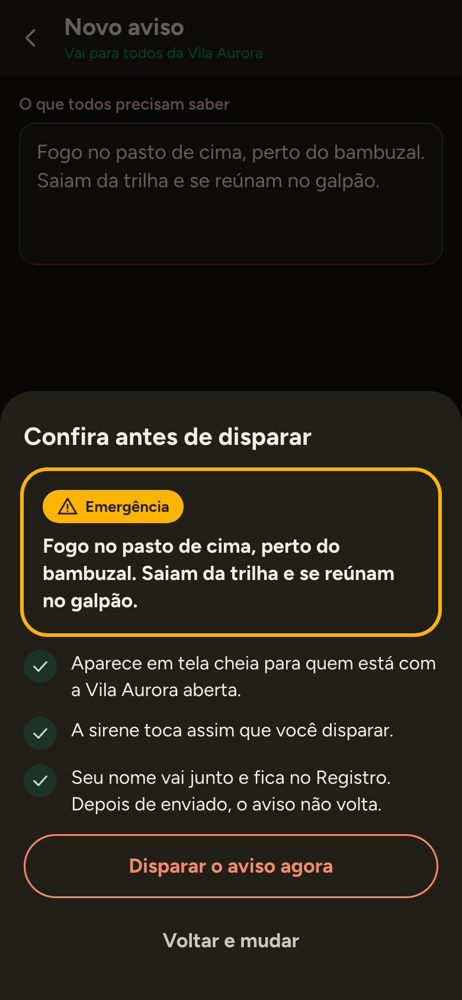 |

**What the person sees.** The inner header "Novo aviso", with "Vai para todos da Vila Aurora". The field "O que todos precisam saber". "Categoria", with one choice among "Emergência", "Água", "Energia", "Saúde" and "Geral". A card "Tocar a sirene", "Só em emergência", with a switch. The line "Quem estiver com a Vila Aurora aberta vê o aviso em tela cheia. Seu nome vai junto." The button "Continuar".

Since Maps, the form also asks where the alert is, "Onde é", with a piece of the map, its pin and its area, or "Sem lugar". An alert with a place shows on [Maps](maps.md#where-a-new-alert-is-in-talk) while it is in force, and each phone works out by itself how far away it is. **Proposed.**

"Continuar" never sends. It opens a second step, a sheet titled "Confira antes de disparar": the alert as people will see it, with its category, and three lines that say what happens: "Aparece em tela cheia para quem está com a Vila Aurora aberta.", "A sirene toca assim que você disparar." and "Seu nome vai junto e fica no Registro. Depois de enviado, o aviso não volta." Then "Disparar o aviso agora", with the danger border because it cannot be undone, and "Voltar e mudar".

**What they can do.** Write, choose the category, turn the siren on or off, check, and send, or go back and change.

**States.**

- Empty: "Escreva o aviso antes de continuar."
- The siren is offered only for an emergency; with another category the switch is off and the line reads "A sirene é só para emergência."
- No siren installed in the community: the card reads "A comunidade não tem sirene ligada." and the switch is not there.
- Sent: the alert opens in the list, and for an emergency the person also sees it full screen, like everyone else.
- No link: the alert goes to the outbox with "Ainda não enviada" and goes out by itself, and the confirmation says so: "Sem ligação com a comunidade. O aviso sai assim que a ligação voltar." With no link, the siren cannot be sounded by this device.

**Who may.** The charter of the community decides, at the setup, whether residents and moderators may send; administrators always may; a child never does. Sending an alert is an act with a power, so it goes to the Registro. **Proposed.**

**Writes and reads.** Writes `alert.created`, with the text, the category, whether the siren was asked, the author, and the place and area when there is one. The siren module writes `siren.sounded` each time it sounds. **Proposed.**

**Many machines.** It never waits: an alert goes out from any machine. With the community split in two, each side warns its own side, and the alert reaches the other when the machines meet. The siren sounds within reach of the machine that got the alert. **Proposed.**

### An emergency alert received

**Path:** `/talk/alerts/<id>`, shown full screen over any page of every app and the portal. **Proposed.**

| Light | Dark |
| --- | --- |
| 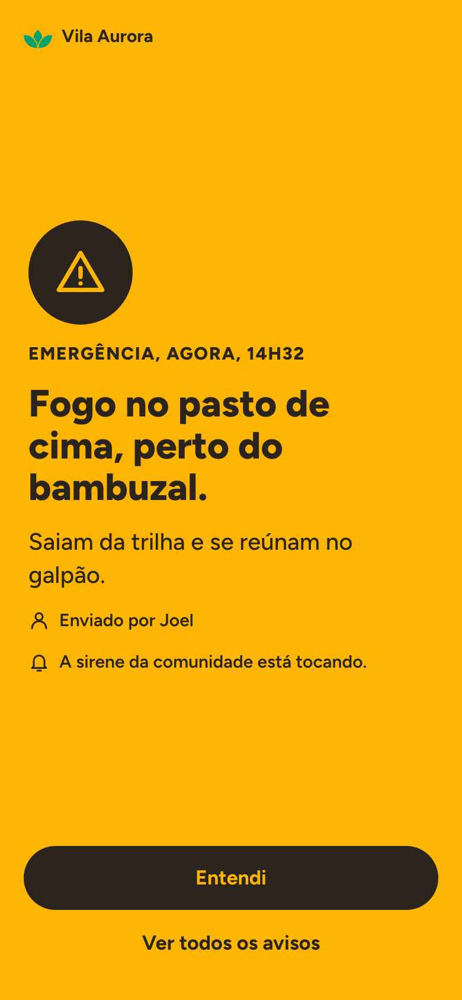 |  |

**What the person sees.** The whole screen in the sun color, with dark text, the same in light and in dark mode. At the top, the community's mark and name. A large dark circle with the siren sign. "Emergência, agora, 14h32". The alert itself in large letters, "Fogo no pasto de cima, perto do bambuzal.", and what to do, "Saiam da trilha e se reúnam no galpão." Who sent it, "Enviado por Joel", and, when the siren is on, "A sirene da comunidade está tocando." At the bottom, "Entendi" and "Ver todos os avisos".

**What they can do.** Read it and close it with "Entendi", which takes them back to where they were, or open the list of alerts.

**States.**

- Without the siren: the last line is not there.
- Several emergencies: the newest on top, with "Mais 1 aviso de emergência".
- A screen reader announces the alert as soon as it arrives, and the focus goes to "Entendi".
- An alert that is not an emergency does not take the screen: it arrives as the card at the top of the home and in the list.

**Who may.** Everyone, a child included.

**Writes and reads.** Reads `alert.created`. Closing writes nothing. **Proposed.**

**Many machines.** Whoever has a page of Earthler open sees it at once, on whichever machine they are. Whoever has nothing open sees it when they open Earthler; with internet, their device gets a notification that says only that there is something new. The siren is what reaches everyone else. **Proposed.**

### No link with the community

**Path:** `/talk/`, as a state of every Talk page. **Proposed.**

| Light | Dark |
| --- | --- |
| 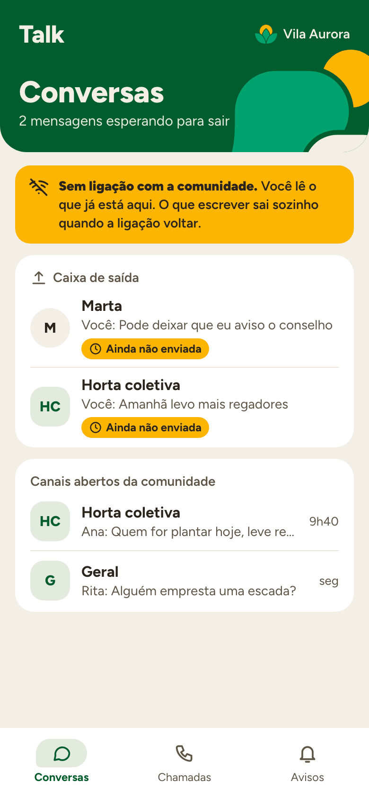 | 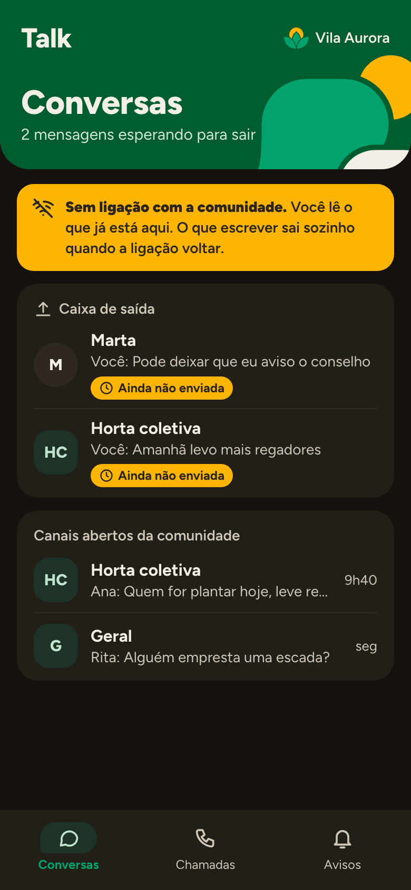 |

**What the person sees.** The cover, with the line "2 mensagens esperando para sair". Under it, the notice in the sun color, the same sentence as on every page of every app: "Sem ligação com a comunidade. Você lê o que já está aqui. O que escrever sai sozinho quando a ligação voltar." Then "Caixa de saída", with each message that has not gone out, where it goes and its text, and the mark "Ainda não enviada". Then the channels and conversations already on the device, which can be read.

**What they can do.** Read what is on the device, write in any conversation, open a message in the outbox to change it or delete it before it goes. Nothing needs to be pressed for it to go out.

**States.**

- The link returns: the notice goes away by itself, each message goes out in order, and its mark becomes its time. The outbox disappears when it is empty.
- A message refused when it goes out, because the person lost the role that allowed it, for instance: it stays in the outbox with "Não foi enviada", the reason, and its text kept.
- Calls cannot be made with no link; meetings neither. Alerts can be written and wait in the outbox.

**Who may.** Everyone.

**Writes and reads.** Nothing reaches the journal until the link returns; then each message writes its own event, with the time it was written. Each message carries a random mark from the device, so sending it twice after a dropped Wi-Fi never makes two. **Proposed.**

**Many machines.** This is the device with no machine in reach. With every machine off, the person still reads what is theirs and writes what will go out when any machine appears. A phone cannot find another phone without a machine in between; that is a limit of the browser. **Proposed.**

## Flows

### Sending an encrypted message

1. Ana writes to Marta and taps send. Her device seals the text with the key of the conversation and signs it with her identity key. In a reply, the quoted message goes inside the sealed text.
2. With a link, the device sends the sealed block to the machine it reaches, which writes `sealed.created` in its own journal and answers. The balloon shows its time.
3. Every other machine follows that journal live and keeps the sealed block. Marta's device, on whichever machine it is, receives it, checks Ana's signature and opens it.
4. With no link, step 2 waits in the outbox, with "Ainda não enviada" in place of the time, and runs by itself when any machine appears.
5. If Marta wrote during a split and her message joins later, it takes its place by the time it was written, with "Chegou depois".

Editing and deleting follow the same path. Forwarding opens the message on the device and seals it again for the other conversation. **Proposed.**

### A call

1. Ana taps the call button in the conversation with Marta. Her device sends the invitation live through the machine it reaches, without writing it in the journal.
2. Marta's device, if Talk is open, rings full screen. With internet and Talk closed, a notification says only that there is something new.
3. Marta answers. The two devices exchange fingerprints signed with their identity keys and connect straight to each other. The sound and the image are encrypted between the devices, and no machine touches them.
4. If the network does not let them connect straight, the screen says so and offers to continue in a community meeting, with the warning that a meeting has no secrecy.
5. Up to five people can be in the call. When it ends, nothing is written, except for a call with a child, which writes `call.logged` for the guardian.

The first steps when the two devices are on different machines are **To prove**. The rest is **Proposed**.

### An emergency alert

1. Joel, who may send alerts, writes it, chooses "Emergência", leaves the siren on and taps "Continuar".
2. The confirmation shows the alert as people will see it and what will happen. He taps "Disparar o aviso agora".
3. The machine his device reaches writes `alert.created` and sounds the siren within its reach, writing `siren.sounded`.
4. Every page of Earthler open on any machine shows the alert full screen. With internet, the other devices get a notification with no content.
5. The alert stays at the top of "Avisos" while it is in force, and the act stays in the Registro with Joel's name.

With the community split in two, each side warns its own side, and the alert reaches the other side when the machines meet. **Proposed.**

### Removing a message, with a reason

1. Bia, a moderator, taps Caio's message in an open channel and chooses "Remover, com motivo".
2. She writes the reason, up to 200 letters, and taps "Remover a mensagem" (today, at `/chat`, the button reads "Remover").
3. The screen on the machine her device reaches checks that she may remove content and writes `message.deleted`, with Caio as the author and the reason. A request from someone without the role is refused and writes nothing.
4. Every open page hears of it at once, and the message gives way to the mark of a removal.
5. The Registro shows who removed whose message and why, for every resident to read.
6. In the night's work, each machine erases the text from its own journal and from the copies it keeps. A machine that was away hides the text as soon as the removal reaches it, and erases it at its next night's work or restart.

Steps 2 to 6 are **Built**, at `/chat` and `/log`. The sheet and the mark "Mensagem removida pela moderação." are **Proposed**.

## Who may do what in Talk

The table of permissions is one file in the core, and no screen decides alone; see [roles and permissions](../design/core.md#roles-and-permissions). "Charter" means the community's rules decide at the setup.

| Action | Resident | Child | Moderator | Administrator |
| --- | --- | --- | --- | --- |
| Read open channels | Yes | Only those the guardian released | Yes | Yes |
| Write in an open channel | Yes (**Built**) | No (**Built**) | Yes (**Built**) | Yes (**Built**) |
| Edit and delete one's own message | Yes (deleting **Built**) | No, in a protected conversation | Yes | Yes |
| Flag someone else's message | Yes | **Not decided** | Yes | Yes |
| Remove someone else's message, with a reason | No (**Built**) | No (**Built**) | Yes (**Built**) | Yes (**Built**) |
| Personal conversation and closed group | Yes | No | Yes | Yes |
| Protected conversation | Only an authorized adult | Yes, with authorized adults | No | Opens one when needed, with a line the guardian sees |
| Read a child's protected conversation | Only the child's guardian | No | No | When needed, recorded |
| Call of up to five | Yes | Only with authorized adults, never recorded, the guardian sees with whom and when | Yes | Yes |
| Large community meeting | Yes | **Not decided** | Yes | Yes |
| Send a general alert | Charter | No | Charter | Yes |
| Read the Registro | Yes (**Built**) | Yes (**Built**) | Yes (**Built**) | Yes (**Built**) |

Nobody reads someone else's personal conversation, an administrator included.

## What Talk writes in the journal

Event types are a noun and a verb in the past, and a type once used is never removed and never changes meaning; see [the core](../design/core.md#events). The names marked **Proposed** settle when the code is written.

| Event | What it records | Mark |
| --- | --- | --- |
| `channel.created` | An open channel, by name. Today only the first, "Geral", created with the community | **Built** for the first; more channels **Proposed** |
| `message.created` | A message in an open channel | **Built** |
| `message.deleted` | A message taken out of its channel: by its author, or by a moderator or administrator with a reason, which goes to the Registro | **Built** |
| `entry.erased` | The night's work replaced deleted text with the erased mark | **Built** |
| `message.edited` | A new text for a message in an open channel | **Proposed** |
| `flag.created`, `flag.resolved` | Someone flagged a message, and the moderation's decision | **Proposed** |
| `chat.created` | A personal conversation or a closed group, with its participants and no content | **Proposed** |
| `chat.changed` | Someone joined or left a group, or its name changed | **Proposed** |
| `chatkey.sealed` | The key of a conversation, sealed for each participant and signed | **Proposed** |
| `sealed.created`, `sealed.edited`, `sealed.deleted` | A message of a personal conversation or group, as a sealed block, with the digests of its attachments outside it | **Proposed** |
| `protectedchat.created`, `protectedmessage.created` | A child's protected conversation and its messages, outside the personal encryption | **Proposed** |
| `protectedchat.opened` | An administrator opened a protected conversation; the guardian sees it | **Proposed** |
| `call.logged` | A call with a child: who, when and how long | **Proposed** |
| `alert.created` | A general alert: text, category, siren, author, and its place and area when there is one | **Proposed** |
| `siren.sounded` | The siren sounded | **Proposed** |

Talk also reads what other areas write: the accounts and their names, the roles, the public keys of each resident, and the guardian of each child with the adults authorized. A call and the invitation to it are never written, and neither is a meeting.

## Many machines, in one table

| What | When a machine leaves | When the community is split in two |
| --- | --- | --- |
| Messages in channels, conversations and groups | Go on (**Built** for the open channel) | Go on on both sides; when they meet, the other side's messages take their place, with "Chegou depois" |
| Deleting and removing | Go on (**Built**) | The same; the earlier of two deletions holds (**Built**) |
| Personal conversations | Go on; they are on the device and every machine keeps the sealed package | The same |
| Call of up to five | Goes on | Only between people on the same side; between devices on different machines, **To prove** |
| Large meeting | Drops if it was on the machine that left, and starts again on another that has the service | Each side has its own |
| Alerts | Go out from any machine | Each side warns its own side; the siren sounds within reach of the machine that got the alert |

Nothing in Talk is counted, so no Talk screen ever shows the notice "Agora não dá para…".

## Not decided

- Who may open a new open channel, and whether a channel can be closed.
- Which channels a child reads before the guardian releases any.
- The default of the charter on who may send a general alert.
- The list of alert categories, whether a community can change it, and whether the siren may sound for anything but an emergency.
- How flagging works inside a personal conversation, which no moderator can read, and whether the person flagged ever learns who flagged.
- Whether a child may flag a message.
- Whether a child sends photos and files in a protected conversation.
- Whether a child may join a large community meeting.
- Who may add people to a closed group, and how many people a group may hold.
- Whether editing a message has a time limit.
- Which key holds when two new keys of the same group were born on the two sides of a split.
- Whether a new conversation can be started with no link to the community.
- Who may open a large meeting room, and whether the meeting is drawn by Earthler or shown in the meeting service's own page.
- How long an emergency alert stays in force, and whether it can be ended or corrected once sent.
- Whether the names under the icons stay Talk, Learn, Decide and Ask in a community that speaks Portuguese; see [principles](principles.md#not-decided).
